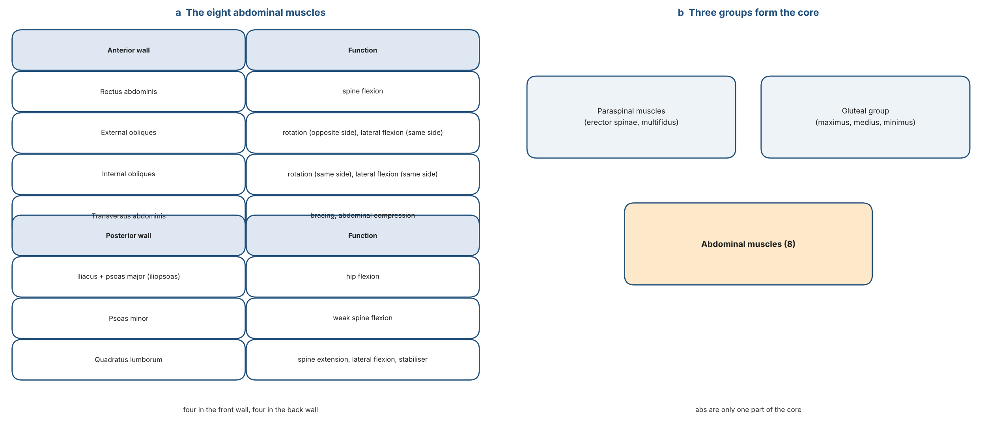
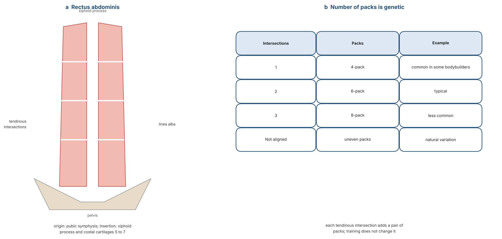
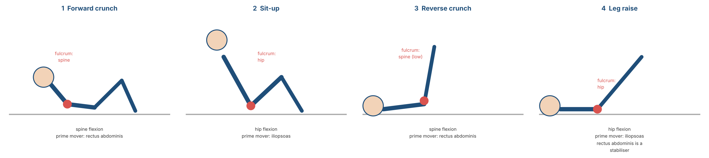
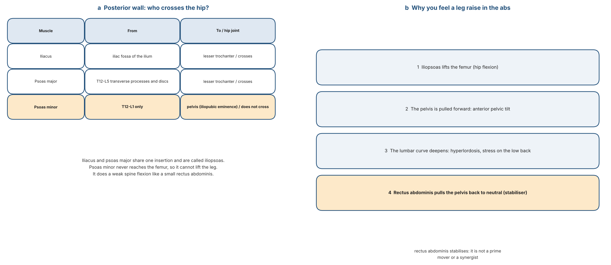
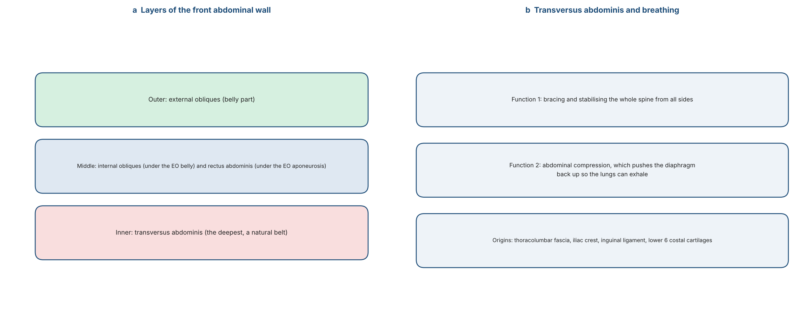
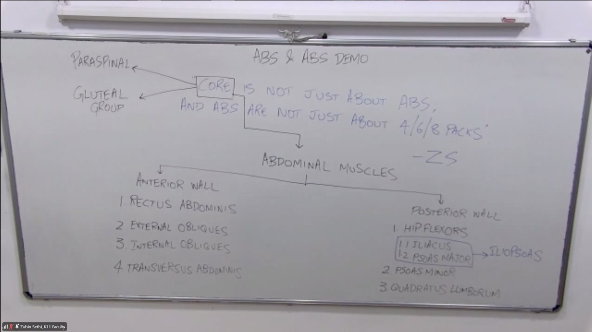
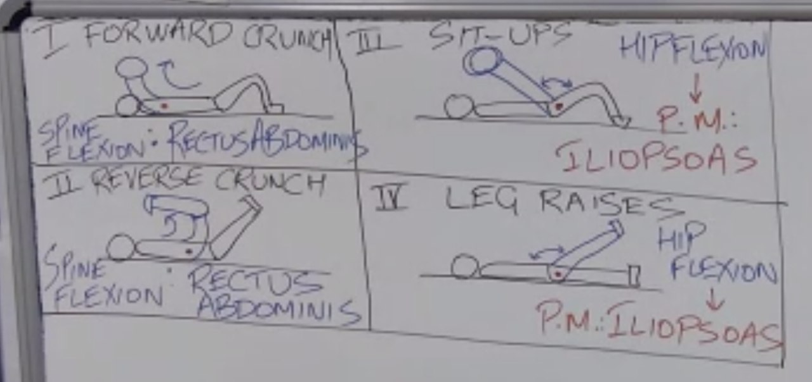
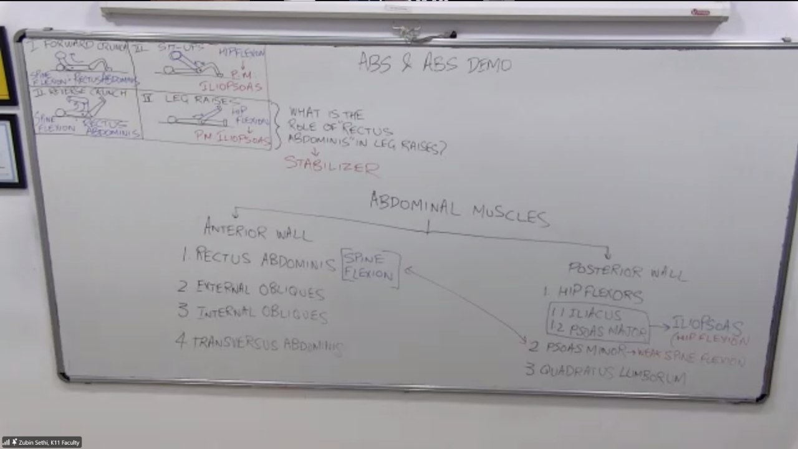

# Abs Lecture: Detailed Notes

**Course:** Personal Training Certification

**Topic:** The abdominal muscles and the core: the eight abdominal muscles in the front and back walls, the rectus abdominis and the genetics of the "six-pack", the iliopsoas and psoas minor, the obliques, the transversus abdominis, the layers of the abdominal wall, the quadratus lumborum, and why some popular exercises are not what they seem

**About these notes:** Detailed notes for the Abs Lecture (the theory), written so the whole lecture can be studied without watching the recordings. The abs were taught as one and a half lectures with theory and demonstrations mixed. The theory from both sessions is collected here. The exercise videos, set-up points and variations are in the Abs Demo notes. For a short revision version, see the Study Notes. Sources: the two session recordings, the course slides ("Body part 4: Abdominals") and the board photos. The figures are original drawings made for these notes.

---

## Abbreviations used in these notes

| Short form | Meaning |
|---|---|
| RA | Rectus abdominis |
| EO, IO | External obliques, internal obliques |
| TA | Transversus abdominis |
| QL | Quadratus lumborum |
| PM | Prime mover |
| TI | Tendinous intersection |
| MAI | Muscle active insufficiency |
| MPI | Muscle passive insufficiency |

## Before this lecture

You should know the back lecture muscles (erector spinae, multifidus), the gluteal group, the hamstrings and hip flexion, the planes of movement, joint actions of the spine (flexion, extension, lateral flexion, rotation), the sliding filament theory, prime mover, synergist and stabiliser, and the resistance profile idea (fulcrum, line of force, moment arm).

## Outline of the lecture

| Part | Topic |
|---|---|
| 1 | The core and the eight abdominal muscles |
| 2 | Rectus abdominis: anatomy |
| 3 | The six-pack myth |
| 4 | Rectus abdominis: function and four popular exercises |
| 5 | The hip flexors: iliacus, psoas major and psoas minor |
| 6 | The role of the rectus abdominis in leg raises |
| 7 | Obliques: fibre direction, anatomy and functions |
| 8 | Transversus abdominis |
| 9 | Layers of the front abdominal wall |
| 10 | Quadratus lumborum |
| 11 | Muscle passive insufficiency |

---

## Part 1: The core and the eight abdominal muscles

The core is not only the abdominal muscles. It is a team of three groups that work like one unit: the **paraspinal muscles** (erector spinae and multifidus, which run along the spine and keep it neutral), the **gluteal group** (maximus, medius and minimus) and the **abdominal muscles**. The abs are also not only the "four, six or eight pack". There are eight abdominal muscles in two walls, and only one of them makes the pack.

| Wall | Muscles |
|---|---|
| Anterior (front) wall | Rectus abdominis, external obliques, internal obliques, transversus abdominis |
| Posterior (back) wall | Hip flexors (iliacus and psoas major), psoas minor, quadratus lumborum |

Spelling notes: it is **transversus**, not transverse (which is the plane). The "p" in psoas is silent. Iliacus and psoas major are often called together the **iliopsoas** (the letter "o" joins two names, as in sternoclavicular or glenohumeral). Psoas minor is not counted as a hip flexor.

## Part 2: Rectus abdominis: anatomy

- **Origin:** pubic symphysis of the pelvis (the cartilaginous joint where the two pubic bones meet). The origin is at the bottom.
- **Insertion:** costal cartilages 5, 6 and 7 on both sides and the xiphoid process (the pointed lower tip of the sternum).
- **Fibres:** straight, "as if drawn with a ruler", so the name rectus (like the rectus femoris).

Two white structures matter:

- **Linea alba** (linea is line, alba is white): the thick vertical white line that divides the front wall into left and right.
- **Tendinous intersections:** thinner horizontal white bands that cross the muscle. The fibres are long, and the intersections keep them from scattering, like the braids in a long ponytail.

## Part 3: The six-pack myth

Photos of bodybuilders and models show four, six, eight or uneven packs. The number does not depend on hours, sets, repetitions, exercises, speed or years of training. It depends on **how many tendinous intersections a person was born with**. One intersection gives four packs, two give six, and three give eight. Packs that are uneven have intersections that are not lined up left to right. Training and diet only reveal what is there, once the layer of subcutaneous fat is low enough. Uneven packs are not a sign of wrong exercise form.

## Part 4: Rectus abdominis: function and four popular exercises

**Function:** spine (trunk) flexion. The muscle shortens from both ends, so spine flexion can be seen two ways: the rib cage moves toward the pelvis (forward crunch) or the pelvis moves toward the rib cage (reverse crunch).

**Which exercises are really spine flexion?** The test is where the fulcrum is.

| Exercise | Fulcrum | Joint action | Prime mover |
|---|---|---|---|
| Forward crunch | Spine (upper) | Spine flexion | Rectus abdominis |
| Sit-up | Hip | Hip flexion | Iliopsoas |
| Reverse crunch | Spine (lower) | Spine flexion | Rectus abdominis |
| Leg raise | Hip | Hip flexion | Iliopsoas |

- In a **sit-up** the angle that closes is at the hip. That is hip flexion, which is not the rectus abdominis job.
- In a **reverse crunch** the hip stays in the pre-flexed position, and the rounding of the spine is the movement. If the legs kept moving, it would be hip flexion.
- In a **leg raise** the hip angle closes, so it is hip flexion, not spine flexion. The spine cannot be pinpointed to one joint, because it has many intervertebral joints, so the fulcrum is given only roughly.

## Part 5: The hip flexors

The prime mover in sit-ups and leg raises is the iliopsoas.

- **Iliacus:** starts on the iliac fossa (the concave inner surface of the ilium) and inserts on the **lesser trochanter** of the femur.
- **Psoas major:** starts on the transverse processes of T12 to L5 and the intervertebral discs on their sides ("a ladder"), and inserts on the same lesser trochanter.
- Both cross the hip joint, so they lift the femur forward in the sagittal plane: **hip flexion**.

**Psoas minor** is the "real brother" of the psoas major, but it is **not** a hip flexor. It starts only at T12 and L1, and it ends on the pelvis (the iliopubic eminence and the pectineal line), not on the femur. It does not cross the hip joint, so it cannot lift the leg. It does a **weak spine flexion**, like a small version of the rectus abdominis, and works as a synergist to it. A memory aid: psoas major works like its twin the iliacus, and psoas minor works like its cousin, the rectus abdominis.

## Part 6: The role of the rectus abdominis in leg raises

If the iliopsoas is the prime mover, why are leg raises felt in the abs? The rectus abdominis is a **stabiliser**. It cannot be a synergist, because it does not do hip flexion.

The reasoning: a muscle pulls from both ends, so as the femur rises, the origin of the iliopsoas on the pelvis is also pulled toward the femur. The pelvis tilts forward, an **anterior pelvic tilt**, like a bucket of water pulled from the front. The lumbar spine is connected to the pelvis, so its lordotic curve deepens into **hyperlordosis**, which puts stress on the low back. The rectus abdominis is attached to the pubic symphysis and pulls the pelvis back up to neutral. The tilt and the curve are prevented, not corrected afterwards. The curve types: cervical and lumbar are lordotic (belly of the curve at the front), thoracic and sacral are kyphotic.

A typical question: in the leg raise, which is the target (prime mover) muscle? The answer is the iliopsoas (iliacus and psoas major).

## Part 7: The obliques

- **External obliques (EO):** superficial. Fibres run **down and inward** (like a hand in a trouser pocket).
- **Internal obliques (IO):** deep, under the EO. Fibres run **up and inward**. Both end at the linea alba.

| | External obliques | Internal obliques |
|---|---|---|
| Origin | Ribs 5 to 12 | Iliac crest, inguinal ligament, thoracolumbar fascia |
| Insertion | Iliac crest, pubic tubercle, linea alba (through an aponeurosis) | Ribs 9 to 12, linea alba |

The inguinal ligament runs between the ilium and the pubis. The aponeurosis of the external oblique looks like a fascia and works like a tendon, as in the palmaris longus. The lower part of the same aponeurosis is where the abdominal head of the pectoralis major gets help.

**Functions** (the muscle on the left side, as an example):

| Muscle | Rotation of the trunk | Lateral flexion |
|---|---|---|
| EO | To the **opposite** side (contralateral) | Same side |
| IO | To the **same** side (ipsilateral) | Same side |

The team: to rotate to the right, the **left EO and the right IO** work together. For lateral flexion to one side, the EO and IO of that side work together. Trunk means the whole torso and the same actions apply to the neck (flexion, extension, lateral flexion, rotation).

## Part 8: Transversus abdominis

The TA is a natural belt, like a lumbosacral belt, that wraps around the trunk from the back and closes at the front.

- **Origin:** thoracolumbar fascia, iliac crest, inguinal ligament, the bottom six costal cartilages.
- **Insertion:** linea alba, xiphoid process, pubic symphysis and the pubic tubercle.

**Functions:** **spine stabilisation** (bracing) and **abdominal compression**. Bracing is like the instruction to brace for impact, or like a wrist brace: it protects the spine from all sides in movement or in posture.

**Compression and breathing.** The diaphragm is the dome at the base of the lungs and the lid of the abdominal cylinder. It moves down in inhalation. To return it, the TA compresses the abdomen from all sides, which pushes the diaphragm back up and the lungs exhale. The abdominal muscles also help force transfer from the lower to the upper body (for example, the force from leg drive), spine stability and spine movement. This is why training the abs is not only for looks.

## Part 9: Layers of the front abdominal wall

| Layer | Muscle |
|---|---|
| Outer (superficial) | External obliques |
| Middle (deep) | Internal obliques and rectus abdominis |
| Inner (deepest) | Transversus abdominis |

The EO has a belly and an aponeurosis. Under the belly part sits the IO, and under the aponeurosis sits the RA, so both are in the same middle layer.

## Part 10: Quadratus lumborum

- **Origin:** iliac crest. **Insertion:** transverse processes of L1 to L5 and the last (floating) rib.
- The name comes from the quadrilateral shape of the two sides together.
- **Functions:** spine extension (a synergist to the erector spinae and multifidus), spine lateral flexion (a synergist to the obliques) and **spine stabilisation**, working isometrically while other movements take place. It is never a prime mover.

## Part 11: Muscle passive insufficiency

Muscle active insufficiency says a multiarticular muscle already contracted at one joint cannot contract fully at the other. **Muscle passive insufficiency** says the same for lengthening: a multiarticular muscle already lengthened at one joint cannot lengthen further at the other. Until now, active insufficiency was a problem to solve. Here passive insufficiency is used on purpose, in the reverse crunch (see the Demo notes).

---

## Key takeaways

The core is the paraspinal muscles, the gluteal group and the abdominal muscles together. The eight abdominal muscles are four in the front wall and four in the back wall. The number of packs is decided by the tendinous intersections a person has, which is genetic. The rectus abdominis flexes the spine. Sit-ups and leg raises are hip flexion exercises led by the iliopsoas, and the rectus abdominis only stabilises the pelvis in a leg raise. The psoas minor is not a hip flexor and does a weak spine flexion. The EO rotates to the opposite side and the IO to the same side, and both laterally flex to the same side. The TA braces the spine and compresses the abdomen. The layers from outside in are EO, then IO and RA, then TA. The QL assists spine extension and lateral flexion and stabilises.

---

## Points to Confirm

1. **Pack numbers.** The class gave 4, 6 and 8 packs as the number from 1, 2 and 3 intersections. The examples of named people in the class are not used here.
2. **Spine flexion fulcrum.** The class said the exact fulcrum cannot be given for the spine, so the figure is approximate.
3. **Psoas minor.** The slide lists its function as "weak trunk flexion". The class used "weak spine flexion". Both are the same.
4. **Support document.** A support document with the meanings of the names was mentioned and is not in these notes.
5. **Quadratus lumborum insertion.** The slide text was not captured. The class said transverse processes of L1 to L5 and the last rib.
6. **Figures.** The figures are simplified drawings made for these notes.

---

# Board Photos from the Lecture

