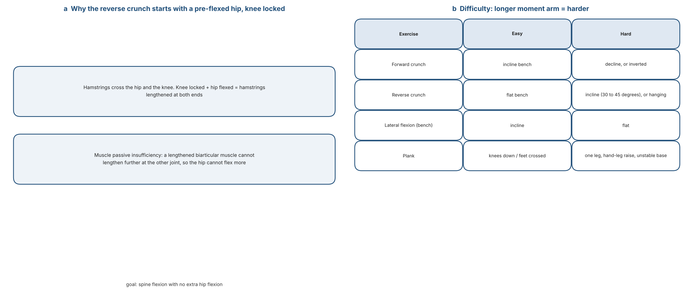
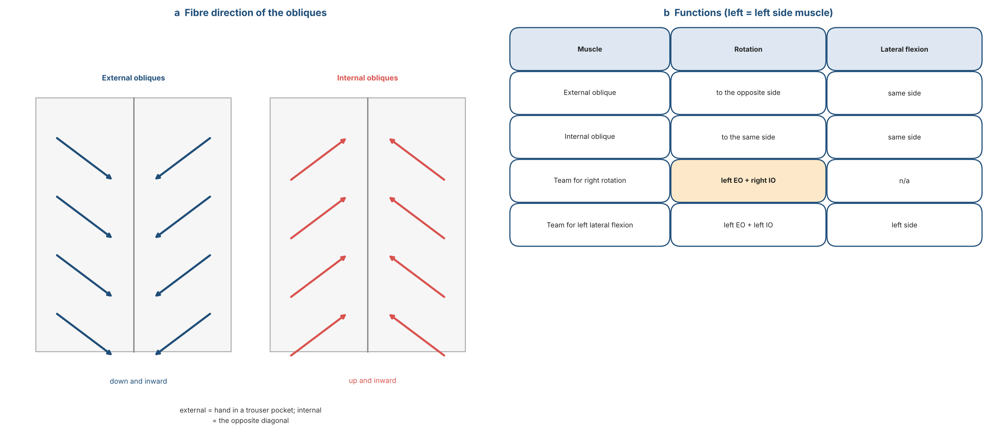
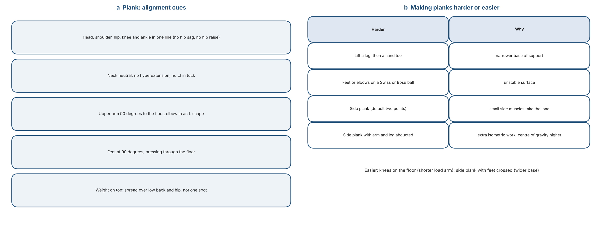
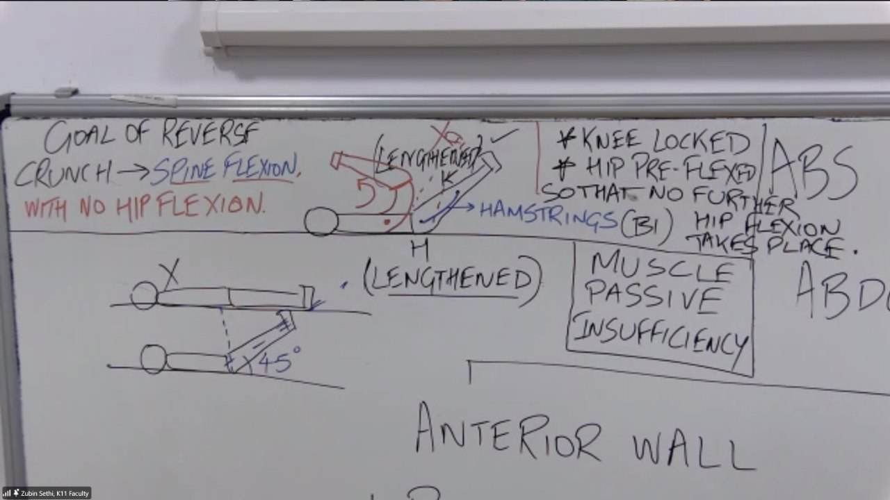
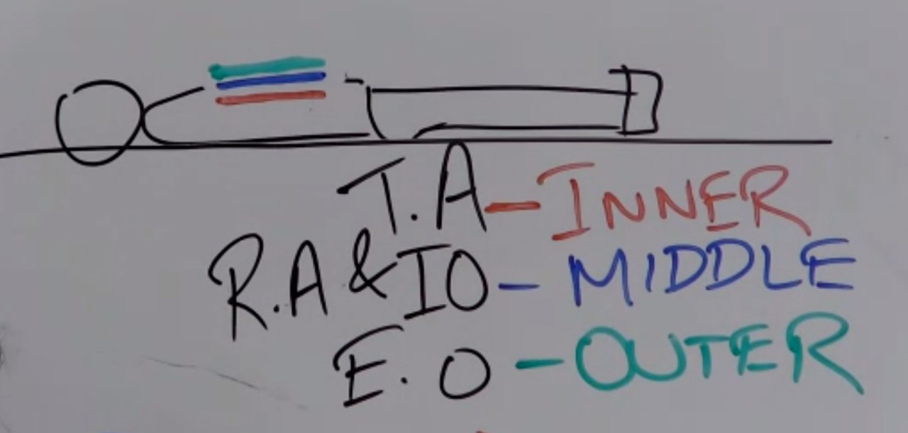
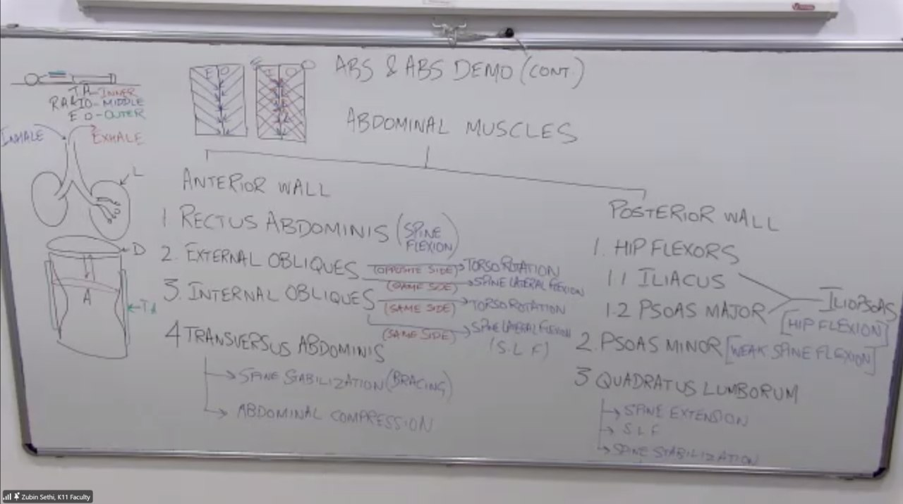

# Abs Demo: Detailed Notes

**Course:** Personal Training Certification

**Topic:** Abs exercises: forward crunch variations, reverse crunch and its starting position, leg raises, twisting crunches and seated torso rotation, lateral flexion, planks and side planks, the breathing pattern, and the advanced schedule

**About these notes:** Detailed notes for the exercise demonstrations in the abs sessions, written so they can be studied without watching the recordings. The muscle theory (anatomy, functions, which exercise is hip flexion and which is spine flexion) is in the Abs Lecture notes. Sources: the two session recordings (exercise video review), the course slides and the board photos. The figures are original drawings made for these notes.

---

## Abbreviations used in these notes

| Short form | Meaning |
|---|---|
| RA | Rectus abdominis |
| EO, IO | External obliques, internal obliques |
| PM | Prime mover |
| MPI | Muscle passive insufficiency |
| RM | Repetition maximum |

## Before this demo

You should know the Abs Lecture content: the fulcrum test for spine flexion versus hip flexion, the oblique functions, and the resistance profile idea (line of force, fulcrum, moment arm: a longer moment arm is harder).

## Outline of the demo

| Part | Topic |
|---|---|
| 1 | Forward crunches and breathing |
| 2 | Making crunches easier or harder |
| 3 | Crunch cum sit-up and cable crunches |
| 4 | Reverse crunches and the starting position |
| 5 | Torso rotation exercises |
| 6 | Spine lateral flexion exercises |
| 7 | Planks and side planks |
| 8 | The advanced schedule and a study table |

---

## Part 1: Forward crunches and breathing

- **Set-up:** lie on the mat with the knees bent. The bent knees pre-fill the gap under the lumbar curve, so the movement starts as spine flexion straight away.
- **Movement:** the head and shoulders leave the mat and the spine rounds. The fulcrum is in the spine and the prime mover is the rectus abdominis. Do not try to touch the elbows to the knees: going beyond the crunch turns it into a sit-up, and the fulcrum moves to the hip.
- **Elbows point to the ceiling**, hands lightly behind the head. Elbows pointing out would retract the scapulae and the back muscles would resist the rounding. Elbows up keeps the scapulae protracted and helps the spine round.
- **Breathing:** there is no Valsalva manoeuvre in abs exercises. Valsalva builds a compression "Swiss ball" in front of the spine to keep it straight in lifts such as the deadlift. Here the spine should flex, so exhale on the concentric and inhale on the eccentric.

## Part 2: Making crunches easier or harder

The difficulty follows the **moment arm**. The line of force passes through the tip of the head (the first part to leave the mat). The distance from the fulcrum to that line is the moment arm.

| Forward crunch | Moment arm | Difficulty |
|---|---|---|
| Incline bench | Shortest | Easy |
| Flat mat | Medium | Moderate |
| Decline bench (anchor strap or a partner sitting on the toes) | Longest | Hard |
| Inverted (hanging) | Longest | Hardest |

**Machines.** A cam based ab crunch machine gives good isolation. A cable crunch on the floor with a rope is common, but there is a better method: use a **lat pulldown machine** facing away from it, with the long handle behind the neck. Facing the machine would let the latissimus dorsi pull the weight (shoulder extension) instead of spine flexion. With the handle behind the neck, shoulder extension is blocked, so only spine flexion is left. A **sling** (the upper arm in the sling, fingers interlocked behind the neck) does the same and also supports the elbow.

## Part 3: Crunch cum sit-up

A crunch cum sit-up is two exercises in one, with two fulcrums and two prime movers in turn. The first half is spine flexion by the rectus abdominis. The second half, when the elbows go to the knees, is hip flexion by the iliopsoas. The elbows point to the ceiling here too. It can be done on a decline bench with anchor pads or straps, or inverted on a Smith machine (the knees over the bar and the feet held by a spotter). The spotter must be of comparable weight, or the spotter is the one lifted. Sit-ups on their own are hip flexion exercises.

## Part 4: Reverse crunches

**Goal:** spine flexion with no active hip flexion, so the rectus abdominis is the only prime mover.

**Starting position:** lie supine with the **hip pre-flexed and the knee locked** (extended). Why this works:

- The hamstrings cross the hip and the knee. With the knee locked and the hip flexed, they are lengthened at both joints.
- By **muscle passive insufficiency**, a lengthened biarticular muscle cannot lengthen further at the other joint, so the hip cannot flex any more. Only the spine can move.
- This is the use of an insufficiency on purpose. Before, muscle active insufficiency was a problem to remove.

**The angle is personal.** There is no fixed angle for the pre-flexed hip, such as 45 degrees. One person with tight hamstrings stops at a steep angle, and another with flexible hamstrings has room for some hip flexion first. A starting position with straight legs parallel to the floor is wrong: that is a leg raise and the hip flexes first.

**Difficulty.** The line of force passes through the heels, which start the lift. Going **incline** (30 degrees, then 45 degrees, legs towards the high end) moves the line of force further away, so the moment arm is longer and the exercise is harder. Hanging from a bar with the toes brought up to the bar is the hardest. It is a leg raise followed by a reverse crunch.

## Part 5: Torso rotation exercises

The obliques are the prime movers. See the figure for fibre directions and functions.

- **Russian twist:** sitting at an angle with the toes off the floor, twisting with a dumbbell or kettlebell. The load acts vertically, but the rotation is in the horizontal plane, so the line of force does not match the line of movement. A cable gives a horizontal line of force, like the cable rotations of the rotator cuff.
- **Seated cable torso twist:** the pulley is at a height so the cable is parallel to the floor. Two points answer why the set-up is as it is. **Seated**, so the pelvis does not turn and only the torso rotates, since the lower body must be stable. **Hold the handle in the hand away from the machine**, with the other hand holding that elbow, so the cable between the arms and the body acts like a cam and gives a better resistance profile. It also stops the arm pulling the weight.
- **Swiss ball version:** hugging a Swiss ball completes the cam, because the cable wraps around the ball and the chest. Use a cable rather than a pec deck machine, since a machine built for another purpose has a movement pattern for that muscle.
- **Twisting crunch cum sit-up:** the right elbow to the left knee and the left elbow to the right knee. The rotation should begin right from the floor with the spine flexion and finish with the hip flexion. If the rotation is added after the crunch, it happens with the hip flexion. For the repetitions, do one side first and then the other (for example 10 and 10), and not alternate. This gives the rectus abdominis and the iliopsoas, which work on every repetition, a rest on the other side.

## Part 6: Spine lateral flexion exercises

The EO and IO of the same side are the prime movers. The weight must go **up** in the concentric.

- **Standing side bend with two dumbbells:** the two weights balance each other, like a weighing scale, so there is hardly any effort.
- **Standing side bend with one dumbbell:** hold the dumbbell on the **opposite** side. When you bend to the right with the dumbbell in the left hand, the weight rises, and the right EO and IO contract. If the dumbbell is on the same side, it goes down while the muscles contract.
- **Cable lateral flexion with a low pulley** gives a longer moment arm than a dumbbell, and the line of force is across the body.
- **High pulley lateral flexion, seated:** the best version. The pulley is high so the cable is parallel to the floor in the start position. **Seated**, so the pelvis does not wobble. Put the **arm holding the cable over the head**: it makes a longer moment arm and locks the arm so the latissimus dorsi (shoulder adduction) cannot help.
- **Back extension bench, sideways:** stand with the side of the thigh on the pad and the side of the lower leg on the other anchor. The pad must be below the hip level. Only go **up** from the start position (the concentric against gravity). Going further down overstretches the muscles and does not meet the concentric criteria. To train the other side, switch sides. Hug a plate, or hold a dumbbell or kettlebell against the chest. Do not hold a weight with the arm hanging, which loads the arm joints and counterbalances the body weight.
- **Incline bench or flat bench (with a person on the feet):** incline is easier and flat is harder, since the line of force moves away from the fulcrum.

## Part 7: Planks

**Regular plank cues:** head, shoulder, hip, knee and ankle in one line, with no hip sagging or hip raising. Neutral neck (no hyperextension and no chin tuck). The upper arm at 90 degrees to the floor, the elbow in an L shape (hands too far or too close put stress on the arm joints). The feet at 90 degrees. Place any added weight over the low back and hip together, not on one spot. The quadriceps and the abs both work in the front plank.

**Making it harder:** the rule of stability, a narrower base of support. Lift a leg (three points), then also lift the opposite hand (two points). Or use an unstable base: a Swiss ball under the feet, a Bosu ball under the elbows or feet, or both. Reducing the angle of the body is another change.

**Side plank:** the base is two points by default, so it is harder. The smaller muscles on the side, such as the gluteus medius and minimus, face the floor. Keep the same alignment (humerus vertical, neck, hip, knee and ankle in a line) and no lateral flexion of the neck.

- **Easier:** put the knees on the floor (the knees bent shifts the fulcrum nearer the load, so the load arm is shorter, as in a knee push-up), or put the feet crossed, which widens the base.
- **Harder:** raise the opposite arm and leg (abducted). The gluteus medius and minimus on the upper side and the middle deltoid hold the position isometrically, and the centre of gravity moves higher.

## Part 8: The advanced schedule and a study table

The slide gives an **advanced level schedule at 6 to 8 RM:**

| No | Exercise |
|---|---|
| 1 | Forward crunch (machine, decline bench or inverted) **or** reverse crunch (incline bench, ab dip stand or hanging) |
| 2 | High pulley lateral flexion |
| 3 | Seated trunk rotation (machine or cable) |

**Study table (optional).** The class suggested building a table with columns B (body part), M (muscle), A (articulation), F (function), E (exercises) and R (special remarks), filled from memory and not copied from notes, so that each column leads to the next. For example, for the quadriceps: the group, its four muscles, which are uniarticular and which biarticular, the function of each, then compound and isolation exercises, and remarks such as reciprocal inhibition and active insufficiency for the biarticular rectus femoris. Origin and insertion are not needed.

---

## Key takeaways

Forward crunches are spine flexion with the fulcrum in the spine. Elbows point to the ceiling, and the breathing is exhale on the concentric and inhale on the eccentric, not Valsalva. Difficulty follows the moment arm: incline is easy, decline and inverted are hard. The reverse crunch starts with the hip pre-flexed and the knee locked so muscle passive insufficiency of the hamstrings stops hip flexion. Rotation and lateral flexion are best done on a cable, seated, with the arms locked so other muscles cannot help. In lateral flexion the weight must go up in the concentric. Planks are made harder by a smaller base of support or an unstable surface, and easier by a shorter lever or a wider base.

---

## Points to Confirm

1. **Videos.** The exercise videos shown in class are not in these notes and are described in words.
2. **Repetitions.** Except for the advanced schedule (6 to 8 RM), no sets or repetitions were given for the exercises.
3. **Side plank with knees.** The class explained the lower knee as moving the fulcrum nearer the load. The slide title said "knees flexed".
4. **Sit-up spotter.** The class gave the spotter weight as a safety point only.
5. **Cable versus machines.** The class said a machine made for one muscle suits that muscle best. The use of a pec deck for rotation was mentioned as an option people use.
6. **Figures.** The figures are summary diagrams made for these notes.

---

# Board Photos from the Demo

