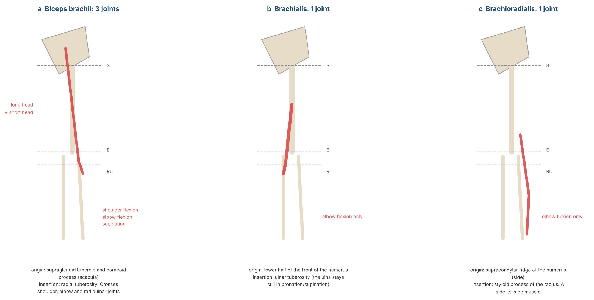
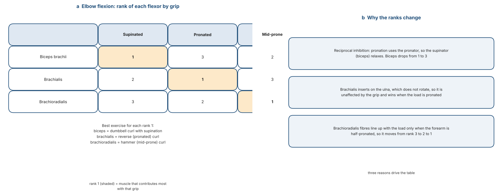
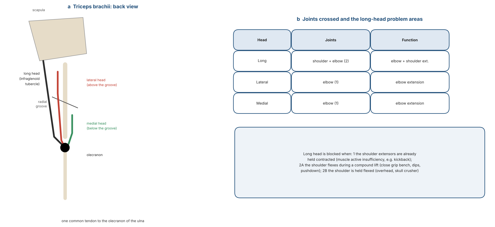
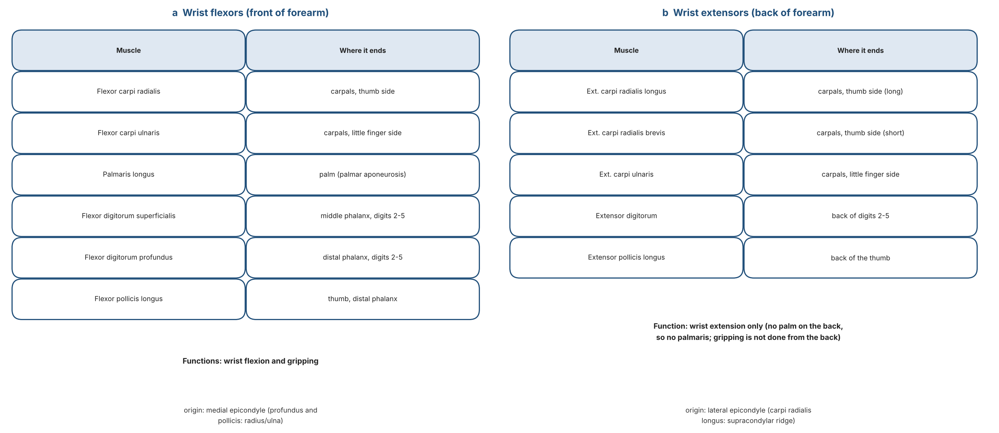
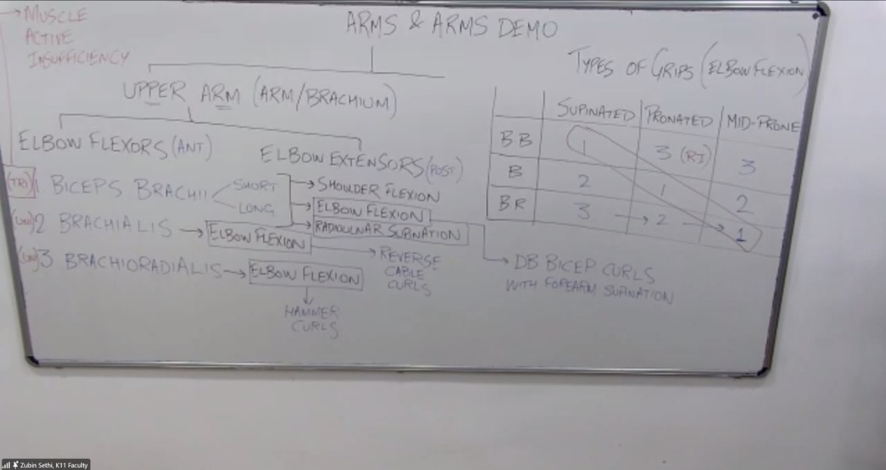
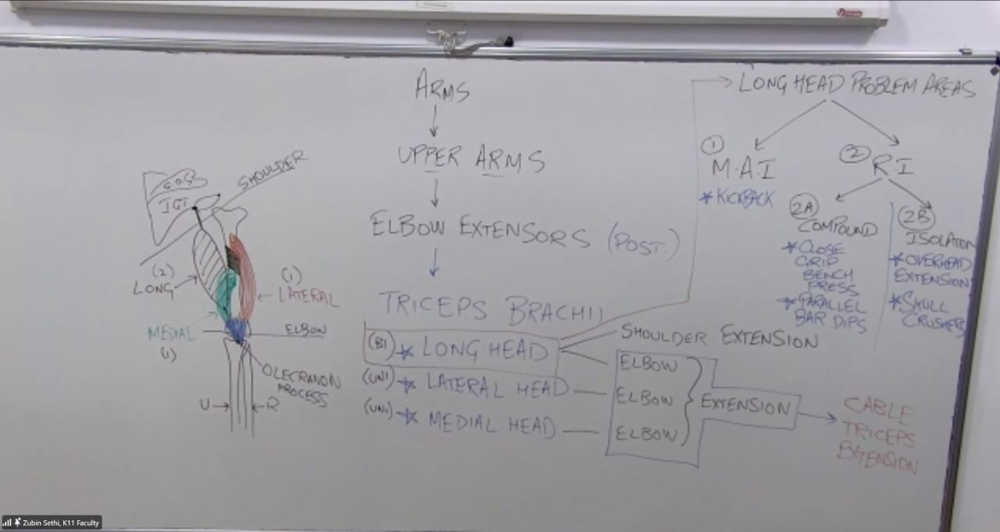
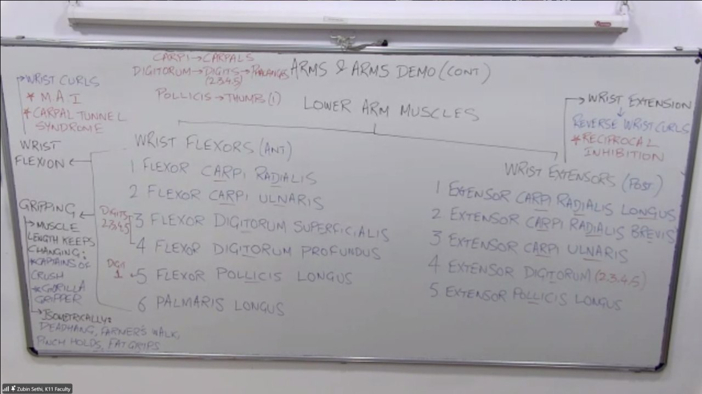

# Arms Lecture: Detailed Notes

**Course:** Personal Training Certification

**Topic:** The arm as a body part: upper arm and forearm, the four muscle groups, the elbow flexors (biceps brachii, brachialis, brachioradialis), the elbow extensors (triceps brachii), the wrist flexors and wrist extensors, joints crossed by each muscle, the grip ranking table and the reasons exercises work or fail

**About these notes:** Detailed notes for the Arms Lecture (the theory), written so the whole lecture can be studied without watching the recording. The arm sessions were taught as one and a half lectures that mixed theory and exercise demonstrations. The theory from both is collected here. The exercise videos, set-up points and exercise lists are in the Arms Demo notes. For a short revision version, see the Study Notes. Sources: the two session recordings, the course slides and the board photos. The figures are original drawings made for these notes.

---

## Abbreviations used in these notes

| Short form | Meaning |
|---|---|
| SGT | Supraglenoid tubercle (top of the shoulder socket) |
| IGT | Infraglenoid tubercle (bottom of the shoulder socket) |
| CP | Coracoid process |
| AP | Acromion process |
| RT | Radial tuberosity |
| UT | Ulnar tuberosity |
| RU | Radioulnar joint |
| MAI | Muscle active insufficiency |
| RI | Reciprocal inhibition |
| Uni-, bi-, triarticular | A muscle that crosses one, two or three joints |

## Before this lecture

You should know the directional terms (anterior, posterior, medial, lateral, dorsal, palmar), the scapula and humerus landmarks, joint actions at the shoulder, elbow and wrist, prime mover and synergist, concentric and eccentric contraction, muscle active insufficiency and reciprocal inhibition (from the legs lecture), and the resistance profile and strength profile idea.

## Outline of the lecture

| Part | Topic |
|---|---|
| 1 | The hierarchy: upper arm, forearm and four groups |
| 2 | Landmarks and how the muscle names are built |
| 3 | The elbow flexors: anatomy |
| 4 | Joints crossed: uni-, bi- and triarticular |
| 5 | Functions of the elbow flexors and the grip ranking table |
| 6 | The elbow extensors: the triceps brachii |
| 7 | Triceps: joints crossed, functions and problem areas |
| 8 | The forearm muscles: decoding the names |
| 9 | Forearm anatomy and functions |
| 10 | Why some exercises work better: the principles behind the arm exercises |

---

## Part 1: The hierarchy

The arm is divided into the **upper arm** (arm or brachium, from shoulder to elbow) and the **lower arm** (forearm, from elbow to wrist). Each region has an anterior group that does flexion and a posterior group that does extension.

| Region | Anterior | Posterior |
|---|---|---|
| Upper arm | Elbow flexors | Elbow extensors |
| Forearm | Wrist flexors | Wrist extensors |

The rule to remember: the anterior group always does flexion of the joint it crosses, the posterior group does extension. The two sessions covered the upper arm first and the forearm second.

## Part 2: Landmarks and name decoding

The biceps and triceps are described as muscles "of the brachium", so their second name is brachii. The names are built from small clues.

- **Biceps brachii:** two heads (bi) on the brachium.
- **Brachialis:** the "-alis" ending means closely related to the brachium.
- **Brachioradialis:** it joins the brachium to the radius. The "o" is a joining letter.

The landmarks used: the glenoid cavity (shoulder socket), the **supraglenoid tubercle** above it and the **infraglenoid tubercle** below it, the **coracoid process**, the **acromion**, the **supracondylar ridge** of the humerus, the **radial tuberosity**, the **ulnar tuberosity** and the **styloid process** of the radius (stylus means pen-shaped point). The **intertubercular groove** is also called the bicipital groove, and the long head tendon of the biceps passes through it.

## Part 3: The elbow flexors: anatomy

The three muscles are on the anterior upper arm. See the figure.

| Muscle | Origin | Insertion |
|---|---|---|
| Biceps brachii, long head | Supraglenoid tubercle | Radial tuberosity |
| Biceps brachii, short head | Coracoid process | Radial tuberosity |
| Brachialis | Anterior humerus, about halfway down | Ulnar tuberosity |
| Brachioradialis | Lateral supracondylar ridge | Styloid process of the radius |

The long head is longer because of its tendon, which runs through the bicipital groove. The brachioradialis is a "side to side" muscle: it starts on the side of the humerus and ends on the side of the radius. It does not sit on the front of the forearm, even though some diagrams draw it that way.

## Part 4: Joints crossed

To decide how many joints a muscle crosses, draw the axis of each joint and see whether the muscle passes it. Three axes are used: shoulder (S), elbow (E) and radioulnar (RU).

- **Brachialis:** it starts on the humerus and ends on the ulna, so it crosses only the elbow. It is **uniarticular**.
- **Brachioradialis:** it starts on the humerus and ends on the radius, from the side. It crosses only the elbow, so it is **uniarticular**. It does not lie across the front of the radioulnar joint.
- **Biceps brachii (both heads):** the origins are on the scapula, so the muscle must cross the shoulder to reach the forearm. It also crosses the elbow, and the radial tuberosity lies just beyond the radioulnar joint, so it crosses that too. It is **triarticular**, the first triarticular muscle in the course.

A muscle can only cross the shoulder if it starts on the scapula, in the same way that a muscle crosses the hip only if it starts on the pelvis.

In the hamstrings, the long head of biceps femoris was biarticular and the short head uniarticular, so a number was written next to each head. Here the number 3 is written next to the biceps as a whole, because both heads cross the same three joints and work in the same exercises.

## Part 5: Functions and the grip ranking table

The biceps functions follow from the joints crossed:

| Joint | Biceps function |
|---|---|
| Shoulder | Flexion |
| Elbow | Flexion |
| Radioulnar | Supination |

The brachialis and brachioradialis have one function: elbow flexion. All three are called the **elbow flexors**.

**What to train.** A muscle is trained through its main job. Shoulder flexion is not the biceps' main job, because the anterior deltoid is the prime mover. The target is elbow flexion, and a second target, supination, can be added.

**The grip decides who leads.** For the pectoralis major the angle changed the focus. For the elbow flexors the **grip** changes it. The three grips are supinated (palms up), pronated (palms down) and mid-prone (palms facing each other, also called neutral or hammer). A table ranks each muscle from 1 to 3 for each grip.

| | Supinated | Pronated | Mid-prone |
|---|---|---|---|
| Biceps brachii | 1 | 3 | 2 |
| Brachialis | 2 | 1 | 3 |
| Brachioradialis | 3 | 2 | 1 |

The reasons:

1. **Supinated.** The biceps and the brachialis fibres line up with the load. The biceps wins because it covers a larger area, and the brachialis starts only halfway down. The brachioradialis fibres fold from the side and have little tension.
2. **Pronated.** The pronator teres contracts to hold the pronated position. By reciprocal inhibition, the supinator side relaxes, and the biceps is the supinator, so it drops to rank 3 even though elbow flexion is its job. The brachialis does not care about pronation or supination, so it takes rank 1. Some brachioradialis fibres now cross the top of the forearm and help a little, so it rises to 2.
3. **Mid-prone.** All brachioradialis fibres now face the load and it takes rank 1. The biceps is half relaxed (a partial pronation has started), so it is 2. The brachialis is 3, because it is unaffected.

**Why the brachialis is unaffected.** It inserts on the ulna, which stays still while the radius rotates. The biceps inserts on the radial tuberosity, which moves every time the grip changes. A simple check: flex the biceps in a supinated grip and feel it with the other hand, then turn the palm down and feel the bulk soften.

**From table to exercise.** Pick the muscle, find its rank 1 grip, and choose an exercise with that grip. Brachioradialis: mid-prone, the hammer curl. Brachialis: pronated, the reverse curl. Biceps: supinated, the dumbbell curl with supination.

## Part 6: The elbow extensors

The elbow extensors are one muscle, the **triceps brachii**, which has three heads (tri means three, ceps means heads) on the posterior upper arm.

| Head | Origin | Insertion |
|---|---|---|
| Long head | Infraglenoid tubercle of the scapula | Olecranon process of the ulna (common tendon) |
| Lateral head | Posterior humerus, above the radial groove | Olecranon process |
| Medial head | Posterior humerus, below the radial groove | Olecranon process |

The radial groove has nothing to do with the radius bone. It is named for the radial nerve that passes through it. The three heads share one tendon. The horseshoe shape seen when the triceps is flexed is the long head. The medial head is not as deep as it seems: in a well-developed arm there is room for it to be seen.

## Part 7: Triceps: joints crossed, functions and problem areas

- **Lateral and medial heads:** they start on the humerus and end on the ulna. They cross only the elbow (uniarticular).
- **Long head:** it starts on the scapula and crosses the shoulder and then the elbow (**biarticular**).

All three do **elbow extension**. The long head also does **shoulder extension**, but this is not its main job (the latissimus dorsi is the prime mover, with the posterior deltoid helping). The grip does not shift focus between heads, so the functions are written once.

**Problem areas of the long head.** The lateral and medial heads work in every elbow extension exercise. The long head only works well in a few. It is blocked in two ways.

1. **Muscle active insufficiency (MAI).** The shoulder extensors are already held contracted to keep the arm back, so the long head cannot also contract fully at the elbow. Example: kickback.
2. **Reciprocal inhibition (RI).** When the shoulder flexors contract, the shoulder extensors relax, and a relaxed long head cannot extend the elbow well. Two types:
   - **2A compound:** the shoulder flexes during the lift. The shoulder flexion starts from a hyperextended position as well (the movement from behind the body forward counts as flexion). Examples: close grip bench press, parallel bar dips, bench dips behind the back, cable pushdown.
   - **2B isolation:** the shoulder is held already flexed (overhead). Examples: skull crusher, overhead dumbbell extension, overhead cable extension, lying cable extension.

These lists are of exercises where the long head is blocked. They are not exercises for the long head. They are still good exercises for the lateral and medial heads, and no exercise is called bad. The point is to know which heads are being trained.

**The solution.** With the arms by the sides (zero degrees of shoulder elevation), the shoulder neither flexes nor is held flexed, so RI is avoided. Gravity keeps the arm there, so the shoulder extensors do not work, so MAI is avoided. Research on the force each head can produce at different shoulder angles also shows the long head is strongest at zero degrees of elevation. This is why the **standing cable triceps extension** is the recommended exercise: all three heads work.

**Leaning on dips.** The body position changes the emphasis on a parallel bar dip. Leaning forward puts more torque on the shoulder, so the chest and shoulder lead. An upright body puts more torque on the elbow, so the triceps leads.

## Part 8: The forearm muscles: decoding the names

The forearm has two groups with 11 muscles in all, and only a few functions, because the functions are per group.

**Wrist flexors (six, anterior):** flexor carpi radialis, flexor carpi ulnaris, flexor digitorum superficialis, flexor digitorum profundus, flexor pollicis longus and palmaris longus.

**Wrist extensors (five, posterior):** extensor carpi radialis longus, extensor carpi radialis brevis, extensor carpi ulnaris, extensor digitorum and extensor pollicis longus.

The names are built from clues about where the muscle ends (insertion), because they all start near the elbow:

| Word | Meaning |
|---|---|
| Carpi | Carpals (wrist bones): the muscle ends at the wrist |
| Radialis / ulnaris | Ends toward the radius (thumb side) or the ulna (little finger side) |
| Digitorum | Digits 2 to 5 (the fingers, not the thumb) |
| Pollicis | The thumb (digit 1) |
| Palmaris | The palm |
| Superficialis / profundus | Near the surface / deep (profound means deep) |
| Longus / brevis | Long / short |

In anatomy the digits are counted from the thumb as 1, so the fingers are 2, 3, 4 and 5. The back of the hand has no palm, so the extensor group has no palmaris.

## Part 9: Forearm anatomy and functions

**Wrist flexors.** Four of the six start from the **medial epicondyle** of the humerus (check the direction: with the thumb up in the anatomical position, the medial side is opposite the thumb). The palmaris longus ends in the **palmar aponeurosis**, a white sheet in the palm that is like a fascia but works like a tendon. A band of tissue at the wrist, the **flexor retinaculum**, holds the tendons in place. The flexor digitorum superficialis ends on the **middle phalanx** of digits 2 to 5 and starts at the medial epicondyle. The flexor digitorum profundus starts lower, on the proximal ulna, and ends on the **distal phalanx**. The flexor pollicis longus starts on the radius and ends on the distal phalanx of the thumb. The phalanges are named proximal (nearest the palm), middle and distal. The thumb has only proximal and distal phalanges.

**Wrist extensors.** Three start from the **lateral epicondyle**. The extensor carpi radialis brevis starts there. The longus starts a little higher, on the supracondylar ridge (the same ridge as the brachioradialis), so it has more length. The extensor digitorum ends behind the fingers near the nails. The extensor pollicis longus starts on the ulna and ends on the back of the thumb.

**Functions:**

- **Wrist flexors:** wrist flexion and **gripping**. Gripping is the function to train because it carries over to every exercise where a bar or handle is held.
- **Wrist extensors:** wrist extension only. Nothing is gripped from the back of the hand.

**Why gripping matters.** In a heavy lift, the target is for the prime movers to fail, not the grip. If the grip fails first, the prime movers still have capacity left.

**Multiarticular muscles.** The forearm muscles cross many joints (elbow, wrist, intercarpal, carpometacarpal, metacarpophalangeal and interphalangeal joints), so MAI and RI apply.

## Part 10: Principles behind the arm exercises

These ideas, taught across the sessions, explain why the exercises in the demo notes are ranked the way they are.

1. **Choose the exercise by the prime function.** The extra functions of a multiarticular muscle (shoulder flexion for the biceps, shoulder extension for the long head) are not the focus.
2. **Muscle active insufficiency.** A multiarticular muscle already contracted at one joint cannot contract fully at the other. High pulley curls, concentration curls and spider curls hold the shoulder in flexion, so the biceps contribution is reduced.
3. **Reciprocal inhibition.** Pronation relaxes the biceps. Gripping relaxes the wrist extensors. Shoulder flexion relaxes the long head of the triceps.
4. **Resistance and strength profile.** The biceps has its best leverage at about 20 to 70 degrees of elbow flexion, according to the muscle research shown. Choose the set-up where the resistance is highest at the range where the muscle is strongest. A cable curl facing away is hardest low in the range, which matches the biceps. Facing towards is hardest at about 90 degrees, which does not.
5. **The concentric and eccentric of the same muscle make a repetition.** An exercise that changes the working muscle in the middle of a repetition (see the Zottman curl in the demo) does not give either muscle a full repetition.
6. **Training frequency.** Elbow flexors already work in every row, pull down and chin up, and the triceps work in presses. When the schedule has room for only one dedicated exercise, choose the recommended one. These ideas return in the scheduling lecture.
7. **Beginners versus advanced.** MAI and RI matter more after the beginner stage, when hypertrophy and progressive overload are the aim.

---

## Key takeaways

The arm has four groups: elbow flexors and extensors in the upper arm and wrist flexors and extensors in the forearm. The anterior group flexes and the posterior group extends. The biceps crosses three joints (shoulder, elbow, radioulnar), the brachialis and brachioradialis cross only the elbow, and the triceps long head crosses two while the other heads cross one. The grip decides which elbow flexor leads: supinated for the biceps, pronated for the brachialis and mid-prone for the brachioradialis. Reciprocal inhibition explains the biceps ranking. The long head of the triceps is blocked by MAI and RI in most exercises and works well only in the arms-by-the-side cable extension. The forearm muscles are named by where they end, and their key functions are wrist flexion, wrist extension and, above all, gripping.

---

## Points to Confirm

1. **Research graphs.** The strength-profile graphs shown in class (elbow flexor and triceps moment arms) are third-party and are described in words only. Confirm the figures to be cited.
2. **Brachioradialis and the radioulnar joint.** The class explained it does not cross the radioulnar joint because it runs from side to side. Some sources differ.
3. **Brachialis halfway.** The class described the origin as the lower half of the anterior humerus ("halfway down").
4. **Shoulder flexion in dips.** The class counted the movement from behind the body forward as flexion. Confirm that this convention is wanted.
5. **Category labels 1, 2A and 2B.** These are the lecturer's teaching labels, not official terms. The class noted that the labels for compound and isolation were once interchanged.
6. **Figures.** The figures are simplified drawings made for these notes. Muscle lines are schematic, not anatomical.

---

# Board Photos from the Lecture

