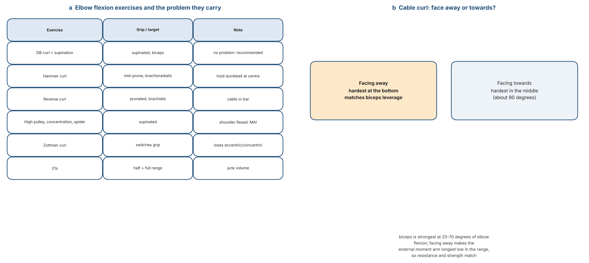
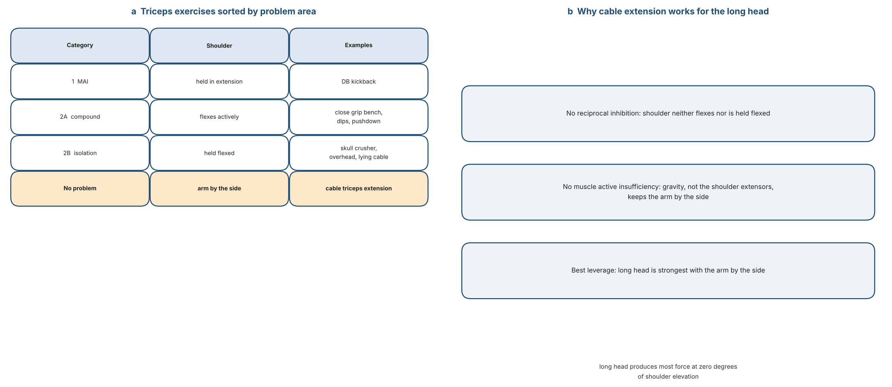
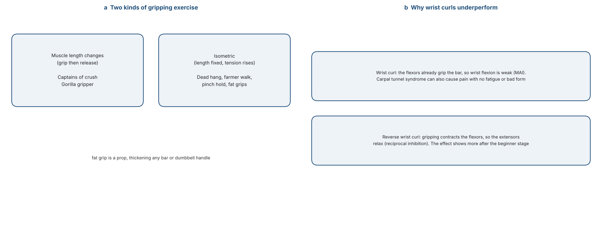
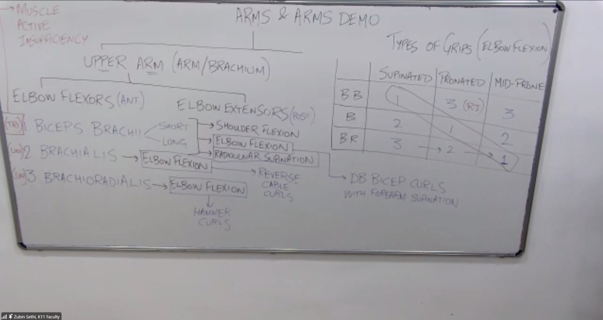
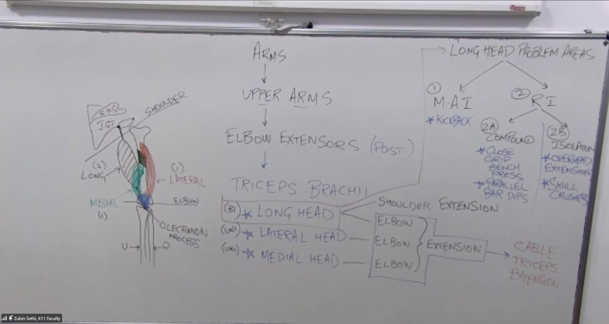
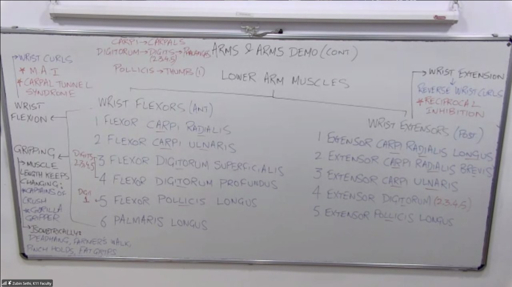

# Arms Demo: Detailed Notes

**Course:** Personal Training Certification

**Topic:** Arm exercises: elbow flexion exercises (curl variations, grips and set-up), triceps exercises sorted by problem area, wrist curls, and grip exercises

**About these notes:** Detailed notes for the exercise demonstrations in the arm sessions, written so they can be studied without watching the recordings. The muscle theory (anatomy, joints crossed, the grip ranking table, the problem areas) is in the Arms Lecture notes. Sources: the two session recordings (exercise video review), the course slides and the board photos. The figures are original drawings made for these notes.

---

## Abbreviations used in these notes

| Short form | Meaning |
|---|---|
| MAI | Muscle active insufficiency |
| RI | Reciprocal inhibition |
| DB, BB | Dumbbell, barbell |
| EZ bar | Zigzag (easy) bar |

## Before this demo

You should know the Arms Lecture content: the grip ranking table, the triceps long head problem areas (1, 2A, 2B), MAI and RI, and the resistance profile versus strength profile idea. The aim of the exercise review is not to call any exercise bad. It is to see which muscle each exercise trains best and why, so a trainer can pick the best one when the schedule allows only one.

## Outline of the demo

| Part | Topic |
|---|---|
| 1 | Elbow flexion exercises: the recommended exercise |
| 2 | Elbow flexion exercises: grips and problems |
| 3 | Cable curls: facing away or towards |
| 4 | Triceps exercises sorted by problem area |
| 5 | The recommended triceps exercise and grips |
| 6 | Wrist curls and their hurdles |
| 7 | Grip exercises |

---

## Part 1: The recommended elbow flexion exercise

When there is room for only one dedicated exercise, the choice is the **standing dumbbell curl with supination**. It trains the biceps through two functions at once: elbow flexion and radioulnar supination ("one bullet, two targets"). Dumbbells are needed because each hand can be turned separately, which a single bar does not allow. The reasons it is chosen over the rest are given below.

**Hold the dumbbell off centre.** In a hammer curl the dumbbell is held in the middle because only elbow flexion happens. In the supination version it is held toward the front end of the handle, so the turning action also meets resistance, like tilting a long pole held at one end.

## Part 2: Grips and problems

- **Hammer curl (mid-prone):** best for the brachioradialis.
- **Reverse curl (pronated):** best for the brachialis. A cable version is the reverse cable curl.
- **Barbell curl:** works the biceps for elbow flexion but not for supination. MAI is not a problem. People with limited wrist or radioulnar mobility can feel forearm discomfort, so the **EZ bar** (slightly tilted, not fully supinated) is more comfortable, and it also shifts some load toward the brachioradialis.
- **High pulley curl, concentration curl and spider curl:** the shoulder is held in flexion, so the biceps is already contracted at the shoulder and its contribution at the elbow is reduced (MAI). Preacher curl in a pronated grip is fine because the brachialis is uniarticular.
- **Concentration curl and the "peak".** A claim that concentration curls build a biceps peak was shown to have no support: the peak is a genetic factor, from a short muscle belly and a long tendon.
- **Zottman curl.** The grip is supinated going up and pronated coming down. This loads the biceps concentric but the brachialis eccentric, so neither muscle does a full repetition, and the grip turn on top of the lift adds wrist risk.
- **21s.** Seven half repetitions low, seven half high, then seven full. The first 14 are partial range and fatigue the muscle before the full-range reps, add calcium related chemical damage without the benefit of full range and are called junk volume. Full range of motion is needed for hypertrophy.

All of this is the principle, not a ban. In a split with an arms day, more exercises can be added.

## Part 3: Cable curls: facing away or towards

The cable curl can be done facing the machine or with the back to it. The external moment arm (the resistance) is greatest low in the range when facing away, and in the middle (about 90 degrees) when facing towards. The research shown gives the biceps the longest internal moment arm at about 20 to 70 degrees of elbow flexion. Facing away puts the highest resistance where the biceps is strongest, so it is the better choice.

## Part 4: Triceps exercises by problem area

All of these train the lateral and medial heads well. The question is whether the long head works.

| Exercise | Why the long head is blocked | Category |
|---|---|---|
| Dumbbell kickback | Shoulder held in extension, so the shoulder extensors are already contracted | 1 (MAI) |
| Close grip bench press | The shoulder flexes in the concentric | 2A |
| Parallel bar dips | The shoulder flexes in the concentric | 2A |
| Bench dips behind the back | The shoulder flexes in the concentric | 2A |
| Cable pushdown | A cable version of the dip: the shoulder flexes | 2A |
| Skull crusher (zigzag bar) | Shoulder held flexed | 2B |
| Overhead dumbbell extension | Shoulder held flexed | 2B |
| Overhead cable extension | Shoulder held flexed | 2B |
| Lying cable extension | Shoulder held flexed | 2B |

Notes on the exercises:

- **Close grip bench press:** the forearms are vertical at the bottom. It is a decline version in the video.
- **Parallel bar dips:** bend the knees and cross the feet so the body does not swing like a pendulum. Stay upright for the triceps and lean forward for the chest.
- **Lying cable extension versus skull crusher:** the cable keeps tension through the range, which helps the lateral and medial heads, but the long head is still blocked.

## Part 5: The recommended triceps exercise and grips

The **standing cable triceps extension** (arms by the sides, elbows fixed) is the recommended exercise. The long head works together with the other two heads because:

1. The shoulder neither flexes nor is held flexed, so there is no RI.
2. Gravity keeps the arm by the side, so the shoulder extensors do not have to work, so there is no MAI.
3. The long head produces its greatest force at zero degrees of shoulder elevation, according to the research shown.

Compare it with the pushdown, which looks the same but moves the shoulder into flexion.

**Grips.** The usual grip is pronated. A supinated grip is the **reverse cable triceps extension**. In elbow flexion a pronated grip is "reverse", while in elbow extension the supinated grip is "reverse". A **rope** does not shift focus between heads. The right choice is the grip the person can use with progressive overload without wrist problems. A rope can cause radial and ulnar deviation with heavy weight, and a poor wrist can then limit the load. Its benefit is a slightly longer range, because the hands can move beside the thighs.

## Part 6: Wrist curls and their hurdles

- **Wrist curl** (supinated grip) trains wrist flexion. **Reverse wrist curl** (pronated) trains wrist extension.
- **MAI:** gripping already contracts the finger flexors, so wrist flexion is weak. Gripping a pen very tightly and trying to flex the wrist shows it: the grip loosens.
- **Carpal tunnel syndrome:** the tunnel between the carpal bones carries the median nerve and other structures. Wrist flexion narrows it. Some people get forearm pain or discomfort in a few repetitions even without fatigue, soreness or bad form. This is a medical syndrome.
- **RI in the reverse wrist curl:** gripping contracts the flexors, so the extensors relax.

These hurdles matter most after the beginner stage. That is why grip exercises become the focus.

## Part 7: Grip exercises

Two categories:

1. **Muscle length changes (grip and release):**
   - **Captains of crush:** a portable spring gripper. Some have a scale (about 5 to 60) and a knob to change the resistance.
   - **Gorilla gripper:** a plate or pin loaded machine with a fixed arm and a movable arm. The base of the palm is on the fixed arm and the fingers close the movable arm so the weight rises. A fulcrum based plate loaded version has a changed resistance profile and is built with progressive overload in mind.
2. **Isometric (length fixed, tension changes):**
   - **Dead hang:** hang from a pull-up bar. The grip fails when the tension is more than the muscles can withstand.
   - **Farmer's walk (carry):** two heavy dumbbells, or a trap bar so the thighs do not touch the bar.
   - **Pinch hold:** hold a plate by its smooth edges between the thumb and fingers. Start with the thumb and four fingers, then use the thumb and one finger and switch fingers.
   - **Fat grips:** a prop that thickens the handle of a dumbbell or bar. It is most useful in pulling movements, such as shrugs or bent over rows.

---

## Key takeaways

The recommended elbow flexion exercise is the standing dumbbell curl with supination, because it trains the biceps for two functions and avoids MAI. Hammer curls suit the brachioradialis and reverse curls the brachialis. Curls with the shoulder flexed carry MAI, and the Zottman curl and 21s waste repetitions. A cable curl facing away matches resistance to the strength profile of the biceps. For the triceps, almost every exercise blocks the long head through MAI or RI, and the standing cable extension is the one that does not. For the forearm, wrist curls face MAI, carpal tunnel and RI, so grip exercises (changing length or isometric) are the main focus.

---

## Points to Confirm

1. **Videos.** The exercise videos shown in class are not in these notes. They are described in words.
2. **Category labels.** The labels 1, 2A and 2B are teaching labels.
3. **Wrist and grip exercise sets and reps.** No set or repetition numbers were given in class.
4. **Gripper scale.** The class said the scale is not the actual weight. The class described a price for a gripper that is not repeated here.
5. **Zottman curl and 21s.** The class gave mechanical reasons. A reference for the chemical damage claim was not shown.
6. **Figures.** The figures are summary diagrams made for these notes.

---

# Board Photos from the Demo

