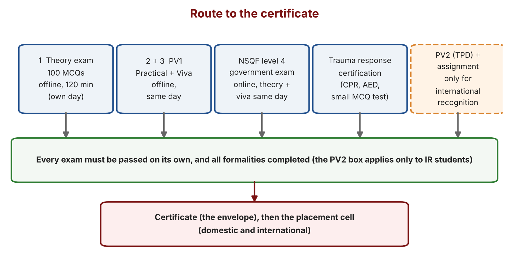
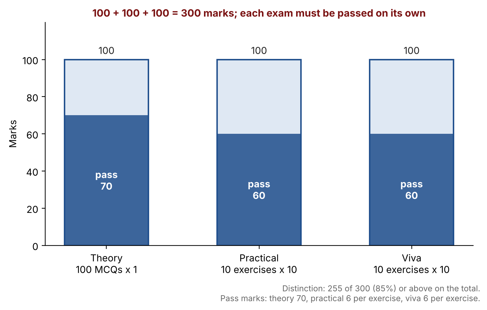
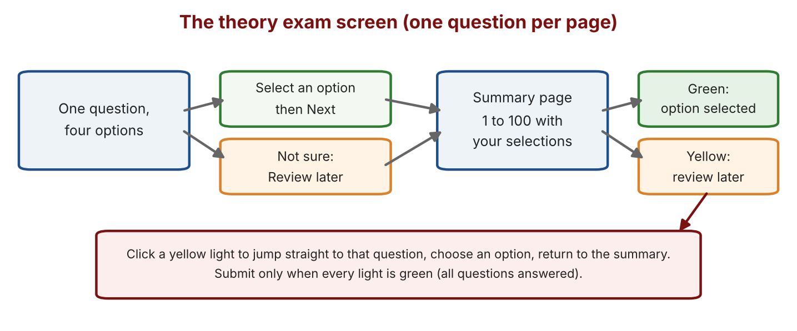
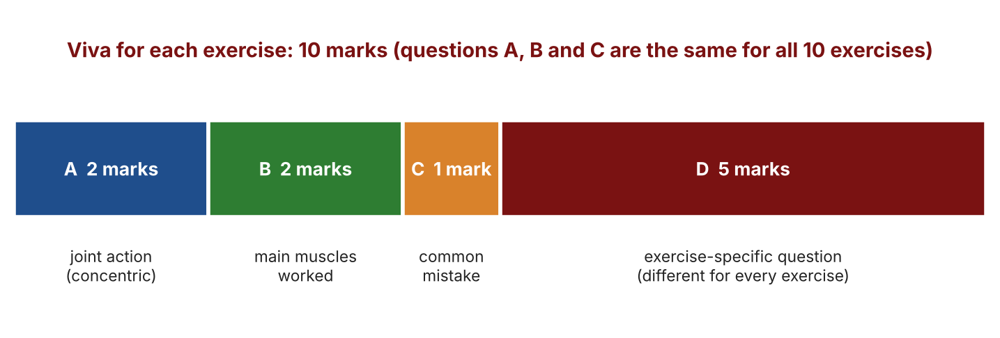
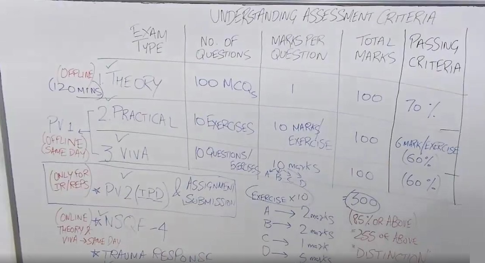
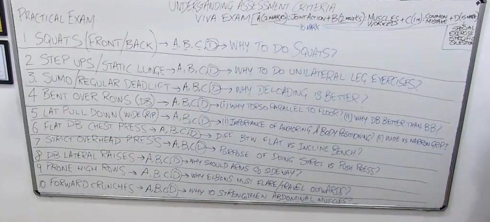

# Understanding Assessment Criteria: Detailed Notes

**Course:** Personal Training Certification

**Topic:** The whole assessment process: exam types, marks and passing criteria, how the theory exam works, the 10 practical exercises, and how to answer the viva questions A, B, C and D

**About these notes:** Detailed notes from the Understanding Assessment Criteria lecture, written so the whole lecture can be studied without watching the recording. Every concept, example, analogy and class question is covered. For a short revision version, see the Study Notes. Sources: the lecture recording and the board photos. No course slides were available for this lecture. The figures are original drawings made for these notes.

---

## Abbreviations used in these notes

| Short form | Meaning |
|---|---|
| MCQ | Multiple-choice question |
| PV1 | Practical and viva 1 (the practical exam and the viva exam, taken together) |
| PV2 | Practical viva 2 (the training program delivery exam, for international recognition only) |
| TPD | Training program delivery (another name for PV2) |
| IR | International recognition |
| NSQF | National Skills Qualifications Framework (level 4 is the exam in this course) |
| CPR | Cardiopulmonary resuscitation |
| AED | Automated external defibrillator |
| DB, BB | Dumbbell, barbell |
| PM | Prime mover |
| HNK | The knee-and-hip rule for squats (knees go forward, hips come down) |

## Before this lecture

This lecture is a map of the exams, so it assumes the whole course so far: the theory lectures and unit tests, the body-part lectures and demos (legs, back, chest, shoulders, arms and abs), the resistance profile idea (moment arm and torque), the stretch reflex, and the names of the joint actions and muscles for each exercise. The viva answers in Part 7 reuse that material.

## Outline of the lecture

| Part | Topic |
|---|---|
| 1 | The types of exam and the route to the certificate |
| 2 | Marks, questions and passing criteria (the table on the board) |
| 3 | The extra requirements: PV2 and assignment, NSQF level 4, trauma response, placement |
| 4 | Theory exam: format, time and the exam screen |
| 5 | The 10 practical exercises |
| 6 | The viva: questions A, B, C and D |
| 7 | Practising A, B and C for every exercise |
| 8 | The D questions (five marks) for all 10 exercises |
| 9 | Preparation advice and closing questions |

---

# Part 1. The types of exam and the route to the certificate

The lecture explains the whole evaluation process: the series of assessments that follow the practical phase of the course. The first step is to list the exam types in a table with these columns: exam type, number of questions, marks per question, total marks and passing criteria.

## 1.1 The three key exams

Three exams are the focus of the lecture.

1. **Theory exam.** This is the exam based on the theory phase of the course.
2. **Practical exam.** Exercises are performed in front of an assessor.
3. **Viva exam.** Spoken questions about the same exercises.

The practical and the viva together are called **PV1** (practical and viva 1). They are offline (in person) and are taken on the same day.

## 1.2 Other requirements before the certificate

Besides the three key exams there are other formalities that must be completed before the certificate is handed over. All of them must be cleared successfully.

| Requirement | Who takes it | Mode |
|---|---|---|
| Theory exam | Everyone | Offline, 120 minutes, on its own day |
| PV1: practical and viva | Everyone | Offline, same day |
| NSQF level 4 | Everyone | Online (theory and viva on the same day) |
| Trauma response certification | Everyone | Special session, then a small MCQ test |
| PV2 (TPD) and assignment submission | Only students who applied for international recognition | In person with a dummy client |

*Figure 1. The exams and formalities that must all be cleared before the certificate. The dashed box applies only to international recognition (IR) students. Schematic.*

Students are asked to be patient. The process sounds long, but it can be done with ease if it is not rushed. The practical phase should be treated as another phase of examination, just as the theory phase was.

---

# Part 2. Marks, questions and passing criteria

This is the table built on the board (see the board photos at the end).

| Exam | Number of questions | Marks per question | Total marks | Passing criteria |
|---|---|---|---|---|
| 1. Theory (offline, 120 minutes) | 100 MCQs | 1 | 100 | 70% (70 of 100) |
| 2. Practical (PV1, offline) | 10 exercises | 10 marks per exercise | 100 | 60% in each exercise (6 of 10) |
| 3. Viva (PV1, offline, same day as the practical) | 10 questions, one per exercise | 10 marks per exercise (split into A, B, C, D) | 100 | 60% in each exercise (6 of 10) |
| **Total** | | | **300** | |

## 2.1 The theory marks

Each MCQ is worth one mark. There is **no negative marking**. A student who answers all 100 correctly scores 100 marks, which is the maximum.

## 2.2 The practical marks

Instead of counting questions, the practical counts exercises. There are 10 exercises and each is worth 10 marks, so the maximum is 10 x 10 = 100.

## 2.3 The viva marks

The viva questions are not asked from anywhere. They are all based on the same 10 exercises. For each exercise there are four types of question, A, B, C and D (see Part 6), and each exercise is worth 10 marks in total, so the viva also has a maximum of 100.

## 2.4 Passing: each exam on its own

The three exams are passed **individually**. The aggregate is not what decides a pass.

- **Theory:** at least 70 of the 100 questions must be correct.
- **Practical:** at least 6 marks out of 10 (60%) in **every** exercise.
- **Viva:** at least 60% in **every** exercise as well.

The rule is per exercise on purpose. If the rule were 60 marks in total, a student could score 10 out of 10 in six exercises, already have 60, and treat the other four as optional. That is not allowed: 60% has to be reached in each exercise.

*Figure 2. Three exams of 100 marks each. The dark part is the pass mark. For the practical and the viva, the 60 is made of at least 6 marks in each of the 10 exercises.*

## 2.5 The total of 300 and the distinction

The three maximum marks together make **300**. The final percentage is calculated from the score out of 300.

A student who scores **85% or above of the total (85% of 300 = 255, so 255 or more)** receives the certificate marked **"Pass with Distinction"** in golden letters. A further benefit is a scholarship on another course from the academy (for example nutrition or special populations), mentioned as around 6,000 (see Points to Confirm).

The target should not be the passing column. The goal for the next few months should be the full marks column, because aiming small leads to small marks. The pass marks are stated only because the rule must be known.

---

# Part 3. The extra requirements in detail

## 3.1 PV2 (TPD) and the assignment: only for international recognition

**What it is.** PV2 stands for practical viva 2. It is also called the TPD exam (training program delivery). It is mandatory only for students who have applied for international recognition (IR). Students on that route receive an IR kit with pre-recorded sessions about TPD. Everyone else skips this box.

**What the exam looks like.** The student demonstrates what was learned in the practical phase on another person, a friend or relative brought as a dummy client. The student takes the client through a full process:

1. The forms and the client interview first: the informed consent form, the PAR-Q type forms and the interview about personal details, lifestyle, habits and sleeping pattern.
2. Fitness testing.
3. Mobility drills.
4. The main training.
5. The cool-down.
6. A discussion with the client.

**The assignment.** The student is given a PDF to fill in and must submit it. On the day of PV2 the assessor asks for the email receipt that shows it was submitted. The assessor is from the academy itself; nobody comes from abroad.

**Switching to IR.** A student who has not applied but wants to may do so midway through the course. Signing for IR makes the student eligible to work in 11 countries. The advice is to switch midway and not at the very end, because a student who switches at the end has to take the theory exam one more time (the existing theory score is not accepted by the international body, which wants its own theory exam through the same process).

## 3.2 NSQF level 4

NSQF level 4 is a certification for everyone, taken by clearing this exam. Key points:

- It is **conducted by the government**, not by the academy. The academy does not set or control it.
- It is **compulsory**.
- It is taken after the academy exams are finished. The exam coordinators help to find a date.
- There is **no practical**. It has only **theory and viva**, and both are **purely online and on the same day**.
- By contrast, the academy's own theory exam is offline and on a separate day, and PV1 is offline with the practical and viva on the same day. (A practical cannot be shown online, and the assessor must be in front of the student.)
- The syllabus is the same as the course (the theory phase and the practical syllabus).
- The questions are similar in type and a little easier, because a student who has cleared the academy exams will find them easy. The nature of the questions can be slightly different: some are technical, and some test **general awareness**. An example of a general-awareness question is whom to report to when a part of a gym machine is not working properly. Such questions sound like common sense.
- The exact questions cannot be predicted. Stay alert, read the question carefully and answer logically.

## 3.3 Trauma response certification

A special session is held for everyone, international and domestic, usually at weekends and at the student's academy city. It is run with a life-saving organisation that trains students in **CPR and AED use**. Straight after the training there is a small MCQ test, like a unit test. The certificate arrives within a day or two, and the student is then a certified life saver.

## 3.4 Placement cell

Once every box is ticked, the certificate (the envelope) is handed over. The placement cell then helps with jobs. It sends notifications about gyms hiring trainers in the student's city. There are separate domestic and international placement cells, because requirements come from gyms around the globe. Being certified by the academy makes a candidate stand out.

---

# Part 4. The theory exam in detail

## 4.1 Format

- 100 MCQs, one mark each, four options with exactly one correct answer, no negative marking.
- **Time: 120 minutes.** The unit tests had 30 MCQs in 30 minutes, which is 1 minute per question. The final exam gives 120 minutes for 100 questions, which is extra time.
- Offline, on a separate day from PV1.
- Questions can have very similar-looking options, so read all options carefully.
- Preparation advice: keep revising. A long gap comes before the exams (a student can sit them only after finishing the practicals with 100% attendance).

## 4.2 Using the time

Students usually finish in about 60 to 70 minutes, but there are **no marks for finishing early**. The remaining time should be used to check the selections: for example, whether any question was left without an option.

## 4.3 Device and invigilation

Depending on the academy, students use the tablets provided or their own phones. An invigilator watches strictly to prevent cheating.

## 4.4 The exam screen and "Review later"

In the unit tests the questions appeared as a form with 10 questions back to back on a page. The final exam software is different: **one question with four options is shown per page**. The student selects an option and clicks Next, so there are 100 clicks.

The software has a **Review later** button on every page. For a question the student is unsure about, the student clicks Review later instead of submitting and moves on. When all 100 questions have been gone through once, a **summary page** appears:

- It lists the numbers 1 to 100 with the selected option next to each (for example 1 A, 2 B, 3 D, 4 C).
- A **green** light means an option has been selected. It does not mean the answer is correct.
- A **yellow** (orange) light marks a question that was marked Review later, or one where no option has been selected.
- Clicking a yellow light jumps straight to that question, so there is no need to remember or scroll back (for example questions 22, 38 and 64).
- The exam is submitted and saved only when all the lights are green, meaning every question has an option selected.

*Figure 3. The one-question-per-page screen, the Review later button and the summary page. Schematic.*

## 4.5 Results

The result is usually sent by email. It is said that it comes within a day or two, and most likely within about two hours.

## 4.6 Rehearsal advice

Before the exams there is a long gap, so revise during it. Two suggestions:

1. **Keep revising**, and keep working on the self-made table (the homework given at the end of the body-part lectures). It is not a one-day job. It can be worked on during the practical phase, which keeps the theory concepts fresh.
2. **Rehearse the MCQ mindset.** When the practical phase is about to end, ask the admin, moderation or support team when unit tests 1, 2 and 3 are being taken in the academy or city, and join the running batch for them. This is a good revision and brings back the exam mode.

---

# Part 5. The 10 practical exercises

The 10 exercises of the practical exam are announced in advance, so there is no surprise about which exercise will come. Each is worth 10 marks. They are listed body part by body part.

| No. | Exercise | Choice allowed? | Notes |
|---|---|---|---|
| 1 | **Squat** (front or back) | Front or back squat | Both are taught. The overhead squat is not one of the options. |
| 2 | **Step-up or static lunge** | Step-up or static lunge | The two unilateral choices. In a static lunge the foot that goes ahead takes the body weight and the foot never leaves the floor. In a dynamic lunge the front foot returns to the start. Static is the one used here. |
| 3 | **Sumo or regular deadlift** | Sumo or regular | Stiff-leg and Romanian deadlifts are not options. |
| 4 | **Bent-over row** (dumbbell) | No | Extension-based (shoulder extension) movement for the horizontal (thoracic) fibres of latissimus dorsi. |
| 5 | **Lat pull-down** (wide grip) | No | Adduction-based movement for the diagonal fibres of latissimus dorsi. A close grip would turn it into an extension-based movement, so the wide grip is specified. |
| 6 | **Flat dumbbell chest press** | No | Flat bench with dumbbells. With a barbell on a flat bench it would be called a bench press. With dumbbells it is called a dumbbell chest press. |
| 7 | **Strict overhead press** | No | Anterior deltoid. Vertical abduction-based compound movement. Three variations were taught (strict, push and jerk). Strict is the one used here. |
| 8 | **Dumbbell lateral raise** | No | Middle deltoid. An isolation movement with free weights, not a machine. |
| 9 | **Prone high row** | No | Posterior deltoid. A compound movement: elbow flexion at the elbow and shoulder horizontal abduction. Done face-down with two dumbbells. |
| 10 | **Forward crunch** | No | Rectus abdominis, spine flexion. Done flat on a mat (not incline or decline). The forward crunch brings the rib cage towards the pelvis. The reverse crunch (pelvis towards the rib cage) is not used. |

The lower-body choices (1, 2 and 3) are the only ones with options. **From number 4 on there is no choice, and the choices must be made on the day.** Practical lessons teach all the variations, so the advice is: do not decide now. Learn everything, find out which version gives the most confidence, and then choose on the day.

## 5.1 Two promises asked from the class

Before the list was revealed, the class was asked for two promises.

1. **Do not start doing only these 10 exercises** until the final exams. Practising without having been taught the correct technique is the risk. The master trainers teach the correct technique in the practical phase, and by the end the student will master the 10 exercises.
2. **Do not pay attention only when these 10 exercises are being taught.** The master trainers teach a wide variety, such as many exercises for the latissimus dorsi when only two are in the exam. The student should focus on all of them, because the course is not for the piece of paper alone. The aim is a future with real clients, so everything must be mastered.

---

# Part 6. The viva: questions A, B, C and D

The viva has questions based on the same 10 exercises. Every exercise has four types of question, and the total value per exercise is **10 marks**.

| Question | Marks | What is asked |
|---|---|---|
| **A** | 2 | The **joint action** of the exercise in the concentric phase |
| **B** | 2 | The **main muscles worked** |
| **C** | 1 | A **common mistake** made in this exercise |
| **D** | 5 | A **special, exercise-specific question** |
| **Total** | **10** | |

*Figure 4. How the 10 viva marks of each exercise are split.*

Key points:

- Questions **A, B and C are the same for every exercise**. Only the answers change. (For the exercises with a choice, such as step-up or static lunge, A, B, C and D are most likely the same for both.)
- Question **D is different for every exercise**: both the question and the answer.
- All 10 exercises have all four questions, so each of A, B, C and D has to be answered for each exercise. This is how 10 marks per exercise and 100 for the viva are reached.

## 6.1 The "silver spoon" idea

The lecture opened with the English metaphor "born with a silver spoon". The point is that A, B and C are known in advance, so a student can prepare them for every exercise and go into the viva with no surprise. Because the D questions are also announced (Part 8), the whole viva is served on a platter, and the only remaining job is to prepare well.

## 6.2 How to prepare: a viva table

Make a table with the exercises in one column and one column each for A, B, C and D. Think through A, B and C for every exercise in advance. Use the practical sessions to fill the common mistakes column.

---

# Part 7. Practising A, B and C for every exercise

The class went through A, B and C for all 10 exercises, with volunteers answering. The corrections and advice are collected here.

## 7.1 General advice for answering

- **Concentric only.** For A, state the joint action in the concentric phase.
- **Go one level deeper to impress.** The minimum for 4 marks (A plus B) is the joint action and the muscle. A fuller answer names the individual muscles and explains, for instance, why some muscles do not contribute. This sets a good impression with the assessor.
- **Answer as a story.** Do not wait for B to be asked. State the joint action and, with it, the muscle that does it. For a compound movement name each joint action together with its muscles: "Hip extension is done by the gluteus maximus and adductor magnus, and knee extension by the quadriceps."
- **Use full names, not nicknames.** Say "middle fibres of trapezius", not "mid traps". Do not say "lats" or "traps". The safe option for the elbow muscles is **elbow flexors** (or elbow extensors).
- **Name the prime movers, not only the stabilisers.** A correct stabiliser answer alone does not secure full marks.

## 7.2 Common mistakes (question C)

- The answer must be **specific to that exercise**. Students tend to pick one or two popular mistakes (such as a missing Valsalva manoeuvre) and attach them to every exercise. The assessor wants mistakes related to the exercise asked about.
- **How to collect them.** In the practical sessions, a batch of seven or eight students watches one student perform while the master trainer points out mistakes and cues. Listen carefully while observing, not only while performing. Carry a small pocket notebook and write the cues in rough, then copy them into a "common mistakes" column.
- **Examples given in the lecture:**
  - Squat: feet at the wrong distance, knees not going forward (HNK rule: the knees should go forward and the hips should come down), back rounded, eccentric phase not controlled (the concentric should be explosive and the eccentric controlled).
  - Lat pull-down: sitting at the rear end of the seat with only the knees under the anchor pad, instead of inserting the thighs fully so the feet are fully grounded for leg drive. This mistake belongs to the lat pull-down and would not be given for a bench press. Also moving the torso to and fro.
  - Step-up or static lunge: taking a step that is too wide or too short.
  - Deadlift: rounded back.
  - Bent-over row: rounded lower back, and not hinging at the hips while going down. Bending forward instead of hinging moves the centre of gravity outside the base of support, which gives a feeling of falling forward.
  - Strict overhead press: the elbows flaring out (to about 90 degrees).
  - Forward crunch: pulling with the legs, flexing the neck too much, and breathing (the lecture mentioned the Valsalva manoeuvre in this context; see Points to Confirm).

## 7.3 A, B and C exercise by exercise

| No. | Exercise | A: joint action (concentric) | B: muscles worked |
|---|---|---|---|
| 1 | Squat | Hip extension and knee extension | Hip extension: gluteus maximus and adductor magnus. Knee extension: quadriceps (the vasti of the quadriceps femoris). For extra depth: the hamstrings are also hip extensors but cannot work in a compound movement because of reciprocal inhibition. Rectus femoris (a biarticular muscle) cannot contribute in the squat, while the other quadriceps muscles work well. |
| 2 | Step-up or static lunge | Hip extension and knee extension (on one leg), plus lateral hip stabilisation | Same prime movers as the squat for hip and knee extension, plus **gluteus medius and minimus** as lateral stabilisers of the hip. People often forget this lateral stabilisation. |
| 3 | Sumo or regular deadlift | Hip extension and knee extension | Hip extension: gluteus maximus and adductor magnus (the "AM and GM", do not forget adductor magnus). Knee extension: quadriceps. **No hamstrings** (they cannot work well in compound lifts, which is why the stiff-leg deadlift exists). In the sumo, **adduction** also happens, so the adductors (adductor magnus, brevis and longus) also work. |
| 4 | Bent-over row (DB) | Shoulder extension, elbow flexion and scapular retraction | Latissimus dorsi (shoulder extension), rhomboid major and minor (scapular retraction, the deep muscles), middle fibres of trapezius (the superficial scapular retractors), elbow flexors. |
| 5 | Lat pull-down (wide grip) | Shoulder adduction and elbow flexion | Diagonal fibres of latissimus dorsi, elbow flexors, and the lower fibres of trapezius working isometrically (as stated in class). |
| 6 | Flat dumbbell chest press | Shoulder horizontal adduction and elbow extension | Pectoralis major (on a flat bench the sternocostal head is dominant, then the abdominal head), and the triceps for elbow extension. For the incline version the clavicular head is dominant. |
| 7 | Strict overhead press | Shoulder vertical abduction and elbow extension | Anterior deltoid and triceps. |
| 8 | Dumbbell lateral raise | Shoulder abduction | Middle deltoid. |
| 9 | Prone high row | Shoulder horizontal abduction and elbow flexion | Posterior deltoid (horizontal abduction) and the elbow flexors. |
| 10 | Forward crunch | Spine flexion | Rectus abdominis only. The oblique muscles have other main jobs (rotation and lateral flexion). |

Notes on the table:

- In the squat discussion, a volunteer gave "hip extension and knee extension" for A and "gluteus maximus and quadriceps" for B. This earns the full 4 marks, and the detail above is the extra level.
- The prone high row is said in class to include shoulder external rotation by a volunteer. The two key joint actions to state are shoulder horizontal abduction and elbow flexion.

---

# Part 8. The D questions (five marks) for all 10 exercises

All the D answers are already in the notes from the demo lectures, so the advice is to use those notes. Answers should be explained in the student's own words, following the lecture framework, and not recited word for word. Five marks are earned for each. The assessor may word the question differently ("why do squats" or "what is the importance of squats"), but the essence is the same.

| No. | Exercise | Question D |
|---|---|---|
| 1 | Squat | Why do squats? |
| 2 | Step-up or static lunge | Why do unilateral leg exercises? |
| 3 | Deadlift | Why is deloading better? |
| 4 | Bent-over row | (i) Why should the torso be parallel to the floor? (ii) Why is the dumbbell better than the barbell? |
| 5 | Lat pull-down | (i) The importance of anchoring and body positioning. (ii) Wide versus narrow grip. |
| 6 | Flat dumbbell chest press | The difference between flat and incline bench. |
| 7 | Strict overhead press | The purpose of doing strict versus push press. |
| 8 | Dumbbell lateral raise | Why should the arms go sideways? |
| 9 | Prone high row | Why must the elbows flare or travel outwards? |
| 10 | Forward crunch | Why strengthen the abdominal muscles? |

Where D has two parts (exercises 4 and 5), each part is worth 2.5 marks, making 5.

## 8.1 Squat: why do squats?

Build the answer on two main points. These apply to squats and also to lunges.

1. **Functional carryover.** Three mini points, for example that squats mimic natural movements, improve and maintain mobility, and train the muscles responsible for locomotion and force generation.
2. **Structural development.** Two mini points: it helps the soft tissues, and it helps bone density, because the squat is a structural lift.

## 8.2 Unilateral leg exercises: why?

1. **Symmetrical development.** It works in two linked stages. First the **neural phase**: because one leg works at a time, the central nervous system detects any imbalance, such as poor motor unit recruitment and rate coding in one leg, and improves it. Then, once that improves, the muscle cell size of the weaker side grows and matches the stronger side. In terms of hypertrophy this gives symmetrical development.
2. **A stabilisation challenge.** The challenge is the lateral stabilisation of the hip.

## 8.3 Deadlift: why is deloading better?

The answer has five to six points and comes from the stretching lecture notes, in the practical applications of the stretch reflex, where it was explained why deloading is better. Points mentioned in class from the notes: avoid the help of the stretch reflex, avoid the bounce, focus on breathing and grip, release the stress on the spine, and functional relevance. These must be explained in words, not just listed. See Points to Confirm.

## 8.4 Bent-over row (two parts)

1. **Why is the torso parallel to the floor?** Because it gives a longer moment arm and therefore longer torque (a greater resistance, from the resistance profile discussion), and a greater range of motion.
2. **Why is the dumbbell better than the barbell?** The dumbbell gives an **isolateral advantage**, which means each side works on its own, so it gives symmetrical development. It also allows a special grip, the natural hanging grip.

## 8.5 Lat pull-down (two parts)

**Part 1: the importance of anchoring and body positioning.**

- **Anchoring** means the legs are fully inserted under the roller pads. The reasons: (a) **leg drive**, because with the thighs under the pad the feet are fully on the ground, the lifter can press the floor, and the upward force enters the body through the kinetic chain, letting a heavier weight be lifted; (b) **stability**, because without proper anchoring a heavy load, for example two times body weight, can lift the person off the seat, and with anchoring the whole body is stable so the focus is on pulling the handle.
- **Body positioning** means an upright torso (seen from the side). The reasons: (a) it avoids **momentum** (swinging to and fro is cheating); (b) it keeps the movement in the frontal plane. With the torso upright the exercise is shoulder adduction by the diagonal fibres of the latissimus dorsi. If the torso is not upright, the handle comes towards the body, the plane and function change and the working muscle changes (the lecture described this as horizontal abduction; see Points to Confirm).

**Part 2: wide versus narrow grip.**

- Wide grip: **shoulder adduction**, which emphasises the **diagonal fibres** of the latissimus dorsi. It builds **width**.
- Narrow grip: **shoulder extension**, so it becomes a rowing movement and emphasises the **horizontal fibres**. It builds **thickness**.

## 8.6 Flat dumbbell chest press: flat versus incline

Look at the direction the humerus travels. On a **flat** bench the humerus travels towards the sternum, which targets the **sternocostal head** and then the abdominal head of pectoralis major. On an **incline** bench the humerus travels towards the clavicle, which targets the **clavicular head** (the "upper chest").

## 8.7 Strict overhead press: strict versus push press

In the **strict** press the anterior deltoid, the prime mover, gets no help from any other part of the body. In the **push press** there is help from the lower body (an upward recoil force from dipping the hips and knees), which lets a heavier weight be lifted. Both are unsupported, so the stabilisers and core work in both. Both are equally important.

## 8.8 Dumbbell lateral raise: why should the arms go sideways?

The arm, especially the upper arm, should travel sideways in the **frontal (coronal) plane**, where the action is shoulder abduction and the target is the middle deltoid. People tend to bring the arms slightly forward, especially with a heavy weight. If the arms come forward, the plane changes from frontal towards sagittal, the action changes from abduction towards flexion, and the target shifts from the middle deltoid towards the anterior deltoid. Plane change, function change, muscle change.

## 8.9 Prone high row: why must the elbows go outwards?

In the prone high row the person lies face-down on an incline bench with the clavicle at the upper edge of the bench and two dumbbells hanging. The elbows must go outwards so that the movement stays in the **horizontal plane**, with shoulder horizontal abduction targeting the **posterior deltoid**. If the elbows come towards the body, the plane changes from horizontal to sagittal, the action changes from horizontal abduction to extension, and the exercise becomes a bent-over row for the latissimus dorsi, which is not the aim of the prone high row.

## 8.10 Forward crunch: why strengthen the abdominal muscles?

This is a body-part question, not an exercise-specific one. Collect the reasons from the abs lecture, in the same way as every body-part lecture began with "why train this".

1. **Spine stability.** The abdominals are one of three core members (the paraspinal muscles, the gluteal muscles and the abdominal muscles). Stronger abdominals make the core more stable and durable and stabilise the spine whenever the spine is involved.
2. **Spine movement.** Sometimes the spine should be stable, and sometimes it should round. The rectus abdominis does spine flexion, so it must be strong.
3. **Bracing.** The transversus abdominis acts as nature's inbuilt belt.
4. **Breathing.** Picture the abdomen as a cylinder with the diaphragm on top. When the diaphragm comes down on inhalation, the transversus abdominis, by abdominal compression, helps to send it back up.

---

# Part 9. Closing questions

**Q: Can hernia be prevented by strengthening the core (the abs)?**

A: Strengthening the muscles, such as the hip flexors and the deeper muscles of the area, may reduce the risk, but it should not be said that it prevents hernia. The word "prevent" should never be used for injuries. Injuries can occur, and what can be done is to reduce the risk of them happening.

**Q: Where can a student get a recording of an earlier lecture (for example Anatomy and Physiology)?**

A: Ask the moderation team or the support team, who can check whether a recording link is available.

---

# Points to Confirm

1. **Scholarship amount.** The lecture said the scholarship for another course for a distinction holder is "somewhere around 6,000" (the currency was not stated). Confirm the amount.
2. **Deloading versus reloading (exercise 3, question D).** The board says "Why deloading is better?". In class the points quoted were "reloading, avoid help of stretch reflex, avoid bounce", which sound like points about *not* reloading or bouncing. Confirm the exact meaning of "deloading" (for example resetting the weight on the floor each repetition) and the 5 to 6 points from the stretching lecture notes.
3. **Lat pull-down with a leaning torso.** The lecture said that leaning back changes the action to "horizontal abduction". Leaning back and pulling the handle towards the body is more usually described as shoulder extension (like a row). Confirm which wording the assessor expects.
4. **Lateral raise with the arms forward.** The lecture said the target is the middle deltoid in the sideways version and shifts towards the anterior deltoid when the arms come forward. One sentence in the recording named the anterior deltoid as the target of the correct version, which is taken as a slip. Confirm the middle deltoid.
5. **Rectus femoris in the squat.** The lecture said rectus femoris cannot contribute in the squat (a biarticular muscle) and that the hamstrings cannot work in compound movements because of reciprocal inhibition. These are stated as taught. Confirm the explanation used in the notes of the earlier lectures.
6. **Bent-over row D part 1.** The recording words the first reason as "longer momentum, longer torque". It is taken as a longer moment arm giving a longer torque. Confirm against the resistance profile notes.
7. **Practical choices.** The recording and the board give "front or back squat", "step-ups or static lunge" and "sumo or regular deadlift" as the options. Confirm the final list with the academy before the exam.
8. **Valsalva manoeuvre in the forward crunch.** The recording is unclear on whether the Valsalva point applies to the crunch or not. Confirm before using it as a common mistake.
9. **Exam-day rules.** The theory time (120 minutes), the device used (tablet or own phone), the results timing and the NSQF format are stated as in the recording and vary by academy. Confirm with the moderation team.

---

# Board Photos from the Lecture

