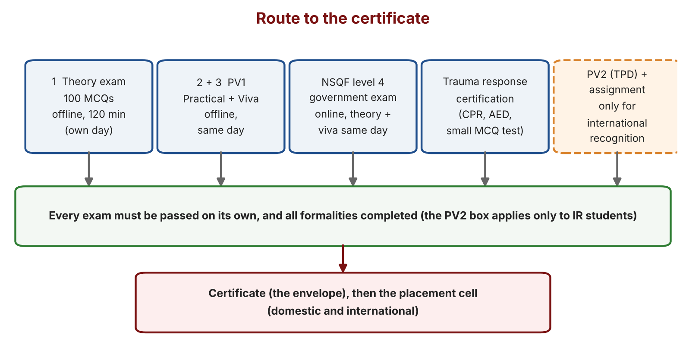
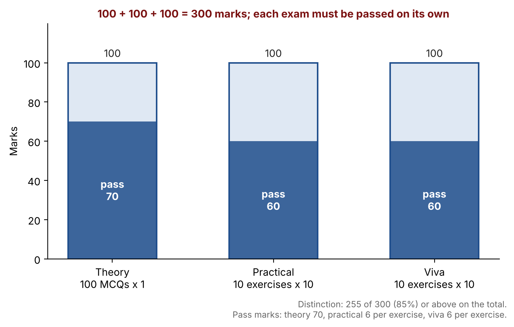
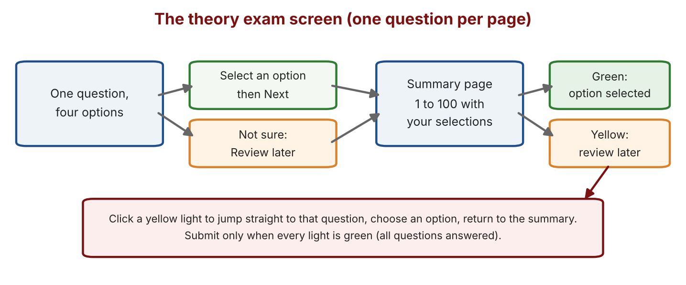
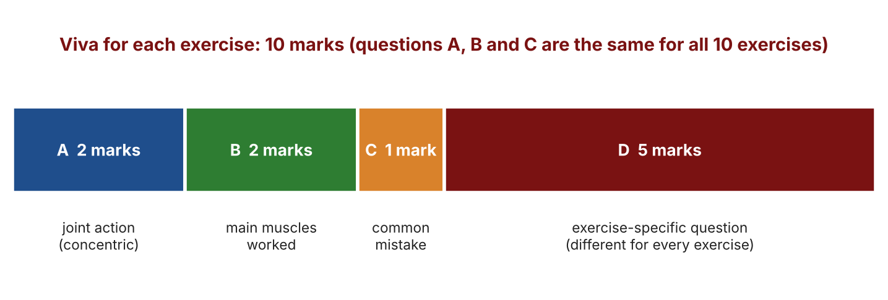
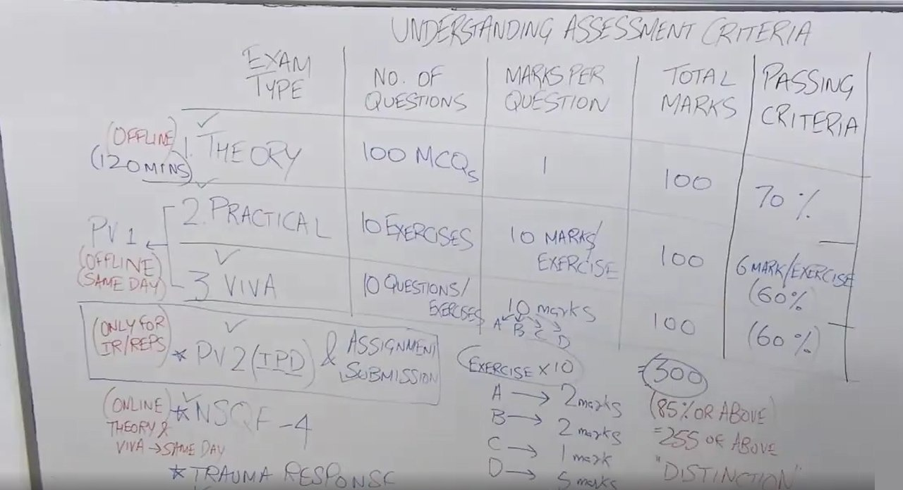
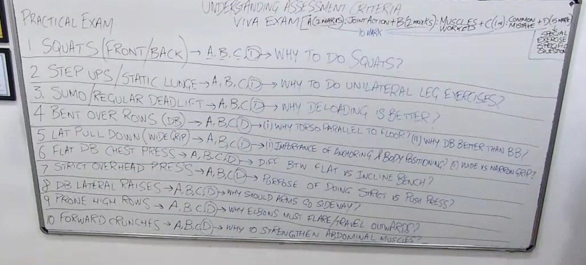

# Understanding Assessment Criteria: Study Notes

**Course:** Personal Training Certification

**Topic:** Exam types, marks and passing rules, the theory exam screen, the 10 practical exercises and the viva questions A, B, C and D

**About these notes:** Short revision version of the Understanding Assessment Criteria lecture. For the full explanation, see the Detailed Notes.

**Big idea:** Every exam is passed on its own, and the viva is predictable: questions A, B and C are the same for all 10 exercises and the D questions are announced, so prepare all of them in advance.

---

## 1. The exams

| Requirement | Who | Mode |
|---|---|---|
| Theory exam | Everyone | Offline, 120 minutes, own day |
| PV1 (practical + viva) | Everyone | Offline, same day |
| NSQF level 4 | Everyone (compulsory) | Online, theory + viva same day, no practical, run by the government |
| Trauma response certification | Everyone | Session (CPR and AED) + small MCQ test |
| PV2 (TPD) + assignment | Only international recognition (IR) students | Dummy client; assessor checks the assignment email receipt |

## 2. Marks and passing

| Exam | Questions | Marks each | Total | Pass |
|---|---|---|---|---|
| Theory | 100 MCQs | 1 (no negative marking) | 100 | 70 |
| Practical | 10 exercises | 10 | 100 | 6 in every exercise |
| Viva | 10 exercises | 10 (A+B+C+D) | 100 | 6 in every exercise |
| **Total** | | | **300** | **Distinction: 255 or above (85%)** |

- Pass **each exam individually**. The aggregate does not replace this.
- A distinction gives "Pass with Distinction" on the certificate and a scholarship on another course (around 6,000, to confirm).

## 3. Theory exam in practice

- 100 questions, 4 options, one correct, 120 minutes (the unit tests were 30 questions in 30 minutes).
- No marks for finishing early. Use the spare time to check.
- One question per page, **Review later** button, then a **summary page**.
- **Green** = an option is selected (not "correct"). **Yellow** = review later or unanswered. Click a yellow light to jump to it. Submit only when all are green.
- Rehearse by joining unit tests 1, 2 and 3 of a running batch.

## 4. The 10 practical exercises

| No. | Exercise | Choice |
|---|---|---|
| 1 | Squat | Front or back |
| 2 | Step-up or static lunge | Either |
| 3 | Sumo or regular deadlift | Either |
| 4 | Bent-over row (DB) | None |
| 5 | Lat pull-down (wide grip) | None |
| 6 | Flat dumbbell chest press | None |
| 7 | Strict overhead press | None |
| 8 | Dumbbell lateral raise | None |
| 9 | Prone high row | None |
| 10 | Forward crunch (flat on the mat) | None |

Two promises: do not train only these 10 exercises before the practical phase, and pay attention to every exercise taught, not only these.

## 5. The viva: A, B, C, D

| Question | Marks | Asks for |
|---|---|---|
| A | 2 | Joint action (concentric) |
| B | 2 | Main muscles worked |
| C | 1 | A common mistake specific to the exercise |
| D | 5 | Exercise-specific question (different for each exercise) |

## 6. A and B for every exercise

| No. | A: joint action | B: muscles |
|---|---|---|
| 1 Squat | Hip extension, knee extension | Gluteus maximus and adductor magnus; quadriceps |
| 2 Step-up or static lunge | Hip and knee extension, lateral hip stabilisation | Same, plus gluteus medius and minimus (stabilisers) |
| 3 Deadlift | Hip extension, knee extension (sumo adds adduction) | Gluteus maximus and adductor magnus; quadriceps; no hamstrings; sumo adds adductors |
| 4 Bent-over row | Shoulder extension, elbow flexion, scapular retraction | Latissimus dorsi, rhomboid major and minor, middle trapezius, elbow flexors |
| 5 Lat pull-down | Shoulder adduction, elbow flexion | Diagonal fibres of latissimus dorsi, elbow flexors, lower trapezius (isometric) |
| 6 Flat DB chest press | Shoulder horizontal adduction, elbow extension | Pectoralis major (sternocostal head, then abdominal head), triceps |
| 7 Strict overhead press | Shoulder vertical abduction, elbow extension | Anterior deltoid, triceps |
| 8 DB lateral raise | Shoulder abduction | Middle deltoid |
| 9 Prone high row | Shoulder horizontal abduction, elbow flexion | Posterior deltoid, elbow flexors |
| 10 Forward crunch | Spine flexion | Rectus abdominis only |

**Answering tips:** use full muscle names (not "lats" or "traps"); say "elbow flexors" as the safe term; name the prime movers, not only the stabilisers; answer as a story (action with its muscle); make common mistakes specific to the exercise and collect them in the practical sessions.

## 7. The D questions

| No. | D question | Key points |
|---|---|---|
| 1 | Why squat? | Functional carryover (three mini points); structural development (soft tissues and bone density) |
| 2 | Why unilateral leg work? | Symmetrical development (neural phase, then hypertrophy of the weaker side); lateral hip stabilisation challenge |
| 3 | Why deloading is better? | Five to six points from the stretching lecture (stretch reflex applications): no stretch reflex help, no bounce, breathing and grip, less stress on the spine, functional relevance |
| 4 | (i) Torso parallel to the floor? (ii) Dumbbell over barbell? | (i) Longer moment arm and torque, greater range of motion. (ii) Isolateral advantage (symmetry), natural hanging grip |
| 5 | (i) Anchoring and body position? (ii) Wide versus narrow grip? | (i) Leg drive, stability, upright torso avoids momentum and keeps the frontal plane. (ii) Wide: adduction, diagonal fibres, width. Narrow: extension, horizontal fibres, thickness |
| 6 | Flat versus incline | Look at where the humerus travels: flat gives the sternocostal head then the abdominal head, incline gives the clavicular head |
| 7 | Strict versus push press | Strict: no outside help, anterior deltoid alone. Push: help from the lower body, heavier load. Core works in both |
| 8 | Why arms sideways? | Stays in the frontal plane: abduction, middle deltoid. Forward arms: plane, function and muscle change (towards anterior deltoid) |
| 9 | Why elbows outwards? | Keeps the horizontal plane: horizontal abduction, posterior deltoid. Otherwise it becomes a bent-over row for latissimus dorsi |
| 10 | Why strengthen abs? | Spine stability, spine movement (flexion), bracing (transversus abdominis), breathing |

## Key terms

| Term | Meaning |
|---|---|
| PV1 | Practical and viva, offline, same day |
| PV2 or TPD | Training program delivery exam for IR students only |
| IR | International recognition |
| NSQF level 4 | Government-run online theory and viva exam, compulsory |
| Pass per exercise | At least 6 of 10 in every practical and viva exercise |
| Distinction | 85% or above of 300, which is 255 or more |
| Review later | Exam screen button that marks a question yellow for a later check |
| Isolateral | Each side works independently (dumbbell advantage) |
| Concentric | The lifting phase, used for viva question A |

## Where the sources differ

1. The scholarship amount for a distinction was said as "around 6,000" with no currency. Confirm it.
2. The board says "deloading" for exercise 3, but the points quoted in class sound like "reloading". Confirm the meaning.
3. The leaning lat pull-down was called "horizontal abduction" in the lecture. Leaning back is more usually shoulder extension.
4. One sentence named the anterior deltoid for the sideways lateral raise. The middle deltoid is taken as the target.

## Quick revision questions

1. How many marks and questions are in the theory exam, and what is the pass mark?
2. Is there negative marking in the theory exam?
3. How long is the theory exam, and how many minutes per question does it give compared with a 30-question unit test?
4. Which two exams make up PV1, and when are they taken?
5. What is the pass rule for the practical exam?
6. Why is the pass rule given per exercise and not as a total?
7. How many marks in total, and what score gives a distinction?
8. Who must take PV2, and what else must they submit?
9. Who runs NSQF level 4, and what does it contain?
10. What does a green light on the summary page mean?
11. What do A, B, C and D ask for, and how many marks does each carry?
12. Which viva questions are the same for all exercises?
13. State A and B for the squat.
14. Why should a deadlift answer not mention the hamstrings, and what extra does the sumo add?
15. State A and B for the lat pull-down.
16. Which head of pectoralis major is dominant on a flat bench and which on an incline?
17. Why should the arms go sideways in a lateral raise?
18. Why must the elbows go outwards in the prone high row?
19. Give the two parts of the D question for the lat pull-down.
20. Give four reasons for strengthening the abdominal muscles.

## Answers

1. 100 MCQs of one mark each; pass at 70.
2. No.
3. 120 minutes. That is 1.2 minutes per question, compared with 1 minute per question in a 30-question, 30-minute unit test.
4. Practical and viva, offline, on the same day.
5. At least 6 marks out of 10 (60%) in every exercise.
6. So a student cannot score full marks in a few exercises and ignore the rest.
7. 300 marks; 255 or more (85% of 300).
8. Students who applied for international recognition. They must submit the assignment (the assessor asks for the email receipt).
9. The government. It is online theory and viva on the same day, with no practical, and is compulsory.
10. An option has been selected for that question. It does not show whether it is correct.
11. A: joint action, 2 marks. B: main muscles, 2 marks. C: common mistake, 1 mark. D: exercise-specific question, 5 marks.
12. A, B and C. The answers differ, the questions are the same.
13. A: hip extension and knee extension. B: gluteus maximus and adductor magnus for the hip, quadriceps for the knee.
14. The hamstrings do not work well in compound lifts (reciprocal inhibition). The sumo adds adduction, so the adductors work too.
15. A: shoulder adduction and elbow flexion. B: diagonal fibres of latissimus dorsi, and the elbow flexors (lower trapezius works isometrically).
16. Sternocostal head on the flat bench (then the abdominal head). Clavicular head on the incline.
17. To stay in the frontal plane doing abduction with the middle deltoid. Forward arms change the plane, the action and the target muscle.
18. To stay in the horizontal plane doing horizontal abduction with the posterior deltoid. Otherwise it becomes a bent-over row for latissimus dorsi.
19. (i) The importance of anchoring and body positioning. (ii) Wide versus narrow grip.
20. Spine stability, spine movement, bracing and breathing.

---

# Board Photos from the Lecture

