# Back Lecture: Detailed Notes

**Course:** Personal Training Certification

**Topic:** The back as a body part: why train it, the seven back muscles (trapezius, levator scapulae, rhomboids, erector spinae group, multifidus), muscle function, spine anatomy and curves, the latissimus dorsi and teres major (anatomy, functions, exercise categories), the pullover, and guidelines on grips, barbell, belt and hip hinge

**About these notes:** Detailed notes for the Back Lecture (the theory), written so the whole lecture can be studied without watching the recordings. Every concept, analogy and class question is covered. The theory parts that were taught in the first half of the demo session (latissimus dorsi and teres major, the pullover, grips and equipment) are included here, in Parts 14 to 20. The figures are original drawings made for these notes. For a short revision version, see the Study Notes. Every back exercise, with set-up, execution and figures, is in the Back Demo notes. Sources: the lecture and demo recordings, the course slides ("Body part 1: Back") and the board photos.

---

## Abbreviations used in these notes

| Short form | Meaning |
|---|---|
| M, O, I, F, E | Muscle, origin, insertion, function, exercise example (the order used for every muscle) |
| C1 to C7 | Cervical vertebrae (neck) |
| T1 to T12 | Thoracic vertebrae (mid-back) |
| L1 to L5 | Lumbar vertebrae (lower back) |
| PSIS | Posterior superior iliac spine |
| ROM | Range of motion |
| Prime mover | The muscle mainly responsible for a movement |
| Synergist | A helper muscle that does the same job with the prime mover |
| Stabiliser | A muscle that works to keep a body part steady |
| Lats | Latissimus dorsi (always use the full name in class) |
| CNS | Central nervous system |
| NHG | Natural hang grip |
| Valsalva | Breathing in and holding the breath to brace the trunk |

## Before this lecture

You should know the skeleton and the main joints, the directional terms (superficial, deep, anterior, posterior, medial, lateral, superior, inferior), the three muscle contractions, compound and isolation exercises, and the planes of movement. The stretching lectures link to this one, because stretching the front muscles and training the back muscles both help posture.

## Outline of the lecture

| Part | Topic |
|---|---|
| 1 | How every body part lecture is organised |
| 2 | Why train the back |
| 3 | The seven back muscles, pronunciation and name decoding |
| 4 | The trapezius: three fibre sets |
| 5 | The analysis flow and what muscle function means |
| 6 | Landmarks used to describe origin and insertion |
| 7 | Trapezius: anatomy, functions and exercises |
| 8 | Levator scapulae |
| 9 | Rhomboids and the idea of synergists |
| 10 | Erector spinae group |
| 11 | Multifidus |
| 12 | Common functions of the erector spinae group and multifidus; spinal curves |
| 13 | Segmentation of the erector spinae group |
| 14 | Recap of the back muscles (class quiz) |
| 15 | Names: latissimus dorsi and teres major |
| 16 | Anatomy of the latissimus dorsi and teres major |
| 17 | Functions of the latissimus dorsi and teres major (multiplanar) |
| 18 | Exercise categories: shoulder extension and adduction, thickness and width |
| 19 | The dumbbell pullover versus the straight arm pulldown and machine pullover |
| 20 | Grips, barbell, lifting belt and hip hinge |

---

## Part 1: How every body part lecture is organised

Every body part has two sessions: the body part lecture, and the demo lecture on the next day. The lecture follows the same flow each time:

1. Why train this body part.
2. The muscle names in that body part.
3. For each muscle, its **function** (at first, the job of the muscle in the body).
4. From the function, the suitable **exercise** for that muscle.

The demo day shows videos of every exercise from the lecture, so that nobody meets an unfamiliar exercise. Form, stance and corrections are taught face to face in the practical sessions with the master trainers, not online. Where a technical comparison can be made online (for example the resistance profile from machine to machine), the demo covers it.

---

## Part 2: Why train the back

1. **Functional carryover.** Back training improves day to day life. It builds the strength to pull something and to lift something from the floor.
2. **Posture.** Some of the back muscles (the erector spinae group) help to maintain and improve posture. People with desk jobs and people who cycle for long periods tend to sit slouched. As with the stretching lectures, where stretching the front muscles helps posture, training these back muscles keeps the back upright.
3. **Protection of the spinal cord.** The brain sits under the skull, and the spinal cord passes through the hollow vertebrae. The cranial bones are strong, but the vertebrae are not as strong, so the back muscles work as a shield for the spinal cord.

The skeleton recap in class: one bone of the spine is a **vertebra**, together they are the **vertebral column** (the spine). The skeleton model has no brain, because it models only the skeletal system.

Q: What is the slouched position of sitting?

A: The posture of a desk worker or a long-distance cyclist, with the back rounded.

**Landmarks policy.** Doctors know many anatomical landmarks very well. Fitness professionals need awareness only. The lecture marks what is important to remember and what is only good to know.

---

## Part 3: The seven back muscles

### 3.1 The menu

1. Trapezius (three fibre sets: upper, middle, lower)
2. Levator scapulae
3. Rhomboids (major and minor)
4. Erector spinae group (spinalis, longissimus, iliocostalis)
5. Multifidus
6. Latissimus dorsi
7. Teres major

Muscles 1 to 5 were taught in this lecture. Muscles 6 and 7 were taught at the start of the demo day.

### 3.2 Use the proper names

Use the full names (trapezius, latissimus dorsi), not "traps" and "lats". Knowing the correct names sets a trainer apart. A trainer who says "train the muscle just below your neck on the right" sounds like a mechanic who says "this black part under the big part", and the client doubts the trainer.

### 3.3 Pronunciation

- **Levator scapulae:** "lei-vator", not "la-vator". The plural of scapula is scapulae.
- **Erector spinae:** "spine-ee", not "spine".
- **Teres:** teres minor exists, but it belongs to the shoulder body part, so only teres major is taken with the back.

### 3.4 What a muscle name can tell you

A muscle name is inspired by one of four traits: **shape, size, location or function**.

| Muscle | Name inspired by | Explanation |
|---|---|---|
| Trapezius | Shape | A kite or diamond shape (called a trapezoid in class) formed by the left and right muscles together |
| Levator scapulae | Function | Like an elevator, it elevates the scapula |
| Rhomboid | Shape | A rhombus, a shape with two pairs of parallel sides |
| Erector spinae | Function | "Erect" means upright, and the group keeps the spine upright |
| Multifidus | Structure | "Multi" means many, "fidus" means parts |

---

## Part 4: The trapezius has three fibre sets

The trapezius covers a large part of the back. Anatomists divide it into three sets of fibres by direction. The colours below are used in every figure.

| Fibres | Direction | Colour |
|---|---|---|
| Upper | Run mostly diagonally downward and outward | Green |
| Middle | Run horizontally outward | Blue |
| Lower | Run upward | Red |

All three exist on both sides of the body.

**Key principle:** the direction of the fibres decides the function, and the function decides the exercise. One exercise cannot target the whole trapezius, so each fibre set needs its own exercise.

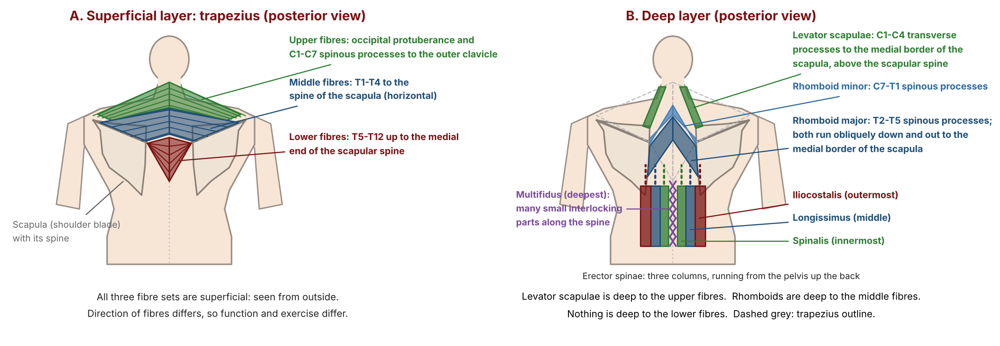

All three fibre sets are **superficial**, that is, close to the surface and visible from outside. The levator scapulae and the rhomboids are **deep**, under the trapezius: the levator under the upper fibres, the rhomboids under the middle fibres. There is no deep muscle under the lower fibres.

---

## Part 5: The analysis flow and the meaning of muscle function

### 5.1 The flow

For every muscle: **M** (muscle), **O** (origin), **I** (insertion), **F** (function), **E** (exercise example).

What must be known: M, F and E. The origin and insertion are **not** mandatory. No test, exam, viva or interview will ask for them. They are taught as a bridge, so that a student can see the function from the origin and insertion instead of memorising it. A support document explains the technical words (occipital protuberance, tubercle, trochanter and so on) in simple terms.

### 5.2 The golden rule of muscle function

**Muscle function is the joint action that takes place when the muscle contracts.**

Always say the joint name with the action: "elbow flexion", not just "flexion". This habit saves marks in the viva.

Worked example: the biceps brachii runs from near the shoulder to the forearm. When it contracts, the forearm comes towards the upper arm, which is **elbow flexion**.

About 90 percent of the time the function is the joint action when the muscle shortens. In some exceptions the muscle works **isometrically** (its length does not change), and these are announced when they arise. This is not the same as isolation.

### 5.3 Choosing the exercise

The best exercise for a muscle is the one in which its function takes place in the **concentric phase**, with that muscle as the prime mover. Example: in a shrug, the bar rising is the concentric phase, and the joint action is shoulder girdle elevation, so shrugs suit the upper trapezius. The upright row is a different movement, and its main job is at the shoulder.

There are exceptions, for example the good morning and the back extension (see Part 12).

---

## Part 6: Landmarks used for origin and insertion

A landmark is a famous point that everyone knows, like meeting at a famous gate of a mall. Landmarks are stepping stones to describe the origin and insertion.

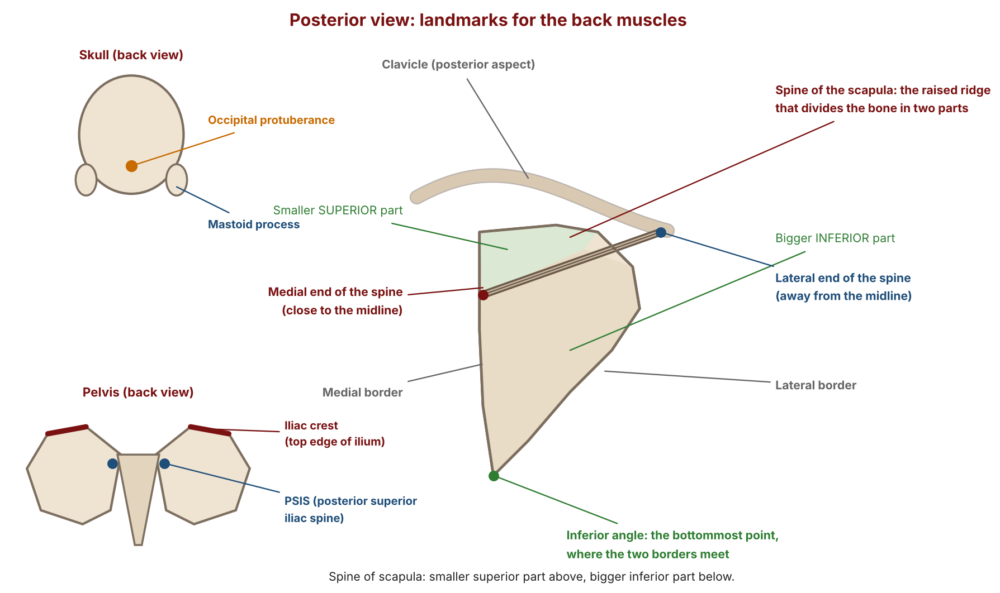

| Landmark | Meaning |
|---|---|
| Process | A projection of bone that does not connect to another bone |
| Spinous process | One pointy projection at the back of each vertebra (the "nose"). The word "spine" here means a pointy surface. |
| Transverse processes | Two projections at the sides of each vertebra (the "ears"). "Transverse" is the other name for horizontal. |
| Spine of the scapula | A raised ridge on the back of the scapula that divides it into a smaller superior part and a bigger inferior part. The word "spine" here means a divider. |
| Inferior angle of the scapula | The bottommost point, where the medial and lateral borders meet |
| Medial border and lateral border | The scapula edges closer to and farther from the midline |
| Medial end and lateral end of the spine of the scapula | The ends of the ridge, closer to and farther from the midline |
| Clavicle, posterior aspect | The back side of the collarbone |
| Occipital protuberance | A bump on the back of the skull. "Protuberance" means something popping out of a surface. |
| Mastoid process | The pointy bump behind the ear |
| Iliac crest | The top edge of the ilium. The ilium is like a mountain, and its peak is the crest. |
| PSIS | The upper of the two pointy surfaces at the back of the ilium (the lower is the posterior inferior iliac spine) |

The spine is also divided into regions: 7 cervical, 12 thoracic and 5 lumbar vertebrae, then the sacrum and the coccyx. The ribs are also called costae.

---

## Part 7: Trapezius in detail

### 7.1 Anatomy

| Fibres | Origin | Insertion | Direction |
|---|---|---|---|
| Upper (green) | Occipital protuberance and the spinous processes of the cervical vertebrae down to C7 | Posterior aspect of the clavicle (the outer part) | Diagonally downward and outward |
| Middle (blue) | Spinous processes T1 to T4 | Spine of the scapula (acromion and spine of the scapula on the slide) | Horizontally outward |
| Lower (red) | Spinous processes T5 to T12 | Medial end of the spine of the scapula | Upward |

### 7.2 Functions

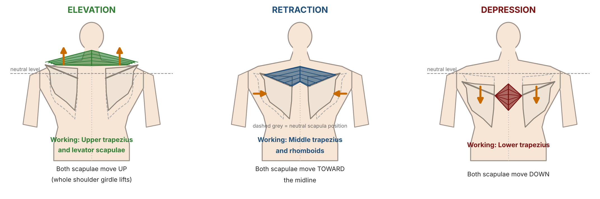

| Fibres | Function | Note |
|---|---|---|
| Upper | **Shoulder girdle elevation** | The whole girdle lifts. Added (secondary) functions: neck extension, and neck lateral flexion because the fibres reach the posterior clavicle. These have no main exercise. |
| Middle | **Scapular retraction** | The scapulae move closer to the midline. |
| Lower | **Scapular depression** | The scapula moves down. |

### 7.3 Exercises for the trapezius

| Fibres | Exercise | Detail |
|---|---|---|
| Upper | Shrugs (barbell or dumbbell) | The bar rising is the concentric phase and the joint action is shoulder girdle elevation |
| Middle | Compound: all rowing exercises. Isolation: **prone shrug** | A row has three joint actions (elbow flexion, shoulder extension, scapular retraction) so it is compound. The prone shrug has only scapular retraction, so it is isolation. |
| Lower | **Reverse shrug** | The only exercise, and it is an isolation exercise |

**Compound versus isolation.** Compound means several joints and joint actions. Isolation means one joint and one joint action.

Q: Which exercise gives only scapular retraction at one joint?

A: The prone shrug. Class answers rejected: the reverse fly (the main movement is shoulder horizontal abduction) and the pullover (shoulder extension).

**Prone shrug set-up.** Lie face down on an incline bench with the collarbone near the top edge. The arms hang at the sides with dumbbells. Pull the shoulder blades together without bending the elbows.

**Reverse shrug set-up.** Sit at a lat pulldown machine. Hold the bar with straight arms raised overhead and do not bend the elbows. Pull the shoulder blades down so the bar comes down slightly and the weight stack rises. It can be copied on a pull-up bar: hang and depress the scapulae only. The movement is a shrug in the opposite direction.

---

## Part 8: Levator scapulae

- **Name:** from "elevator", its function.
- **Position:** deep, under the upper fibres of the trapezius.
- **Origin:** transverse processes of C1 to C4 (the spinous processes are used by the trapezius).
- **Insertion:** the medial border of the scapula above the spine of the scapula.
- **Function:** shoulder girdle elevation. It runs fairly vertically at the side of the neck, so it does not do neck extension or neck lateral flexion.
- **Exercise:** the same as the upper trapezius (shrugs).

---

## Part 9: Rhomboids and the synergist idea

- **Position:** deep, under the middle fibres of the trapezius.
- **Origin:** minor from the spinous processes of C7 and T1, major from T2 to T5.
- **Insertion:** both on the medial border of the scapula. The minor is in line with the spine of the scapula and the major is below it.
- **Memory story:** the major and the minor are two brothers who split a family property of six fibres (C7 to T5): the younger brother (minor) took the first two, the elder (major) the rest. This is only a memory aid.
- **Function:** scapular retraction, with a little elevation because the fibres are slightly diagonal.
- **Exercise:** the same as the middle trapezius (rows and prone shrugs).
- **Together:** the two make a rhombus. Both work as one team, and the minor and major do not differ in benefit.

**Synergists.** The levator assists the **upper** fibres only, and the rhomboids assist the **middle** fibres only. It is wrong to say they help the whole trapezius, because the lower fibres have no deep partner. Two muscles with the same function are both trained by the same exercise. The bigger superficial muscle is the prime mover and the deeper one works as a synergist.

---

## Part 10: Erector spinae group

The group is three muscles that keep the spine erect. Together with the multifidus they are also called the **paraspinal muscles**, because they lie beside the spine and run almost parallel to it. They start low on the spine and end high.

| Muscle | Name hint | Origin | Insertion | Function |
|---|---|---|---|---|
| Spinalis (innermost, green) | Closest to the spine | Slide: spinous processes L2 to T11 (the lecture gave T11, T12 and the tip of L1) | Occipital bone | Spine extension, maintaining neutral spine, spine lateral flexion |
| Longissimus (middle, blue) | The longest | Blends with the iliocostalis in the lumbar region | Mastoid process of the skull | The same three |
| Iliocostalis (outermost, red) | Ilium plus ribs (costae) | Iliac crest, sacrum and the lumbar vertebrae (slide: up to T11) | Transverse processes of C4 to C6 | The same three |

The iliocostalis crosses the ribs on its way up, hence its name.

---

## Part 11: Multifidus

- A single muscle made of many small parts, like the links of a chain. Each part has its own origin and insertion.
- **Pattern:** each part starts at the "ear" (transverse process) of one vertebra, skips the next vertebra and ends at the "nose" (spinous process) of the vertebra after it. The lowest parts begin at the PSIS and the sacrum. The pattern repeats up to C2.
- **Role:** these interlocking parts hold the vertebrae together so the spine moves as a unit and the vertebrae do not move on one another. Analogies: a grandmother's crisscross knitting, or stitches on a cut.
- **Function:** the same as the erector spinae group: spine extension, maintaining neutral spine, spine lateral flexion.

The erector spinae group and the multifidus are taught together because the multifidus does exactly the same job, although it is not deep to the group.

---

## Part 12: Common functions of the erector spinae group and multifidus

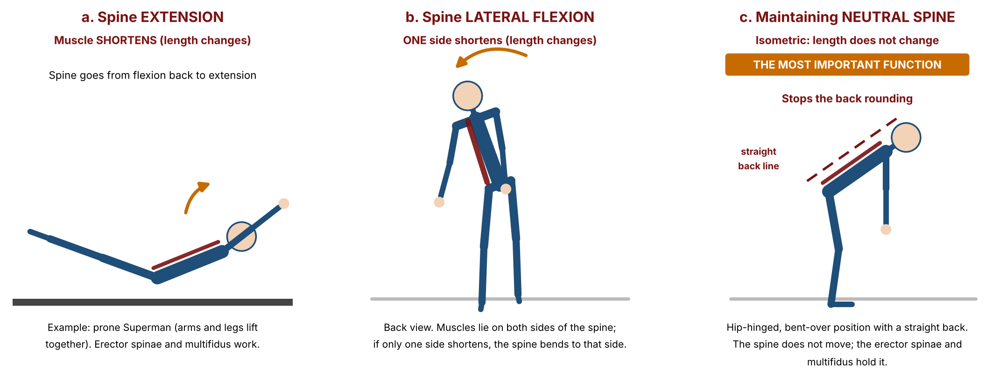

### 12.1 Function 1: spine extension (length changes)

From a flexed spine, the muscles contract and bring the spine back to extension. **Exercise: the superman.** Lie face down on a mat and lift the arms and legs together. The erector spinae and multifidus shorten and the spine extends. Class answers rejected: the deadlift (the joint action is at the hip and the spine stays neutral) and cat or camel pose (it is a yoga mobility drill, not an exercise). The prone alternate arm and leg raise is a variation.

### 12.2 Function 2: spine lateral flexion (length changes)

When only one side shortens, the spine bends to that side. No exercise example is given here. The abdominal lecture will list the obliques, whose main function is lateral flexion, and the erector spinae and multifidus will work as synergists from behind. Exercise examples are written only for the main functions.

### 12.3 Function 3: maintaining neutral spine (isometric, the most important)

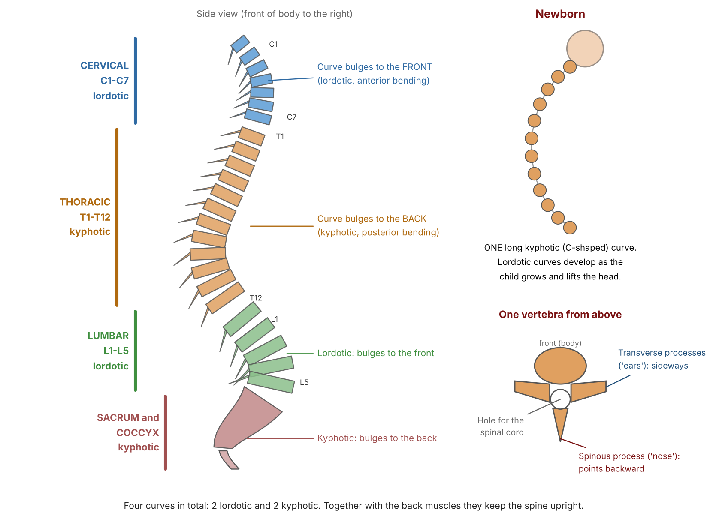

**Spinal curves.** Seen from behind, the spine looks straight, but from the side it has four curves: **lordotic** (the cervical and lumbar curves) and **kyphotic** (the thoracic and sacral curves). A baby starts with one long kyphotic curve, and the lordotic curves develop as the child grows. The curves counterbalance the weight of the skull and rib cage and help to stand upright.

During a bend forward and back up, the erector spinae and multifidus do not shorten or lengthen. They work **isometrically** to keep the spine's length and curves, so the back does not round. Without them the spine would be more likely to round.

This function matters for daily life (lifting from the floor) and for exercises:

- **Bent over row:** the erector spinae hold the neutral spine.
- **Deadlift** (the "king of lifts", a functional lift): the leg muscles are the prime movers, and the erector spinae group is the **stabiliser** that stops the back rounding.

**Exercises that train this function** (the erector spinae and multifidus are the target, even though the hip extensors are the prime movers):

1. **Good morning.** A barbell on the back, hinge forward without bending the knees, and come up. Going down is hip flexion, and coming up is hip extension. It is the most challenging for the erector spinae, so it prepares them for the deadlift.
2. **Back extension** on a back extension bench. The thighs and lower legs are anchored and the person goes all the way down and up. The exercise is called a **back extension**, not a "hyperextension", because hyperextension is the non-recommended way. The reasons are covered in the demo notes.

These two exercises are exceptions to the rule that the target must be the prime mover in the concentric phase.

Q: The lumbar region has only one muscle of the group. Is that why the lumbar region gets pain?

A: No. It is the muscle of the three that contributes most there, but other muscles (for example in the abdomen) support the area. Fewer muscles does not simply mean more pain, and there can be many reasons.

---

## Part 13: Segmentation of the erector spinae group

This is a "good to know" topic. Nobody will ask for the segment names. The names to know are the muscle names, functions and exercises.

Each muscle is divided into segments by the region it passes through, because the muscles are long. The lecture used an analogy of a long border with army, navy and air force: for trouble in one region you call the forces already stationed there.

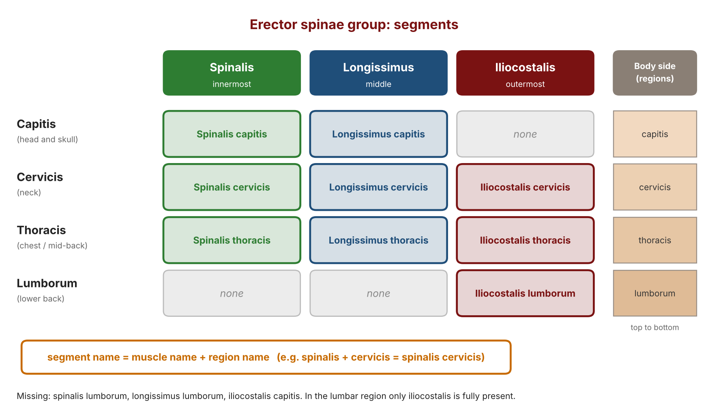

**Naming rule:** segment name = muscle name + region name. Regions from the top: **capitis** (head), **cervicis** (neck), **thoracis** (chest and mid-back), **lumborum** (lower back).

- **Capitis:** spinalis capitis and longissimus capitis (the iliocostalis has no capitis segment).
- **Cervicis:** all three.
- **Thoracis:** all three.
- **Lumborum:** only iliocostalis lumborum, because the longissimus borrows its start from the iliocostalis there and the spinalis only touches the top of L1. The lumbar region carries the weight of the upper body, so a muscle must be fully present to contribute.

---
## Part 14: Recap of the back muscles (class quiz)

Q: Which fibres of the trapezius are the levator scapulae deep to?

A: The upper fibres. The levator helps the upper fibres with shoulder girdle elevation.

Q: Which muscle is deep to the lower trapezius?

A: None. The rhomboids are deep to the **middle** fibres.

Q: What is the main job of the middle fibres with the rhomboids?

A: Scapular retraction.

Q: What is the function of the lower trapezius?

A: Scapular depression.

Q: Name the three muscles of the erector spinae group, and one more muscle that does the same job.

A: Spinalis, longissimus and iliocostalis. The multifidus does the same job.

Q: What are the functions of these muscles?

A: Spine extension and spine lateral flexion (the length changes), and maintaining the neutral spine (isometric).

A short daily revision of about 20 minutes is recommended.

---

## Part 15: Names

- **Latissimus dorsi:** "latissimus" comes from Greek for "wide" and "dorsi" means "back" (as in the dorsal surface of the hand). It is the widest muscle of the back, and in general the widest muscle of the body.
- **Teres major:** "teres" means cylindrical (round), and "major" means bigger than the teres minor. The teres minor belongs to the shoulder body part, because its job resembles the shoulder muscles. The teres major is taken with the back because it shares the origin, insertion and functions of the latissimus dorsi.

---

## Part 16: Anatomy

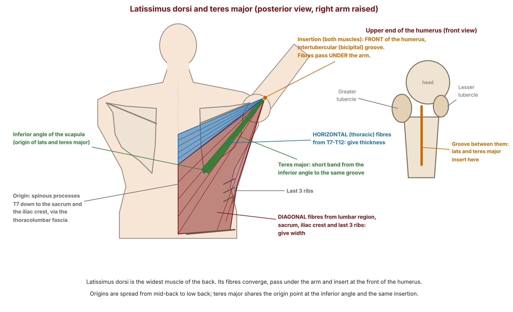

### 16.1 Landmarks recalled

- The **inferior angle** is where the scapula's two borders meet.
- The upper end of the humerus has a narrow lane called the groove. A **tubercle** is a bump (like a speed breaker). The bigger bump is the **greater tubercle** and the smaller is the **lesser tubercle**. The lane between them is the **intertubercular groove** ("inter" means between, as in international). Its other name is the **bicipital groove**.

### 16.2 Latissimus dorsi

| Item | Detail |
|---|---|
| Origin | Spinous processes from T7 down to the lumbar vertebrae, the sacrum and the coccyx, through the **thoracolumbar fascia** (the white fascia at the thoracic and lumbar region); the iliac crest; the last three ribs; the inferior angle of the scapula |
| Insertion | The **front** of the humerus, in the intertubercular (bicipital) groove |
| Path | The fibres converge and go **under** the arm, not over it, to reach the front of the humerus |

**Horizontal and diagonal fibres.** There is no official classification like the upper, middle and lower trapezius, but this one helps to choose exercises:

- **Horizontal (thoracic) fibres:** from T7 to T12, running roughly horizontally.
- **Diagonal fibres:** from the lumbar region, sacrum, iliac crest and last three ribs.

### 16.3 Teres major

It arises at the inferior angle of the scapula, inserts in the same groove and has the same functions as the latissimus dorsi. It is smaller, so it produces less force.

---

## Part 17: Functions

The functions were shown with elastic bands on a skeleton. When the arm moves so that the fibres are lengthened, the function is the return movement.

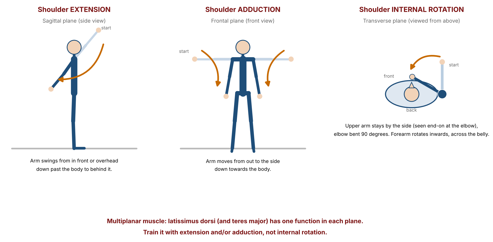

| Plane | Function | Fibres lengthened by |
|---|---|---|
| Sagittal | **Shoulder extension** | Arm raised in flexion |
| Frontal (coronal) | **Shoulder adduction** | Arm abducted |
| Transverse (horizontal) | **Shoulder internal rotation** | External rotation, because the insertion is at the front of the humerus |

The latissimus dorsi is therefore a **multiplanar** muscle.

**Training rule.** Internal rotation is the main job of a muscle in another body part. The latissimus dorsi does it on paper, but do **not** train the latissimus dorsi through internal rotation. Use shoulder extension, shoulder adduction, or both. With limited exercise slots, do extension in one session and adduction in the next.

Q: Is the main function of the latissimus dorsi extension and adduction, and the teres major only an assistant?

A: The teres major does the same job and produces less force because of its size. It is not simply a synergist. It depends on the exercise.

---

## Part 18: Exercise categories

### 18.1 Compound and isolation

Compound means several joints and joint actions, one of which is shoulder extension (or adduction). Isolation means one joint and only the target action.

### 18.2 Shoulder extension

| Type | Exercises | Detail |
|---|---|---|
| Compound | **Chin-up** (narrow grip) | The body goes up. Shoulder extension and elbow flexion. The latissimus dorsi is the prime mover and the biceps brachii a synergist. |
| Compound | **Lat pulldown, close (narrow) grip** | The body is fixed and the bar comes to you |
| Compound | Most rowing exercises | Bent over row, T-bar row, seated row, chest-supported row, one arm row |
| Isolation | **Straight arm pulldown** | Stand at a high cable with a straight bar, lean slightly forward and keep the elbows straight. Pull the handle to the thighs. Only the shoulder moves. |

Note that "pull-up" and "chin-up" are different. Narrow hands on a supinated grip make a chin-up. The word "most" is used for the rows because of one exception, covered in a later lecture.

**Supported and unsupported rows.** The bent over row is unsupported. The seated row is supported at the pelvic girdle only. The chest-supported row machine is more supported, at the pelvic girdle **and** the spine.

### 18.3 Shoulder adduction

| Type | Exercises | Detail |
|---|---|---|
| Compound | **Pull-up** (wide grip), **lat pulldown, wide grip** | When the grip widens the elbows leave the sagittal plane and enter the frontal plane. The target muscle is the same, but the plane and action change. |
| Isolation | A multi-gym machine with a rotatable lever | With the lever at the side and brought to the body, the action is pure shoulder adduction |

The exercises on the extension list must be noted as narrow (close) grip and those on the adduction list as wide.

### 18.4 Thickness and width

Shoulder extension exercises use more of the horizontal fibres, and adduction exercises use more of the diagonal fibres. Growing the diagonal fibres gives a **wider** back, and growing the horizontal fibres gives a **thicker** back. Doing only one type neglects the other fibres.

**Myth.** Holding the bar as wide as possible does not create a V-taper. The V shape comes from growth of the diagonal fibres. A claimed benefit needs scientific evidence.

---

## Part 19: The pullover

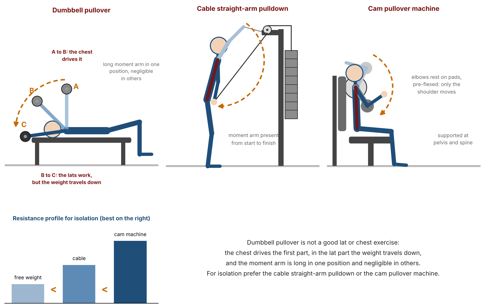

### 19.1 Why the dumbbell pullover is not recommended for the latissimus dorsi

The lifter lies face up with one dumbbell held in both hands. Take three positions: **A** (dumbbell above the chest), **B** (mid range) and **C** (arm overhead).

- From **A to B** the **chest** does the work (the pectoralis shares the same groove).
- From **B to C** the **latissimus dorsi** works, but the weight travels **down** with gravity, so the lats do not get good resistance.
- The lecture compared this to a relay race, where each runner covers a different part.

The exercise is not good for the latissimus dorsi, and not the best for the chest either. Better chest options will come in the chest lecture.

### 19.2 Resistance profile ranking for isolation

Free weight (dumbbell, barbell, plates) is below cable, and cable is below the **cam-based machine** (the best).

- **Straight arm pulldown (cable):** the latissimus dorsi enjoys the resistance over the range.
- **Machine pullover (cam-based):** seated, supported at the pelvic girdle and spine, with elbow pads that keep the elbows pre-flexed. Only the shoulder moves (extension), so it is still isolation. The support and stability let the CNS focus on the prime mover, which helps hypertrophy. Machines can be stack-loaded, plate-loaded or fulcrum-based.

**Conclusion:** both the straight arm pulldown and the machine pullover are much better than the dumbbell pullover.

### 19.3 Class question on the pullover

Q: Why is the dumbbell pullover not suggested for the latissimus dorsi? What is the "eccentric part"?

A: A to B is driven by the chest and B to C by the latissimus dorsi. In B to C the muscle contracts, but the weight travels down. Hypertrophy is best with tension against gravity, and when the dumbbell goes against gravity the chest is more involved. In the straight arm pulldown the latissimus dorsi works over B to C with a good moment arm and resistance profile.

---

## Part 20: Grips, barbell, belt and hip hinge (guidelines for exercise videos)

These guidelines are used later in the Back Demo, when the exercise videos are watched. **Set-up** is everything before the first rep (loading, getting into position). **Execution** starts with the first rep.

### 20.1 Grips

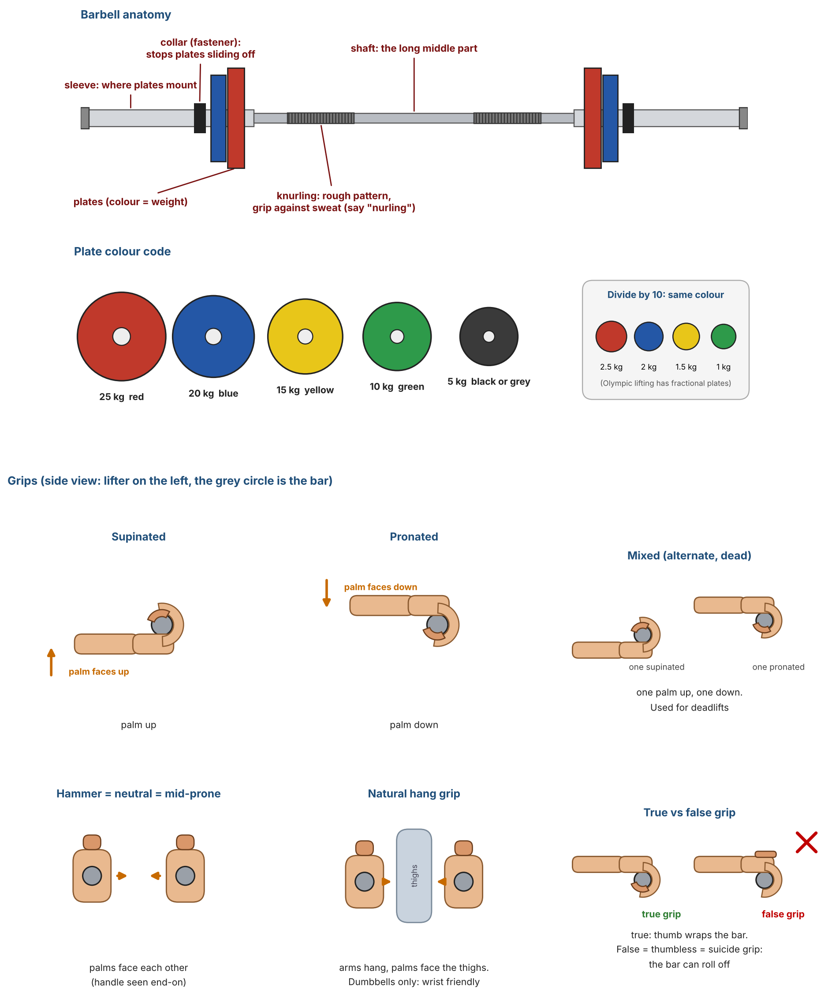

| Grip | Meaning |
|---|---|
| Supinated | Palm up |
| Pronated | Palm down |
| Mixed (alternate hand, dead grip) | One palm up, one down. Used for deadlifts. |
| Hammer, neutral, mid-prone | Palms facing each other |
| Natural hang grip (NHG) | Arms hang at the sides with the palms facing the thighs. Only possible with two separate objects (dumbbells). Most wrist friendly, so a set ends from prime mover failure, not wrist discomfort. |
| True grip | The thumb wraps round the bar |
| False (thumbless, suicide) grip | The thumb is not wrapped. On the bench press the bar can roll and fall. |

"Supine" and "prone" describe the body lying face up or face down. "Supination" and "pronation" are forearm actions at the radioulnar joint.

**Which grip lifts the heaviest for rows?** The supinated grip, because the biceps brachii (the biggest elbow flexor) works best in it. In pronation or mid-prone grip other members of the elbow flexor group work (covered in the arms lecture). A self-test: tense the biceps with the palm facing you, then rotate to pronation and the muscle disengages.

**Coaching point.** Some people have poor radioulnar or wrist mobility and find supination uncomfortable. Do not push them into it. Give them the most suitable grip, which may allow a heavier load.

### 20.2 Barbell and accessories

| Item | Meaning |
|---|---|
| Collar | Stops the plates sliding off the sleeve (the holder is called a fastener) |
| Sleeve | The part where the plates mount |
| Shaft | The long middle part |
| Knurling | The rough pattern for grip against sweat (the k is silent: "nurling") |

**Plate colour code:** 25 kg red, 20 kg blue, 15 kg yellow, 10 kg green, 5 kg black or grey. Divide by 10 and the colour stays the same (2.5 kg red, 2 kg blue, 1.5 kg yellow, 1 kg green). Olympic lifting uses fractional plates.

- **Lifting straps:** wrapped round the bar and hand so a set ends when the prime mover fails, not the grip.
- **Chalk:** magnesium carbonate, which absorbs sweat.
- **Lifting shoes:** explained in the legs lecture.

### 20.3 Lifting belt and Valsalva

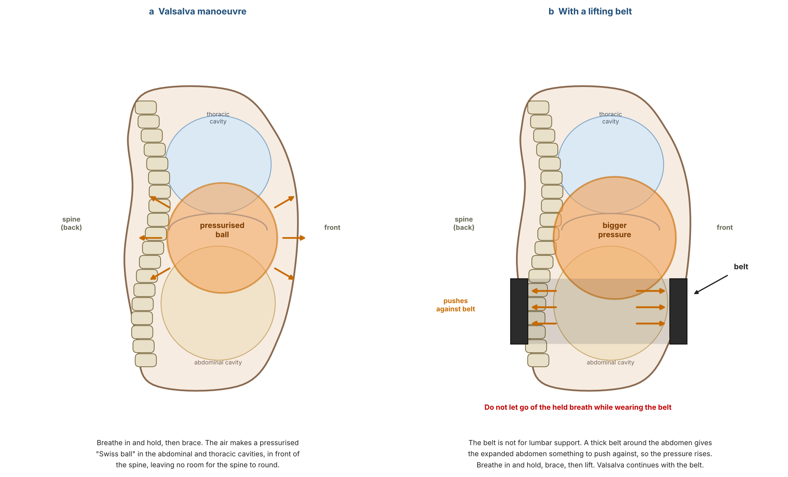

It is a myth that a belt is for lumbar support. Breathing in and holding the breath (Valsalva) makes a pressurised "Swiss ball" in the abdominal and thoracic cavities in front of the spine, so there is no room for the spine to round. When a load is too heavy for Valsalva alone, a thick belt gives the expanded abdomen something to push against and raises the pressure further. The Valsalva must continue while wearing the belt.

### 20.4 Hip hinge

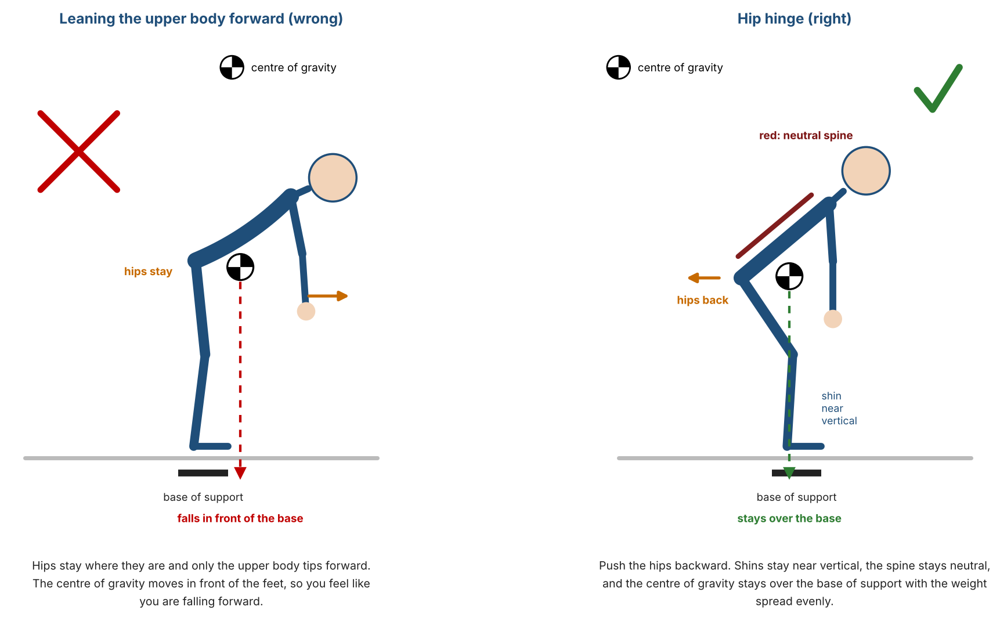

There are two ways to bend over: lean the upper body forward, or hinge at the hips (push the hips back). The hip hinge is preferred, because the centre of gravity stays over the base of support, the weight is spread evenly, and there is no feeling of falling forward.

---

Key takeaways: the trapezius has three fibre sets, each with its own function and exercise (shrug, prone shrug and row, reverse shrug). The levator scapulae and rhomboids are deep helpers of the upper and middle fibres. The erector spinae group and the multifidus have three functions, and the most important is the isometric function of maintaining a neutral spine, trained with good mornings and back extensions. The latissimus dorsi and teres major extend, adduct and internally rotate the shoulder, but train them with extension (thickness) and adduction (width) only. The cable straight arm pulldown and the machine pullover beat the dumbbell pullover. The belt works with Valsalva to raise abdominal pressure, and the hip hinge keeps the centre of gravity over the base.

---

## Points to Confirm

1. **Spinalis origin.** The lecture gave T11, T12 and the tip of L1. The slide gives the spinous processes of L2 to T11. Confirm which to use.
2. **Iliocostalis origin.** The lecture excluded the thoracic region. The slide extends the origin to T11.
3. **Rhomboid major origin.** One answer in class said T3 to T4. The slide and the rest of the lecture say T2 to T5.
4. **Upper trapezius neck lateral flexion.** The lecture added it, but the slide lists only shoulder girdle elevation and neck extension.
5. **Levator scapulae and neck extension.** The slide's combined table lists neck extension for the levator. The lecture says the levator does not do it.
6. **Back extension function.** The slide lists back extensions as spine extension. The lecture teaches them as an exercise for maintaining the neutral spine (isometric).
7. **Atlantoaxial joint.** The lecture explained why the multifidus does not reach C1 by saying that joint is occupied. The atlantoaxial joint is between C1 and C2, and the skull meets C1 at the atlanto-occipital joint. The explanation is therefore not exact.
8. **Multifidus levels.** The lecture used a skip of one vertebra. The slide says the insertion is 2 to 4 levels above the origin.
9. **Lordotic and kyphotic definitions.** The lecture's wording was loose. The usual meaning is a curve that bulges to the front (lordotic) or to the back (kyphotic).
10. **"Para" means parallel.** This was a memory aid. In the word paraspinal, "para" strictly means beside.
11. **Kite or diamond as a trapezoid.** A kite or a diamond is not strictly a trapezoid. The name is explained here as a shape trait.
12. **Longissimus is the longest.** On the board sketch the iliocostalis looked longer. The sketch was not to scale.
13. **Concentric in the pullover.** The class argued that the lats work "eccentrically" in B to C because the weight travels down. By the standard definition, a muscle shortening is concentric, so the real point is the resistance profile (where the load is greatest), not the contraction type.
14. **Teres major as a synergist.** The answer was left open and depended on the exercise.
15. **Band colours and the rotatable lever.** The recording was unclear for the band colours on the skeleton and for the name of the multi-gym machine.
16. **Slides.** The slides contain a schedule and the exercise tables for the latissimus dorsi. The exercise tables are covered in Part 18. The schedule was not discussed in class.
17. **Figures.** The figures are simplified drawings made for these notes, so the exact positions and sizes of muscles are approximate.

---

# Board Photos from the Lecture

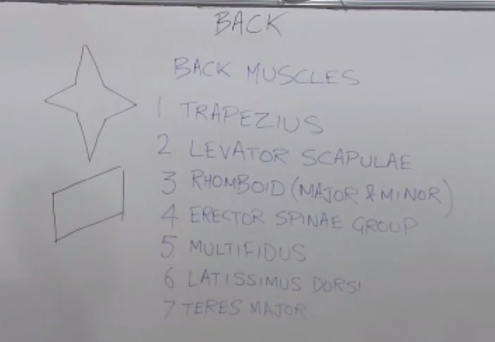

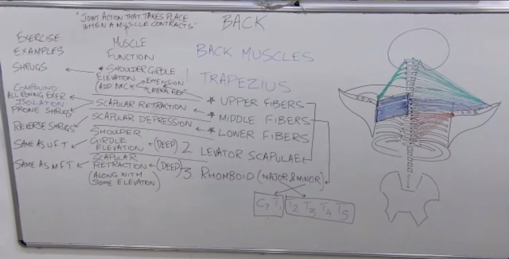

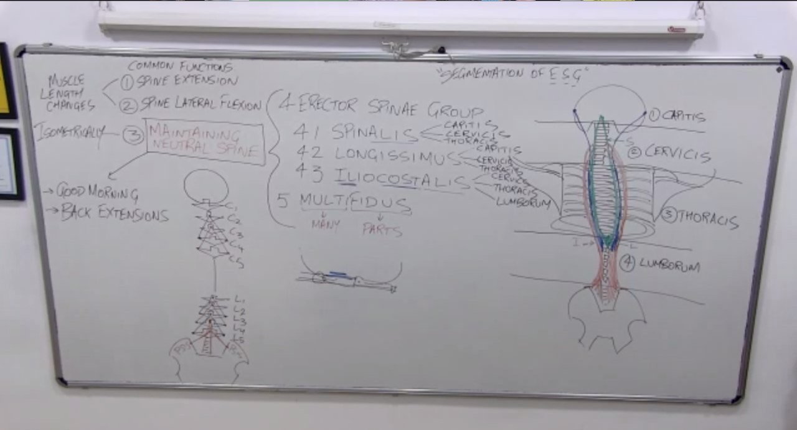

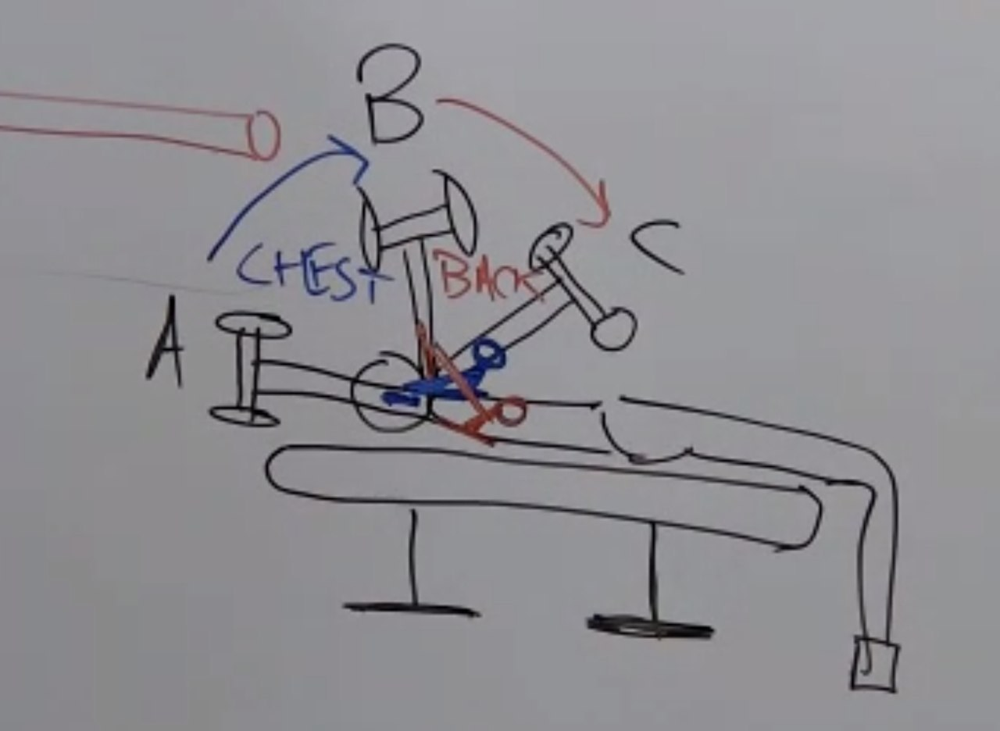

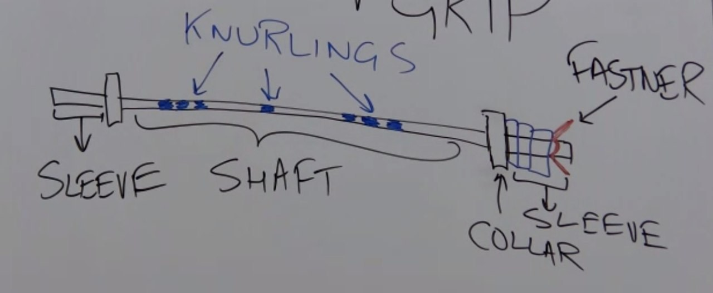

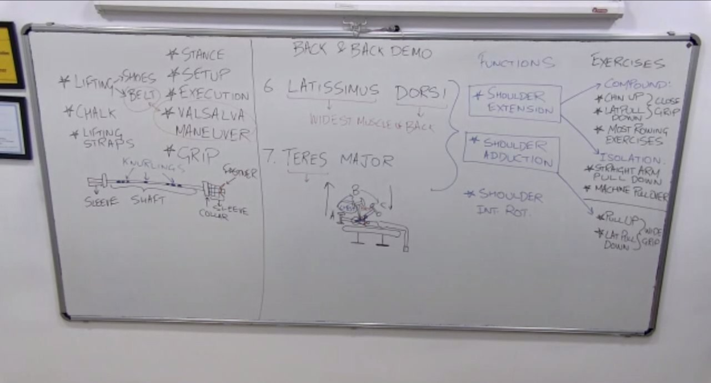
