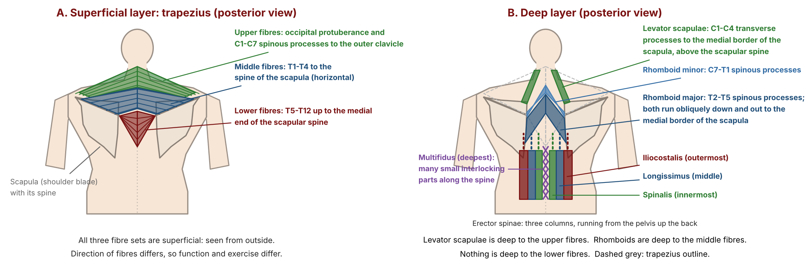
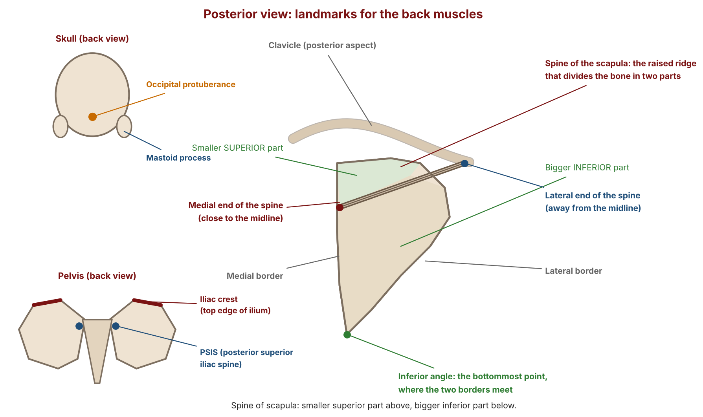
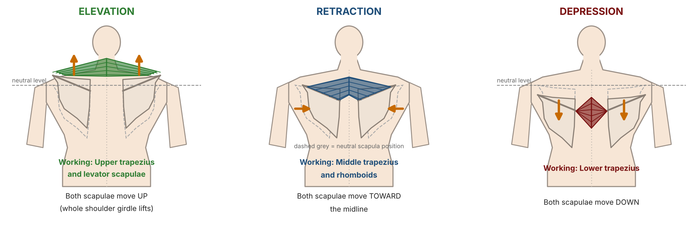
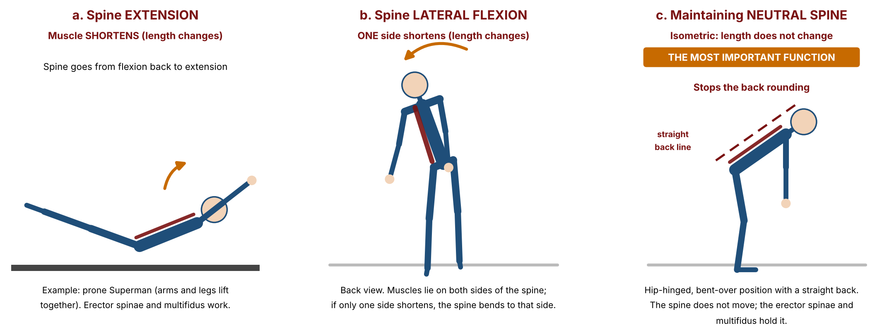
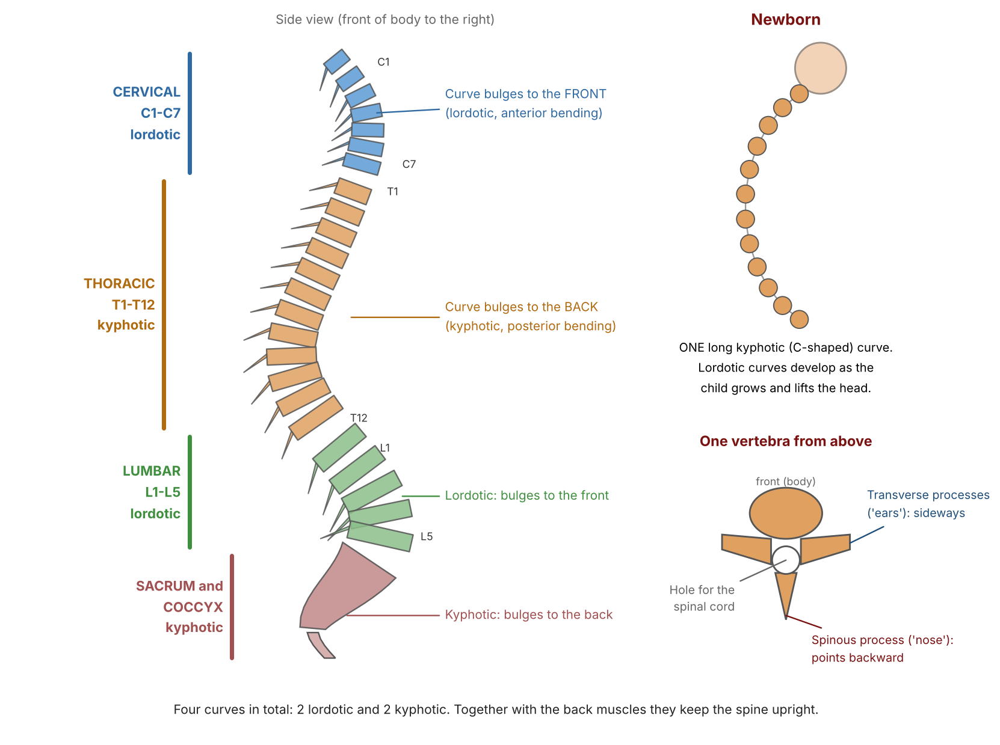
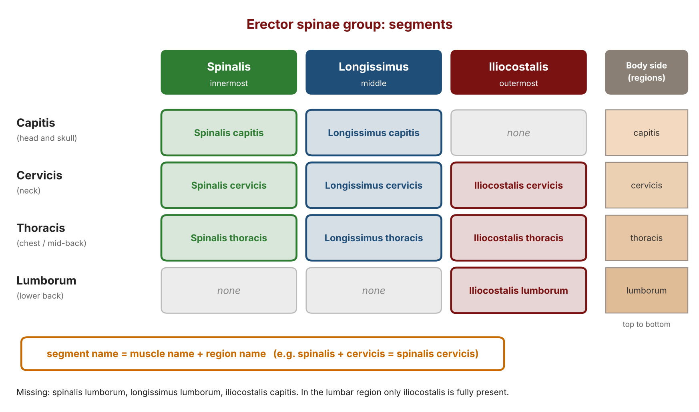
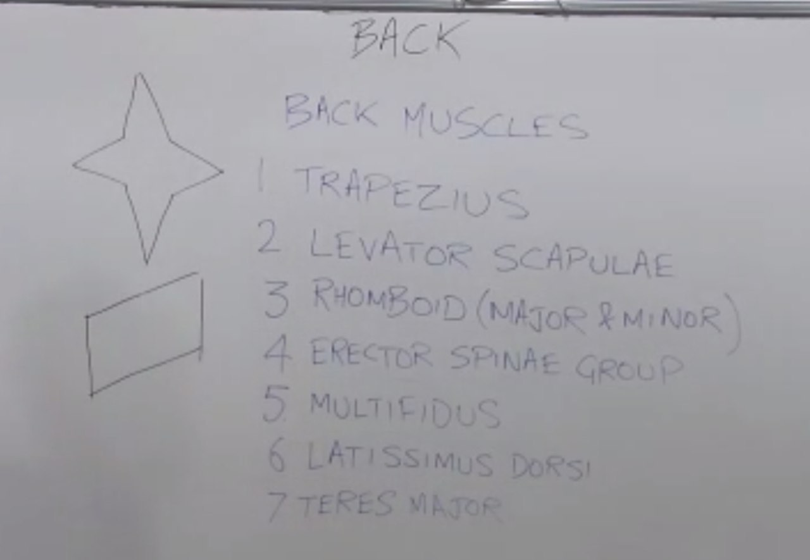
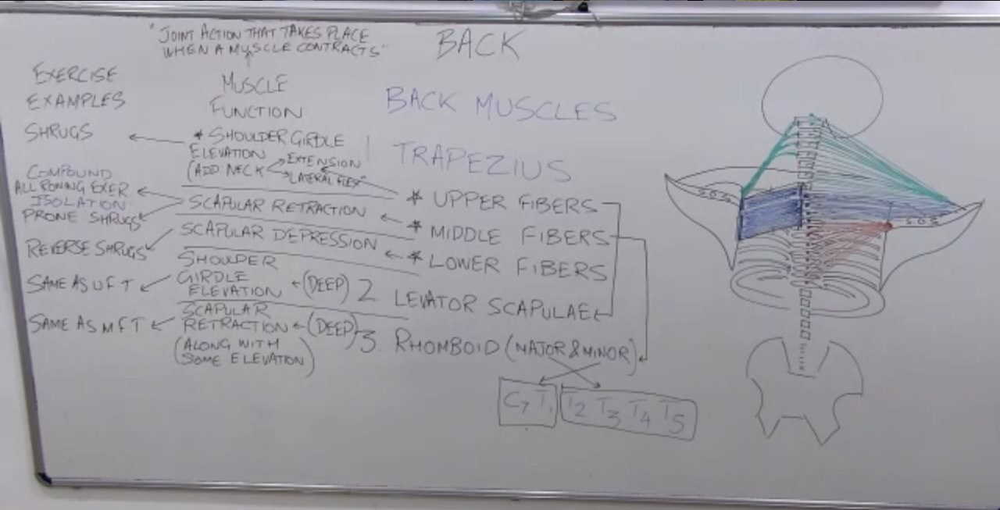
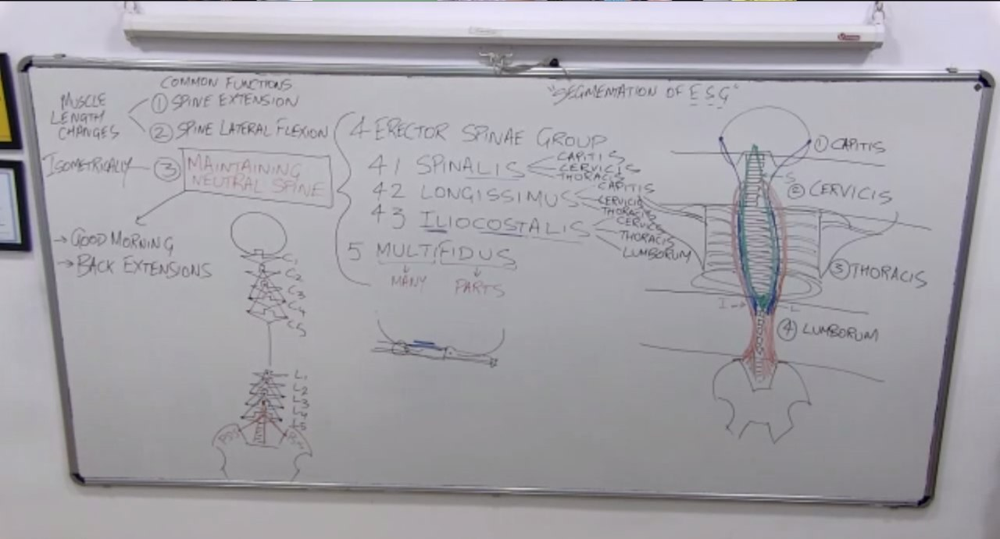

# Back Lecture: Detailed Notes

**Course:** Personal Training Certification

**Topic:** The back as a body part: why train it, the seven back muscles (trapezius, levator scapulae, rhomboids, erector spinae group, multifidus, with latissimus dorsi and teres major introduced in the demo), muscle function, spine anatomy and curves, and exercise examples

**About these notes:** Detailed notes from the Back Lecture, written so the whole lecture can be studied without watching the recording. Every concept, analogy and class question is covered. The figures are original drawings made for these notes. For a short revision version, see the Study Notes. The latissimus dorsi, teres major and the exercise demonstrations are in the Back Demo notes. Sources: the lecture recording, the course slides ("Body part 1: Back") and the board photos.

---

## Abbreviations used in these notes

| Short form | Meaning |
|---|---|
| M, O, I, F, E | Muscle, origin, insertion, function, exercise example (the order used for every muscle) |
| C1 to C7 | Cervical vertebrae (neck) |
| T1 to T12 | Thoracic vertebrae (mid-back) |
| L1 to L5 | Lumbar vertebrae (lower back) |
| PSIS | Posterior superior iliac spine |
| ROM | Range of motion |
| Prime mover | The muscle mainly responsible for a movement |
| Synergist | A helper muscle that does the same job with the prime mover |
| Stabiliser | A muscle that works to keep a body part steady |

## Before this lecture

You should know the skeleton and the main joints, the directional terms (superficial, deep, anterior, posterior, medial, lateral, superior, inferior), the three muscle contractions, compound and isolation exercises, and the planes of movement. The stretching lectures link to this one, because stretching the front muscles and training the back muscles both help posture.

## Outline of the lecture

| Part | Topic |
|---|---|
| 1 | How every body part lecture is organised |
| 2 | Why train the back |
| 3 | The seven back muscles, pronunciation and name decoding |
| 4 | The trapezius: three fibre sets |
| 5 | The analysis flow and what muscle function means |
| 6 | Landmarks used to describe origin and insertion |
| 7 | Trapezius: anatomy, functions and exercises |
| 8 | Levator scapulae |
| 9 | Rhomboids and the idea of synergists |
| 10 | Erector spinae group |
| 11 | Multifidus |
| 12 | Common functions of the erector spinae group and multifidus; spinal curves |
| 13 | Segmentation of the erector spinae group |

---

## Part 1: How every body part lecture is organised

Every body part has two sessions: the body part lecture, and the demo lecture on the next day. The lecture follows the same flow each time:

1. Why train this body part.
2. The muscle names in that body part.
3. For each muscle, its **function** (at first, the job of the muscle in the body).
4. From the function, the suitable **exercise** for that muscle.

The demo day shows videos of every exercise from the lecture, so that nobody meets an unfamiliar exercise. Form, stance and corrections are taught face to face in the practical sessions with the master trainers, not online. Where a technical comparison can be made online (for example the resistance profile from machine to machine), the demo covers it.

---

## Part 2: Why train the back

1. **Functional carryover.** Back training improves day to day life. It builds the strength to pull something and to lift something from the floor.
2. **Posture.** Some of the back muscles (the erector spinae group) help to maintain and improve posture. People with desk jobs and people who cycle for long periods tend to sit slouched. As with the stretching lectures, where stretching the front muscles helps posture, training these back muscles keeps the back upright.
3. **Protection of the spinal cord.** The brain sits under the skull, and the spinal cord passes through the hollow vertebrae. The cranial bones are strong, but the vertebrae are not as strong, so the back muscles work as a shield for the spinal cord.

The skeleton recap in class: one bone of the spine is a **vertebra**, together they are the **vertebral column** (the spine). The skeleton model has no brain, because it models only the skeletal system.

Q: What is the slouched position of sitting?

A: The posture of a desk worker or a long-distance cyclist, with the back rounded.

**Landmarks policy.** Doctors know many anatomical landmarks very well. Fitness professionals need awareness only. The lecture marks what is important to remember and what is only good to know.

---

## Part 3: The seven back muscles

### 3.1 The menu

1. Trapezius (three fibre sets: upper, middle, lower)
2. Levator scapulae
3. Rhomboids (major and minor)
4. Erector spinae group (spinalis, longissimus, iliocostalis)
5. Multifidus
6. Latissimus dorsi
7. Teres major

Muscles 1 to 5 were taught in this lecture. Muscles 6 and 7 were taught at the start of the demo day.

### 3.2 Use the proper names

Use the full names (trapezius, latissimus dorsi), not "traps" and "lats". Knowing the correct names sets a trainer apart. A trainer who says "train the muscle just below your neck on the right" sounds like a mechanic who says "this black part under the big part", and the client doubts the trainer.

### 3.3 Pronunciation

- **Levator scapulae:** "lei-vator", not "la-vator". The plural of scapula is scapulae.
- **Erector spinae:** "spine-ee", not "spine".
- **Teres:** teres minor exists, but it belongs to the shoulder body part, so only teres major is taken with the back.

### 3.4 What a muscle name can tell you

A muscle name is inspired by one of four traits: **shape, size, location or function**.

| Muscle | Name inspired by | Explanation |
|---|---|---|
| Trapezius | Shape | A kite or diamond shape (called a trapezoid in class) formed by the left and right muscles together |
| Levator scapulae | Function | Like an elevator, it elevates the scapula |
| Rhomboid | Shape | A rhombus, a shape with two pairs of parallel sides |
| Erector spinae | Function | "Erect" means upright, and the group keeps the spine upright |
| Multifidus | Structure | "Multi" means many, "fidus" means parts |

---

## Part 4: The trapezius has three fibre sets

The trapezius covers a large part of the back. Anatomists divide it into three sets of fibres by direction. The colours below are used in every figure.

| Fibres | Direction | Colour |
|---|---|---|
| Upper | Run mostly diagonally downward and outward | Green |
| Middle | Run horizontally outward | Blue |
| Lower | Run upward | Red |

All three exist on both sides of the body.

**Key principle:** the direction of the fibres decides the function, and the function decides the exercise. One exercise cannot target the whole trapezius, so each fibre set needs its own exercise.

All three fibre sets are **superficial**, that is, close to the surface and visible from outside. The levator scapulae and the rhomboids are **deep**, under the trapezius: the levator under the upper fibres, the rhomboids under the middle fibres. There is no deep muscle under the lower fibres.

---

## Part 5: The analysis flow and the meaning of muscle function

### 5.1 The flow

For every muscle: **M** (muscle), **O** (origin), **I** (insertion), **F** (function), **E** (exercise example).

What must be known: M, F and E. The origin and insertion are **not** mandatory. No test, exam, viva or interview will ask for them. They are taught as a bridge, so that a student can see the function from the origin and insertion instead of memorising it. A support document explains the technical words (occipital protuberance, tubercle, trochanter and so on) in simple terms.

### 5.2 The golden rule of muscle function

**Muscle function is the joint action that takes place when the muscle contracts.**

Always say the joint name with the action: "elbow flexion", not just "flexion". This habit saves marks in the viva.

Worked example: the biceps brachii runs from near the shoulder to the forearm. When it contracts, the forearm comes towards the upper arm, which is **elbow flexion**.

About 90 percent of the time the function is the joint action when the muscle shortens. In some exceptions the muscle works **isometrically** (its length does not change), and these are announced when they arise. This is not the same as isolation.

### 5.3 Choosing the exercise

The best exercise for a muscle is the one in which its function takes place in the **concentric phase**, with that muscle as the prime mover. Example: in a shrug, the bar rising is the concentric phase, and the joint action is shoulder girdle elevation, so shrugs suit the upper trapezius. The upright row is a different movement, and its main job is at the shoulder.

There are exceptions, for example the good morning and the back extension (see Part 12).

---

## Part 6: Landmarks used for origin and insertion

A landmark is a famous point that everyone knows, like meeting at a famous gate of a mall. Landmarks are stepping stones to describe the origin and insertion.

| Landmark | Meaning |
|---|---|
| Process | A projection of bone that does not connect to another bone |
| Spinous process | One pointy projection at the back of each vertebra (the "nose"). The word "spine" here means a pointy surface. |
| Transverse processes | Two projections at the sides of each vertebra (the "ears"). "Transverse" is the other name for horizontal. |
| Spine of the scapula | A raised ridge on the back of the scapula that divides it into a smaller superior part and a bigger inferior part. The word "spine" here means a divider. |
| Inferior angle of the scapula | The bottommost point, where the medial and lateral borders meet |
| Medial border and lateral border | The scapula edges closer to and farther from the midline |
| Medial end and lateral end of the spine of the scapula | The ends of the ridge, closer to and farther from the midline |
| Clavicle, posterior aspect | The back side of the collarbone |
| Occipital protuberance | A bump on the back of the skull. "Protuberance" means something popping out of a surface. |
| Mastoid process | The pointy bump behind the ear |
| Iliac crest | The top edge of the ilium. The ilium is like a mountain, and its peak is the crest. |
| PSIS | The upper of the two pointy surfaces at the back of the ilium (the lower is the posterior inferior iliac spine) |

The spine is also divided into regions: 7 cervical, 12 thoracic and 5 lumbar vertebrae, then the sacrum and the coccyx. The ribs are also called costae.

---

## Part 7: Trapezius in detail

### 7.1 Anatomy

| Fibres | Origin | Insertion | Direction |
|---|---|---|---|
| Upper (green) | Occipital protuberance and the spinous processes of the cervical vertebrae down to C7 | Posterior aspect of the clavicle (the outer part) | Diagonally downward and outward |
| Middle (blue) | Spinous processes T1 to T4 | Spine of the scapula (acromion and spine of the scapula on the slide) | Horizontally outward |
| Lower (red) | Spinous processes T5 to T12 | Medial end of the spine of the scapula | Upward |

### 7.2 Functions

| Fibres | Function | Note |
|---|---|---|
| Upper | **Shoulder girdle elevation** | The whole girdle lifts. Added (secondary) functions: neck extension, and neck lateral flexion because the fibres reach the posterior clavicle. These have no main exercise. |
| Middle | **Scapular retraction** | The scapulae move closer to the midline. |
| Lower | **Scapular depression** | The scapula moves down. |

### 7.3 Exercises for the trapezius

| Fibres | Exercise | Detail |
|---|---|---|
| Upper | Shrugs (barbell or dumbbell) | The bar rising is the concentric phase and the joint action is shoulder girdle elevation |
| Middle | Compound: all rowing exercises. Isolation: **prone shrug** | A row has three joint actions (elbow flexion, shoulder extension, scapular retraction) so it is compound. The prone shrug has only scapular retraction, so it is isolation. |
| Lower | **Reverse shrug** | The only exercise, and it is an isolation exercise |

**Compound versus isolation.** Compound means several joints and joint actions. Isolation means one joint and one joint action.

Q: Which exercise gives only scapular retraction at one joint?

A: The prone shrug. Class answers rejected: the reverse fly (the main movement is shoulder horizontal abduction) and the pullover (shoulder extension).

**Prone shrug set-up.** Lie face down on an incline bench with the collarbone near the top edge. The arms hang at the sides with dumbbells. Pull the shoulder blades together without bending the elbows.

**Reverse shrug set-up.** Sit at a lat pulldown machine. Hold the bar with straight arms raised overhead and do not bend the elbows. Pull the shoulder blades down so the bar comes down slightly and the weight stack rises. It can be copied on a pull-up bar: hang and depress the scapulae only. The movement is a shrug in the opposite direction.

---

## Part 8: Levator scapulae

- **Name:** from "elevator", its function.
- **Position:** deep, under the upper fibres of the trapezius.
- **Origin:** transverse processes of C1 to C4 (the spinous processes are used by the trapezius).
- **Insertion:** the medial border of the scapula above the spine of the scapula.
- **Function:** shoulder girdle elevation. It runs fairly vertically at the side of the neck, so it does not do neck extension or neck lateral flexion.
- **Exercise:** the same as the upper trapezius (shrugs).

---

## Part 9: Rhomboids and the synergist idea

- **Position:** deep, under the middle fibres of the trapezius.
- **Origin:** minor from the spinous processes of C7 and T1, major from T2 to T5.
- **Insertion:** both on the medial border of the scapula. The minor is in line with the spine of the scapula and the major is below it.
- **Memory story:** the major and the minor are two brothers who split a family property of six fibres (C7 to T5): the younger brother (minor) took the first two, the elder (major) the rest. This is only a memory aid.
- **Function:** scapular retraction, with a little elevation because the fibres are slightly diagonal.
- **Exercise:** the same as the middle trapezius (rows and prone shrugs).
- **Together:** the two make a rhombus. Both work as one team, and the minor and major do not differ in benefit.

**Synergists.** The levator assists the **upper** fibres only, and the rhomboids assist the **middle** fibres only. It is wrong to say they help the whole trapezius, because the lower fibres have no deep partner. Two muscles with the same function are both trained by the same exercise. The bigger superficial muscle is the prime mover and the deeper one works as a synergist.

---

## Part 10: Erector spinae group

The group is three muscles that keep the spine erect. Together with the multifidus they are also called the **paraspinal muscles**, because they lie beside the spine and run almost parallel to it. They start low on the spine and end high.

| Muscle | Name hint | Origin | Insertion | Function |
|---|---|---|---|---|
| Spinalis (innermost, green) | Closest to the spine | Slide: spinous processes L2 to T11 (the lecture gave T11, T12 and the tip of L1) | Occipital bone | Spine extension, maintaining neutral spine, spine lateral flexion |
| Longissimus (middle, blue) | The longest | Blends with the iliocostalis in the lumbar region | Mastoid process of the skull | The same three |
| Iliocostalis (outermost, red) | Ilium plus ribs (costae) | Iliac crest, sacrum and the lumbar vertebrae (slide: up to T11) | Transverse processes of C4 to C6 | The same three |

The iliocostalis crosses the ribs on its way up, hence its name.

---

## Part 11: Multifidus

- A single muscle made of many small parts, like the links of a chain. Each part has its own origin and insertion.
- **Pattern:** each part starts at the "ear" (transverse process) of one vertebra, skips the next vertebra and ends at the "nose" (spinous process) of the vertebra after it. The lowest parts begin at the PSIS and the sacrum. The pattern repeats up to C2.
- **Role:** these interlocking parts hold the vertebrae together so the spine moves as a unit and the vertebrae do not move on one another. Analogies: a grandmother's crisscross knitting, or stitches on a cut.
- **Function:** the same as the erector spinae group: spine extension, maintaining neutral spine, spine lateral flexion.

The erector spinae group and the multifidus are taught together because the multifidus does exactly the same job, although it is not deep to the group.

---

## Part 12: Common functions of the erector spinae group and multifidus

### 12.1 Function 1: spine extension (length changes)

From a flexed spine, the muscles contract and bring the spine back to extension. **Exercise: the superman.** Lie face down on a mat and lift the arms and legs together. The erector spinae and multifidus shorten and the spine extends. Class answers rejected: the deadlift (the joint action is at the hip and the spine stays neutral) and cat or camel pose (it is a yoga mobility drill, not an exercise). The prone alternate arm and leg raise is a variation.

### 12.2 Function 2: spine lateral flexion (length changes)

When only one side shortens, the spine bends to that side. No exercise example is given here. The abdominal lecture will list the obliques, whose main function is lateral flexion, and the erector spinae and multifidus will work as synergists from behind. Exercise examples are written only for the main functions.

### 12.3 Function 3: maintaining neutral spine (isometric, the most important)

**Spinal curves.** Seen from behind, the spine looks straight, but from the side it has four curves: **lordotic** (the cervical and lumbar curves) and **kyphotic** (the thoracic and sacral curves). A baby starts with one long kyphotic curve, and the lordotic curves develop as the child grows. The curves counterbalance the weight of the skull and rib cage and help to stand upright.

During a bend forward and back up, the erector spinae and multifidus do not shorten or lengthen. They work **isometrically** to keep the spine's length and curves, so the back does not round. Without them the spine would be more likely to round.

This function matters for daily life (lifting from the floor) and for exercises:

- **Bent over row:** the erector spinae hold the neutral spine.
- **Deadlift** (the "king of lifts", a functional lift): the leg muscles are the prime movers, and the erector spinae group is the **stabiliser** that stops the back rounding.

**Exercises that train this function** (the erector spinae and multifidus are the target, even though the hip extensors are the prime movers):

1. **Good morning.** A barbell on the back, hinge forward without bending the knees, and come up. Going down is hip flexion, and coming up is hip extension. It is the most challenging for the erector spinae, so it prepares them for the deadlift.
2. **Back extension** on a back extension bench. The thighs and lower legs are anchored and the person goes all the way down and up. The exercise is called a **back extension**, not a "hyperextension", because hyperextension is the non-recommended way. The reasons are covered in the demo notes.

These two exercises are exceptions to the rule that the target must be the prime mover in the concentric phase.

Q: The lumbar region has only one muscle of the group. Is that why the lumbar region gets pain?

A: No. It is the muscle of the three that contributes most there, but other muscles (for example in the abdomen) support the area. Fewer muscles does not simply mean more pain, and there can be many reasons.

---

## Part 13: Segmentation of the erector spinae group

This is a "good to know" topic. Nobody will ask for the segment names. The names to know are the muscle names, functions and exercises.

Each muscle is divided into segments by the region it passes through, because the muscles are long. The lecture used an analogy of a long border with army, navy and air force: for trouble in one region you call the forces already stationed there.

**Naming rule:** segment name = muscle name + region name. Regions from the top: **capitis** (head), **cervicis** (neck), **thoracis** (chest and mid-back), **lumborum** (lower back).

- **Capitis:** spinalis capitis and longissimus capitis (the iliocostalis has no capitis segment).
- **Cervicis:** all three.
- **Thoracis:** all three.
- **Lumborum:** only iliocostalis lumborum, because the longissimus borrows its start from the iliocostalis there and the spinalis only touches the top of L1. The lumbar region carries the weight of the upper body, so a muscle must be fully present to contribute.

---

Key takeaways: the trapezius has three fibre sets, each with its own function and exercise (shrug, prone shrug and row, reverse shrug). The levator scapulae and rhomboids are deep helpers of the upper and middle fibres. The erector spinae group and the multifidus have three functions, and the most important is the isometric function of maintaining a neutral spine, trained with good mornings and back extensions.

---

## Points to Confirm

1. **Spinalis origin.** The lecture gave T11, T12 and the tip of L1. The slide gives the spinous processes of L2 to T11. Confirm which to use.
2. **Iliocostalis origin.** The lecture excluded the thoracic region. The slide extends the origin to T11.
3. **Rhomboid major origin.** One answer in class said T3 to T4. The slide and the rest of the lecture say T2 to T5.
4. **Upper trapezius neck lateral flexion.** The lecture added it, but the slide lists only shoulder girdle elevation and neck extension.
5. **Levator scapulae and neck extension.** The slide's combined table lists neck extension for the levator. The lecture says the levator does not do it.
6. **Back extension function.** The slide lists back extensions as spine extension. The lecture teaches them as an exercise for maintaining the neutral spine (isometric).
7. **Atlantoaxial joint.** The lecture explained why the multifidus does not reach C1 by saying that joint is occupied. The atlantoaxial joint is between C1 and C2, and the skull meets C1 at the atlanto-occipital joint. The explanation is therefore not exact.
8. **Multifidus levels.** The lecture used a skip of one vertebra. The slide says the insertion is 2 to 4 levels above the origin.
9. **Lordotic and kyphotic definitions.** The lecture's wording was loose. The usual meaning is a curve that bulges to the front (lordotic) or to the back (kyphotic).
10. **"Para" means parallel.** This was a memory aid. In the word paraspinal, "para" strictly means beside.
11. **Kite or diamond as a trapezoid.** A kite or a diamond is not strictly a trapezoid. The name is explained here as a shape trait.
12. **Longissimus is the longest.** On the board sketch the iliocostalis looked longer. The sketch was not to scale.
13. **Figures.** The figures are simplified drawings made for these notes, so the exact positions and sizes of muscles are approximate.
14. **Slides.** The slides contain a schedule and the exercise tables for the latissimus dorsi. These were covered in the demo sessions and are in those notes.

---

# Board Photos from the Lecture

