# Back Lecture: Study Notes

**Course:** Personal Training Certification

**Topic:** Why train the back, the trapezius, levator scapulae, rhomboids, erector spinae group and multifidus (functions, exercises, spine curves), the latissimus dorsi and teres major, the pullover, grips, barbell, belt and hip hinge

**About these notes:** Short revision version of the Back Lecture. For the full explanation of every concept, example and class question, see the Detailed Notes. The latissimus dorsi, teres major, pullover, grips and equipment are included here, in sections 9 to 13. The exercise demonstrations are in the Back Demo notes. The figures are original drawings. Sources: the lecture recording, the course slides and the board photos.

**Big idea:** For each muscle, learn the name, the function (the joint action when it contracts) and an exercise whose concentric phase is that function. The three fibre sets of the trapezius each need their own exercise, and the most important job of the erector spinae and multifidus is to hold the spine neutral (isometric).

---

## 1. Why train the back

- **Functional carryover:** pulling and lifting from the floor.
- **Posture:** the erector spinae group helps keep the back upright.
- **Shield for the spinal cord:** the vertebrae are not as strong as the skull.

## 2. How to study each muscle

- Order: **M**uscle, **O**rigin, **I**nsertion, **F**unction, **E**xercise. Know M, F and E. Origin and insertion are not mandatory.
- **Muscle function = joint action when the muscle contracts.** Say the joint name (for example "elbow flexion").
- Best exercise: the function happens in the concentric phase and the muscle is the prime mover.
- Names come from shape, size, location or function.

## 3. The seven back muscles

| No. | Muscle | Position | Function | Exercise example |
|---|---|---|---|---|
| 1a | Upper trapezius | Superficial | Shoulder girdle elevation | Shrugs |
| 1b | Middle trapezius | Superficial | Scapular retraction | Rows (compound), prone shrug (isolation) |
| 1c | Lower trapezius | Superficial | Scapular depression | Reverse shrug |
| 2 | Levator scapulae | Deep to upper fibres | Shoulder girdle elevation | Same as upper trapezius |
| 3 | Rhomboids (minor and major) | Deep to middle fibres | Scapular retraction | Same as middle trapezius |
| 4 | Erector spinae group | Paraspinal | Spine extension, spine lateral flexion, maintaining neutral spine | Superman, good morning, back extension |
| 5 | Multifidus | Paraspinal, many small parts | Same as the erector spinae group | Same |
| 6 | Latissimus dorsi | See the Back Demo notes | | |
| 7 | Teres major | See the Back Demo notes | | |

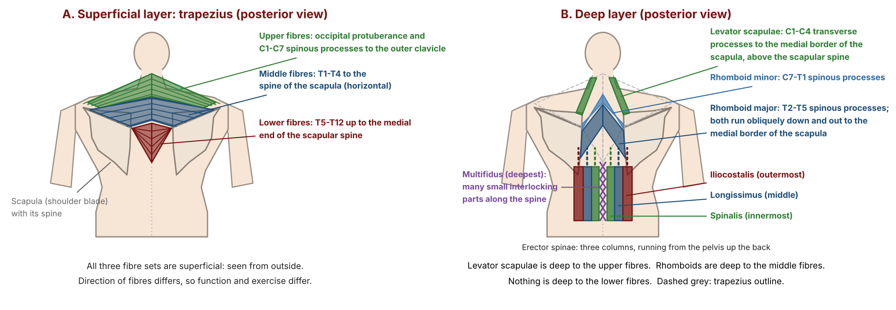

- The levator assists the **upper** fibres only. The rhomboids assist the **middle** fibres only. There is nothing deep to the lower fibres.
- Pronounce it "lei-vator" and "spine-ee".

## 4. Landmarks (good to know)

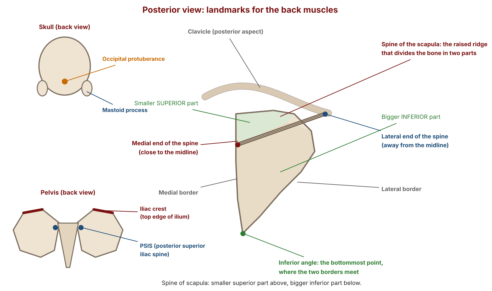

- **Spinous process** (the "nose", one, backward) and **transverse processes** (the "ears", two, sideways).
- **Spine of the scapula** divides the scapula into a smaller superior part and a bigger inferior part. The **inferior angle** is its bottommost point.
- Spine regions: 7 cervical, 12 thoracic, 5 lumbar, then sacrum and coccyx.

## 5. Trapezius

| Fibres | Origin | Insertion | Direction |
|---|---|---|---|
| Upper | Occipital protuberance and the neck vertebrae to C7 | Posterior clavicle | Diagonally down and out |
| Middle | T1 to T4 | Spine of the scapula | Horizontal |
| Lower | T5 to T12 | Medial end of the scapular spine | Upward |

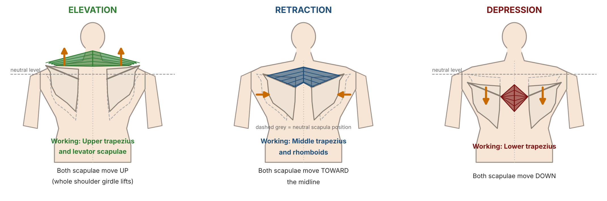

- Compound versus isolation: compound means many joints, isolation means one.
- **Prone shrug:** on an incline bench with the chest supported, pull the shoulder blades together with the elbows straight.
- **Reverse shrug:** at a lat pulldown with straight arms, pull the shoulder blades down.

## 6. Erector spinae group

| Muscle | Name hint | Insertion |
|---|---|---|
| Spinalis (innermost) | Closest to the spine | Occipital bone |
| Longissimus (middle) | The longest | Mastoid process |
| Iliocostalis (outermost) | Ilium plus ribs | Transverse processes of C4 to C6 |

- Origin: low on the spine and the pelvis. Insertion: high.
- **Multifidus** has many small parts: each starts at the transverse process of one vertebra, skips one, and ends at the spinous process of the next. It holds the vertebrae together.

## 7. The three functions of the erector spinae and multifidus

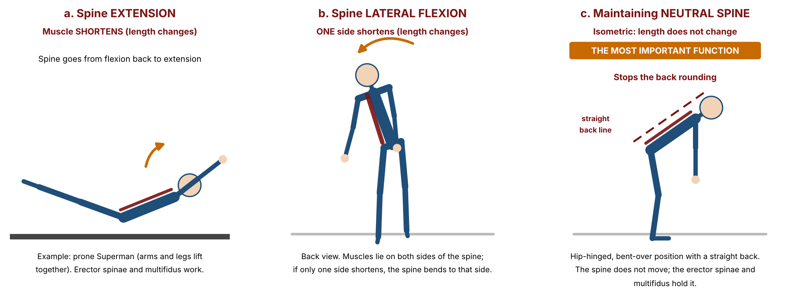

| Function | Length | Exercise |
|---|---|---|
| Spine extension | Changes | Superman |
| Spine lateral flexion | Changes | (obliques in the abdominal lecture) |
| **Maintaining neutral spine** | **Does not change (isometric)** | Good morning, back extension |

- **Spinal curves:** cervical and lumbar are lordotic, thoracic and sacral are kyphotic. A baby has one kyphotic curve.
- In the deadlift and the bent over row, the erector spinae are **stabilisers** and the prime movers are elsewhere.
- Write **back extension**, not hyperextension.

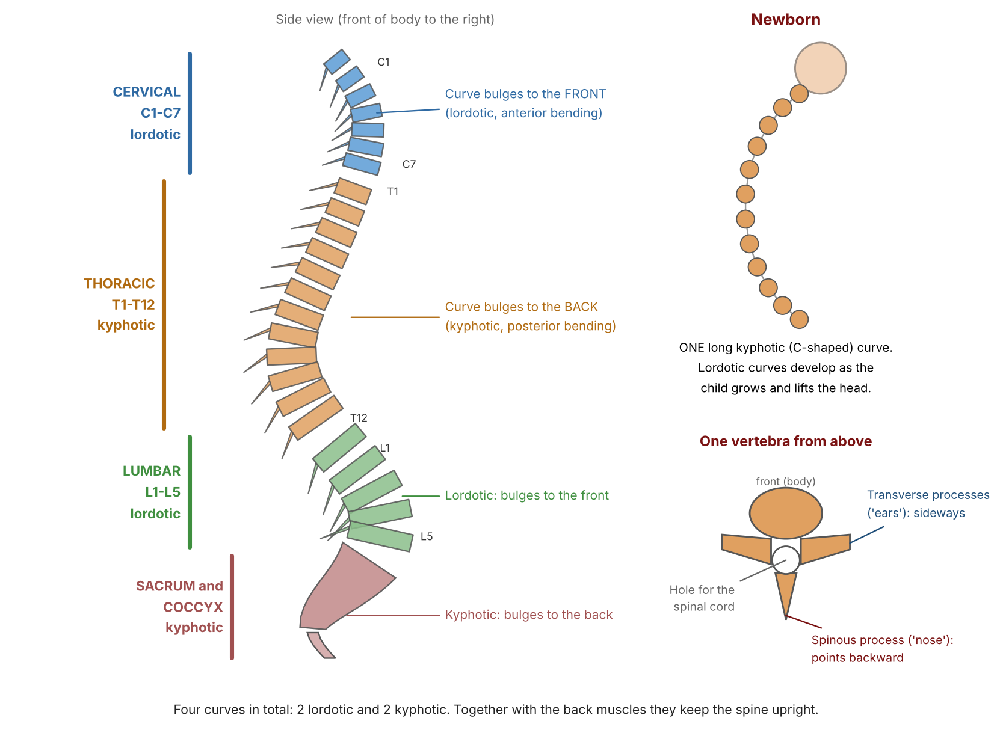

## 8. Segments of the erector spinae group (good to know)

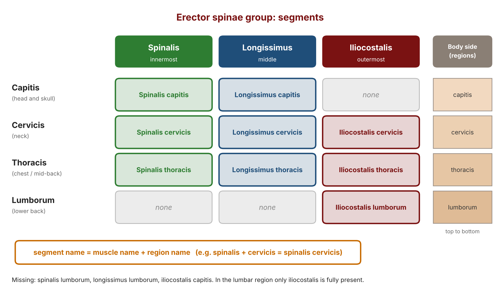

- Name = muscle + region: capitis, cervicis, thoracis, lumborum.
- Only the iliocostalis reaches the lumbar region.

## 9. Latissimus dorsi and teres major

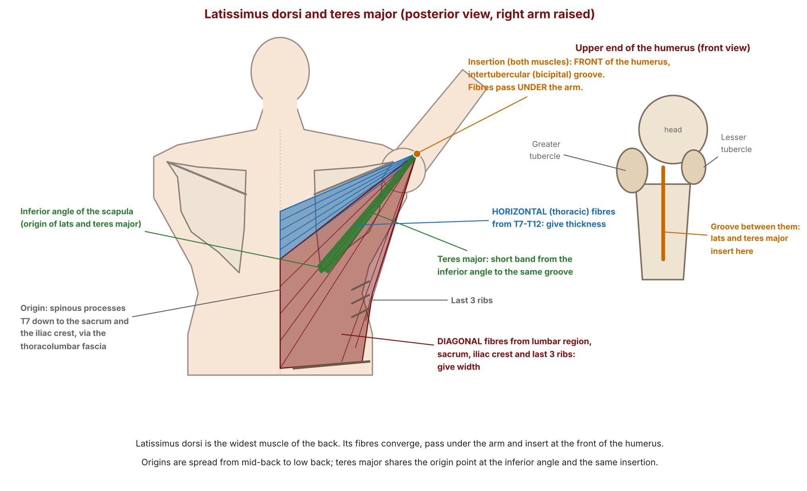

| Point | Latissimus dorsi | Teres major |
|---|---|---|
| Name | "Widest back" | Cylindrical, bigger than teres minor |
| Origin | T7 to the sacrum and coccyx (via the thoracolumbar fascia), iliac crest, last 3 ribs, inferior angle of the scapula | Inferior angle of the scapula |
| Insertion | Front of the humerus, intertubercular (bicipital) groove | Same groove |
| Functions | Shoulder extension, adduction, internal rotation | Same |

- Fibres go **under** the arm to the front of the humerus.
- **Horizontal fibres** (T7 to T12) and **diagonal fibres** (lumbar, sacrum, iliac crest, last 3 ribs) is a teaching split.

## 10. Functions

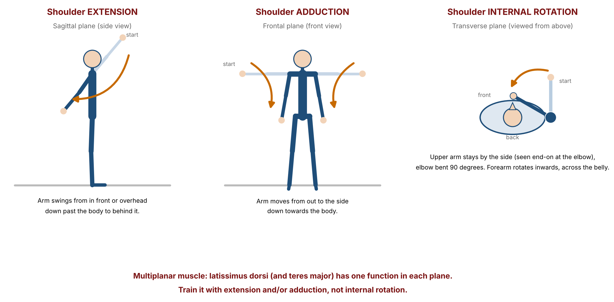

| Plane | Function |
|---|---|
| Sagittal | Shoulder extension |
| Frontal | Shoulder adduction |
| Transverse | Shoulder internal rotation |

- Multiplanar muscle. **Do not train it with internal rotation.** Use extension and/or adduction.

## 11. Exercise categories

| Function | Compound | Isolation |
|---|---|---|
| Shoulder extension | Chin-up (narrow grip), close grip lat pulldown, most rows | Straight arm pulldown |
| Shoulder adduction | Wide grip pull-up, wide grip lat pulldown | Multi-gym lever machine |

- Rows: bent over, T-bar, seated, one arm, chest-supported. Support: unsupported (bent over), pelvic girdle (seated row), pelvic girdle and spine (chest-supported).
- **Thickness vs width:** extension uses more horizontal fibres (thicker back), adduction uses more diagonal fibres (wider back). Do both.
- **Myth:** a very wide grip does not create a V-taper.

## 12. Pullover

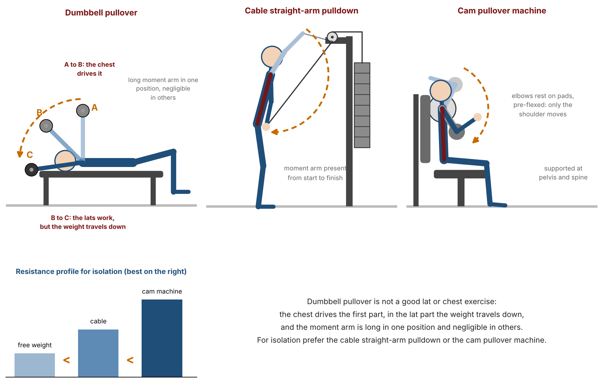

- Dumbbell pullover, positions A, B, C: A to B the chest drives, B to C the lats but the weight travels down. Not good for the lats or the chest.
- Resistance profile for isolation: **free weight < cable < cam machine**.
- Better: **straight arm pulldown** (cable) and **machine pullover** (cam, supported at pelvis and spine, elbows pre-flexed on pads, only the shoulder moves).

## 13. Grips, barbell, belt and hip hinge

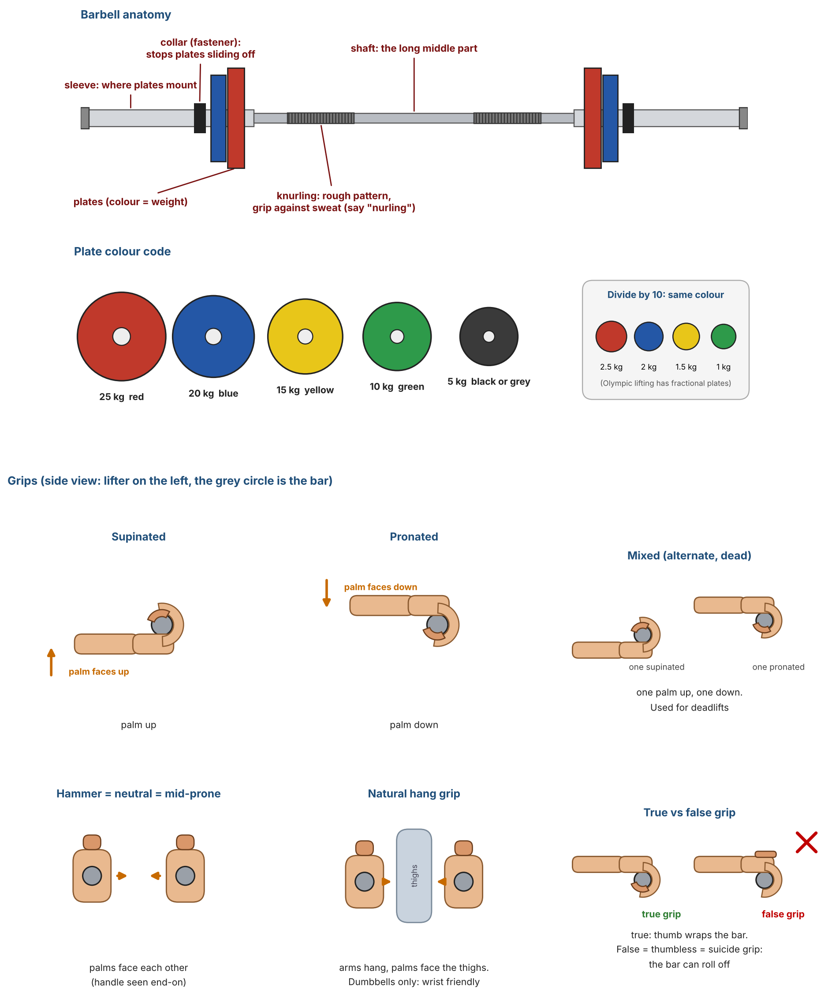

| Grip | Meaning |
|---|---|
| Supinated | Palm up |
| Pronated | Palm down |
| Mixed (alternate, dead grip) | One up, one down (deadlift) |
| Hammer, neutral, mid-prone | Palms facing |
| Natural hang grip | Palms facing the thighs, dumbbells only |
| False (thumbless, suicide) grip | Thumb not wrapped |

- Supinated grip lifts the most in rows (biceps brachii works best). Do not force it on people with poor wrist or forearm mobility.
- Barbell parts: collar (fastener), sleeve, shaft, knurling.
- Plates: 25 red, 20 blue, 15 yellow, 10 green, 5 black or grey.
- Straps so the prime mover fails first. Chalk is magnesium carbonate.
- **Belt:** not for lumbar support. Valsalva plus a belt raises abdominal pressure so the spine cannot round. Keep the Valsalva going.

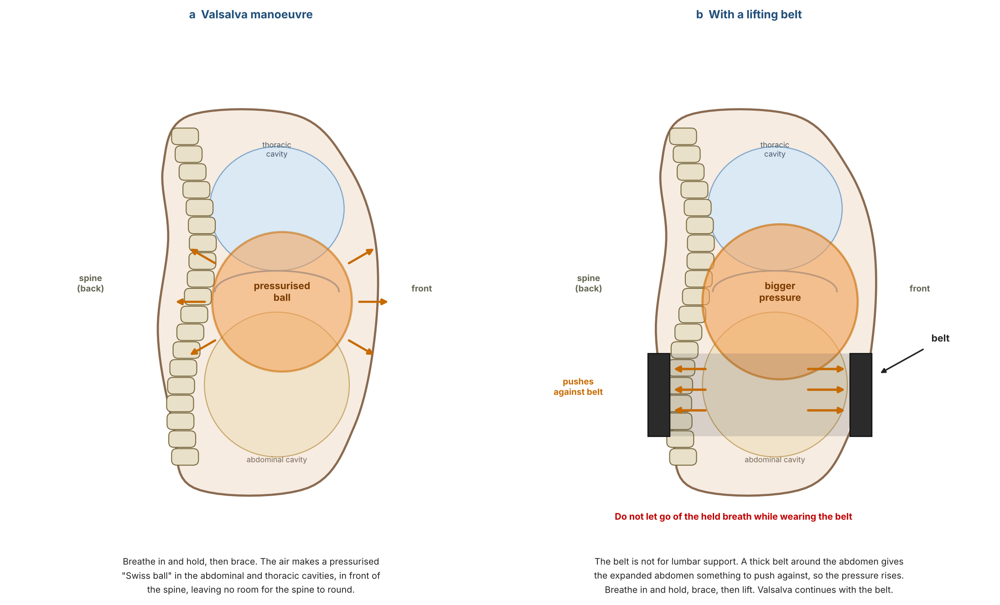

- **Hip hinge** beats leaning forward: the centre of gravity stays over the base.

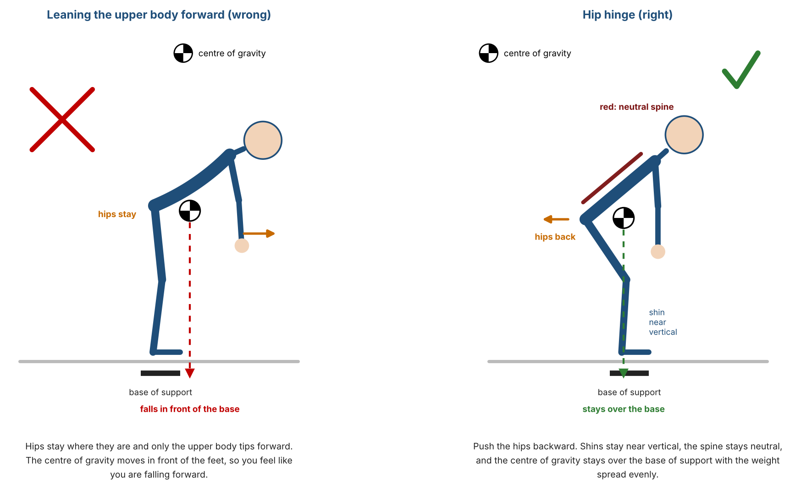

## 14. Key terms

|---|---|
| Muscle function | The joint action when the muscle contracts |
| Superficial and deep | Close to the surface and away from it |
| Prime mover | The main muscle for a movement |
| Synergist | A helper with the same function |
| Stabiliser | Works to keep a part steady |
| Compound exercise | More than one joint |
| Isolation exercise | One joint |
| Paraspinal | Beside the spine |
| Lordotic | Curve bulging to the front |
| Kyphotic | Curve bulging to the back |
| Neutral spine | The natural curves held, no rounding |
| Multiplanar | Working in more than one plane |
| Thoracolumbar fascia | The white fascia over the thoracic and lumbar spine |
| Intertubercular groove | Groove between the greater and lesser tubercles of the humerus |
| Moment arm | Perpendicular distance from the fulcrum to the line of force |
| Valsalva | Breath held to brace the trunk |
| Hip hinge | Bending by pushing the hips back |

## 15. Where the sources differ

- **Spinalis origin:** T11, T12 and the tip of L1 (lecture) versus L2 to T11 (slide).
- **Iliocostalis origin:** thoracic region excluded (lecture) versus up to T11 (slide).
- **Back extension:** spine extension (slide) versus neutral spine, isometric (lecture).
- **Levator scapulae and neck extension:** on the slide, not in the lecture.
- **Multifidus insertion:** skip one vertebra (lecture) versus 2 to 4 levels (slide).
- **Pullover and "eccentric":** the argument is really about the resistance profile, not the contraction type.
- **Teres major:** not strictly a synergist. It depends on the exercise.

## 16. Revision questions

1. What are the three reasons to train the back?
2. What is the order of analysis for each muscle?
3. Define muscle function.
4. Which parts of the analysis are mandatory?
5. What decides the exercise for a muscle?
6. Name the three fibre sets of the trapezius and the direction of each.
7. Give the function and an exercise for each trapezius fibre set.
8. Why can one exercise not target the whole trapezius?
9. Which muscle is deep to the upper fibres, and which to the middle fibres?
10. Why does nothing help the lower fibres as a deep partner?
11. What is the function of the levator scapulae?
12. What is the function of the rhomboids?
13. Describe the prone shrug.
14. Describe the reverse shrug.
15. Name the three muscles of the erector spinae group, innermost to outermost.
16. Why is the multifidus called "multi-fidus"?
17. Name the three functions of the erector spinae and multifidus.
18. Which of the three functions is isometric, and why is it the most important?
19. Name the four spinal curves and their types.
20. Which segment of the erector spinae group is in the lumbar region?
21. What do "latissimus" and "teres" mean?
22. State the origin and insertion of the latissimus dorsi.
23. Why do the fibres go "under" the arm?
24. What are the horizontal and diagonal fibres?
25. State the functions of the latissimus dorsi and teres major.
26. Which function should not be used to train the latissimus dorsi?
27. Give a compound and an isolation exercise for shoulder extension.
28. Give a compound exercise for shoulder adduction.
29. How does a wider grip change the exercise?
30. What gives a thicker back, and what gives a wider back?
31. Why is the dumbbell pullover not recommended?
32. Rank free weight, cable and cam machine for isolation.
33. Describe the machine pullover.
34. Which grip lifts the heaviest in rows and why?
35. What is the natural hang grip and why use it?
36. Name the parts of a barbell.
37. Give the plate colour code.
38. What is the real job of a lifting belt?
39. Why is the hip hinge preferred over leaning forward?

## Answers

1. Functional carryover, posture, and protection of the spinal cord.
2. Muscle, origin, insertion, function, exercise example.
3. The joint action that takes place when the muscle contracts.
4. Muscle name, function and exercise example.
5. The exercise in which the muscle's function is the concentric action, with the muscle as prime mover.
6. Upper (diagonally down and out), middle (horizontal), lower (upward).
7. Upper: shoulder girdle elevation, shrugs. Middle: scapular retraction, rows and prone shrugs. Lower: scapular depression, reverse shrugs.
8. The fibres run in different directions, so each set has a different function.
9. The levator scapulae is deep to the upper fibres and the rhomboids are deep to the middle fibres.
10. There is no deep muscle under the lower fibres.
11. Shoulder girdle elevation.
12. Scapular retraction (with a little elevation).
13. On an incline bench with the chest supported, hang dumbbells and pull the shoulder blades together without bending the elbows.
14. At a lat pulldown with straight arms overhead, pull the shoulder blades down without bending the elbows.
15. Spinalis, longissimus, iliocostalis.
16. "Multi" means many and "fidus" means parts: it is one muscle made of many small parts.
17. Spine extension, spine lateral flexion, maintaining neutral spine.
18. Maintaining neutral spine. The length does not change. It stops the spine rounding in daily lifting, the bent over row and the deadlift.
19. Cervical (lordotic), thoracic (kyphotic), lumbar (lordotic), sacral (kyphotic).
20. Iliocostalis lumborum.
21. Latissimus is "widest" and dorsi is "back". Teres is cylindrical.
22. Origin: T7 to the sacrum and coccyx via the thoracolumbar fascia, iliac crest, last three ribs, inferior angle of the scapula. Insertion: the intertubercular groove at the front of the humerus.
23. The fibres pass beneath the arm to reach the front of the humerus.
24. Horizontal: from T7 to T12. Diagonal: from the lumbar region, sacrum, iliac crest and last three ribs.
25. Shoulder extension, shoulder adduction, shoulder internal rotation.
26. Internal rotation.
27. Compound: chin-up, close grip lat pulldown or rows. Isolation: straight arm pulldown.
28. Wide grip pull-up or wide grip lat pulldown.
29. The elbows leave the sagittal plane and enter the frontal plane, so the action changes from extension to adduction.
30. Horizontal fibres (extension exercises) give thickness. Diagonal fibres (adduction exercises) give width.
31. A to B is the chest and in B to C the weight travels down, so the lats get poor resistance.
32. Free weight is lowest, cable is higher, cam machine is the best.
33. Seated, supported at the pelvic girdle and spine, elbows pre-flexed on pads, only the shoulder moves into extension against a cam.
34. The supinated grip, because the biceps brachii works best in it.
35. Arms hang with palms facing the thighs, using dumbbells. It is wrist friendly so the set ends from prime mover failure.
36. Collar, sleeve, shaft and knurling.
37. 25 kg red, 20 kg blue, 15 kg yellow, 10 kg green, 5 kg black or grey.
38. With Valsalva it raises abdominal pressure in front of the spine so the spine cannot round.
39. The centre of gravity stays over the base of support and the weight is spread evenly.

---

## Board photos

See the Back Lecture Detailed Notes for the board photos.
