# Back Demo: Detailed Notes

**Course:** Personal Training Certification

**Topic:** Back exercise demo: dumbbell and barbell bent over rows, one arm row, seated and supported rows, lat pulldown, chin-up, pull-up, straight arm pulldown, shrugs, prone high row, prone and reverse shrugs, good morning, back extensions, superman and deadlift

**About these notes:** Detailed notes for the Back Demo, the exercise part of the back body part, written so the demo can be studied without watching the recordings. The demo ran over two class sessions because of an interruption, and the two are combined here into one set. Each exercise is covered with set-up, execution, muscles, mistakes and class questions, with figures showing how to perform it. The figures are original drawings made for these notes. They show the idea of each exercise, and the practical sessions teach the exact form. The theory (the back muscles, the latissimus dorsi and teres major, the pullover, grips, barbell, belt and hip hinge) is in the Back Lecture notes. For a short revision version, see the Study Notes. Sources: the session recordings, the course slides ("Body part 1: Back") and the board photos. Part 9 (prone high row) was not taught in class and is explained from standard exercise science.

---

## Abbreviations used in these notes

| Short form | Meaning |
|---|---|
| ROM | Range of motion |
| CNS | Central nervous system |
| NHG | Natural hang grip |
| BOR | Bent over row |
| PT station | Personal training station, a cable pulley machine |
| Bilateral | One object held with both hands |
| Isolateral | Two separate objects, both sides working together |
| Unilateral | One side at a time |

## Before this demo

You should know the Back Lecture: the seven back muscles and their functions, the latissimus dorsi and teres major (Parts 15 to 19), and the grip names, barbell parts, belt and hip hinge (Part 20). You should also know the planes of movement, the resistance profile ranking (free weight, cable, cam machine), moment arm, and the difference between compound and isolation exercises.

## Outline of the demo

| Part | Topic |
|---|---|
| 1 | How the demo works |
| 2 | Dumbbell bent over row and barbell bent over row, with two viva points |
| 3 | One arm row |
| 4 | Seated row and supported rows, handle choice |
| 5 | Close grip lat pulldown and the chin-up, anchoring, lower trapezius |
| 6 | Isolation for shoulder extension: straight arm pulldown, pullover |
| 7 | Shoulder adduction: wide grip lat pulldown and pull-up |
| 8 | Trapezius exercises: shrugs, prone shrug, reverse shrug |
| 9 | Prone high row (not taught in class) |
| 10 | Erector spinae and multifidus: good morning, back extension, reverse back extension, superman |
| 11 | Deadlift and sumo deadlift |
| 12 | Class questions and what follows |

---

## Part 1: How the demo works

The demo is a video-watching session. Short clips are played and paused, and the set-up, anchoring, joint action and working muscle are discussed, with questions to the class. The exercises written on the board in a body part lecture are the recommended ones. The demo also discusses dos, don'ts, machine variety and resistance profile, so a trainer knows what will be met in gyms. The hands-on version is learned in the practical sessions with the master trainers.

Watch each video once in silence, then discuss. Observe the stance, the set-up and execution, the breath, the grip, the gaze and the hip hinge. The grip names, the barbell parts, the belt and the hip hinge are in the Back Lecture, Part 20.

---

## Part 2: The bent over rows

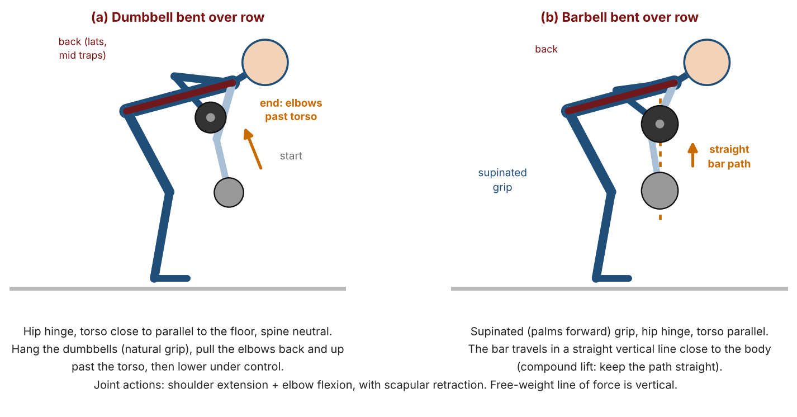

### 2.1 Dumbbell bent over row

- **Equipment:** a pair of dumbbells on the floor. It is **isolateral** (two separate objects working at the same time).
- **Set-up:** lift the dumbbells, then hinge at the hip into the bent position. The set-up ends there. Use the natural hang grip.
- **Execution:** inhale, and the execution starts. Pull (concentric), then lower (eccentric).
- **Movement:** compound. Shoulder extension (latissimus dorsi, prime mover), elbow flexion (elbow flexors) and scapular retraction.
- **Slide data:** sagittal plane. Working muscles: latissimus dorsi, teres major, posterior deltoid, and elbow flexors (biceps brachii, brachialis, brachioradialis).
- **Path:** in a compound movement the weight moves in a straight (linear) path.

### 2.2 Barbell bent over row

- **Equipment:** a barbell that starts on the floor. It is **bilateral**. The lifter in the video used a supinated grip.
- **Path:** the barbell travels in a **straight line**, not a curve. In about 7 of 10 people the bar path looks curved, and this is corrected in the industry. When a prime mover works alone (isolation, for example a pec fly machine) the path is naturally curved.

### 2.3 Two viva points

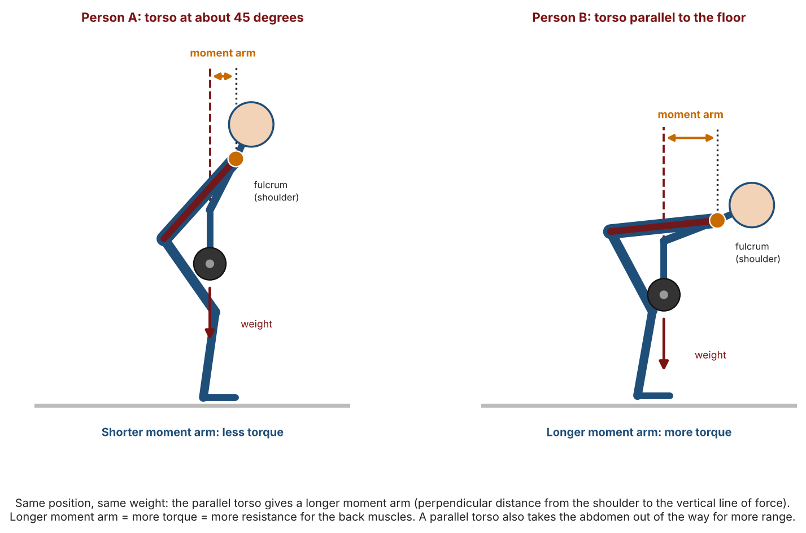

**Point 1: keep the torso as parallel to the floor as possible.** Compare person A (torso at an angle) with person B (torso parallel). The line of force of a free weight is vertical through the weight. The fulcrum is the shoulder joint, and the moment arm is the perpendicular distance from the fulcrum to the line of force.

- Benefit 1: B has a **longer moment arm**, so more torque, more resistance and more muscle effort.
- Benefit 2: a **greater range of motion**, because the abdomen is out of the way. (The recording cut this point off, and range of motion is the likely meaning.)

**Point 2: the dumbbell is better than the barbell for the bent over row.**

- **Symmetry.** With a barbell the stronger side compensates for the weaker side. With two dumbbells each side carries its own load. The CNS notices the poor motor unit recruitment and rate coding of the weaker side and works on it (the neural stage). Then the muscle cells of the weaker side grow to match (the hypertrophy stage).
- **Natural hang grip** is possible only with dumbbells.

---

## Part 3: One arm row (unilateral)

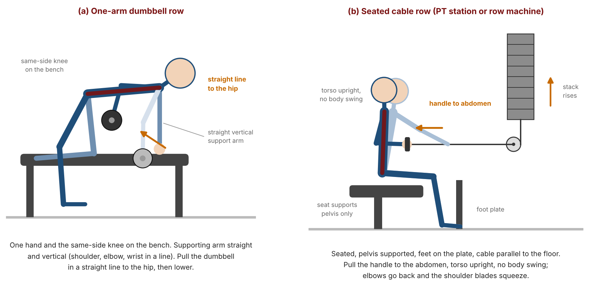

- **Set-up:** a dumbbell in one hand and the other hand on a bench as an anchor. The supporting arm is straight and perpendicular to the floor and the bench, so the shoulder, elbow and wrist are in a line. The same-side knee is also on the bench.
- **Execution:** compound movement. The dumbbell travels in a **linear path** for better engagement of the muscles.
- **Group:** shoulder extension (latissimus dorsi).
- **Classification recap:** the barbell bent over row is bilateral, the dumbbell bent over row is isolateral, and the one arm row is unilateral.

---

## Part 4: Seated row and supported rows

### 4.1 Seated row (cable)

- **Equipment:** a dedicated seated row machine (plate or pin loaded). If there is none, use the PT station.
- **Set-up:** set the pulley height so the cable runs parallel to the floor.
- **Execution:** pull the handle to the abdomen, torso upright. Avoid moving to and fro: that is momentum.
- **Cheating** (momentum) is a technique for an advanced stage, once hypertrophy is achieved and the load is heavy with correct form. A beginner using three or four plates should not use it.

Q: Is the seated row supported or unsupported?

A: It is supported at the pelvic girdle (the seat) only. The spine is not supported.

Q: Which back muscle group works isometrically to stop the back rounding?

A: The erector spinae group. This is why the function "maintaining neutral spine" matters.

### 4.2 Supported (chest-supported) row machines

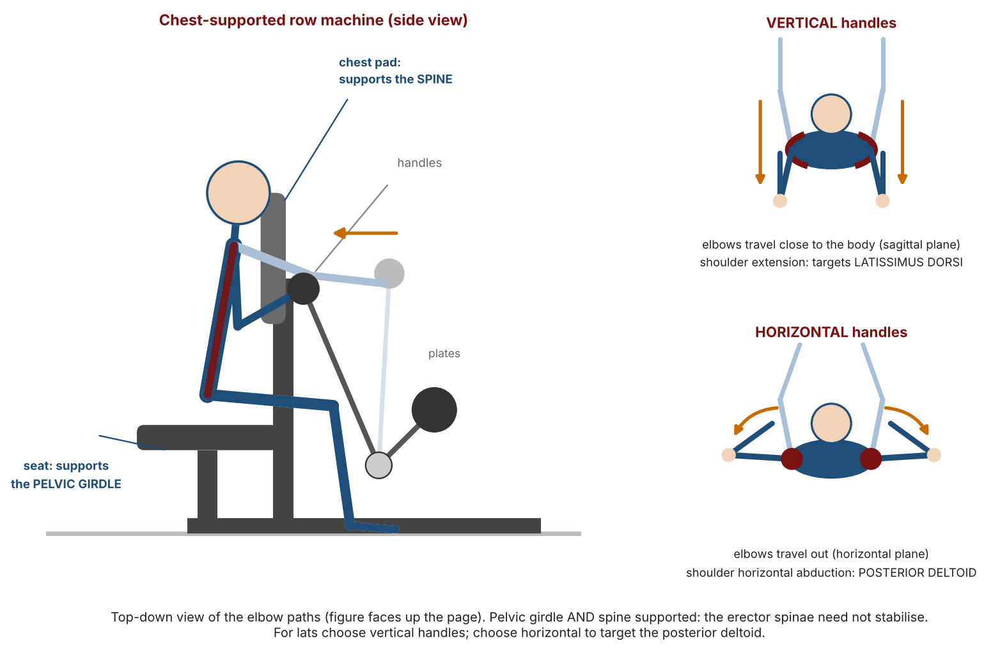

- A chest pad doubles the support: the pelvic girdle and the spine are supported, so the stabilising job of the erector spinae is taken care of.
- Plate-loaded supported rows are fulcrum based (lever arms), not guide-rod based. Pulling the handles raises the plate.

### 4.3 Handle choice: vertical or horizontal

| Handles | Elbow path | Action | Target |
|---|---|---|---|
| Vertical (neutral, hammer type) | Close to the body, sagittal plane | Shoulder extension | Latissimus dorsi |
| Horizontal | Out to the side, horizontal plane | Shoulder horizontal abduction | Posterior deltoid (as in the reverse fly) |

For the latissimus dorsi choose the vertical handles. A cue: "which wall are the elbows cleaning?"

---

## Part 5: Close grip lat pulldown and the chin-up

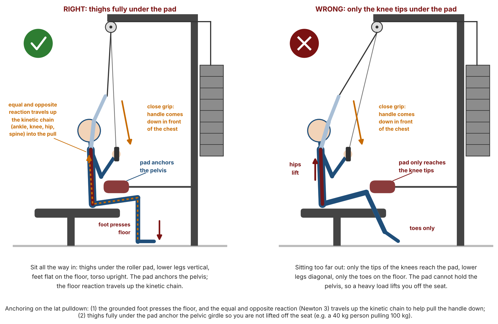

The lat pulldown brings the object to you. In the chin-up and pull-up you go towards the object.

### 5.1 Anchoring on the lat pulldown

- **Equipment:** a roller (anchor) pad over the thighs.
- **Right:** sit with the thighs fully under the pad, the lower legs vertical and the feet flat and grounded.
- **Wrong:** sitting too far out so only the knee tips reach the pad, with the lower legs diagonal and only the toes on the floor.
- **Two reasons for anchoring:**
  1. **Force transfer.** A grounded foot presses on the floor. By Newton's third law the equal and opposite reaction travels up the ankle, knee, hip and spine through the kinetic chain, and helps pull the handle down. This allows heavier lifting (the same idea as leg drive in the bench press).
  2. **Anchoring the pelvic girdle,** so the person is not lifted off the seat. For example, a 40 kg person pulling 100 kg stays seated only when properly under the pad.
- **Torso:** keep it upright so the cable travels perpendicular to the floor. Two common errors are rocking to and fro and leaning back so the cable travels diagonally.

### 5.2 The lower trapezius works isometrically

Q: Which trapezius fibres work in the lat pulldown?

A: The lower fibres, but **isometrically**. This is an exception to the usual meaning of "works".

- In vertical pulling (lat pulldown, chin-up, pull-up) the scapula should not shrug up, so it should not elevate.
- The lower fibres hold the scapula at the neutral level without changing length.
- No elevation does not mean depression. Depression needs the lower fibres to contract concentrically, and this is trained with the reverse shrug.
- The upper fibres are not worked by these exercises, so regular shrugs are added. The middle fibres are worked in all rows. The lower fibres get isometric work in pulldowns and chin-ups.
- Prone shrugs and reverse shrugs suit people with specific needs, such as competitive bodybuilders. A beginner whose goal is not the middle or lower trapezius already gets them from rows and pulldowns.

### 5.3 Chin-up

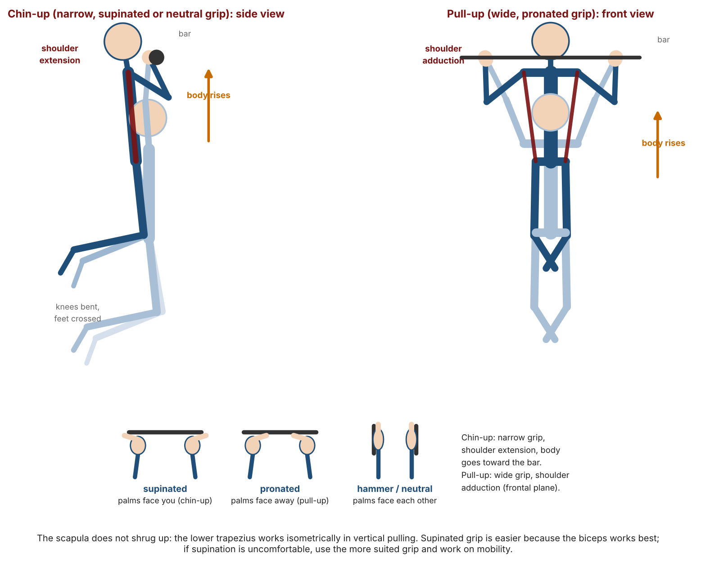

- **Action:** shoulder extension (close grip, supinated or hammer).
- **Body position:** knees flexed and feet crossed to stop the body swinging like a pendulum.
- **Grip in the video:** parallel (hammer, neutral, mid-prone). The machine had side bars only, so a supinated grip was not possible.
- **Why chin-ups feel easier than pull-ups:** in the supinated grip the strongest elbow flexor works at its best, and in the pronated grip it is disengaged and another helper with less force takes over, so the latissimus dorsi does more of the work in pronated pull-ups.
- **Clients who cannot supinate** (forearm or wrist mobility problems): do not force the grip. Use the hammer grip, keep the exercise challenging, and work on mobility with dynamic and static stretching meanwhile.

---

## Part 6: Isolation for shoulder extension

### 6.1 Straight arm pulldown (cable)

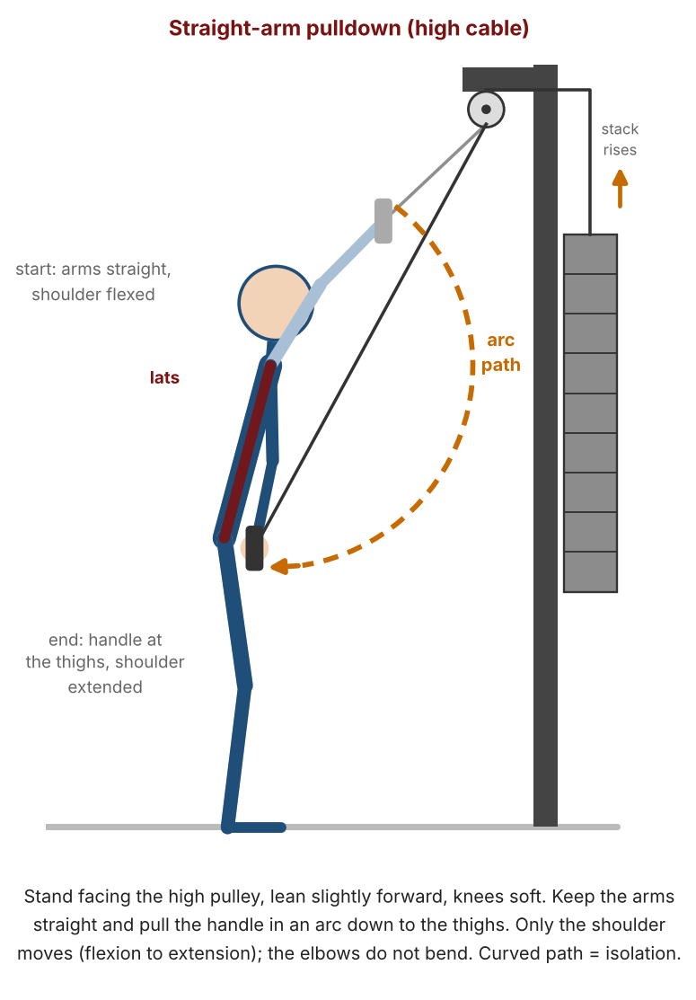

- **Joint action:** only the shoulder moves, from flexion into extension in the concentric phase. The elbow does not flex. The handle comes down to the thighs and the weight stack rises.
- **Path:** compound means a linear path, and isolation means a **curved** path. This holds for all body parts.
- **Resistance profile:** in isolation the target needs a moment arm that is kept through the range, not too long or too short. The fulcrum is the shoulder, and the moment arm is the perpendicular line from the shoulder to the line of force. In the straight arm pulldown there is a moment arm from start to finish.

### 6.2 Pullover comparison

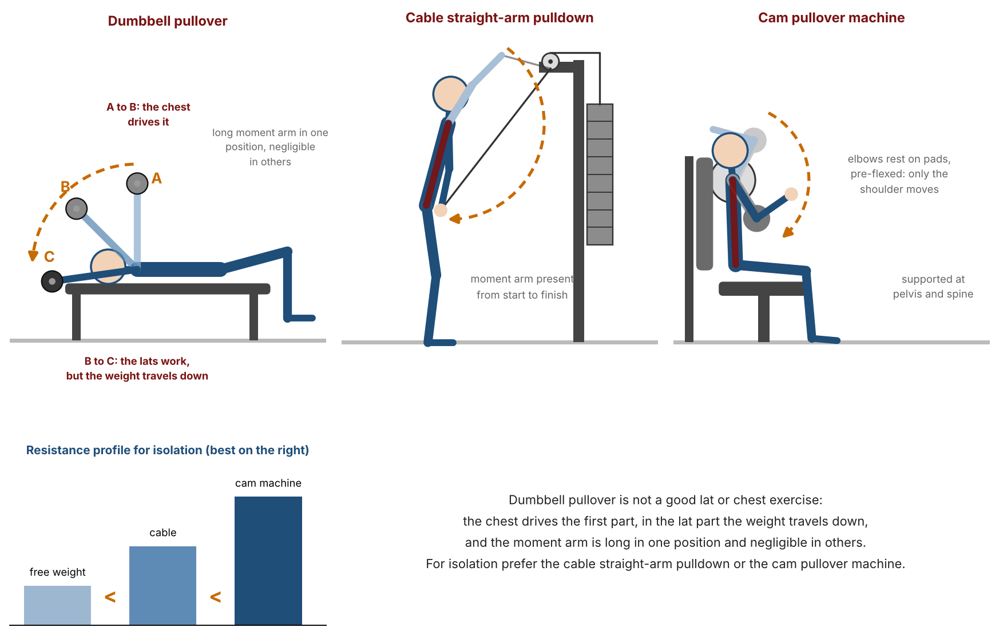

| Pullover | Moment arm |
|---|---|
| Dumbbell | Long in one position and negligible in others |
| Cable (straight arm pulldown) | Present from start to finish |
| Cam machine | Best: cam plus cushioned elbow supports and the most stability |

The cam pullover is better than the cable, and the cable is better than the dumbbell. The elbows are pre-flexed in the machine, but it is not compound because there is no elbow flexion or extension. The pullover also works the chest in the first part of the range. Its resistance profile is not great for the chest, so do not use it for the chest.

---

## Part 7: Shoulder adduction

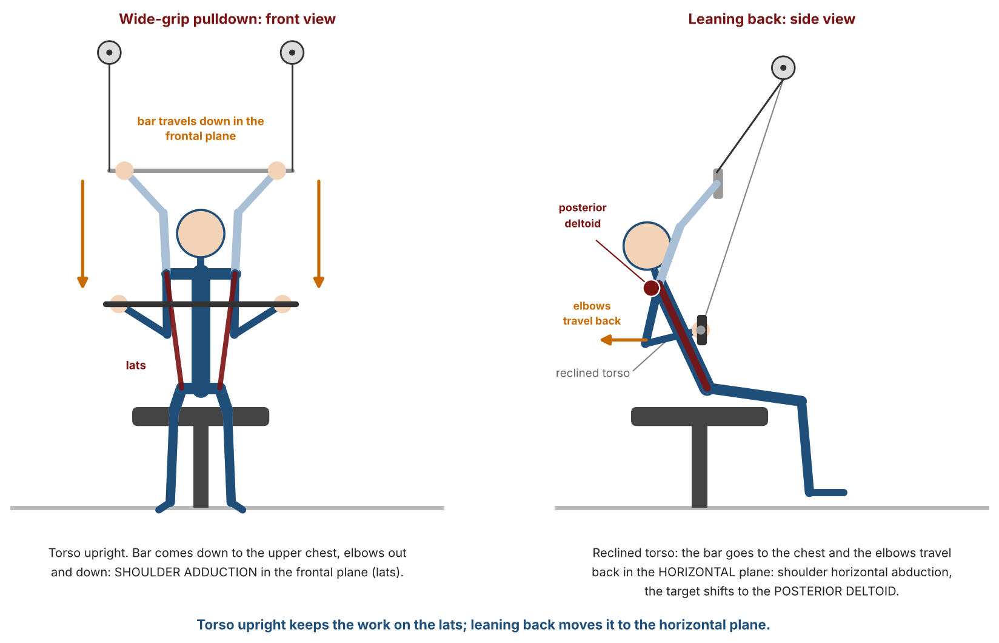

**Wide grip lat pulldown and pull-up.** The anchoring is the same as in Part 5.

- **Torso upright:** the handle travels downward in the frontal plane. The shoulder does **shoulder adduction**, and the target is the latissimus dorsi.
- **Torso reclined:** the handle travels towards the chest, and the humerus moves away from the midline in the horizontal plane. This is **shoulder horizontal abduction**, and the target shifts to the posterior deltoid.
- "What is the anchoring for" and "what is the significance of keeping the torso upright" were flagged as likely exam content.
- The lower trapezius works isometrically here too.
- **Pull-up:** you go towards the object, with a pronated grip, which is slightly more challenging. Knees flexed and feet crossed.

---

## Part 8: Trapezius exercises

### 8.1 Shrugs (upper fibres)

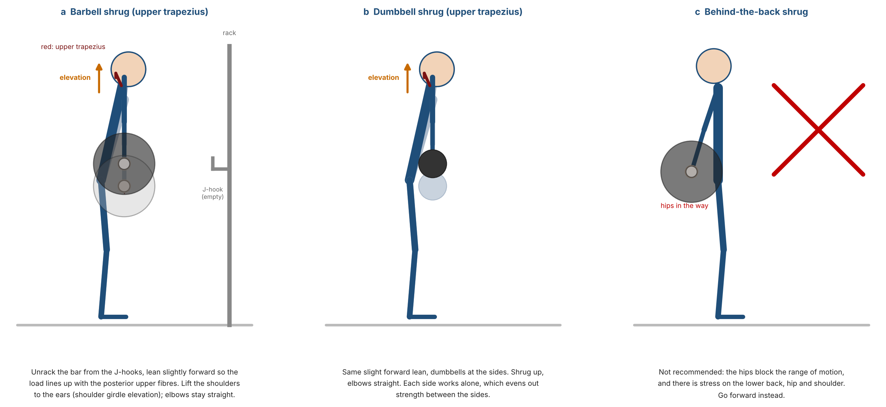

- **Joint action:** shoulder girdle elevation in the coronal (frontal) plane.
- **Grip in the video:** natural (dead) grip.
- **Barbell set-up:** the bar on the J-hooks of a power cage at a set height (the cage is covered in the legs lecture). Unrack the bar, then lean slightly forward before shrugging. For dumbbells, lean slightly forward too.
- **Why lean forward:** most upper trapezius fibres lie on the back of the neck and upper back. With the load hanging in front, the line of load does not align with the fibres. Leaning forward aligns the load and fibres, so force is used efficiently. (The lecture's "9 of 10 fibres" figure is only an illustration.)
- **Behind-the-back shrug:** not scientifically recommended. The hips limit the elevation, and there is stress on the lower back, hip and shoulder.

Q: When you shrug behind the back, does the chest work?

A: No. The chest has no elevation function. To target a muscle, do its function in the concentric phase.

Q: Why is the dumbbell better than the barbell for shrugs?

A: Symmetrical development (the weak side must carry its own load) and the natural hang grip. The barbell is still useful for progressive overload once symmetry is achieved, because gym dumbbells top out (about 60 to 70 kg in some gyms).

### 8.2 Prone shrug (middle fibres, also prone retraction)

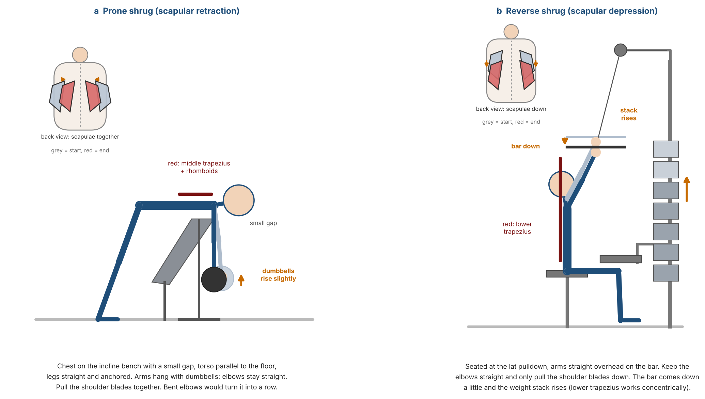

- **Joint action:** scapular retraction in the transverse plane. Works the middle trapezius and the rhomboids.
- **Set-up:** an incline bench, chest on the bench, dumbbells. The **tabletop position** has the shoulder and hip aligned and the torso parallel to the floor. Keep a small gap and do not rest fully on the backrest (it makes the legs awkward and stresses the knee and hip). The legs are straight and anchored on the floor.
- **Execution:** pull the shoulder blades together. If the elbows bend, it turns into a supported bent over row (a shoulder extension exercise).

### 8.3 Reverse shrug (lower fibres)

- **Joint action:** scapular depression. The lower fibres shorten (concentric).
- **Equipment:** the lat pulldown station. Contrast: in the lat pulldown the lower fibres are isometric, and in the reverse shrug they are concentric.

---

## Part 9: Prone high row

> **Not taught in class.** The prone high row is on the slide schedule (weeks 1 to 4) and in the video library (video 13), but it was not discussed in the sessions. This part is explained from standard exercise science using the same rules taught in this demo. Check the exact form against the practical sessions.

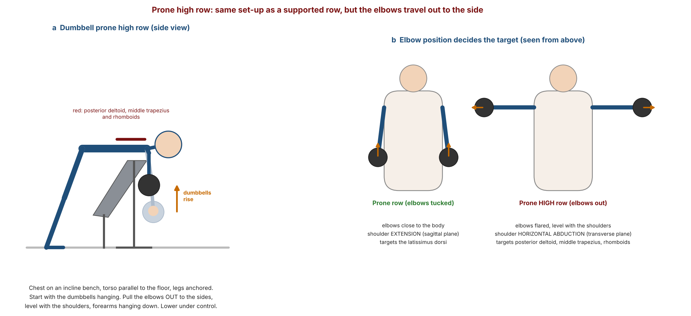

### 9.1 What it is

The prone high row is a supported row where the **elbows travel out to the sides**, level with the shoulders, instead of staying close to the body. "Prone" means face down, chest on a bench. "High" refers to the high elbow position. It is the row version of the handle choice in Part 10: **horizontal handles** (elbows out) target the posterior deltoid, and **vertical handles** (elbows close) target the latissimus dorsi.

### 9.2 Set-up

- An incline bench (a low to moderate incline), with the chest on the pad and the head clear of the top of the bench.
- Torso in the **tabletop position** (the same as the prone shrug in Part 8): keep a small gap and do not rest the whole body on the backrest. Legs straight and anchored on the floor.
- A pair of dumbbells (isolateral), hanging straight down from the shoulders. A pronated grip is the usual choice.

### 9.3 Execution

- **Concentric:** pull the elbows **out and up to the sides**, until the upper arms are about level with the shoulders. The forearms hang roughly vertical, and the elbow angle stays about the same through the set. Squeeze the shoulder blades together at the top.
- **Eccentric:** lower the dumbbells under control to the hanging position.
- The torso stays still. Do not lift the chest off the bench, swing, or shrug the shoulders towards the ears.

### 9.4 Joint action and muscles

| Item | Detail |
|---|---|
| Plane | Transverse (horizontal) plane |
| Main joint action | **Shoulder horizontal abduction** (the same action as the reverse fly and the horizontal handles of the supported row) |
| Scapula | Retraction, as the shoulder blades are drawn together |
| Elbow | Held at a fixed angle, so it is not a compound elbow flexion exercise like the bent over row |
| Prime mover | **Posterior deltoid** |
| Other working muscles | **Middle trapezius and rhomboids** (scapular retraction), with the infraspinatus and teres minor helping the shoulder |
| Stabilisers | Lower trapezius holds the scapula neutral (isometric, as in the lat pulldown). The erector spinae are supported by the bench |

The latissimus dorsi is **not** the target. It works for shoulder extension and adduction, and in this exercise the elbows move out to the side, not back along the body.

### 9.5 How it differs from the other rows and shrugs

| Exercise | Elbows | Action | Target |
|---|---|---|---|
| Prone row, vertical handles or elbows tucked | Bent, close to the body | Shoulder extension | Latissimus dorsi |
| **Prone high row** | Out to the side, level with the shoulders | Shoulder horizontal abduction | Posterior deltoid, middle trapezius, rhomboids |
| Prone shrug (Part 8) | Straight | Scapular retraction only | Middle trapezius and rhomboids |

Rule of thumb from the demo: the **elbow path decides the target**. "Which wall are the elbows cleaning?" Elbows close to the body clean the side walls and train the latissimus dorsi. Elbows out in front of the face and to the sides train the rear shoulder and mid back.

### 9.6 Common mistakes

- **Elbows drifting back along the body.** It becomes a supported bent over row and shifts the work back to the latissimus dorsi.
- **Shrugging the shoulders up.** The upper trapezius takes over from the target muscles.
- **Swinging or lifting the chest** off the bench. Momentum (cheating) is only for advanced lifters.
- **Too heavy.** The posterior deltoid and middle back muscles are small. Use a load that allows a controlled squeeze at the top.

### 9.7 Resistance profile

With the arms hanging straight down the weight has almost no moment arm for shoulder horizontal abduction. As the upper arms rise towards horizontal the moment arm grows, so the resistance is **greatest at the top**, where the shoulder blades are squeezed together. This suits the target muscles, which work hardest near the end of the range. Dumbbells are free weights, so on the resistance ranking (free weight, cable, cam machine) a reverse fly machine is a better isolation choice, and the dumbbell version is more demanding on stability.

Q: Why is the prone high row not a latissimus dorsi exercise?

A: The latissimus dorsi acts in the sagittal plane (shoulder extension) and the frontal plane (shoulder adduction). Taking the elbows out to the side is shoulder horizontal abduction in the transverse plane, which is a posterior deltoid and middle back action.

---

## Part 10: Erector spinae and multifidus

The demos run from the most difficult to the least difficult.

### 10.1 Good morning (the most difficult)

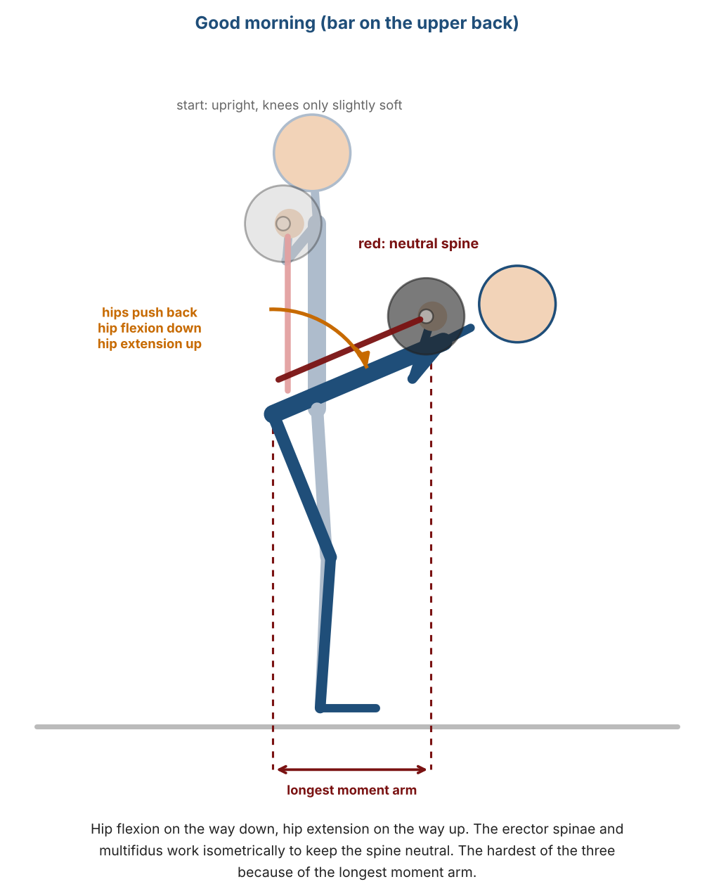

- **Start:** stand as if starting a squat with the bar on the upper back, but with no knee bend. Hinge at the hips.
- **Eccentric:** the peak is the bottom, torso forward. The joint action is hip flexion.
- **Concentric:** hip extension. The prime mover is the gluteus maximus (assisted by the hamstrings).
- **Role of the erector spinae and multifidus:** isometric. They keep the spine neutral going down and up, and prepare it for the deadlift.
- **Exception to the target rule:** here the target is the stabiliser. Better exercises for the glutes exist in the legs lecture.
- **Resistance profile:** the fulcrum is in the lumbar spine and the line of force is vertical through the weight on the back. The good morning gives the **longest moment arm** for the erector spinae, longer than the deadlift where the plates are in the hands. This is why it is the hardest: training it the harder way prepares the spine for its job in the deadlift.

### 10.2 Back extension on the bench (one level easier)

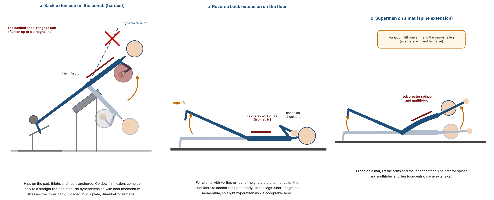

- **Name:** back extension, not hyperextension.
- **Fulcrum:** the hip. The prime mover is still the hip extensors, and the emphasis is on the erector spinae keeping the neutral spine while going down in flexion and coming up in extension.
- **Range:** between the two red lines (from flexion up to neutral). Do not continue to the hyperextension line. A clip going beyond is in the "non recommended" file.
- **Why avoid hyperextension:** with a load, going down with gravity and coming back creates momentum, and going into hyperextension with load and momentum stresses the lower back.
- **Terminology:** a doctor calls all of it extension. The fitness industry created "hyperextension" to separate dos and don'ts.
- **Loaded versions:** hug a plate, a dumbbell or a kettlebell at the chest.

Q: Can a barbell and plates be used to load the back extension on the machine?

A: No. It obstructs the range of motion (the barbell hits the floor halfway). Hugging a plate, dumbbell or kettlebell is best. A load on the back would become a supported good morning that needs help and is less stable. The bench is for stability, so do not add instability.

### 10.3 Reverse back extension on the floor (the easiest)

- **Who:** clients with vertigo (dizziness and low confidence at small heights) or fear of height.
- **Set-up:** lie face down on the floor with the hands on the shoulders, which anchors the upper body.
- **Execution:** the legs move into extension. The fulcrum is the hip and the erector spinae work isometrically. The focus is not the glutes.
- **Hyperextension** is acceptable here, because there is no momentum and the range from the floor is short.

### 10.4 Superman (spine extension function)

- The erector spinae and multifidus contract **concentrically** to take the upper body from extension towards hyperextension. This is the spine extension function. Raising the legs is isometric work.
- **Variation:** lift opposite limbs (right arm with left leg, or left arm with right leg), the prone alternate hand leg raise.
- Lateral flexion of the spine is covered with the obliques in the abdominal lecture.

---

## Part 11: The deadlift and sumo deadlift

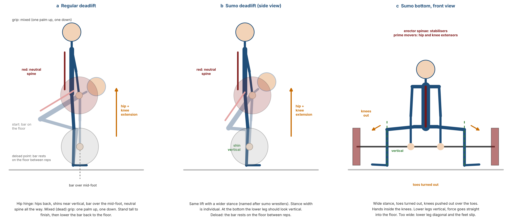

Shown as the practical application of the erector spinae as stabilisers.

Q: Which joints are involved in the deadlift?

A: The hip and the knee. The concentric action is hip extension plus knee extension (quadriceps for the knee, glutes with hamstrings for the hip, covered in the legs lecture).

**Exam hint:** the erector spinae in the deadlift are **stabilisers** that stop the spine rounding. Do not answer prime mover.

Q: Why is the deadlift done on back day?

A: The legs are the prime movers. It is placed between the back and legs lectures because the back muscles stabilise. Whether it is on back day depends on the schedule and the split (push pull legs, full body, upper lower, single body part), covered in the two scheduling lectures.

**Sumo deadlift:** the only difference is a wider stance (named after sumo wrestlers). The stance width is not fixed for everyone. Rule from the practicals: at the bottom the lower leg (tibia) should look **vertical**. If the stance is too wide, the lower leg is diagonal, the force through the floor is diagonal, and the feet tend to slip. Another technical point is deferred to the legs lecture. A recap of deloading and non-deloading was planned for the deadlift.

## Part 12: Class questions and what follows

Q: Is the T-bar row (or machine handles) also better than the dumbbell rows?

A: The T-bar row is a different exercise, not a bent over row.

The demo is followed by the legs lecture. A back support document is shared with the batch.

---

## Back exercise video library

The session worked through the back exercise library. The videos were listed in this order:

| No. | Video |
|---|---|
| 1 to 2 | Bent over dumbbell rows, bent over barbell rows |
| 3 to 4 | One arm dumbbell rows (right and left) |
| 5 | Low cable rows (seated rows) |
| 6 to 7 | Narrow grip chin-ups, narrow grip lat pulldowns |
| 8 | Straight arm pulldowns |
| 9 to 10 | Pull-ups (wide grip), wide grip lat pulldowns |
| 11 to 12 | Dumbbell shrugs, barbell shrugs |
| 13 | Prone high rows |
| 14 and 14.1 | Reverse shrugs on the lat pulldown machine, prone shrugs |
| 15 to 16 | Prone alternate hand and leg raises, prone both hand and leg raises (superman) |
| 17 | Reverse back extension off the floor |
| 18 | Back extensions (and non-recommended and loaded versions) |
| 19 | Good mornings |
| 20 to 24 | Regular deadlifts, sumo deadlifts (warm up, two preparation clips, main) |
| Straps 1 to 5 | Wearing lifting straps, and use of straps on a barbell and a dumbbell |

---

---

Key takeaways: in a bent over row, keep the torso parallel and the path straight, and prefer dumbbells for symmetry. Choose vertical handles and an upright torso to keep the work on the latissimus dorsi, and anchor the lat pulldown with the thighs fully under the pad. The lower trapezius works isometrically in vertical pulling and concentrically only in the reverse shrug. Lean slightly forward for shrugs. Taking the elbows out turns a row into the prone high row for the rear deltoid and middle back. Use the good morning and the back extension (not hyperextension) to train the erector spinae to hold the neutral spine, and remember they are stabilisers in the deadlift.

---

## Points to Confirm

1. **"Hyper extension" slip.** The lecture said this once for the shoulder in a row and corrected it to shoulder extension.
2. **"PNS" for CNS.** The symmetry explanation said PNS once. The central nervous system is meant.
3. **Range of motion benefit.** The recording cut the second benefit of a parallel torso. Range of motion is the likely meaning.
4. **Slide assignments.** The slides ask trainers to counsel a training partner on doing bent over rows before supported rows, to counsel gym members to reset their deadlifts, and to counsel a friend about wide grip lat pulldowns before narrow grip. The slide's ordering rule for narrow and wide grip was not discussed in this session.
5. **Video audio.** The audio of the dumbbell row video failed part way, so the breathing points are not fully recorded.
6. **Handle choice wording.** The lecture said the "horizontal fibres" are targeted in shoulder extension while discussing the handles. It appears to mean the posterior deltoid for the horizontal handles.
7. **Wide grip answers.** During the lat pulldown discussion the class answers flipped between abduction and adduction. The wide grip is shoulder adduction.
8. **Planes in the reclined pulldown.** The lecture said "sagittal" and "frontal" interchangeably. Adduction is in the frontal plane and extension is in the sagittal plane. It also said "horizontal adduction" once and corrected it to horizontal abduction.
9. **Upper trapezius origin.** The lecture said C1 to C7. The slide says occipital protuberance to C7.
10. **The "9 of 10 fibres" figure.** An illustration, not a measurement.
11. **Names of the machines.** The lecture said "one arrow" for the one arm row, and the machine for the reverse shrug was heard as the lat pulldown.
12. **Second benefit of dumbbells in shrugs.** The recording was unclear (a joke term). The natural hang grip is taken as the likely meaning.
13. **Moment arm.** The recording often wrote "momentum" where moment arm is meant.
14. **Good morning and the target rule.** The lecture said the target is usually the prime mover and called this an exception.
15. **Back extension on slides.** The slide lists the back extension as spine extension. This session teaches it as neutral spine work.
16. **Slide schedule.** The slides contain a weekly schedule and relative and absolute strength examples. They were not discussed in these sessions.
17. **Prone high row.** The prone high row is in the video library and on the slide schedule (weeks 1 to 4), but it was not discussed in class. Part 9 explains it from standard exercise science. Please check it against the exact form taught in the practical sessions.
18. **Two sessions combined.** The demo was split over two sessions because of an interruption, so the exercise parts of both are combined here.
19. **Figures.** The figures are simplified drawings made for these notes. Exact form is taught in the practical sessions.

---

# Board Photos from the Demo

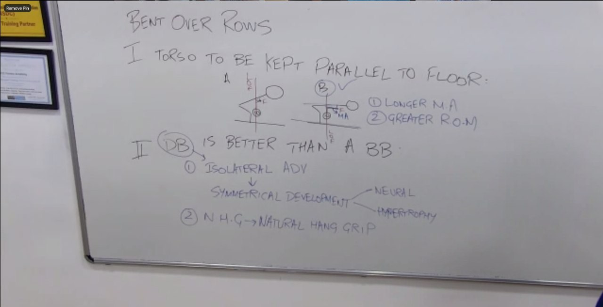
