# Back Demo: Study Notes

**Course:** Personal Training Certification

**Topic:** Back demo: latissimus dorsi and teres major, exercise categories, the pullover, and every back exercise (rows, lat pulldown, chin-up, pull-up, straight arm pulldown, shrugs, prone high row, prone and reverse shrug, good morning, back extensions, superman, deadlift), plus grips and equipment guidelines

**About these notes:** Short revision version of the Back Demo (the two demo sessions combined). For the full explanation of every exercise, example and class question, see the Detailed Notes. The figures are original drawings that show the idea of each exercise. The practical sessions teach the exact form. Sources: the session recordings, the course slides and the board photos. The prone high row was not taught in class and is explained from standard exercise science.

**Big idea:** The latissimus dorsi and teres major extend, adduct and internally rotate the shoulder. Train them with shoulder extension (thickness) and shoulder adduction (width). Match the exercise to the muscle function: rows and close grip pulldowns give shoulder extension, wide grips give shoulder adduction, elbows out gives horizontal abduction for the posterior deltoid, shrugs, prone shrugs and reverse shrugs give the three trapezius functions, and the good morning and back extension train the erector spinae to hold the neutral spine.

---

## 1. Latissimus dorsi and teres major

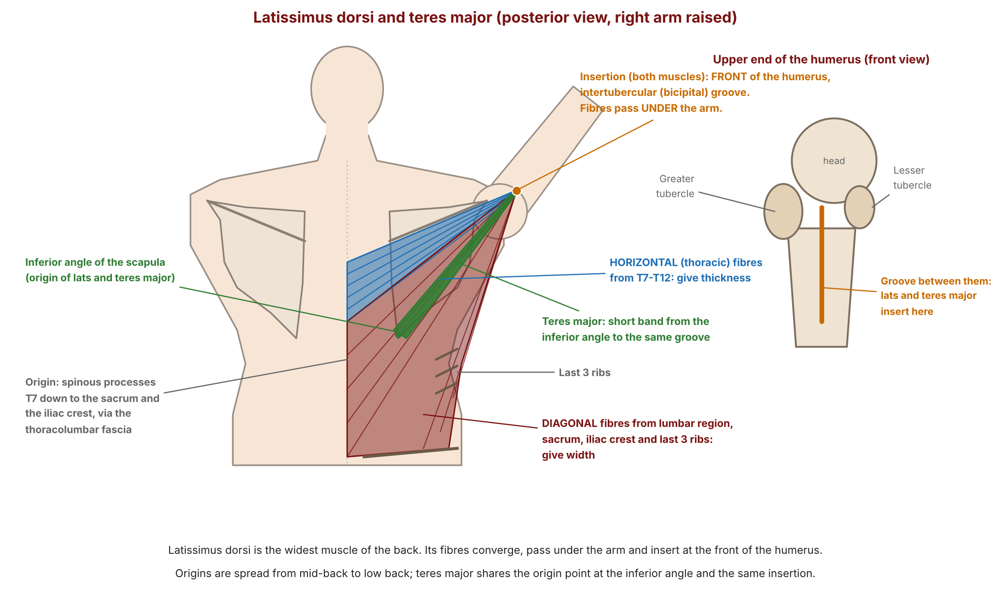

| Point | Latissimus dorsi | Teres major |
|---|---|---|
| Name | "Widest back" | Cylindrical, bigger than teres minor |
| Origin | T7 to the sacrum and coccyx (via the thoracolumbar fascia), iliac crest, last 3 ribs, inferior angle of the scapula | Inferior angle of the scapula |
| Insertion | Front of the humerus, intertubercular (bicipital) groove | Same groove |
| Functions | Shoulder extension, adduction, internal rotation | Same |

- Fibres go **under** the arm to the front of the humerus.
- **Horizontal fibres** (T7 to T12) and **diagonal fibres** (lumbar, sacrum, iliac crest, last 3 ribs) is a teaching split.

## 2. Functions

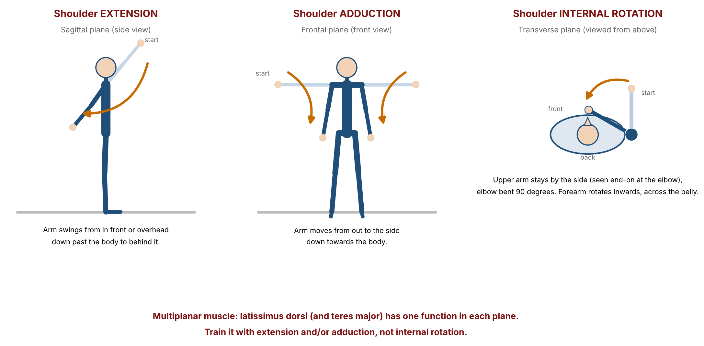

| Plane | Function |
|---|---|
| Sagittal | Shoulder extension |
| Frontal | Shoulder adduction |
| Transverse | Shoulder internal rotation |

- Multiplanar muscle. **Do not train it with internal rotation.** Use extension and/or adduction.

## 3. Exercise categories

| Function | Compound | Isolation |
|---|---|---|
| Shoulder extension | Chin-up (narrow grip), close grip lat pulldown, most rows | Straight arm pulldown |
| Shoulder adduction | Wide grip pull-up, wide grip lat pulldown | Multi-gym lever machine |

- Rows: bent over, T-bar, seated, one arm, chest-supported. Support: unsupported (bent over), pelvic girdle (seated row), pelvic girdle and spine (chest-supported).
- **Thickness vs width:** extension uses more horizontal fibres (thicker back), adduction uses more diagonal fibres (wider back). Do both.
- **Myth:** a very wide grip does not create a V-taper.

## 4. Exercise map

| Target | Function | Exercise | Type |
|---|---|---|---|
| Latissimus dorsi | Shoulder extension | One arm row, seated row, supported row, bent over rows | Compound |
| Latissimus dorsi | Shoulder extension | Close grip lat pulldown, chin-up | Compound |
| Latissimus dorsi | Shoulder extension | Straight arm pulldown, cam pullover | Isolation |
| Latissimus dorsi | Shoulder adduction | Wide grip lat pulldown, pull-up | Compound |
| Upper trapezius | Shoulder girdle elevation | Barbell or dumbbell shrug | Isolation |
| Middle trapezius and rhomboids | Scapular retraction | Prone shrug | Isolation |
| Lower trapezius | Scapular depression | Reverse shrug | Isolation |
| Erector spinae and multifidus | Neutral spine (isometric) | Good morning, back extension | Compound |
| Erector spinae and multifidus | Spine extension | Superman | Isolation |

## 5. Rows

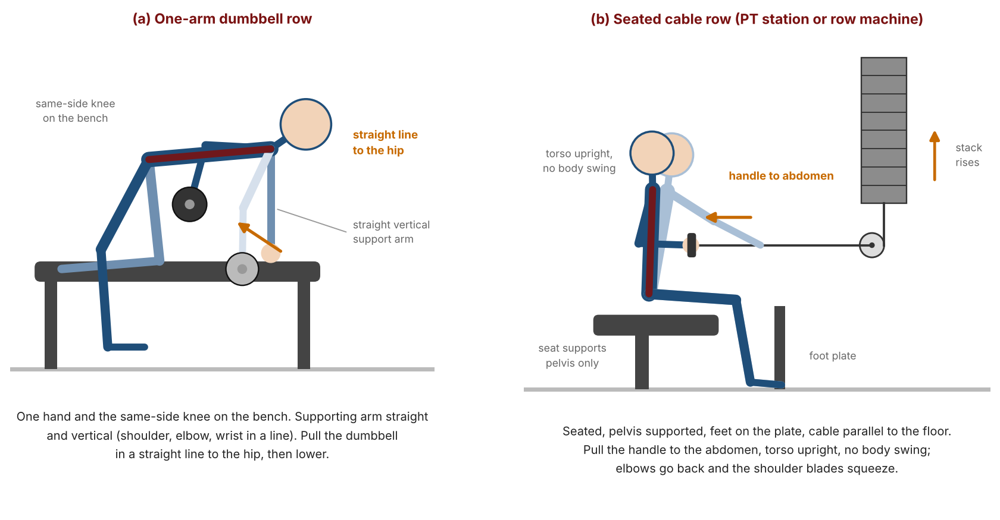

- **One arm row** (unilateral): hand and same-side knee on the bench, supporting arm straight and vertical, linear path.
- **Seated row:** cable parallel to the floor, torso upright, **no body swing**. Supported at the pelvis only. The erector spinae stop the back rounding (isometric). Cheating is for advanced lifters only.

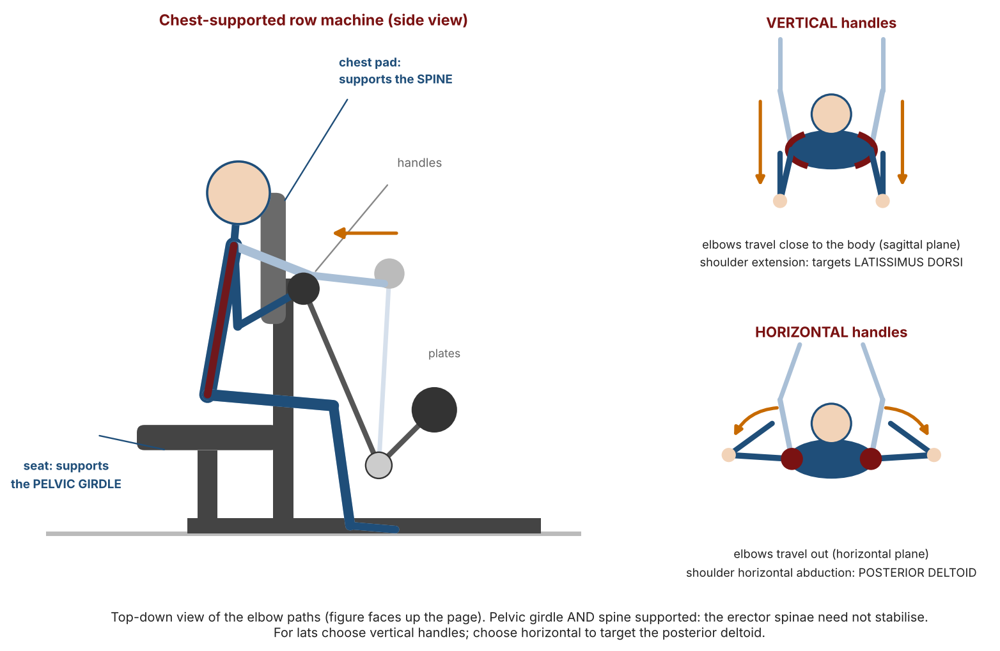

| Handles | Action | Target |
|---|---|---|
| Vertical | Shoulder extension | Latissimus dorsi |
| Horizontal | Shoulder horizontal abduction | Posterior deltoid |

- Chest-supported machine: pelvic girdle **and** spine supported. Plate-loaded versions are fulcrum based.

## 6. Bent over rows

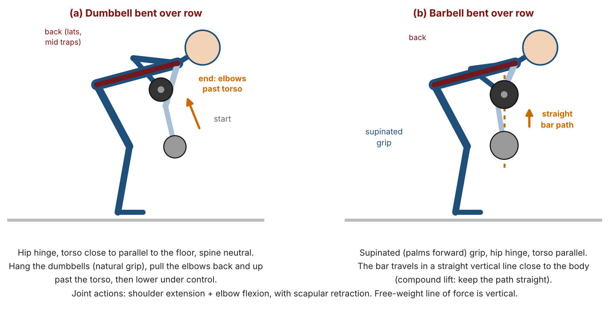

- Dumbbell row: natural hang grip, isolateral. Barbell row: bilateral, supinated grip. Both: hip hinge, compound, **straight path**. Shoulder extension, elbow flexion and scapular retraction.

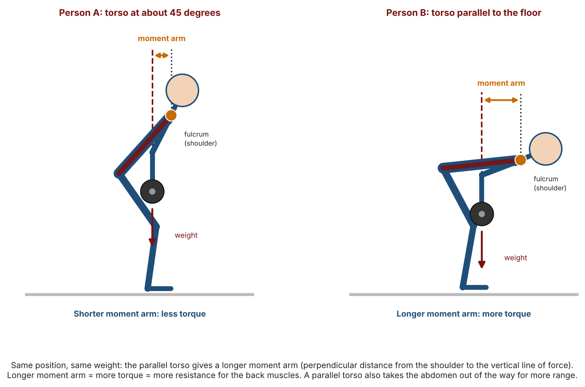

| Viva point | Reason |
|---|---|
| Keep the torso parallel to the floor | Longer moment arm, more torque and resistance; the abdomen is out of the way, more range |
| Dumbbell is better than barbell | Symmetry (the weak side must carry its own load: neural stage, then hypertrophy stage), and natural hang grip |

## 7. Lat pulldown, chin-up and pull-up

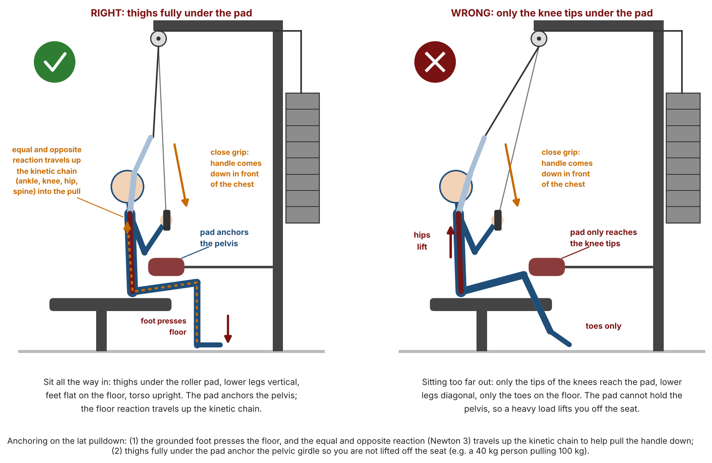

- **Anchoring:** thighs fully under the pad, lower legs vertical, feet flat. Two reasons: (1) force transfer up the kinetic chain (Newton's third law), (2) the pelvis is not lifted off the seat.
- **Torso upright.** Errors: body swing, leaning back.
- **Lower trapezius works isometrically** in vertical pulling: it stops the scapula elevating. Depression (concentric) is only in the reverse shrug.

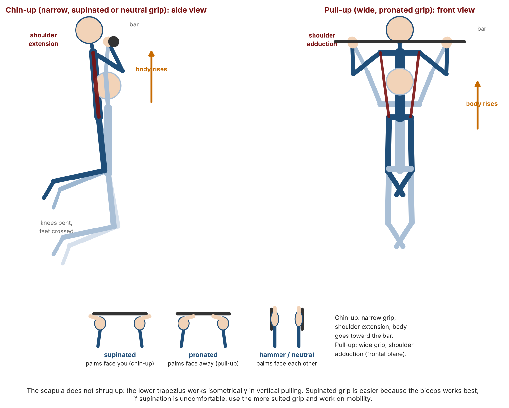

- **Chin-up:** narrow grip, shoulder extension, knees bent and feet crossed. Supinated grip is easier because the strongest elbow flexor is at its best. For clients who cannot supinate, use the hammer grip and work on mobility.
- **Pull-up:** pronated wide grip, shoulder adduction, slightly more challenging.

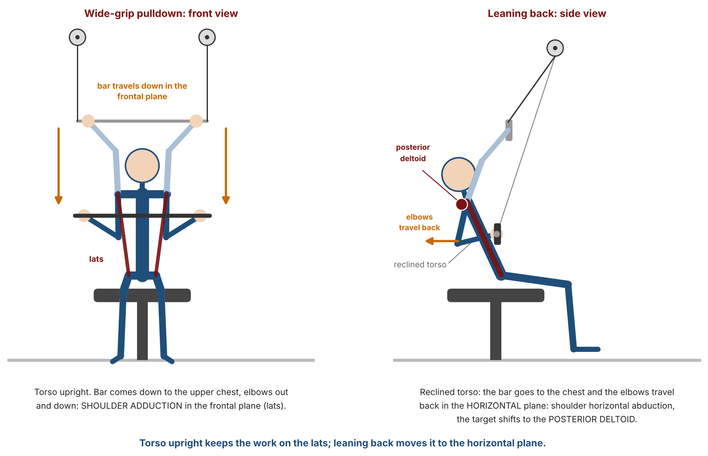

| Torso | Plane | Action | Target |
|---|---|---|---|
| Upright | Frontal | Shoulder adduction | Latissimus dorsi |
| Reclined | Horizontal | Shoulder horizontal abduction | Posterior deltoid |

## 8. Pullover and isolation for shoulder extension

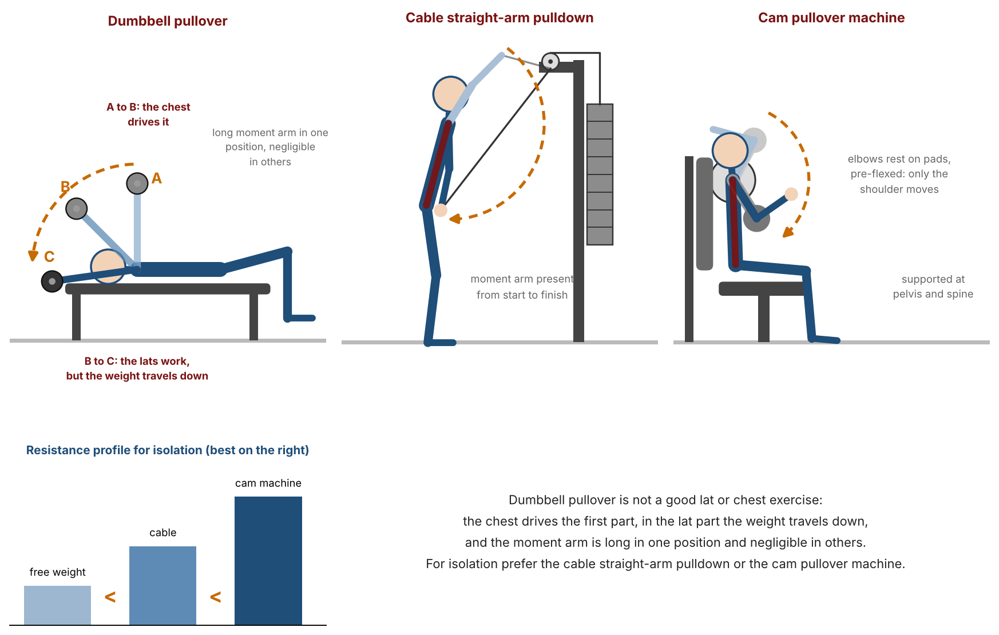

- Dumbbell pullover, positions A, B, C: A to B the chest drives, B to C the lats but the weight travels down. Not good for the lats or the chest.
- Resistance profile for isolation: **free weight < cable < cam machine**.
- Better: **straight arm pulldown** (cable) and **machine pullover** (cam, supported at pelvis and spine, elbows pre-flexed on pads, only the shoulder moves).

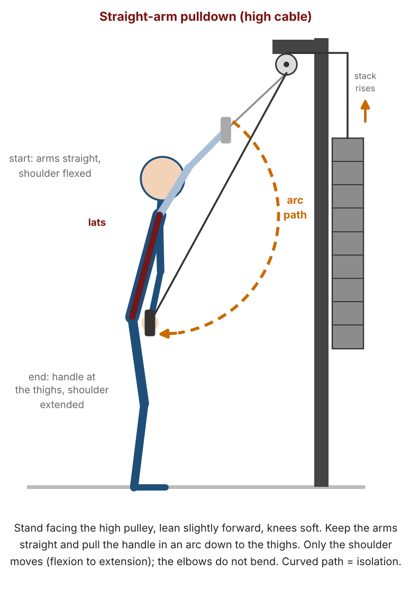

- **Straight arm pulldown:** only the shoulder moves, elbows straight, curved path (isolation = curved, compound = linear).
- Resistance profile: dumbbell (long moment arm in one position only) < cable (moment arm throughout) < **cam machine** (best, with support and stability).
- The pullover also works the chest early in the range. Do not use it for the chest.

## 9. Trapezius exercises

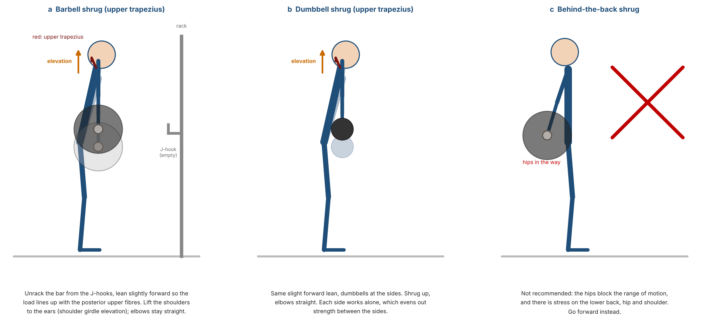

- **Shrug:** shoulder girdle elevation. **Lean slightly forward** so the load lines up with the posterior fibres. **No behind-the-back shrugs** (hips limit range, stress on lower back, hip and shoulder). Dumbbells give symmetry. Barbells help overload once symmetry is achieved.

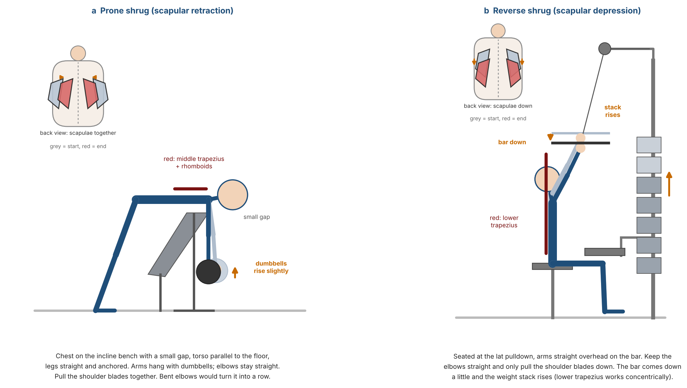

- **Prone shrug:** incline bench, tabletop position, small gap, elbows straight, pull the shoulder blades together. Bent elbows turn it into a row.
- **Reverse shrug:** lat pulldown station, elbows straight, pull the shoulder blades down.

## 10. Prone high row (not taught in class)

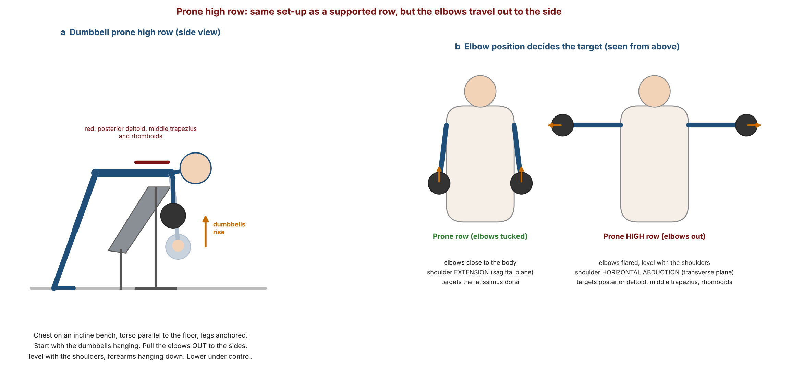

- Explained from standard exercise science. It is on the slide schedule and in the video library, but it was not discussed in class. Check the form in the practicals.
- **Set-up:** incline bench, chest on the pad, tabletop position, legs anchored, dumbbells hanging.
- **Execution:** pull the **elbows out to the sides**, level with the shoulders, forearms hanging down. Squeeze the shoulder blades. Lower under control.
- **Action:** shoulder horizontal abduction (transverse plane) with scapular retraction. **Posterior deltoid** is the prime mover, with the middle trapezius and rhomboids. **Not** a latissimus dorsi exercise.
- Elbow path decides the target: elbows close = latissimus dorsi (extension), elbows out = posterior deltoid (horizontal abduction). Straight elbows and only the scapula moving = prone shrug.
- Mistakes: elbows drifting back (becomes a row), shrugging up, swinging, too heavy.

## 11. Erector spinae and multifidus exercises

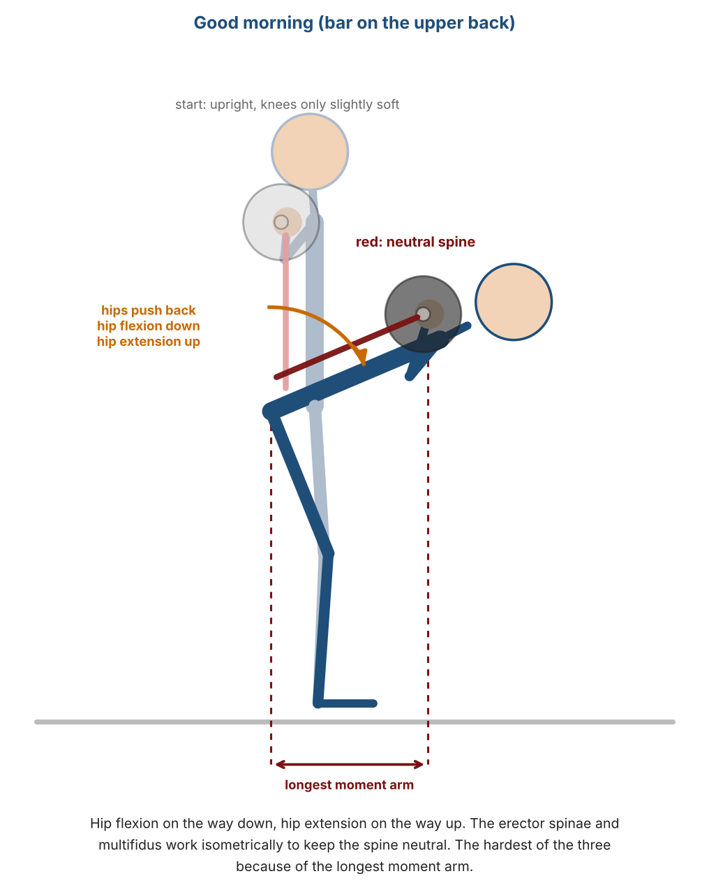

- **Good morning:** hip hinge with the bar on the back. Hip flexion down, hip extension up. The erector spinae work isometrically. Hardest, because it has the **longest moment arm**.

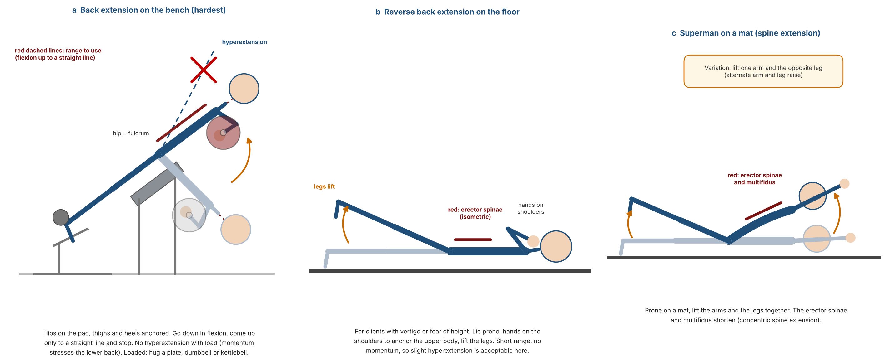

- **Back extension on the bench:** go down in flexion, come up to a straight line and stop. No hyperextension with load. Load by hugging a plate, dumbbell or kettlebell, never a barbell on the machine.
- **Reverse back extension on the floor:** for vertigo or fear of height. Hands on the shoulders, legs lift.
- **Superman:** spine extension, erector spinae and multifidus shorten. Variation: opposite arm and leg.

## 12. Deadlift and sumo deadlift

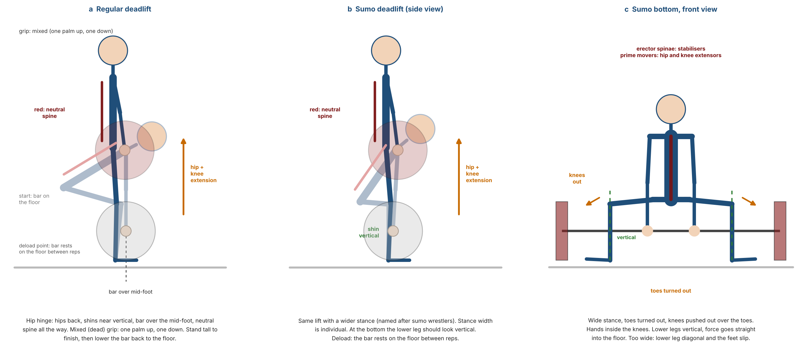

- Hip extension plus knee extension. Prime movers: leg muscles. **Erector spinae: stabilisers.**
- Sumo: wider stance. At the bottom the lower leg should look **vertical**.

## 13. Grips and equipment

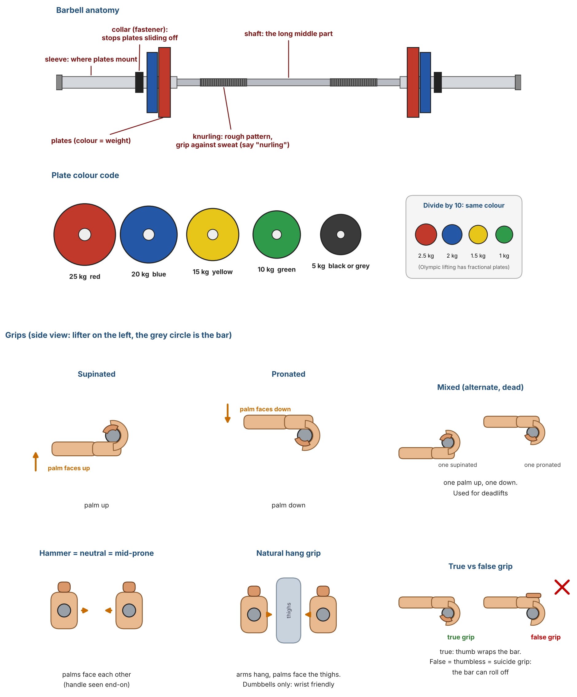

| Grip | Meaning |
|---|---|
| Supinated | Palm up |
| Pronated | Palm down |
| Mixed (alternate, dead grip) | One up, one down (deadlift) |
| Hammer, neutral, mid-prone | Palms facing |
| Natural hang grip | Palms facing the thighs, dumbbells only |
| False (thumbless, suicide) grip | Thumb not wrapped |

- Supinated grip lifts the most in rows (biceps brachii works best). Do not force it on people with poor wrist or forearm mobility.
- Barbell parts: collar (fastener), sleeve, shaft, knurling.
- Plates: 25 red, 20 blue, 15 yellow, 10 green, 5 black or grey.
- Straps so the prime mover fails first. Chalk is magnesium carbonate.
- **Belt:** not for lumbar support. Valsalva plus a belt raises abdominal pressure so the spine cannot round. Keep the Valsalva going.

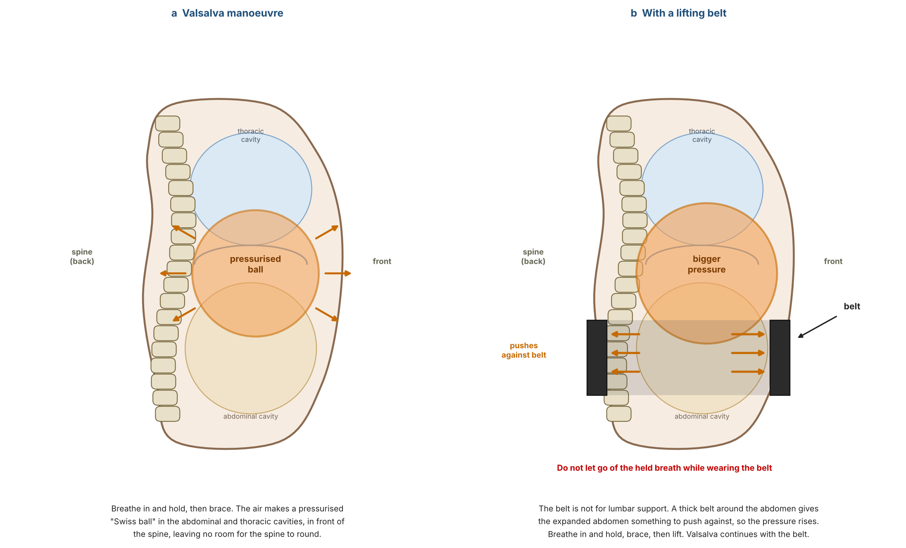

- **Hip hinge** beats leaning forward: the centre of gravity stays over the base.

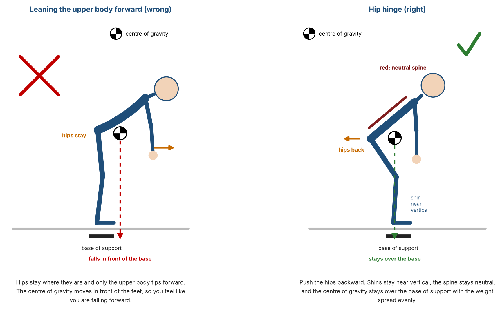

## 14. Key terms

| Term | Meaning |
|---|---|
| Multiplanar | Working in more than one plane |
| Thoracolumbar fascia | The white fascia over the thoracic and lumbar spine |
| Intertubercular groove | Groove between the greater and lesser tubercles of the humerus |
| Isolateral | Two separate objects, both sides at once |
| Bilateral | One object, both sides |
| Unilateral | One side at a time |
| Moment arm | Perpendicular distance from the fulcrum to the line of force |
| Valsalva | Breath held to brace the trunk |
| Hip hinge | Bending by pushing the hips back |
| Anchoring | Fixing the body so the force goes into the pull |
| Kinetic chain | Force passing ankle, knee, hip, spine |
| Tabletop position | Shoulder and hip aligned, torso parallel to the floor |
| Hammer grip | Palms facing each other |
| Back extension | Bench exercise stopping at a straight line |
| Hyperextension | Going past a straight line (not recommended with load) |
| Cheating | Using momentum, only for advanced lifters |
| Sumo deadlift | Deadlift with a wide stance |

## 15. Where the sources differ

- **Pullover and "eccentric":** the argument is really about the resistance profile, not the contraction type.
- **Teres major:** not strictly a synergist. It depends on the exercise.
- **Back extension:** neutral spine work (session) versus spine extension (slide).
- **Wide grip:** the class sometimes said abduction. The correct action is adduction.
- **Prone high row:** not taught in class. Explained from standard exercise science.

## 16. Revision questions

1. What do "latissimus" and "teres" mean?
2. State the origin and insertion of the latissimus dorsi.
3. Why do the fibres go "under" the arm?
4. What are the horizontal and diagonal fibres?
5. State the functions of the latissimus dorsi and teres major.
6. Which function should not be used to train the latissimus dorsi?
7. Give a compound and an isolation exercise for shoulder extension.
8. Give a compound exercise for shoulder adduction.
9. How does a wider grip change the exercise?
10. What gives a thicker back, and what gives a wider back?
11. Why is the dumbbell pullover not recommended?
12. Rank free weight, cable and cam machine for isolation.
13. Describe the machine pullover.
14. Which grip lifts the heaviest in rows and why?
15. What is the natural hang grip and why use it?
16. Name the parts of a barbell.
17. Give the plate colour code.
18. What is the real job of a lifting belt?
19. Why is the hip hinge preferred over leaning forward?
20. Give two reasons to keep the torso parallel and two reasons dumbbells beat barbells in the bent over row.
21. Which muscle group stops the back rounding in a seated row?
22. Is the seated row supported or unsupported?
23. Which handles target the latissimus dorsi in a supported row, and which the posterior deltoid?
24. Give the two reasons for anchoring on the lat pulldown.
25. What is the correct leg position in the lat pulldown?
26. How does the lower trapezius work in vertical pulling?
27. Why is the chin-up easier than the pull-up?
28. What should be done for a client who cannot supinate?
29. What changes if the torso leans back in a wide grip pulldown?
30. Describe the straight arm pulldown.
31. Rank the dumbbell, cable and cam pullovers.
32. Why lean forward in a shrug?
33. Why is the behind-the-back shrug not recommended?
34. Why is the dumbbell better than the barbell for shrugs?
35. Describe the prone shrug.
36. Describe the reverse shrug and how it differs from the lat pulldown for the lower trapezius.
37. What are the hip actions in a good morning?
38. Why is the good morning the hardest exercise for the erector spinae?
39. How should the back extension be performed, and why not hyperextension?
40. What is the role of the erector spinae in the deadlift, and what rule applies to the sumo stance?
41. What is the prone high row, and which joint action does it use?
42. Which muscles are the prime mover and the helpers in the prone high row?
43. How does the prone high row differ from the prone shrug and from a row with vertical handles?

## Answers

1. The erector spinae group, isometrically.
2. Supported at the pelvic girdle only.
3. Vertical handles target the latissimus dorsi, horizontal handles the posterior deltoid.
4. Force transfer through the kinetic chain, and anchoring the pelvic girdle so the person is not lifted off the seat.
5. Thighs fully under the pad, lower legs vertical, feet flat on the floor.
6. Isometrically. It holds the scapula at neutral and stops it elevating.
7. In the supinated grip the strongest elbow flexor works at its best, so the latissimus dorsi does more of the work in the pronated pull-up.
8. Do not force it. Use the hammer grip, keep it challenging and work on mobility.
9. The movement moves from the frontal to the horizontal plane (shoulder horizontal abduction) and the target shifts to the posterior deltoid.
10. Stand at a high cable, lean slightly forward, keep the elbows straight and pull the handle in an arc to the thighs. Only the shoulder moves.
11. Dumbbell is lowest, cable is better, cam machine is the best.
12. Most upper trapezius fibres are at the back, so leaning forward lines the load up with them.
13. The hips limit the elevation and there is stress on the lower back, hip and shoulder.
14. Symmetrical development (the weak side carries its own load) and the natural hang grip.
15. On an incline bench in the tabletop position, hang dumbbells and pull the shoulder blades together with straight elbows. Bent elbows turn it into a row.
16. At the lat pulldown station with straight arms, pull the shoulder blades down. The lower fibres shorten here (concentric), but are isometric in the lat pulldown.
17. Hip flexion on the way down and hip extension on the way up.
18. It has the longest moment arm for the erector spinae.
19. Go down in flexion, come up to a straight line and stop. Hyperextension with load adds momentum and stresses the lower back.
20. They are stabilisers that stop the spine rounding. The prime movers are the hip and knee extensors. In the sumo stance the lower leg should look vertical at the bottom.
21. A supported row on an incline bench where the elbows go out to the sides, level with the shoulders. The joint action is shoulder horizontal abduction in the transverse plane, with scapular retraction.
22. The posterior deltoid is the prime mover, with the middle trapezius and rhomboids (and the infraspinatus and teres minor helping). It is not a latissimus dorsi exercise.
23. Vertical handles keep the elbows close and give shoulder extension for the latissimus dorsi. The prone shrug keeps the elbows straight and only the scapula moves. The prone high row takes the elbows out for horizontal abduction.

---

## Board photos

See the Back Demo Detailed Notes for the board photos.
