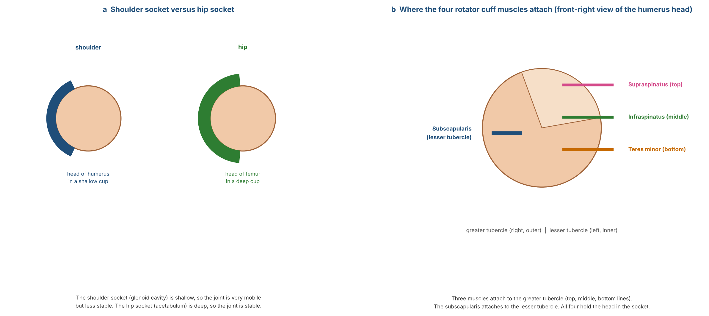
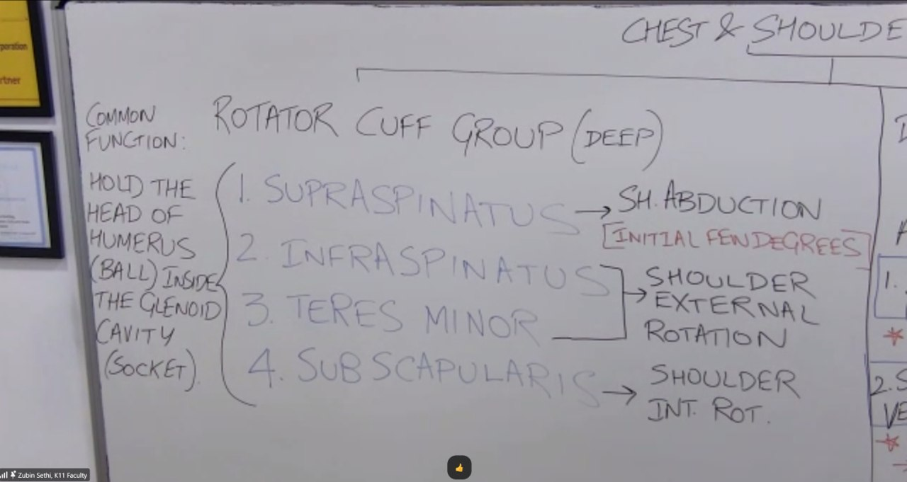
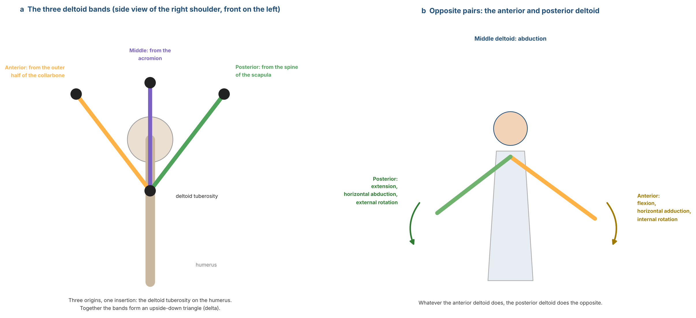
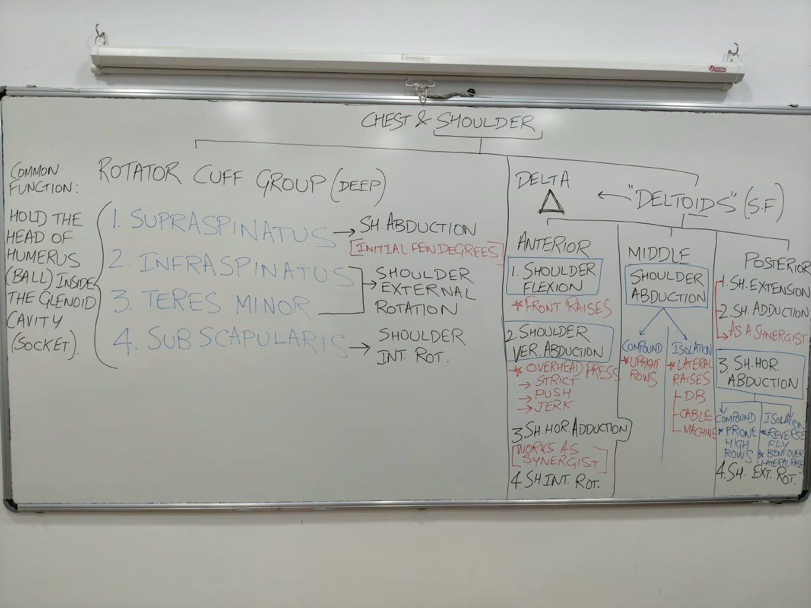
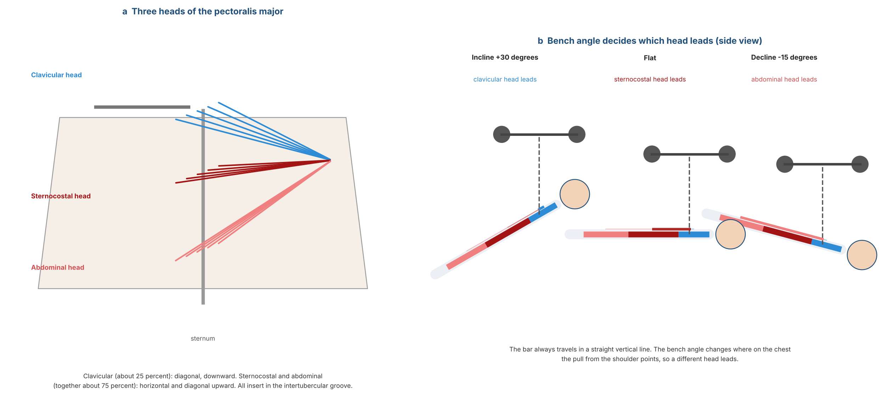
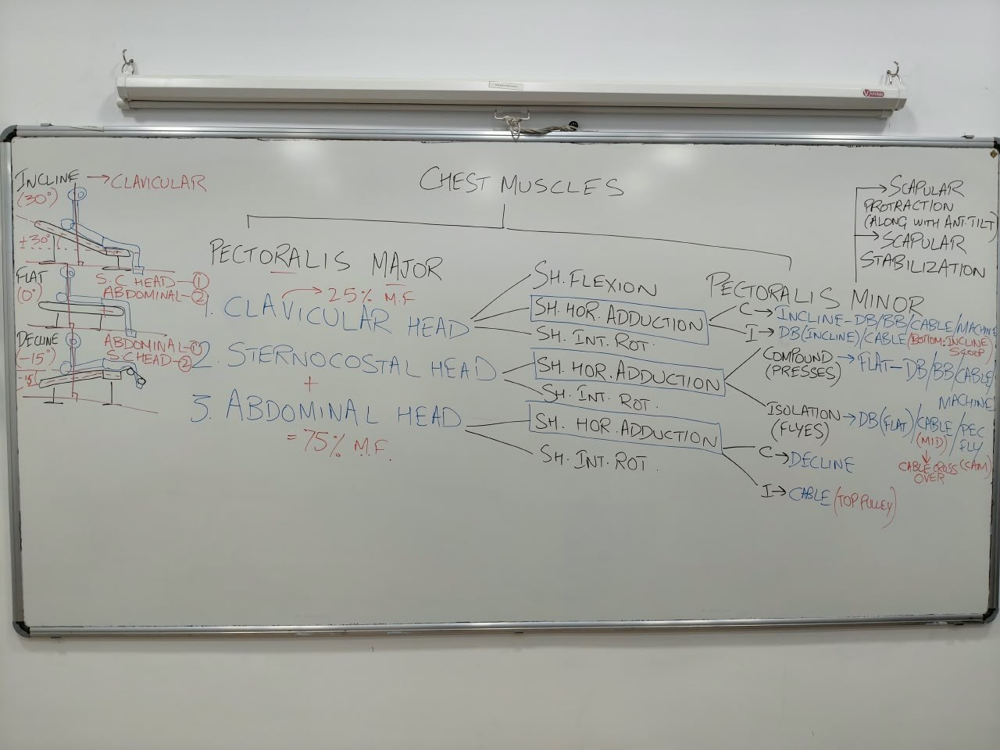

# Chest Shoulder Lecture: Detailed Notes

**Course:** Personal Training Certification

**Topic:** Chest and shoulder as a body part: why train them, the shoulder joint (glenohumeral joint), the rotator cuff group (supraspinatus, infraspinatus, teres minor, subscapularis), the three parts of the deltoid, their functions and exercises, the pectoralis major and its three heads, bench angles, the pectoralis minor

**About these notes:** Detailed notes for the Chest Shoulder Lecture (the theory), written so the whole lecture can be studied without watching the recording. Every concept, analogy and class question is covered. The exercise demonstrations (videos, set-up and form points) are in the Chest Shoulder Demo notes. For a short revision version, see the Study Notes. Sources: the lecture recording, the course slides ("Body part 3: Chest and Shoulders") and the board photos. The figures are original drawings made for these notes.

---

## Abbreviations used in these notes

| Short form | Meaning |
|---|---|
| RCG | Rotator cuff group |
| SF | Superficial |
| M, O, I, F, E | Muscle, origin, insertion, function, exercise example |
| Prime mover | The muscle mainly responsible for a movement |
| Synergist | A helper muscle that does the same job as the prime mover |
| Stabiliser | A muscle that works to keep a body part steady |
| Compound | An exercise with movement at more than one joint |
| Isolation | An exercise with movement at one joint |

## Before this lecture

You should know the joints of the shoulder girdle (sternoclavicular, acromioclavicular, scapulothoracic and glenohumeral), the landmarks of the scapula and humerus from the back lecture, the planes of movement, shoulder joint actions (including horizontal adduction and vertical abduction), compound and isolation exercises, and the idea of a prime mover and a synergist.

## Outline of the lecture

| Part | Topic |
|---|---|
| 1 | Why train chest and shoulder |
| 2 | The glenohumeral joint: three characteristics |
| 3 | Two layers of muscle: the deep rotator cuff group and the superficial deltoid |
| 4 | The rotator cuff group: anatomy, functions, when and how to train |
| 5 | The deltoids: names, anatomy, functions |
| 6 | Deltoid exercises |
| 7 | The pectoralis major: three heads |
| 8 | Bench angles and head emphasis |
| 9 | Exercise glossary for the chest |
| 10 | The pectoralis minor |

---

## Part 1: Why train chest and shoulder

1. **Pushing strength.** On back day the theme was pulling and lifting. Chest and shoulder train two kinds of pushing: a **horizontal push** and a **vertical push**.
2. **Protection of a crucial joint.** These muscles act as a shield around the shoulder joint, the champion joint of the body, the joint with the most joint actions (from the kinesiology lectures).

---

## Part 2: The glenohumeral joint

The shoulder joint is the **glenohumeral joint**, a ball and socket joint. The name carries the two parts: *gleno* comes from the **glenoid cavity** (the socket) and *humeral* from the **head of the humerus** (the ball). *Glenoid* means a shallow cavity, like a shallow cup. The glenoid cavity is part of the scapula, on its lateral side.

Three characteristics explain why the joint needs so much protection.

1. **Less structurally stable.** Compare it with the hip, the other ball and socket joint. In the hip the head of the femur sits deep in the acetabulum. In the shoulder the ball is just mounted on a shallow socket. This gives an advantage and a drawback.
   - Advantage: more movement. The shoulder has 11 joint actions and the hip 10. The extra one is **vertical abduction**, which the hip cannot do because the ball sits inside the socket.
   - Drawback: the ball can come out of the socket, which is a **shoulder dislocation**. Shoulder dislocations are much more common than hip dislocations. A hip dislocation needs a big impact such as an accident, while a shoulder dislocation is common in sportspeople such as fast bowlers.
2. **Highly mobile.** Most joint actions are possible: flexion, extension, hyperextension, abduction, adduction, horizontal adduction, rotations and circumduction.
3. **Widely used.** Writing on a board, carrying shopping, lifting something to a shelf, and nearly every gym exercise (every row and lat pulldown in the back lecture used shoulder extension and adduction).

Because it is unstable, mobile and used all the time, nature gave it layers of muscle all around it.

---

## Part 3: Two layers of protection

The shoulder muscles come in two groups:

- **Deep layer:** the **rotator cuff group** (RCG), which sits close to the joint.
- **Superficial layer:** the **deltoids**, which cover the rotator cuff from above.

The class compared it to a two-step verification on a payment app: the higher the risk, the more layers of safety.

---

## Part 4: The rotator cuff group

### 4.1 The four muscles

1. Supraspinatus
2. Infraspinatus
3. Teres minor (the "younger brother" of teres major from the back lecture)
4. Subscapularis

### 4.2 Insertion: where they attach

All four attach near the head of the humerus. The head has two bumps, the **greater tubercle** (larger, on the lateral side) and the **lesser tubercle** (smaller, on the medial side). Between them lies the **intertubercular groove**, the landmark used on back day for the latissimus dorsi and used again today for the chest.

A memory hack from class: a **condyle** is found at the end of a bone where it forms a hinge joint with another bone (for example at the knee and the elbow). The head of the humerus is a ball and socket end, so it has tubercles, not condyles. *Tubercle* means a small bump, *inter* means between, so the intertubercular groove is the groove between the two tubercles.

The greater tubercle has three lines, one above the other.

| Muscle | Attaches to |
|---|---|
| Supraspinatus | Top line of the greater tubercle |
| Infraspinatus | Middle line of the greater tubercle |
| Teres minor | Bottom line of the greater tubercle |
| Subscapularis | The whole lesser tubercle |

### 4.3 Origin, name and function of each muscle

The names come from the origins.

- **Supraspinatus.** *Supra* is above and *spinatus* refers to the spine of the scapula. It starts in the **supraspinous fossa** (a pit above the spine of the scapula), passes through the gap above the joint and attaches at the very tip of the humerus. When it contracts, the arm moves away from the midline in the frontal plane, so the function is **shoulder abduction**. Because it only reaches the tip of the humerus, it can only produce the **initial few degrees (about 20 to 30)** of abduction. The middle deltoid, which reaches further down the humerus, does the full movement up to 90 degrees.
- **Infraspinatus.** *Infra* is below. It starts in the **infraspinous fossa** (below the spine of the scapula), comes over the back of the arm and attaches to the middle line. Function: **shoulder external rotation**.
- **Teres minor.** *Teres* means round or cylindrical. It starts on the **lateral border** of the scapula, comes over the arm and attaches to the bottom line. Teres major (back lecture) starts at the inferior angle of the scapula, goes under the arm and attaches in the intertubercular groove, so it does internal rotation. Teres minor has the same job as the infraspinatus: **shoulder external rotation**.
- **Subscapularis.** *Sub* is under. It starts in the **subscapular fossa**, on the front (anterior) surface of the scapula, goes under the arm and attaches to the lesser tubercle. Function: **shoulder internal rotation**.

*Fossa* means a pit or a concave surface, like the bowl of a spoon.

A point the class stressed for tests: external rotation has **two** muscles in this group (infraspinatus and teres minor). Internal rotation has **one** (subscapularis). If both external rotators are listed as options, both are correct.

### 4.4 The common function: holding the ball in the socket

The four muscles come from different directions and together hold the head of the humerus inside the glenoid cavity. This is where the name comes from: a cuff, as in handcuffs, tied round the head. In the class framing: the standalone functions (abduction, external and internal rotation) are their jobs as **prime movers**, and the cuff action is their job as **stabilisers**.

### 4.5 When and how to train the rotator cuff

**When.** If you train them with real weights as prime movers, do it at the **end** of the chest and shoulder workout. If they are tired at the start, the stabiliser job in the heavy lifts (when the deltoid and chest lift a heavy load and the head of the humerus must stay in the socket) is compromised. If the purpose is mobility (dynamic stretching, light rotations with body weight or the lightest weight), do it at the **beginning**, within the limits taught in the stretching lecture.

**How.** The key point is the choice of equipment. Internal and external rotation happen in the horizontal (transverse) plane. A dumbbell's weight acts straight down, so the line of force does not match the line of movement. A **cable** set level with the forearm acts along the movement through the whole range. For the supraspinatus nothing extra is needed, because abduction exercises for the middle deltoid train it as well. The videos are in the demo.

---

## Part 5: The deltoids

### 5.1 Names

The deltoid has three parts. The names come from location: **anterior** (front), **posterior** (back, not "rear delt" in professional use) and **middle**. Do not write *medial* for the middle part. *Medial* means closer to the midline, *middle* means between the anterior and posterior parts.

*Deltoid* comes from the Greek letter delta, a triangle, and *-oid* means like. The three bands form an inverted triangle.

### 5.2 Anatomy

| Part | Origin | Insertion |
|---|---|---|
| Anterior deltoid | Lateral half of the clavicle | Deltoid tuberosity of the humerus |
| Middle deltoid | Acromion process of the scapula | Deltoid tuberosity |
| Posterior deltoid | Spine of the scapula | Deltoid tuberosity |

- The clavicle was divided into a medial half (closer to the sternum, the origin of the clavicular head of the pectoralis major) and a lateral half (the anterior deltoid).
- The **acromion** is the highest point of the scapula. *Acromion* is Greek for the highest point. The acromioclavicular joint is named after it.
- A **tuberosity** is a rough bump. The deltoid tuberosity is named after the muscle, not after the humerus, as the gluteal tuberosity of the femur was named after the gluteus maximus.

### 5.3 Functions

| Part | Functions |
|---|---|
| Anterior deltoid | Shoulder flexion; shoulder vertical abduction; shoulder horizontal adduction (as a synergist to the chest); shoulder internal rotation |
| Middle deltoid | Shoulder abduction |
| Posterior deltoid | The exact opposite of the anterior deltoid: shoulder extension; shoulder adduction; shoulder horizontal abduction; shoulder external rotation |

**How the anterior deltoid gets vertical abduction.** With the arm already at 90 degrees abduction, external rotation moves the muscle upwards on the shoulder, so a contraction then takes the arm above 90 degrees (vertical abduction).

**Agonist and antagonist.** The anterior and posterior deltoid are a classic agonist and antagonist pair. Whatever the anterior deltoid does, the posterior deltoid does the opposite. For adduction, the arm moving from above the head down to the side is all adduction (vertical abduction applies only above 90 degrees).

---

## Part 6: Deltoid exercises

The framework for every muscle: take the function, find an exercise whose concentric phase is that function, then separate compound and isolation exercises.

### 6.1 Anterior deltoid

Its four functions are not equal. The prime mover role applies to the first two, so a box is drawn round them on the board.

| Function | Role | Exercise |
|---|---|---|
| Shoulder flexion | Prime mover | Front raises |
| Shoulder vertical abduction | Prime mover | Overhead press (also called a shoulder press). Variations: strict press, push press, jerk. Equipment: barbell, dumbbell, machine |
| Shoulder horizontal adduction | Synergist (the chest is the prime mover) | Covered with the chest |
| Shoulder internal rotation | Synergist (the subscapularis is the prime mover) | Not trained through the anterior deltoid |

### 6.2 Middle deltoid

- **Isolation:** lateral raises. Equipment: dumbbell (both arms together is *isolateral*), cable (one side at a time, *unilateral*) and machine (standing or seated, often with a forearm pad for extra stability). A barbell cannot be used. A free weight, a cable and a cam machine have different resistance profiles (see the resistance profile lecture).
- **Compound:** the upright row, because shoulder abduction happens with elbow flexion. The upright row targets the middle deltoid, not the upper trapezius. This links to the unit test: "upper trapezius is the target muscle in the upright row" is an incorrect statement.
- **Medical versus fitness view:** the scapula elevates a little in a lateral raise. For a fitness professional the lateral raise is still an isolation exercise for shoulder abduction. The same holds for the reverse fly.

### 6.3 Posterior deltoid

The latissimus dorsi, with extension and adduction as its main functions, is the prime mover for those two functions of the posterior deltoid, so the posterior deltoid is a synergist there. The unique function of the posterior deltoid is **shoulder horizontal abduction**.

- **Isolation:** the **reverse fly** (reverse pec deck): the pec deck with the lever arms set to the rear of the machine, the lifter facing the machine from the back. Also the **bent over lateral raise**.
- **Compound:** the **prone high row**: lying face down on an incline bench, the elbows go out to the side (not towards the body) with the dumbbells travelling in a straight line. Shoulder horizontal abduction and elbow flexion. This is the exceptional row from the back lecture: in every other row the shoulder moves into extension.
- **Face pull.** It is compound (horizontal abduction with elbow flexion) but not recommended without support. The weight pulls the lifter forward towards the machine and the erector spinae group has to resist it (a tug of war), so the nervous system is concerned with stability. A **chest supported face pull** on an incline bench fixes it.

---

## Part 7: The pectoralis major

### 7.1 The muscles of the chest

There are two: **pectoralis major** (bigger) and **pectoralis minor** (smaller). The surname is about size.

### 7.2 Three heads

The fibres of the pectoralis major run in different directions, just as the trapezius fibres did, and the heads are named after their origins.

| Head | Origin | Fibre direction | Share |
|---|---|---|---|
| Clavicular head | Medial half of the clavicle | Diagonal, downward | About 25 percent |
| Sternocostal head | Sternum and the top six costal cartilages | Mostly horizontal, outward | Together about 75 percent |
| Abdominal head | The aponeurosis (a flat tendon sheet) of the external oblique, an abdominal muscle (covered in the abs lecture) | Diagonal, upward | |

Everyday names: upper, middle and lower chest. The course uses the head names.

All three insert in the **intertubercular groove** of the humerus. The back muscles (latissimus dorsi, teres major) come from behind and insert in this groove. The chest muscles come from the front and insert in the same groove.

### 7.3 Functions

| Head | Functions |
|---|---|
| Clavicular | Shoulder horizontal adduction; shoulder internal rotation; shoulder flexion (its origin is higher than its insertion) |
| Sternocostal | Shoulder horizontal adduction; shoulder internal rotation |
| Abdominal | Shoulder horizontal adduction; shoulder internal rotation |

The main job of all three is **shoulder horizontal adduction**. Shoulder flexion is trained through the anterior deltoid, and internal rotation through the subscapularis. So the exercises for the chest are built on horizontal adduction.

The sternocostal and abdominal heads work together and train in similar exercises. The clavicular head, being 25 percent, must be trained separately.

---

## Part 8: Bench angles

In a compound press the bar moves in a **straight line**, perpendicular to the floor. At the top the arm looks 90 degrees to the floor. What changes between benches is the **direction in which the humerus travels** relative to the body.

| Bench | Angle | Humerus points towards | Leading head | Second |
|---|---|---|---|---|
| Incline | About +30 degrees | The clavicle | Clavicular | None (works alone) |
| Flat | 0 degrees | The sternum and costal cartilages | Sternocostal | Abdominal |
| Decline | About -15 degrees | The abdomen | Abdominal | Sternocostal |

- The angle is the angle between the axis of the seat and the axis of the back rest. A phone measure app can set it once. Most benches have slots only, so a visual assessment is enough.
- Because the sternocostal and abdominal heads are the bigger heads, people lift heavier on flat and decline than on incline.
- **Weekly frequency.** If a person trains flat on Monday, incline on Wednesday and flat on Friday, all three heads have been trained over the week.
- **The same trick works in isolation.** On a cable crossover with a single handle, the pulley height changes the direction of the humerus: a **high** pulley points the humerus at the abdomen (abdominal head), a **mid** pulley at the sternum (sternocostal head) and a **low** pulley at the clavicle (clavicular head). On machines without a label, look at the direction the humerus travels to see which head works.

---

## Part 9: Exercise glossary for the chest

Shoulder horizontal adduction in a **compound** way (with elbow extension) is a **press**. In an **isolation** way it is a **fly**.

| Head | Bench | Presses | Flies |
|---|---|---|---|
| Sternocostal | Flat | Barbell, dumbbell, cable, machine | Dumbbell fly (flat), cable crossover (mid pulley), pec deck (cam machine) |
| Clavicular | Incline +30 | Barbell, dumbbell, cable, machine | Incline dumbbell fly, **incline scoop** (low pulley) |
| Abdominal | Decline -15 | Barbell, dumbbell, cable, machine | Cable fly from a high pulley (no special name) |

- Only a dumbbell can be used for a free weight fly, not a barbell.
- The pec deck looks like a sternocostal exercise because the humerus points at the sternum, though studies suggest all three heads work as a team on it.
- The class compared free weight, cable and cam machine resistance profiles for the fly. The comparison is in the demo.

---

## Part 10: The pectoralis minor

| Item | Detail |
|---|---|
| Origin | Ribs 3 to 5 (costa, not the costal cartilage) |
| Insertion | Coracoid process of the scapula |
| Functions | Scapular protraction (with anterior pelvic tilt, as when putting on a heavy backpack); scapular stabilisation (an isometric hold) |

*Coracoid* comes from a Greek word meaning crow, because the process looks like a crow's beak. The muscle is a stabiliser and there is no exercise to train it. It is good to know on medical grounds. It lies under the pectoralis major, which is the superficial chest muscle.

---

## Key takeaways

Chest and shoulder train horizontal and vertical pushing strength and protect the least stable, most mobile joint in the body. The shoulder has two layers: the deep rotator cuff group, which holds the head of the humerus in the socket and also rotates and abducts it, and the superficial deltoid. Train the rotator cuff at the end of the workout for strength and at the start for mobility, and choose equipment so the line of force matches the movement (a cable). The deltoid has three parts with opposite pairs of functions at the front and back, and the middle part does abduction. The pectoralis major has three heads, with horizontal adduction as the main function. The bench angle changes which head leads because the bar path is straight and the humerus points in a different direction. Presses are compound and flies are isolation.

---

## Points to Confirm

1. **Rear delt and posterior deltoid.** The class said to use "posterior deltoid" in professional use. The prone high row exercise is covered here and again in the Back Demo notes.
2. **Slide versus class.** The slide lists the supraspinatus as holding the head of the humerus and doing the initial degrees of abduction. The slide for the anterior deltoid lists "shoulder vertical abduction", and the class explained how it works (external rotation raises the muscle). Confirm the explanation is wanted.
3. **Pectoralis major insertion.** The slide gives the bicipital (intertubercular) groove. The class called it the intertubercular groove. Both names refer to the same groove.
4. **Medical versus fitness language.** The class said lateral raises and reverse flies are called isolation from a fitness view, but they involve some scapular movement. This is as taught.
5. **Face pull.** The class said "face pull" is debatable and explained it in the demo.
6. **Support document.** A support document with the Greek name meanings was shared with the batch and is not in these notes.
7. **Figures.** The figures are simplified drawings made for these notes. Muscle positions and fibre directions are approximate.

---

# Board Photos from the Lecture

