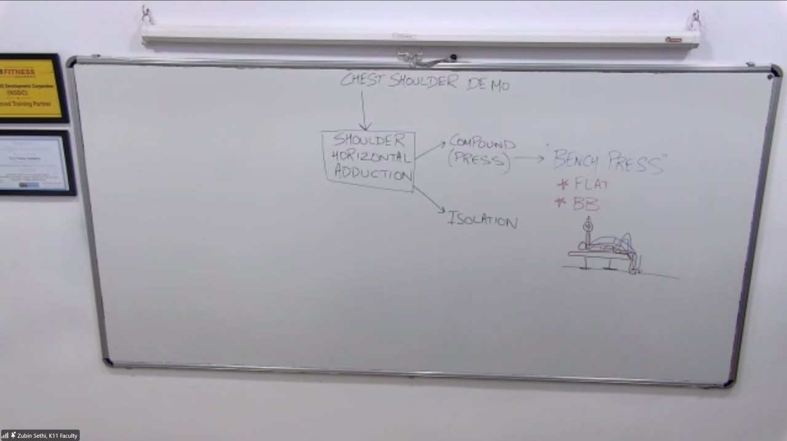
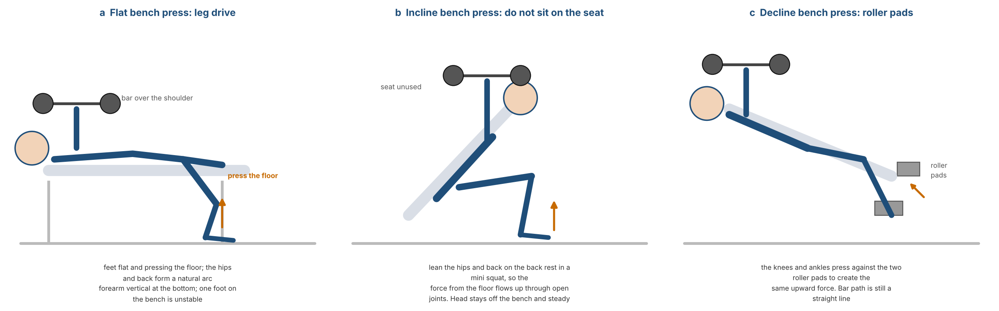
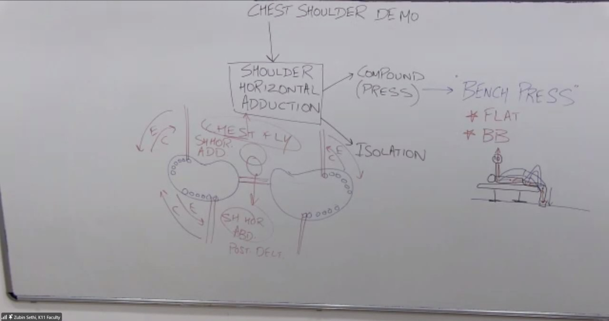
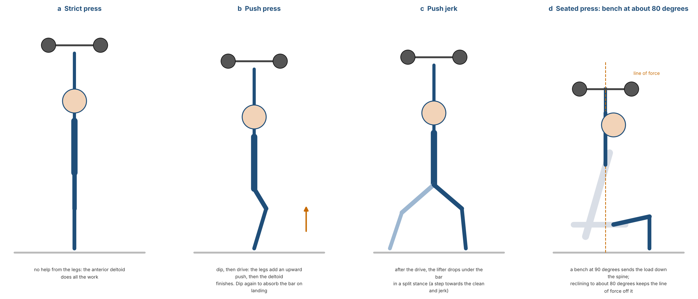
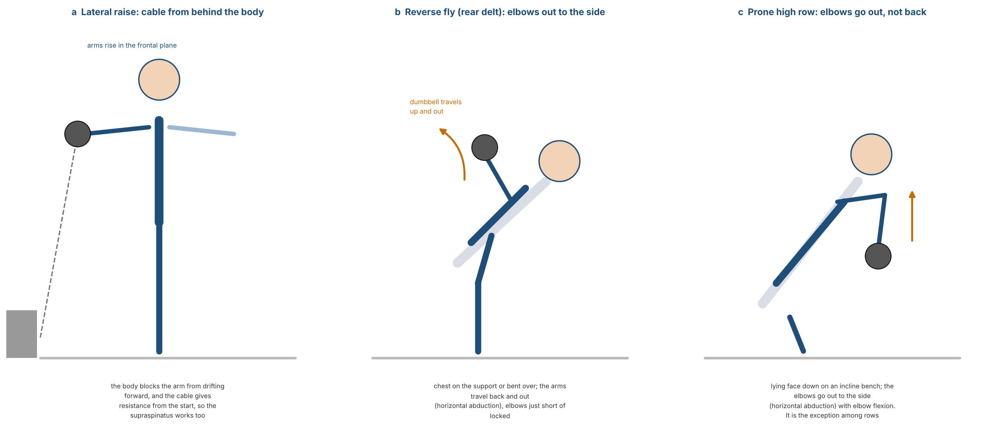
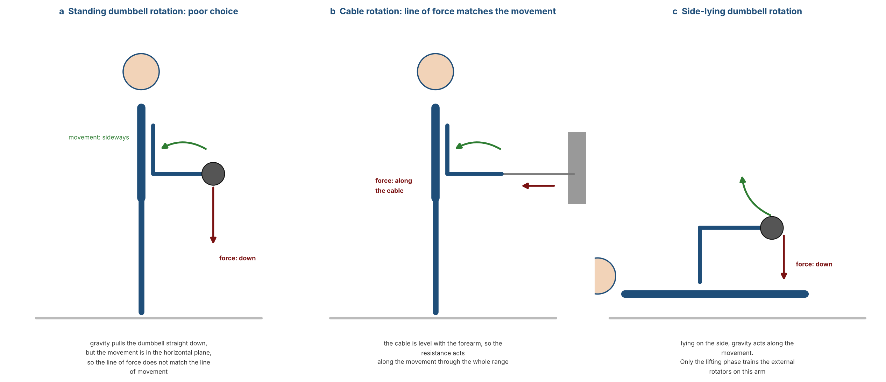
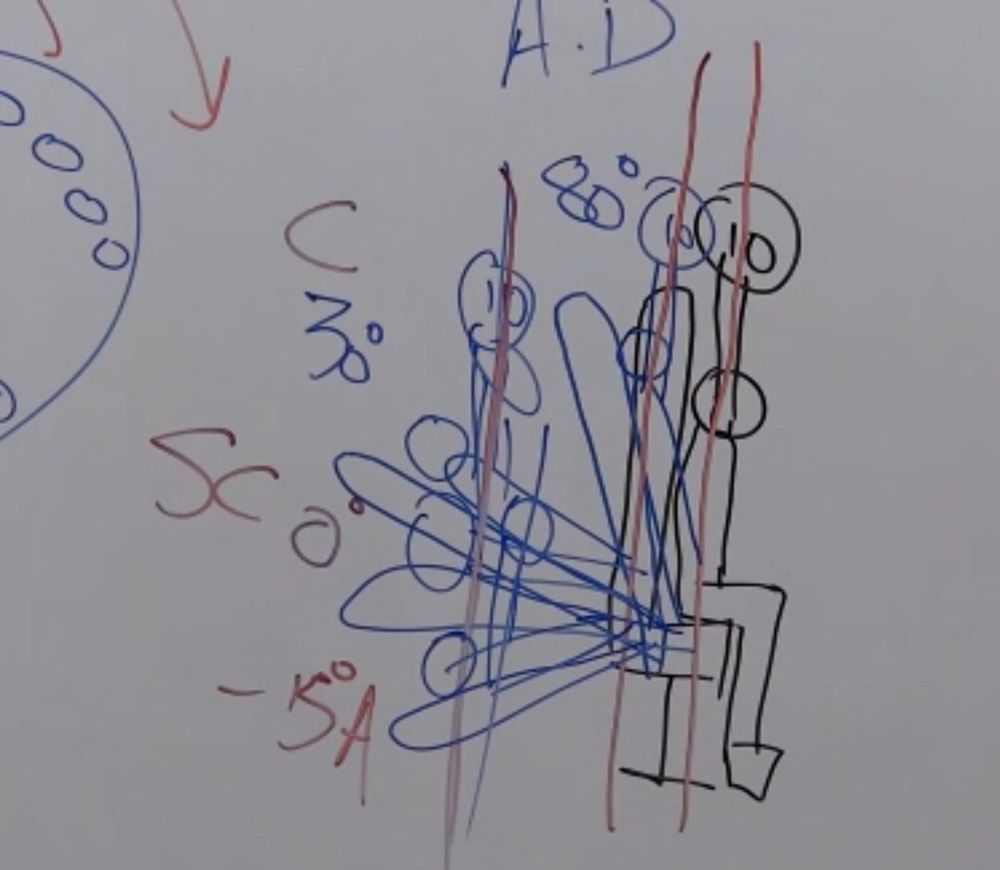

# Chest Shoulder Demo: Detailed Notes

**Course:** Personal Training Certification

**Topic:** Chest shoulder demo: the three sources of power in a bench press, flat, incline and decline presses (set-up, grip distance, leg drive, scapular position), cable and machine presses, flies (free weight, cable, cam machine), overhead presses (strict, push press, jerk), lateral raises, upright row, reverse fly, face pull, prone high row, rear delt rows, the standing multi-flight machine and rotator cuff exercises

**About these notes:** Detailed notes for the Chest Shoulder Demo, written so the demo can be studied without watching the recordings. The demo is a video-watching session: each exercise from the lecture was shown and discussed (set-up, execution, mistakes, resistance profile). The theory (muscles, functions, bench angles) is in the Chest Shoulder Lecture notes. The figures are original drawings made for these notes, and the practical sessions teach the exact form. For a short revision version, see the Study Notes. Sources: the session recording, the course slides ("Body part 3: Chest and Shoulders") and the board photos.

---

## Abbreviations used in these notes

| Short form | Meaning |
|---|---|
| PT station | Personal training station, a cable machine with adjustable pulleys |
| ROM | Range of motion |
| CNS | Central nervous system |
| Valsalva | Breathing in and holding the breath to brace the trunk |
| Isolateral | Two separate objects, both sides working together |
| Unilateral | One side at a time |
| Prime mover | The muscle mainly responsible for a movement |
| Synergist | A helper muscle that does the same job as the prime mover |

## Before this demo

You should know the chest and shoulder lecture: the rotator cuff group, the three deltoids, the three heads of the pectoralis major and how the bench angle changes the leading head. You should also know kinetic chain, stretch reflex, resistance profile, base of support, the Valsalva manoeuvre and the difference between compound and isolation exercises.

## Outline of the demo

| Part | Topic |
|---|---|
| 1 | Shoulder horizontal adduction: the plan |
| 2 | Three sources of power in the bench press |
| 3 | Flat barbell bench press: set-up and form |
| 4 | Flat dumbbell press |
| 5 | Decline press |
| 6 | Incline press |
| 7 | Scapular retraction and depression |
| 8 | Cable chest press |
| 9 | Machine presses |
| 10 | Flies: free weight, cable and cam machine |
| 11 | Class questions on the stretch reflex and deloading |
| 12 | Overhead press: strict, push press, jerk |
| 13 | Front raise and lateral raise |
| 14 | Upright row |
| 15 | Posterior deltoid: reverse fly, face pull, rear delt row, prone high row |
| 16 | Standing multi-flight machine |
| 17 | Rotator cuff exercises |
| 18 | Class questions and what follows |

---

## Part 1: The plan

The demo starts with the chest, so the function to keep in mind is shoulder horizontal adduction. It can be done as a **compound** (a press, with elbow extension) or in **isolation** (a fly). The most popular press is the **bench press**.

**Naming.** Used on its own, "bench press" means a **flat bench with a barbell**. With a dumbbell the exercise is called a **dumbbell chest press**, and an angled bench gets a prefix (incline or decline).

---

## Part 2: Three sources of power in a bench press

1. **Contractility.** The chest muscle contracts when it receives an electrical stimulus, and the contraction produces force.
2. **Stretch reflex.** A bench press starts with an **eccentric** phase: the bar is lowered, the chest muscle lengthens, and the muscle spindle tells the CNS that the muscle is stretched. At the bottom of the eccentric, the CNS orders the muscle to contract. This contraction is added to the press.
3. **Leg drive.** The third source, used on purpose. The feet press the floor, and by Newton's third law an equal and opposite force comes back from the floor. It travels up the **kinetic chain**: ankle, knee, hip, spine, into the press.

Leg drive helps a person who has stopped progressing (at any strength level, a 4 RM at 40 kg and at 140 kg are the same intensity) to continue progressive overload.

**The arc.** Many people show an arch in the hips and lower back. This arch is a visual sign that the person is pressing the floor. It is a result of the leg drive. The goal is not to build the arch on purpose. A deliberately raised hip causes stress in the lower back, and it cannot be kept through the whole set.

**Feet.** The feet are fully grounded. Resting one foot on the bench looks relaxed but gives up the leg drive and narrows the base of support, so the lift is less stable.

---

## Part 3: Flat barbell bench press

### 3.1 Rack set-up

The press can be done on a dedicated bench press rack (bench fixed to two uprights with height slots) or in a power cage with a separate flat bench. The rack height is set so that, with the arms fully extended, the barbell is at **wrist level or slightly below**, never above. If it is higher, the lifter has to protract the shoulders to unrack and again to rerack when tired. Set at wrist level, the lifter only pushes it slightly off the hooks and then lowers it.

### 3.2 Hand distance

The barbell has rings on the shaft with **knurling** (the rough pattern) between them. The distance between hands is not the same for everyone. To find it, unrack the bar (with no load for the first time), lower it to the chest and pause. At the bottom the **forearms should look perpendicular (90 degrees) to the floor**.

- Too wide: the forearm leans outwards, which stresses the elbow, wrist and shoulder.
- Too narrow: the forearm leans inwards, which is inefficient and unsafe for the joints.

The forearms are vertical only at the bottom. As the bar goes up the arms move wider, because the exercise is shoulder horizontal adduction. With a barbell the hands cannot move closer, so the bar would turn into a close grip bench press, which is shoulder flexion.

### 3.3 Spotter

Standing **behind the head** is the best place to help unrack and rerack, and also to check the forearm angle from behind.

### 3.4 The lift

The arch is built before unracking by pressing the floor. Then: unrack, inhale (Valsalva), lower in a controlled way, press, exhale at the end of the repetition.

---

## Part 4: Flat dumbbell press

- **Set-up.** The lifter has to bring the dumbbells to the start. Rest them on the thighs and use the push of the thighs to swing them to the start position while pressing the floor.
- **Arm path.** The arms are close at the top (the dumbbells move in a straight line) and the forearms are not vertical at the bottom. The distance between the hands is smaller than with a barbell because the two objects are separate.
- **Head targeted.** The upper arm points towards the sternum and costal cartilages, so the sternocostal head leads.

---

## Part 5: Decline press

Everything in the set-up is the same, including the vertical forearm at the bottom. The difference is the leg drive: the feet cannot press the floor. The lifter uses **two roller pads**, one for the knees and one for the ankles, and presses the lower leg against the anchor pad. The same upward force then travels through ankle, knee, hip and spine.

- **Dumbbell version.** Because the legs are fixed, the lifter cannot kick the dumbbells up with the thighs. Two helpers hand the dumbbells in the start position. At a lighter weight it is possible without help.
- **Bar path.** The path stays straight and perpendicular to the floor, even though the bench is declined. The bar does not curve towards the chin. People who bring the bar in an arc towards the chin to "target the lower chest" do not need to. The humerus points towards the abdomen at the angle of the bench (about -15 degrees), so the abdominal head leads, with the sternocostal head as second.

---

## Part 6: Incline press

- **Seat.** The lifter does not sit on the seat. The hip and spine lean on the back rest in a **mini squat** position. Sitting at 90 degrees at the hip and knee would waste the force from the floor, because the sharper the angle at a joint, the more force is lost there. In a mini squat the force flows from lower body to upper body.
- **Head.** The head is kept **off the bench** and steady. Every body part touching the bench pushes against it, and the bench pushes back. If the head is on the bench, the push goes through the neck (the cervical spine). The head should not follow the bar back and forth.
- **Question from class.** The upper arm should be slightly forward of the body line in the exact bottom position. The trainer explained the exact execution in the practical sessions.

---

## Part 7: Scapular retraction and depression

Before the first repetition, the lifter sets the shoulder blades with **scapular retraction and depression**. This does several things at once:

1. It places the scapulothoracic joint in the best position, so the shoulder joints are not stressed.
2. The humerus falls into an angled position by itself (not flaring). The humerus then points towards the sternum and costal cartilages, the right destination. If the shoulders were raised, it would point towards the neck.
3. The chest stays upright.
4. It gives the lifter a **personal landing point** for the bar on the chest. The landing point is not "the first button of the shirt". It is wherever the bar lands for that person when the set-up is right, because every shoulder joint is different.

Learning to see and correct these points in other people is part of the practical sessions.

---

## Part 8: Cable chest press

This is a standing press on a **PT station**. Both pulleys are brought close and the cables run in a straight line, so it is a press and not a fly.

- On an ordinary cable machine with the weight stacks far apart, the cables travel in an arc. That makes a fly.
- **One leg forward.** The lifter leans forward to press, so the centre of gravity shifts forward. With both feet level, the centre of gravity would leave the base of support and the CNS would have to worry about balance. One foot forward widens the base so the centre of gravity falls inside it again.

---

## Part 9: Machine presses

- **Seated press machines.** The path of the levers decides the angle. On a flat machine the humerus points to the sternum (sternocostal head), on an incline machine to the clavicle (clavicular head), and on a decline machine to the abdomen (abdominal head). The machine may be pin loaded or plate loaded (a fulcrum based machine). Look at the direction of the humerus to see which head works.
- **Lying machine press.** Some have a fixed bench for the sternocostal head and others (a multi-press) have an adjustable bench with the levers adjusted to match, so one machine can do incline, flat and decline presses. The same machine can also do a shoulder press.

---

## Part 10: Flies

### 10.1 Free weight (incline dumbbell fly)

- The lifter does not sit on the seat (same mini squat position).
- **Resistance profile.** With the dumbbells wide apart, the moment arm is long and the load on the muscle is high. At the top, with the dumbbells together, the moment arm is almost nothing. The load is high where the muscle is long and low where it is short.
- **Fly turning into a press.** In a fly the triceps give no help. When the lifter goes heavy, the body bends the elbows and presses. A free weight allows this because its path is not restricted. Machines and cables restrict the path.

### 10.2 Cable (incline scoop)

For the same incline position, the pulley is set at the bottom, which is called an **incline scoop**. The muscle gets a decent moment arm at the top as well, so the resistance profile is better balanced.

Comparison should be made incline with incline.

### 10.3 Cam machine (pec deck or machine fly)

- The lifter leans on the back rest (no need to use the seat).
- **Stretch reflex.** The standard set-up is to bring the handles to the front first, then lower them out to the sides (eccentric), then bring them back (concentric). The eccentric first uses the stretch reflex. Exhale after the concentric.
- **Elbows.** Keep the elbows "shy of lock" (slightly bent), not fully locked.
- **Cam.** The cams are the bean shaped parts with holes. The holes set the start position. The **range limiting device** (latch system) stops the eccentric at a safe range, because overstretching is not useful: a person cannot generate force from a very stretched position.
- The same machine is used for the reverse fly (see Part 15). The handles are set at the rear and the **concentric comes first**, because the machine is built that way. The target is then the posterior deltoid with horizontal abduction.

---

## Part 11: Class questions on the stretch reflex and deloading

**When do we use the stretch reflex and when deloading?** The stretch reflex is automatic. We do not switch it on. The machine or the exercise either lets it happen (eccentric first) or not. Holding a position is not needed to use it, and a pause of a few seconds would lose it. The faster the stretch, the stronger the reflex.

**Why deloading in the deadlift?** The deadlift is the lift for picking heavy things from the floor in daily life, so the aim is for the muscles to build force from scratch without help from the stretch reflex. In most other exercises the stretch reflex is helpful and breaks a plateau.

---

## Part 12: Overhead press

### 12.1 Strict press

No help from the legs. The anterior deltoid does the work of vertical abduction. The whole core must stay stable. It gives functional carryover for holding something heavy overhead without help from the lower body.

### 12.2 Push press

The bar sits on the front of the shoulders (front rack, two finger grip). The lifter **pushes a spring**: a small dip at the hip and knee, then a quick extension. The recoil lifts the heels and lifts the bar off the shoulders. Then the anterior deltoid finishes the press. A heavier load is possible.

- **Second dip.** When the bar lands back, the hips and knees dip again to absorb the shock, like a shock absorber. It must be synchronised with the landing. Common mistakes are **delayed dipping** (after the bar has landed) and **premature dipping** (before it lands).
- **Not a squat.** The hip and knee only create the spring. It is not an exercise for the legs. Do not make it a mini squat.

### 12.3 Strict versus push press

| | Strict press | Push press |
|---|---|---|
| Help from the lower body | None | Yes |
| Heavier load | No | Yes |
| Structural lift (barbell)? | No (hip and knee not involved) | Yes (bilateral, actual loading, hip and knee involved) |

A **structural lift** needs all five points of the definition, including bilateral loading, so the push press is a structural lift when it is done with a barbell. The prime mover is still the anterior deltoid.

### 12.4 Seated press

It is always strict. It is supported, so the CNS can focus on the prime mover. Do not set the back rest at **90 degrees**: the line of force then passes along the spine and onto the pelvis, which stresses the spine. Set it at about **80 degrees**. The pathway stays straight, the load is off the spine and the anterior deltoid is better aligned with the load. Standing presses do not cause this stress because the load passes down the central axis.

The press is done in a plane slightly in front of the exact frontal plane, so it is a mix of the frontal and sagittal planes. In the same way an incline scoop is a mix of horizontal and sagittal planes, so it also uses some shoulder flexion, which suits the clavicular head.

**Bench angle summary.** With the bar path straight, +30 degrees targets the clavicular head, flat the sternocostal head and -15 the abdominal head. If the bench goes up to about 80 degrees, the abdominal head leads and the action becomes vertical abduction.

### 12.5 Push jerk and the clean and jerk

In a **push jerk** the lifter uses the same drive, then drops under the bar in a **split stance** instead of pressing it up. The body comes under the bar and the arms lock overhead. Heavier loads are possible because the full body is used. The jerk is the third part of the **clean and jerk** (deadlift from the floor, front squat, then the jerk).

**Which lets you lift the heaviest?** The jerk, then the push press, then the strict press. A seated press is a strict press with support and has no thrust.

---

## Part 13: Front raise and lateral raise

### 13.1 Front raise

An isolation exercise for the anterior deltoid (shoulder flexion). With a dumbbell the moment arm is long at the top and almost nothing at the bottom (**top overload**), which is why a cable is a better choice.

### 13.2 Lateral raise

- **Isolation** for the middle deltoid (shoulder abduction). It can be unilateral or isolateral with dumbbells.
- **No shrugging.**
- **Plane.** With a free weight, a lifter who goes heavy tends to drift forward out of the frontal plane. The load then shifts to the anterior deltoid. A cable or machine restricts the path.
- **Bent elbows.** Some bend the elbow to keep the arm in the plane and go heavy, but this stresses the wrist and elbow. The shoulder, elbow and humerus should stay aligned. If you need to bend the elbow, a machine with a forearm pad supports the wrist and elbow.
- **Cable.** Bring the cable from **behind the body**. The body acts as a barrier so the arm cannot leave the frontal plane. The cable also gives resistance from the very start, which trains the **supraspinatus** (the first 20 to 30 degrees) together with the middle deltoid. A dumbbell gives almost no resistance at the start. The cable version is usually done one side at a time.
- **Machine.** A plate loaded fulcrum machine or a cam machine, seated, with the elbows kept bent on the pad. It is still isolation. The cam based machine has a better resistance profile.

---

## Part 14: Upright row

The compound exercise for the middle deltoid (shoulder abduction with elbow flexion), with a dumbbell, barbell or cable. The path is a straight line. In all the isolation versions the path was an arc, and in compound exercises the path is always linear.

---

## Part 15: Posterior deltoid exercises

- **Reverse fly (machine).** The same machine as the pec deck, with the lifter facing the back rest, the chest on it, and the legs generating the upward force. The concentric comes first.
- **Chest supported face pull (compound).** The pulley is set at a height so the cables travel in a straight line. The support removes the tug of war, so a face pull becomes stable.
- **Rear delt row on a machine.** If the elbows move back (shoulder extension with elbow flexion), it is a row.
- **Prone high row.** Dumbbells and an incline bench, the lifter lying face down. The elbows go out to the side, not towards the body, with shoulder horizontal abduction and elbow flexion. The dumbbells travel in a straight line. A viva point from class is that it is the exception among rowing exercises, which is why the back lecture said "most" rows have shoulder extension.

---

## Part 16: Standing multi-flight machine

A multi-purpose machine with a rotatable lever arm, a height adjustment on a counterweight system with a clutch, and a slope adjustment for the movable arms. The axis of the pulleys is set at the height of the shoulders. It is used one arm at a time, standing sideways or facing.

- **Anterior deltoid:** shoulder flexion in the sagittal plane.
- **Middle deltoid:** shoulder abduction with the resistance coming from the side, which is what the deltoid needs. A dumbbell's resistance is erratic and comes from below.
- **Latissimus dorsi:** with the lever set high and brought down, the joint action is shoulder adduction, so this machine gives an **isolation exercise for shoulder adduction** with no help from the elbow flexors (the wide grip lat pulldown and the pull-up are compound).

---

## Part 17: Rotator cuff exercises

- **Cable rotation.** Use a single handle with the cable level with the forearm. With the handle in the hand on one side, the external rotation phase lifts the weight (infraspinatus, teres minor). With the cable on the other side, the internal rotation phase lifts the weight (subscapularis). The side you hold the handle on and the direction you rotate decide which muscle works in the concentric phase.
- **Side-lying dumbbell.** Lie on the side with the elbow on the body. The line of force (down) now matches the line of movement. This version trains the external rotators only in the lifting phase, and switching arms gives the other side. Internal rotation is not possible this way, because the lowering phase is eccentric.
- Supraspinatus is trained by lateral raises (cable from behind).

---

## Part 18: Class questions and what follows

Two body parts remain: arms and abs. They are split over three lectures. Arms and the arms demo are combined in one and a half lectures, and abs and the abs demo in the other one and a half lectures. After these is unit test two.

---

## Exercise video library

| Exercise | Main muscles |
|---|---|
| Bench press (flat, barbell), flat dumbbell press | Pectoralis major (sternocostal head), anterior deltoid, triceps |
| Decline barbell and dumbbell press | Abdominal head, sternocostal head |
| Incline dumbbell press, incline fly, incline scoop | Clavicular head |
| Cable chest press (PT station), machine presses | Pectoralis major |
| Cable crossover, pec deck | Pectoralis major |
| Strict press, push press, push jerk | Anterior deltoid, triceps |
| Dumbbell front raise | Anterior deltoid |
| Lateral raises (dumbbell, cable, machine), upright row | Middle deltoid |
| Reverse fly, rear delt row, prone high row | Posterior deltoid |
| Standing multi-flight machine | Anterior and middle deltoid, latissimus dorsi |
| Cable and side-lying rotation | Rotator cuff group |

---

## Key takeaways

Every bench press has three sources of power: contraction, the stretch reflex and leg drive. Press the floor, keep the head off the bench, set the scapulae back and down and let the arch follow. The bar path is straight, and the bench angle (not a curved bar path) changes the leading head. The forearm should be vertical at the bottom of a barbell press. For a fly, compare free weight, cable and cam machine incline against incline, and keep the elbows shy of lock. The push press uses a spring from the hips and knees, with a second dip to absorb the landing, and it is a structural lift with a barbell. Use a bench at 80 degrees for a seated overhead press. Lateral raises should be done without shrugging, preferably on a cable from behind the body. Rotator cuff exercises need the line of force to match the line of movement.

---

## Points to Confirm

1. **Video library.** The exact list of the exercise videos was taken from the discussion in class. A folder view on the screen was not readable, so some video names may be missing.
2. **Question about the head position.** The class asked about the upper arm position in the incline press, and the answer was left to the practical sessions.
3. **Structural lift.** The class said the push press is a structural lift with a barbell and not with a dumbbell. The five points of the definition come from an earlier lecture.
4. **Deloading and stretch reflex.** The explanation of deloading in the deadlift is taken from class.
5. **Slide schedule and assignments.** The slides contain an advanced schedule (6 to 8 RM) and assignments (counsel members on the 30 degree incline angle, standing versus seated overhead press, and kinetic chain in pressing). They were not discussed in this session.
6. **Figures.** The figures are simplified drawings made for these notes. Exact form is taught in the practical sessions.

---

# Board Photos from the Demo

