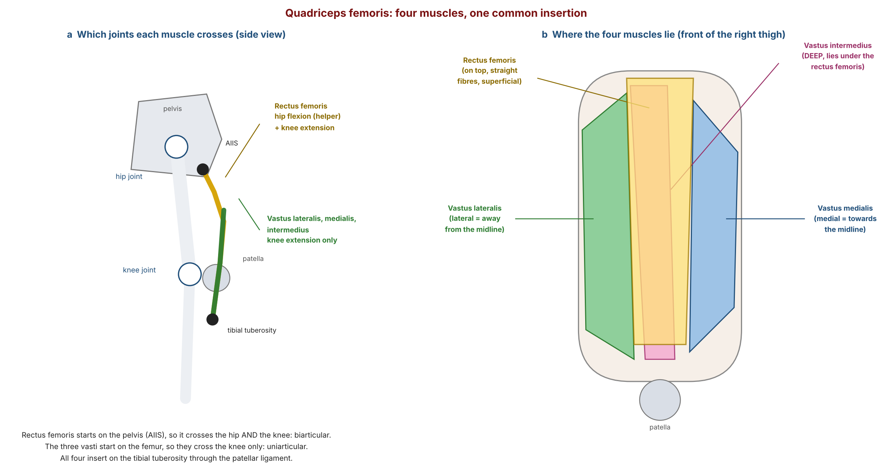
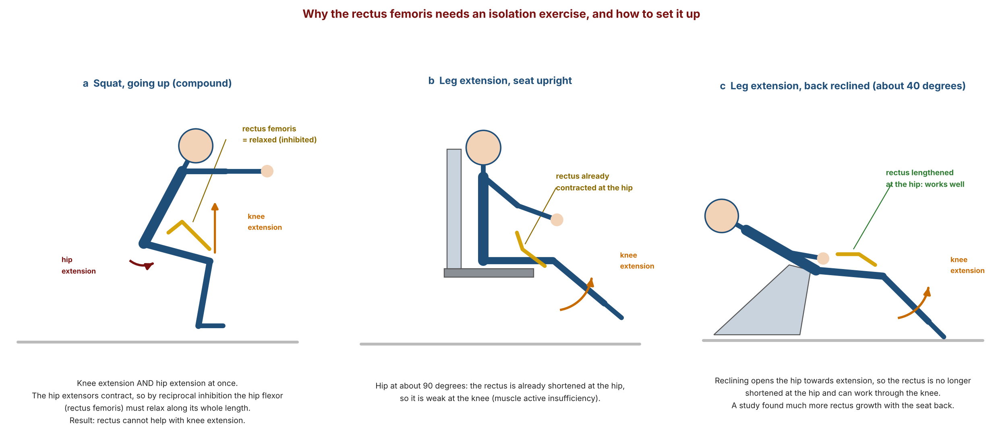
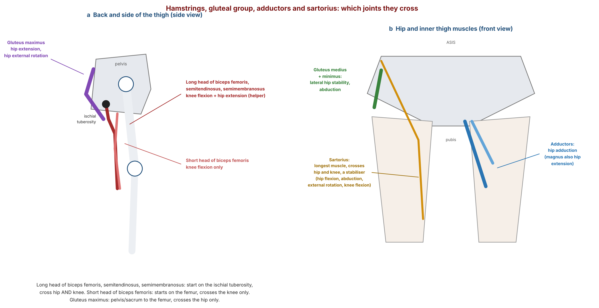
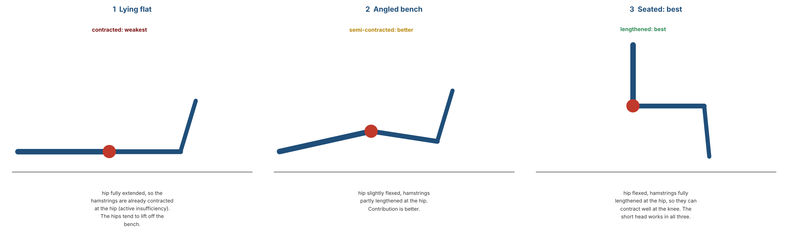
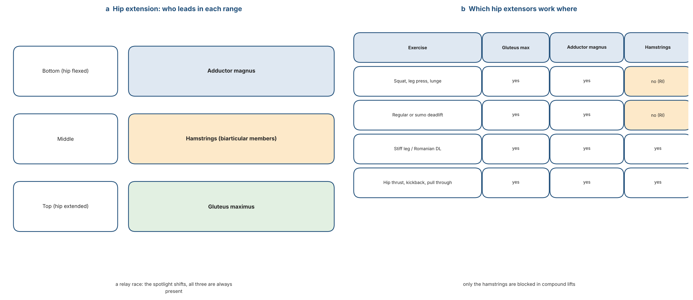
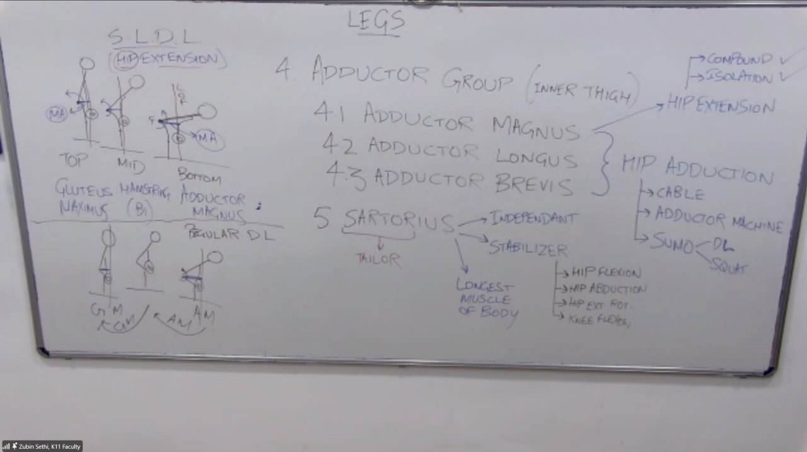
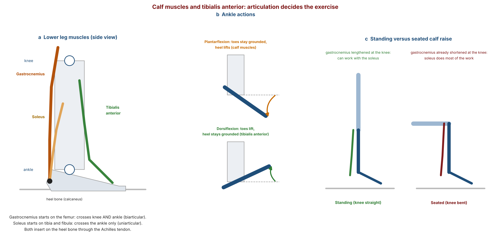

# Legs Lecture: Detailed Notes

**Course:** Personal Training Certification

**Topic:** The legs as a body part: why train them, a recap of the hip, knee and ankle joints and their actions, the quadriceps femoris (names, landmarks, origins, insertion, articulation, functions), compound and isolation exercises, reciprocal inhibition and the leg extension, the hamstrings, gluteal group, adductors and sartorius, and the lower leg (gastrocnemius, soleus, tibialis anterior)

**About these notes:** Detailed notes for the Legs Lecture (the theory), written so the whole lecture can be studied without watching the recordings. The first part of the leg teaching, the quadriceps, was taught in the lecture session. The lower leg theory was taught at the start of the demo session and is placed here with the other theory. The hamstrings, gluteal group, adductors and sartorius were taught in a second session of the lecture and are covered in Part 7. The exercise demonstrations are in the Legs Demo notes. For a short revision version, see the Study Notes. Sources: the session recordings (including the second lecture session), the course slides ("Body part 2: Legs") and the board photos. The figures are original drawings made for these notes.

---

## Abbreviations used in these notes

| Short form | Meaning |
|---|---|
| M, O, I, F, E | Muscle, origin, insertion, function, exercise example (the order used for every muscle) |
| AIIS | Anterior inferior iliac spine |
| ASIS | Anterior superior iliac spine |
| ROM | Range of motion |
| Biarticular | Crosses two joints |
| Uniarticular | Crosses one joint |
| Prime mover | The muscle mainly responsible for a movement |
| Synergist | A helper muscle that does the same job as the prime mover |
| Stabiliser | A muscle that works to keep a body part steady |
| Compound | An exercise that moves more than one joint |
| Isolation | An exercise that moves one joint |

## Before this lecture

You should know the skeleton and the main joints, the directional terms, the planes of movement, compound and isolation exercises, and the way every body part lecture is organised (muscle, function, then the exercise whose concentric phase is that function). The back lecture is the model for this one.

## Outline of the lecture

| Part | Topic |
|---|---|
| 1 | Why train the legs |
| 2 | Recap: bones, joints and actions of the lower body |
| 3 | The leg muscle groups: the menu |
| 4 | The quadriceps femoris: name, landmarks, origin, insertion, articulation, function |
| 5 | Compound exercises for the quadriceps and the isolation question |
| 6 | Reciprocal inhibition, the rectus femoris and the leg extension |
| 7 | Hamstrings, gluteal group, adductors and sartorius |
| 8 | The lower leg: gastrocnemius, soleus and tibialis anterior |
| 9 | Exercise per muscle: summary table |

---

## Part 1: Why train the legs

1. **Power generation.** The legs hold the largest muscles in the body. They produce the force for jumping, sprinting, throwing (the throw starts from the ground) and heavy lifting.
2. **Daily tasks.** Standing up, climbing stairs, walking, getting out of a car and picking things up from the floor all depend on the legs. Strong legs keep a person independent for longer in life.
3. **Sport.** Almost every sport, from running and cycling to swimming and racket games, needs leg strength and leg endurance.

Three joints carry the body weight: the hip, the knee and the ankle. The leg exercises train the muscles that cross them.

---

## Part 2: Recap of bones, joints and actions

The class started with a recap on the skeleton model and the board.

| Joint | Type | Main actions |
|---|---|---|
| Hip | Ball and socket | Flexion, extension, abduction, adduction, internal and external rotation |
| Knee | Hinge | Flexion and extension |
| Ankle | Hinge | Plantarflexion and dorsiflexion |

- **Flexion** reduces the angle of a joint and **extension** increases it.
- **Abduction** moves a limb away from the midline and **adduction** brings it towards the midline.
- **Rotation** turns the limb around its long axis: internal (towards the midline) and external (away).
- At the ankle, **plantarflexion** points the toes down (as on tiptoes) and **dorsiflexion** lifts the toes towards the shin.

---

## Part 3: The leg muscle groups

The lecture board lists the groups to study, each with its function and an exercise.

1. Quadriceps femoris (four muscles)
2. Hamstrings (three muscles)
3. Gluteal group (gluteus maximus, medius and minimus)
4. Adductors
5. Sartorius
6. Lower leg: gastrocnemius, soleus, tibialis anterior

---

## Part 4: The quadriceps femoris

### 4.1 Decoding the name

- **Quadri** means four and **ceps** means heads, so it is a muscle with four heads. **Femoris** means "of the femur", the thigh bone.
- **Rectus** means straight. The rectus femoris runs straight down the front of the thigh.
- **Vastus** means large or vast. **Lateralis** is the outer side. **Medialis** is towards the midline. **Intermedius** is the one between them, deep under the rectus femoris. Take care: *medius* means medium (in the middle) and *medialis* means towards the midline.
- The plural of vastus is **vasti**. "The vasti" means the three vasti together.

### 4.2 Landmarks (awareness only)

| Landmark | Meaning |
|---|---|
| AIIS | A bump on the front of the pelvis, lower than the ASIS. Do not mix the two. |
| Greater and lesser trochanter | Bumps at the top of the femur. "Trochanter" comes from a Greek word for runner, because the muscles that move the leg attach here. |
| Tuberosity | A rough, large bump (for example the tibial tuberosity on the front of the shin, and the ischial tuberosity of the pelvis, the sitting bone). |
| Tubercle | A small bump. |

### 4.3 Origins and insertion

| Muscle | Origin | Insertion |
|---|---|---|
| Rectus femoris | Anterior inferior iliac spine (AIIS) | Tibial tuberosity, through the patellar ligament |
| Vastus lateralis | Greater trochanter and the outer shaft of the femur | Same |
| Vastus medialis | Inner (medial) shaft of the femur | Same |
| Vastus intermedius | Front and outer shaft of the femur, deep | Same |

All four join in one **common tendon** that passes over the kneecap (patella) as the patellar ligament and attaches to the tibial tuberosity.

### 4.4 Articulation: how many joints does the muscle cross?

- The **rectus femoris** starts on the pelvis, so it crosses the hip and the knee. It is **biarticular**.
- The **three vasti** start on the femur, so they cross the knee only. They are **uniarticular**.

### 4.5 Functions

| Muscle | Function |
|---|---|
| Rectus femoris | Knee extension, and hip flexion (as a helper) |
| Vastus lateralis, medialis, intermedius | Knee extension |

The vasti are pure knee extensors. The rectus femoris is a knee extensor that also helps to flex the hip.

---

## Part 5: Compound exercises, and why add isolation

### 5.1 Compound exercises that train the quadriceps

The squat, the regular and sumo deadlift, the leg press, lunges and step-ups all extend the knee against load, so the quadriceps work in every one of them. The demo explains each in turn.

### 5.2 Two questions from the board

1. **Why add an isolation exercise if the compound exercises already train the quadriceps?**
2. **How should the isolation exercise be done?**

The answer to the first question is the rectus femoris. In the compound exercises it does not do its full job. The answer to the second is the leg extension, set up in the right way (Part 6).

---

## Part 6: Reciprocal inhibition, the rectus femoris and the leg extension

### 6.1 Reciprocal inhibition

When one muscle contracts, the nervous system relaxes the muscle on the opposite side of the joint, the antagonist. This is **reciprocal inhibition**.

In a squat or a leg press, the hip extends on the way up. The hip extensors (the gluteus maximus and the hamstrings) contract. The rectus femoris is a hip flexor, so it is the opposite of the hip extensors and is inhibited. The result is that the rectus femoris cannot contribute fully to knee extension in compound movements, even though it is a knee extensor. Only the three vasti do the work.

### 6.2 The leg extension and active insufficiency

The leg extension isolates the knee, which removes the hip extension that inhibits the rectus femoris. There is still one problem. On an upright seat the hip is already flexed (about 90 degrees), so the rectus femoris is already shortened at the hip before the knee even starts to extend. A muscle that is already short cannot shorten much more and produces little force. This is **active insufficiency**.

The fix is to **recline the seat back** so the hip opens. This lengthens the rectus femoris at the hip and lets it produce force at the knee.

A study compared leg extensions done reclined at about 40 degrees with the upright position of about 90 degrees. The reclined group showed much more growth of the rectus femoris. This is why the notes recommend the seat back.

The leg extension trains all four muscles. With the seat reclined it is the one exercise that loads the rectus femoris well, and that is the reason to include it.

---

## Part 7: Hamstrings, gluteal group, adductors and sartorius

The posterior thigh, the pelvis, the inner thigh and the sartorius are taught as groups two to four plus one independent muscle. The same order is used for each: muscle, origin and insertion, articulation (how many joints it crosses), function, then exercises.

### 7.1 Hamstrings (posterior thigh)

Three muscles: the **biceps femoris** (two heads, "bi" for two and "ceps" for heads, on the femur, so the full name is biceps femoris, never just biceps), the **semimembranosus** and the **semitendinosus**. "Semi" means half. The semimembranosus looks half muscle and half thin membrane (a sheet). The semitendinosus looks half muscle and half tendon.

| Muscle | Origin | Insertion | Joints crossed |
|---|---|---|---|
| Semimembranosus | Ischial tuberosity | Medial condyle of the tibia | Hip and knee (2) |
| Semitendinosus | Ischial tuberosity | Medial to the tibial tuberosity on the tibia | Hip and knee (2) |
| Biceps femoris, long head | Ischial tuberosity | Junction of the head of the fibula and the lateral condyle of the tibia | Hip and knee (2) |
| Biceps femoris, short head | Linea aspera of the femur | Same junction as the long head | Knee only (1) |

The long head is longer because it starts on the pelvis, and the short head starts on the femur. Because the three biarticular muscles start on the ischial tuberosity (part of the hip), they must cross the hip axis and then the knee axis. The short head starts and ends below the hip, so it crosses only the knee. The number 2 is written next to the long head, and the number 1 next to the short head, not next to biceps femoris as a whole.

**Functions.** The biarticular members do **knee flexion** (the lower leg moves toward the thigh) and **hip extension** (when the hip is flexed they are lengthened, and shortening returns the femur). The short head does **knee flexion only**.

**Hip extension and the compound problem.** The compound exercises for hip extension are the same ones used for the vasti (squat, regular and sumo deadlift, leg press, lunges, step-ups). The biarticular hamstrings cannot contribute well in them, for the same reason the rectus femoris could not (Part 6), seen from the knee instead of the hip. In the concentric phase the knee extends, so the knee extensors (the vasti) contract and the knee flexors, which are the hamstrings, must relax. A hamstring relaxed at the knee relaxes along its whole length and cannot also extend the hip. This is **reciprocal inhibition**. The hip is not short of extensors, because two other muscles do hip extension without crossing the knee (the gluteus maximus and the adductor magnus), so the compound exercises are still fine for those.

**Isolation for the hamstrings.** Two kinds, and both are needed.

- **Hip extension isolation:** remove knee movement so only the hip works. The **stiff leg deadlift** and the **Romanian deadlift** keep the knee extended, so there is no knee extension in the concentric and no reciprocal inhibition. (The regular deadlift bends the knee, which is why it is not suitable.) The two lifts differ in small ways that are shown in the demo.
- **Knee flexion isolation:** the **leg curl**. It is the only way to train the short head, which has nothing to do with the hip, so a hip extension isolation alone does not train the whole group. It also helps the biarticular members, so it is marked as the most important exercise.

**Which leg curl?** The long head, semimembranosus and semitendinosus face muscle active insufficiency if they are already contracted at the hip. There are three machines:

1. **Lying flat (prone):** the hip is fully extended, so the biarticular hamstrings are already contracted at the hip and cannot contract well at the knee. The hips tend to lift off the bench, which is the body trying to flex the hip and lengthen them.
2. **Angled bench:** the hip is slightly flexed, so the contraction at the hip is partly removed and the contribution is better.
3. **Seated:** the hip is flexed, so the biarticular members are properly lengthened at the hip and can contract fully at the knee. The short head works in all three. The **seated leg curl** is the one to include, as the reclined seat is for the leg extension.

### 7.2 Gluteal group (pelvis)

Three muscles with the same first name, and the second name tells the size: **maximus** (largest), **medius** (medium) and **minimus** (smallest). The gluteus maximus is the **largest** muscle in the body (the widest is the latissimus dorsi, the longest is the sartorius). Use the full names, not "glutes".

| Muscle | Origin | Insertion |
|---|---|---|
| Gluteus maximus | Posterior part of the gluteal surface of the ilium, sacrum and coccyx | Iliotibial (IT) band and the gluteal tuberosity of the femur |
| Gluteus medius | Lateral (curved) part of the gluteal surface of the ilium, higher | Greater trochanter |
| Gluteus minimus | Same surface, lower, deep to the medius | Greater trochanter |

- The **IT band** is a tough band of connective tissue (not a bone, tendon or ligament) between the ilium and the tibia, which gives stability in lower body movement. The gluteal tuberosity is named after the muscle, not the bone. The gluteus maximus has diagonal and horizontal fibres, but no official upper and lower parts.
- The medius is superficial and the minimus is deep, and together they look like a mushroom or a petroleum company logo. They do exactly the same job.
- All three cross the hip only (uniarticular).

**Functions of the gluteus maximus:** hip extension (diagonal fibres), hip external rotation and **hip horizontal abduction** (horizontal fibres, as on an abductor machine with the knees together at the start). It does not do abduction in the frontal plane.

**Functions of the gluteus medius and minimus:** hip **abduction** (frontal plane), hip rotation (internal by the front fibres, external by the back fibres) and, the most important, **lateral stabilisation of the hip**: when one leg is lifted, they work isometrically on the supporting side and keep the pelvis level. Walking is a series of one-leg moments. Apes have no medius or minimus because their ilium is flat, so they use all four limbs.

**Exercises:**

| Function | Compound | Isolation |
|---|---|---|
| Gluteus maximus hip extension | Squats, regular and sumo deadlift, leg press, lunges, step-ups | Hip thrust, glute kickback (cable or machine), cable pull through, Romanian and stiff leg deadlift, back extension |
| Gluteus maximus horizontal abduction | | Abductor machine with the setup for horizontal abduction |
| Medius and minimus abduction | | Standing cable abduction (ankle strap on the leg away from the machine) |
| Medius and minimus lateral stabilisation | Lunges, step-ups, pistol squats (Bulgarian split squat too) | |

The hip thrust is isolation because only the hip moves: the knee only opens and closes like a hinge and the vasti do no real work. Compound and isolation both build muscle: compound saves time and trains the hip and knee together, and isolation lets the nervous system recruit only the target. External and internal rotation are not trained on their own.

**Lateral stabilisation needs unilateral and unsupported work.** A unilateral leg press does not qualify, because the person is seated and supported. The exercise must be on one leg and unsupported.

### 7.3 Adductors (inner thigh)

Medically five muscles, but fitness science uses three: **adductor magnus** (mega, big), **adductor longus** and **adductor brevis**. All start on different parts of the pelvic girdle and insert on the **linea aspera**. The brevis covers the upper third, the longus the upper two thirds and the magnus the whole line.

- All three have **diagonal fibres**, so all three do **hip adduction** (the femur goes toward the midline).
- The magnus also has **vertical fibres** that run to the **medial condyle of the femur** (so they do not cross the knee). They give the magnus a second function, **hip extension**, which the longus and the brevis do not have.

**Exercises for adduction:** cable adduction (ankle strap, start with the leg abducted), the adductor machine set up with the pad on the inner side, and the **sumo deadlift or sumo squat**, where the wide stance makes adduction happen in the concentric together with hip and knee extension.

### 7.4 Hip extension relay: three extensors

Three muscles extend the hip: the gluteus maximus, the adductor magnus and the hamstrings (the biarticular members). They share the range like runners in a relay, and all three are always present.

- **Bottom (hip flexed):** the adductor magnus leads (its vertical fibres have the longest moment arm).
- **Middle:** the hamstrings lead.
- **Top (hip extended):** the gluteus maximus leads (it is next to the hip joint).

In a **stiff leg deadlift** with a free weight, the moment arm (distance from the hip to the vertical line of force) is longest at the bottom and shortest at the top, so the adductor magnus enjoys the best resistance profile and the gluteus maximus the worst. In a **regular deadlift** only two hip extensors share the work, because the hamstrings are inhibited. A cable (pull through) or a cam gives a more even resistance, and the gluteus maximus gets resistance at the top range. A hyperextension machine works at the top range where the gluteus maximus leads and the resistance is good. Therefore the hamstrings need isolation, and the gluteus maximus and adductor magnus work in both compound and isolation.

### 7.5 Sartorius

The sartorius is a single muscle that is **independent** (not in a group) and is never a prime mover. It is a **stabiliser of the leg** in lower body exercises. It is the **longest muscle in the body** (the smallest is the stapedius in the ear). It starts on the ASIS and inserts on a point inferior and medial to the tibial tuberosity, wrapping the thigh like a snake, so it crosses the hip and the knee.

Its four stabilising functions are **hip flexion, hip abduction, hip external rotation and knee flexion**. Performed in order, they put the leg in the cross-legged position of a tailor, which is how the name was made (sartor is the Greek for tailor, in the class explanation). It is visible only in some segments, and only in very lean people. It is not trained directly.

---

## Part 8: The lower leg

### 8.1 The three muscles

- **Gastrocnemius.** The name means "belly of the leg" (the *c* is silent). It is the visible bulge of the calf. It starts on the femoral condyles (above the knee), so it is **biarticular**. It inserts on the heel bone (calcaneus) through the **Achilles tendon**.
- **Soleus.** Named for its flat shape, like a sole (or the sole fish). It lies deep to the gastrocnemius. It starts on the tibia and fibula, so it is **uniarticular** (ankle only). It shares the Achilles tendon.
- **Tibialis anterior.** It lies on the front of the shin. It starts on the upper two thirds of the outer tibia and inserts on the medial cuneiform and first metatarsal of the foot.

### 8.2 Functions

| Muscle | Function |
|---|---|
| Gastrocnemius | Ankle plantarflexion, and helps knee flexion |
| Soleus | Ankle plantarflexion |
| Tibialis anterior | Ankle dorsiflexion, and foot inversion |

### 8.3 Articulation decides the exercise

Because the gastrocnemius crosses the knee, its length depends on the knee angle. With the **knee straight** (standing calf raise, calf press) it is stretched at the knee and can work together with the soleus. With the **knee bent** (seated calf raise) it is already shortened at the knee, so the **soleus** does most of the work. Train both, with a standing and a seated exercise.

The gastrocnemius is a synergist in knee flexion (the leg curl). It is the prime mover only in plantarflexion. The demo uses this for exercise order.

The tibialis anterior is the opposing muscle and has its own exercise, the toe raise.

---

## Part 9: Exercise per muscle

| Muscle or group | Function | Exercise examples |
|---|---|---|
| Quadriceps | Knee extension (rectus also hip flexion) | Squats, lunges, step-ups, leg press, leg extension (reclined) |
| Hamstrings | Knee flexion, hip extension (isolation only) | Seated leg curl, stiff leg and Romanian deadlifts |
| Gluteus maximus | Hip extension, external rotation, horizontal abduction | Hip thrust, kickback, cable pull through, deadlifts, squats |
| Gluteus medius and minimus | Hip abduction, rotation, lateral hip stabilisation | Standing cable abduction; lunges, step-ups, pistol squats (unilateral, unsupported) |
| Adductors | Hip adduction (magnus also extension) | Cable and machine adduction, sumo deadlift and squat |
| Sartorius | Leg stabiliser (hip flexion, abduction, external rotation, knee flexion) | No direct exercise |
| Gastrocnemius | Plantarflexion | Standing calf raise, calf press |
| Soleus | Plantarflexion | Seated calf raise |
| Tibialis anterior | Dorsiflexion | Toe raise |

---

## Key takeaways

The legs carry the body, produce the most power and matter in daily life and sport. The quadriceps have four muscles, and only the rectus femoris crosses the hip, which makes it biarticular and explains why compound exercises under-train it through reciprocal inhibition. Recline the seat on the leg extension to avoid active insufficiency. The hamstrings flex the knee and extend the hip, but the biarticular members are blocked in compound lifts by reciprocal inhibition, so they need isolation (stiff leg and Romanian deadlifts, and the seated leg curl, which also trains the short head). The gluteus maximus extends the hip, rotates it externally and does horizontal abduction, the gluteus medius and minimus abduct and stabilise the hip from the side (so train them with unilateral, unsupported exercises), and the adductors adduct, with the magnus also extending the hip. The adductor magnus, hamstrings and gluteus maximus share hip extension like a relay from the bottom to the top range. The sartorius is the independent, longest muscle and a leg stabiliser. In the calf, the gastrocnemius crosses the knee and the soleus does not, so train the calf with the knee straight and with the knee bent. The tibialis anterior dorsiflexes the ankle and has its own exercise.

---

## Points to Confirm

1. **Leg curl machines.** The three machine types are described from the class explanation. The demo notes show the machines.
2. **Gluteus medius and minimus.** The slides list abduction and internal rotation. The class gave abduction, rotation both ways and lateral stabilisation of the hip. The class version is used.
3. **Hip extension relay.** The class said the three extensors take turns in the bottom, middle and top range, and also that there are no hard boundaries. This is shown as the leading muscle by range.
4. **Rectus femoris study.** The reclined leg extension study was mentioned in class without a citation. Confirm the reference if it is needed in the notes.
5. **Landmark wording.** "Trochanter means runner" is a memory aid from class and is based on the Greek word.
6. **Lower leg placement.** The lower leg theory was taught at the start of the demo session. It is placed here so every theory topic is in the lecture notes.
7. **Figures.** The figures are simplified drawings made for these notes. Muscle positions and sizes are approximate. The practical sessions teach exact form.

---

# Board Photos from the Lecture

