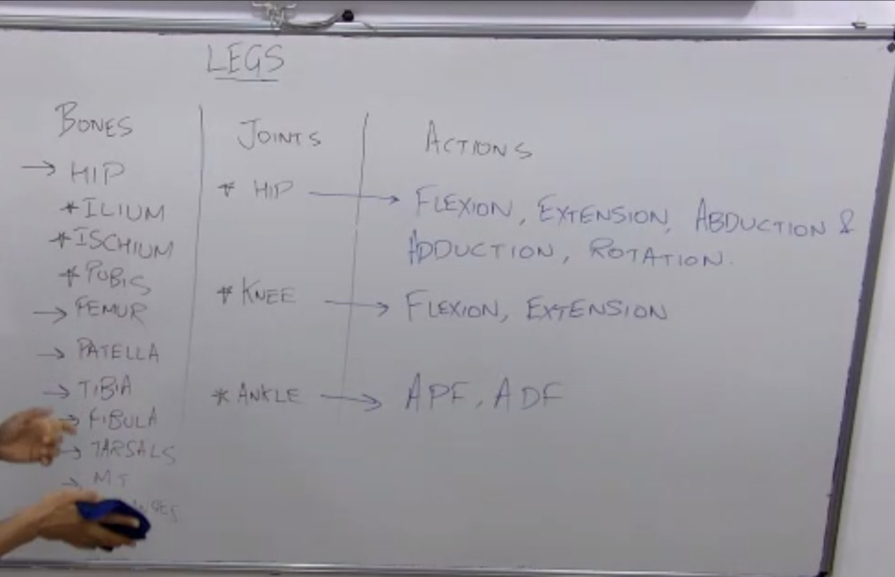
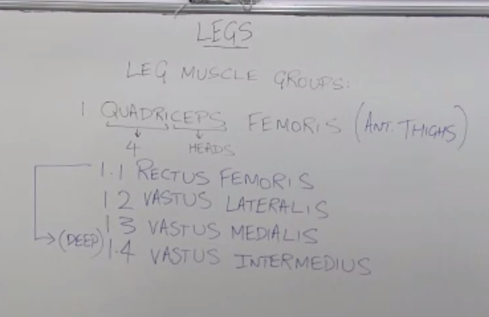
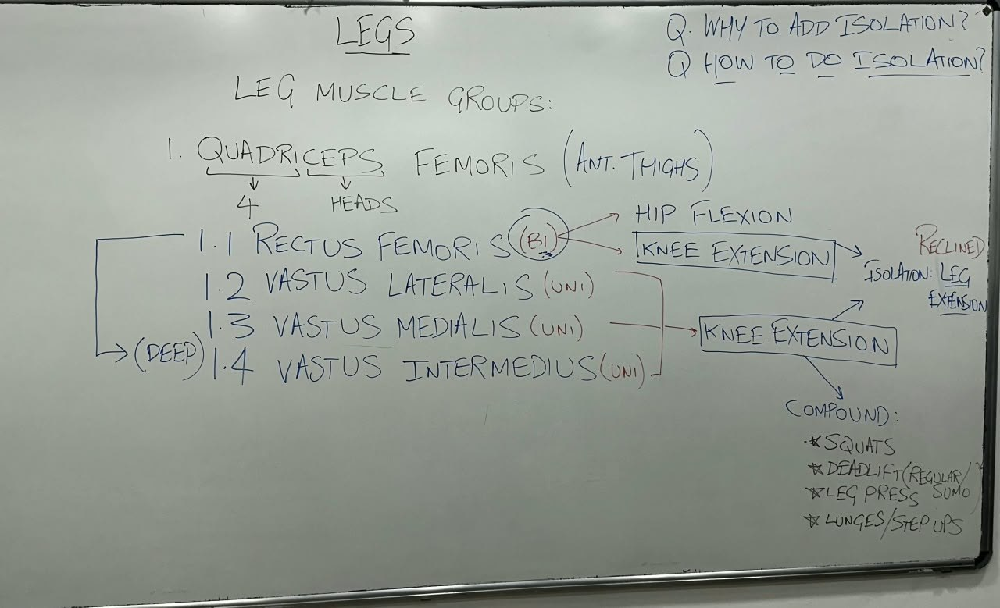
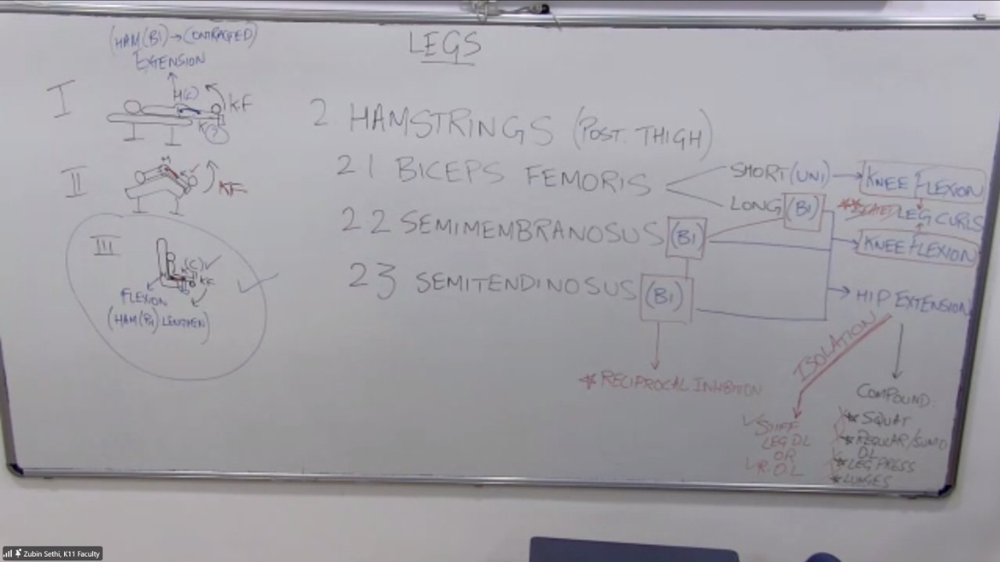
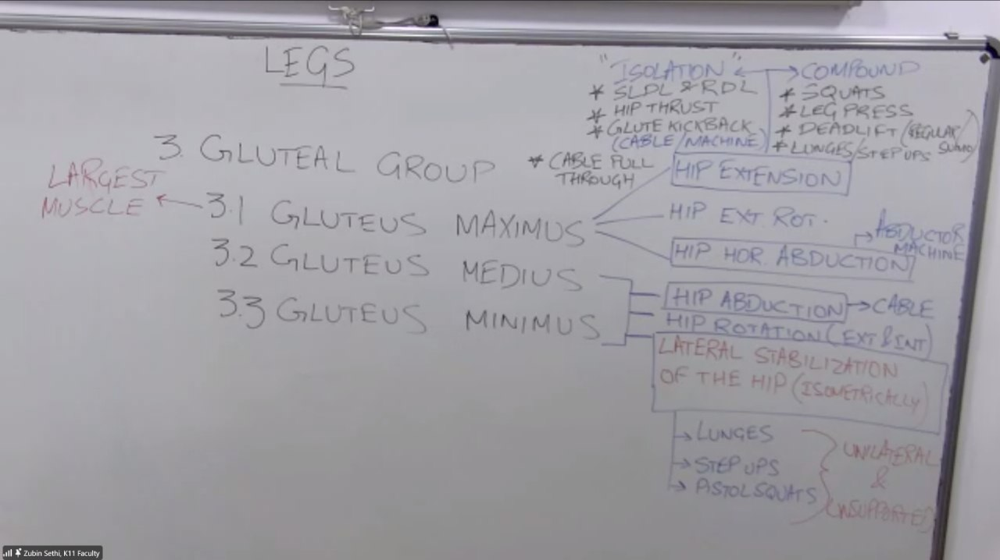
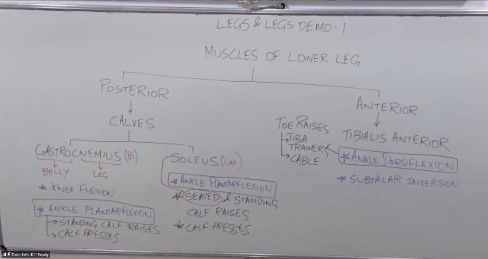

# Legs Lecture: Detailed Notes

**Course:** Personal Training Certification

**Topic:** The legs as a body part: why train them, a recap of the hip, knee and ankle joints and their actions, the quadriceps femoris (names, landmarks, origins, insertion, articulation, functions), compound and isolation exercises, reciprocal inhibition and the leg extension, the hamstrings, gluteal group, adductors and sartorius, and the lower leg (gastrocnemius, soleus, tibialis anterior)

**About these notes:** Detailed notes for the Legs Lecture (the theory), written so the whole lecture can be studied without watching the recordings. The first part of the leg teaching, the quadriceps, was taught in the lecture session. The lower leg theory was taught at the start of the demo session and is placed here with the other theory. The hamstrings, gluteal group, adductors and sartorius are covered from the course slides and the board photos, because no recording of that teaching was available (see Points to Confirm). The exercise demonstrations are in the Legs Demo notes. For a short revision version, see the Study Notes. Sources: the session recordings, the course slides ("Body part 2: Legs") and the board photos. The figures are original drawings made for these notes.

---

## Abbreviations used in these notes

| Short form | Meaning |
|---|---|
| M, O, I, F, E | Muscle, origin, insertion, function, exercise example (the order used for every muscle) |
| AIIS | Anterior inferior iliac spine |
| ASIS | Anterior superior iliac spine |
| ROM | Range of motion |
| Biarticular | Crosses two joints |
| Uniarticular | Crosses one joint |
| Prime mover | The muscle mainly responsible for a movement |
| Synergist | A helper muscle that does the same job as the prime mover |
| Stabiliser | A muscle that works to keep a body part steady |
| Compound | An exercise that moves more than one joint |
| Isolation | An exercise that moves one joint |

## Before this lecture

You should know the skeleton and the main joints, the directional terms, the planes of movement, compound and isolation exercises, and the way every body part lecture is organised (muscle, function, then the exercise whose concentric phase is that function). The back lecture is the model for this one.

## Outline of the lecture

| Part | Topic |
|---|---|
| 1 | Why train the legs |
| 2 | Recap: bones, joints and actions of the lower body |
| 3 | The leg muscle groups: the menu |
| 4 | The quadriceps femoris: name, landmarks, origin, insertion, articulation, function |
| 5 | Compound exercises for the quadriceps and the isolation question |
| 6 | Reciprocal inhibition, the rectus femoris and the leg extension |
| 7 | Hamstrings, gluteal group, adductors and sartorius |
| 8 | The lower leg: gastrocnemius, soleus and tibialis anterior |
| 9 | Exercise per muscle: summary table |

---

## Part 1: Why train the legs

1. **Power generation.** The legs hold the largest muscles in the body. They produce the force for jumping, sprinting, throwing (the throw starts from the ground) and heavy lifting.
2. **Daily tasks.** Standing up, climbing stairs, walking, getting out of a car and picking things up from the floor all depend on the legs. Strong legs keep a person independent for longer in life.
3. **Sport.** Almost every sport, from running and cycling to swimming and racket games, needs leg strength and leg endurance.

Three joints carry the body weight: the hip, the knee and the ankle. The leg exercises train the muscles that cross them.

---

## Part 2: Recap of bones, joints and actions

The class started with a recap on the skeleton model and the board.

| Joint | Type | Main actions |
|---|---|---|
| Hip | Ball and socket | Flexion, extension, abduction, adduction, internal and external rotation |
| Knee | Hinge | Flexion and extension |
| Ankle | Hinge | Plantarflexion and dorsiflexion |

- **Flexion** reduces the angle of a joint and **extension** increases it.
- **Abduction** moves a limb away from the midline and **adduction** brings it towards the midline.
- **Rotation** turns the limb around its long axis: internal (towards the midline) and external (away).
- At the ankle, **plantarflexion** points the toes down (as on tiptoes) and **dorsiflexion** lifts the toes towards the shin.

---

## Part 3: The leg muscle groups

The lecture board lists the groups to study, each with its function and an exercise.

1. Quadriceps femoris (four muscles)
2. Hamstrings (three muscles)
3. Gluteal group (gluteus maximus, medius and minimus)
4. Adductors
5. Sartorius
6. Lower leg: gastrocnemius, soleus, tibialis anterior

---

## Part 4: The quadriceps femoris

### 4.1 Decoding the name

- **Quadri** means four and **ceps** means heads, so it is a muscle with four heads. **Femoris** means "of the femur", the thigh bone.
- **Rectus** means straight. The rectus femoris runs straight down the front of the thigh.
- **Vastus** means large or vast. **Lateralis** is the outer side. **Medialis** is towards the midline. **Intermedius** is the one between them, deep under the rectus femoris. Take care: *medius* means medium (in the middle) and *medialis* means towards the midline.
- The plural of vastus is **vasti**. "The vasti" means the three vasti together.

### 4.2 Landmarks (awareness only)

| Landmark | Meaning |
|---|---|
| AIIS | A bump on the front of the pelvis, lower than the ASIS. Do not mix the two. |
| Greater and lesser trochanter | Bumps at the top of the femur. "Trochanter" comes from a Greek word for runner, because the muscles that move the leg attach here. |
| Tuberosity | A rough, large bump (for example the tibial tuberosity on the front of the shin, and the ischial tuberosity of the pelvis, the sitting bone). |
| Tubercle | A small bump. |

### 4.3 Origins and insertion

| Muscle | Origin | Insertion |
|---|---|---|
| Rectus femoris | Anterior inferior iliac spine (AIIS) | Tibial tuberosity, through the patellar ligament |
| Vastus lateralis | Greater trochanter and the outer shaft of the femur | Same |
| Vastus medialis | Inner (medial) shaft of the femur | Same |
| Vastus intermedius | Front and outer shaft of the femur, deep | Same |

All four join in one **common tendon** that passes over the kneecap (patella) as the patellar ligament and attaches to the tibial tuberosity.

### 4.4 Articulation: how many joints does the muscle cross?

- The **rectus femoris** starts on the pelvis, so it crosses the hip and the knee. It is **biarticular**.
- The **three vasti** start on the femur, so they cross the knee only. They are **uniarticular**.

### 4.5 Functions

| Muscle | Function |
|---|---|
| Rectus femoris | Knee extension, and hip flexion (as a helper) |
| Vastus lateralis, medialis, intermedius | Knee extension |

The vasti are pure knee extensors. The rectus femoris is a knee extensor that also helps to flex the hip.

---

## Part 5: Compound exercises, and why add isolation

### 5.1 Compound exercises that train the quadriceps

The squat, the regular and sumo deadlift, the leg press, lunges and step-ups all extend the knee against load, so the quadriceps work in every one of them. The demo explains each in turn.

### 5.2 Two questions from the board

1. **Why add an isolation exercise if the compound exercises already train the quadriceps?**
2. **How should the isolation exercise be done?**

The answer to the first question is the rectus femoris. In the compound exercises it does not do its full job. The answer to the second is the leg extension, set up in the right way (Part 6).

---

## Part 6: Reciprocal inhibition, the rectus femoris and the leg extension

### 6.1 Reciprocal inhibition

When one muscle contracts, the nervous system relaxes the muscle on the opposite side of the joint, the antagonist. This is **reciprocal inhibition**.

In a squat or a leg press, the hip extends on the way up. The hip extensors (the gluteus maximus and the hamstrings) contract. The rectus femoris is a hip flexor, so it is the opposite of the hip extensors and is inhibited. The result is that the rectus femoris cannot contribute fully to knee extension in compound movements, even though it is a knee extensor. Only the three vasti do the work.

### 6.2 The leg extension and active insufficiency

The leg extension isolates the knee, which removes the hip extension that inhibits the rectus femoris. There is still one problem. On an upright seat the hip is already flexed (about 90 degrees), so the rectus femoris is already shortened at the hip before the knee even starts to extend. A muscle that is already short cannot shorten much more and produces little force. This is **active insufficiency**.

The fix is to **recline the seat back** so the hip opens. This lengthens the rectus femoris at the hip and lets it produce force at the knee.

A study compared leg extensions done reclined at about 40 degrees with the upright position of about 90 degrees. The reclined group showed much more growth of the rectus femoris. This is why the notes recommend the seat back.

The leg extension trains all four muscles. With the seat reclined it is the one exercise that loads the rectus femoris well, and that is the reason to include it.

---

## Part 7: Hamstrings, gluteal group, adductors and sartorius

This part follows the course slides and the board photos.

### 7.1 Hamstrings

| Muscle | Origin | Insertion | Function |
|---|---|---|---|
| Biceps femoris, long head | Ischial tuberosity | Head of the fibula and the outer tibia | Knee flexion and hip extension |
| Biceps femoris, short head | Linea aspera of the femur | Same | Knee flexion only |
| Semitendinosus | Ischial tuberosity | Inner (medial) tibia | Knee flexion and hip extension |
| Semimembranosus | Ischial tuberosity | Inner (medial) tibia | Knee flexion and hip extension |

Three of the four heads cross the hip and the knee, so the hamstrings are mostly biarticular. The short head of the biceps femoris starts on the femur and crosses the knee only. Exercises: the leg curl for knee flexion, and the stiff leg deadlift or Romanian deadlift for hip extension.

### 7.2 Gluteal group

| Muscle | Origin | Insertion | Function |
|---|---|---|---|
| Gluteus maximus | Ilium, sacrum and coccyx | Gluteal tuberosity and the iliotibial band | Hip extension and external rotation |
| Gluteus medius | Ilium | Greater trochanter | Hip abduction, stabilising the pelvis from side to side, internal rotation |
| Gluteus minimus | Ilium | Greater trochanter | Same as the gluteus medius |

Exercises: the hip thrust, squats and deadlifts for the gluteus maximus, and standing cable abduction for the gluteus medius and minimus.

### 7.3 Adductors and sartorius

| Muscle | Function |
|---|---|
| Adductor magnus | Hip adduction and hip extension |
| Adductor longus and brevis | Hip adduction |
| Sartorius | Hip flexion, abduction and external rotation, and knee flexion |

The sartorius runs from the ASIS across the thigh to the inner upper tibia. It is the longest muscle in the body, and it works mostly as a stabiliser.

Exercises: the seated and standing adduction for the adductors. The sartorius has no direct exercise. The adductor magnus is the muscle that takes over hip extension at the bottom of a deep squat or deadlift.

---

## Part 8: The lower leg

### 8.1 The three muscles

- **Gastrocnemius.** The name means "belly of the leg" (the *c* is silent). It is the visible bulge of the calf. It starts on the femoral condyles (above the knee), so it is **biarticular**. It inserts on the heel bone (calcaneus) through the **Achilles tendon**.
- **Soleus.** Named for its flat shape, like a sole (or the sole fish). It lies deep to the gastrocnemius. It starts on the tibia and fibula, so it is **uniarticular** (ankle only). It shares the Achilles tendon.
- **Tibialis anterior.** It lies on the front of the shin. It starts on the upper two thirds of the outer tibia and inserts on the medial cuneiform and first metatarsal of the foot.

### 8.2 Functions

| Muscle | Function |
|---|---|
| Gastrocnemius | Ankle plantarflexion, and helps knee flexion |
| Soleus | Ankle plantarflexion |
| Tibialis anterior | Ankle dorsiflexion, and foot inversion |

### 8.3 Articulation decides the exercise

Because the gastrocnemius crosses the knee, its length depends on the knee angle. With the **knee straight** (standing calf raise, calf press) it is stretched at the knee and can work together with the soleus. With the **knee bent** (seated calf raise) it is already shortened at the knee, so the **soleus** does most of the work. Train both, with a standing and a seated exercise.

The gastrocnemius is a synergist in knee flexion (the leg curl). It is the prime mover only in plantarflexion. The demo uses this for exercise order.

The tibialis anterior is the opposing muscle and has its own exercise, the toe raise.

---

## Part 9: Exercise per muscle

| Muscle or group | Function | Exercise examples |
|---|---|---|
| Quadriceps | Knee extension (rectus also hip flexion) | Squats, lunges, step-ups, leg press, leg extension (reclined) |
| Hamstrings | Knee flexion, hip extension | Leg curls, stiff leg and Romanian deadlifts |
| Gluteus maximus | Hip extension, external rotation | Hip thrust, deadlifts, squats |
| Gluteus medius and minimus | Hip abduction, pelvic stability | Standing cable abduction, lunges |
| Adductors | Hip adduction (magnus also extension) | Seated and standing adduction |
| Gastrocnemius | Plantarflexion | Standing calf raise, calf press |
| Soleus | Plantarflexion | Seated calf raise |
| Tibialis anterior | Dorsiflexion | Toe raise |

---

## Key takeaways

The legs carry the body, produce the most power and matter in daily life and sport. The quadriceps have four muscles, and only the rectus femoris crosses the hip, which makes it biarticular and explains why compound exercises under-train it through reciprocal inhibition. Recline the seat on the leg extension to avoid active insufficiency. The hamstrings flex the knee and extend the hip, the gluteus maximus extends the hip, the gluteus medius and minimus abduct and stabilise the pelvis, and the adductors adduct. In the calf, the gastrocnemius crosses the knee and the soleus does not, so train the calf with the knee straight and with the knee bent. The tibialis anterior dorsiflexes the ankle and has its own exercise.

---

## Points to Confirm

1. **Recording gap.** The recording of the leg lecture covers the quadriceps only. The teaching of the hamstrings, gluteal group, adductors and sartorius was not in the material provided, so Part 7 follows the course slides and the board photos. Please check it against what was taught in class.
2. **Gluteus medius and minimus.** The slides list abduction and internal rotation, and they also describe the lateral hip stabiliser role. Check which wording the course uses.
3. **Hamstring origin of the short head.** The short head of the biceps femoris is taken from the slides (linea aspera). Check against the class version.
4. **Rectus femoris study.** The reclined leg extension study was mentioned in class without a citation. Confirm the reference if it is needed in the notes.
5. **Landmark wording.** "Trochanter means runner" is a memory aid from class and is based on the Greek word.
6. **Lower leg placement.** The lower leg theory was taught at the start of the demo session. It is placed here so every theory topic is in the lecture notes.
7. **Figures.** The figures are simplified drawings made for these notes. Muscle positions and sizes are approximate. The practical sessions teach exact form.

---

# Board Photos from the Lecture

