# Legs Demo: Detailed Notes

**Course:** Personal Training Certification

**Topic:** Legs demo: why squats and lunges matter, the back, front and overhead squat, resistance profile in the squat, supported squats (hack squat, V-squat, pendulum, belt, Smith machine, ball squat), lunges (static, dynamic, walking, reverse), step-ups, the pistol squat, the leg press, the stiff leg and Romanian deadlift, hip isolation (hip thrust, cable pull-through, glute kickback), the leg extension, leg curls, calf and tibialis exercises, abduction and adduction, and the order of the calf raise and leg curl

**About these notes:** Detailed notes for the whole Legs Demo, written so the demo can be studied without watching the recordings. The demo ran over two class sessions, and they are combined here into one set. The theory taught at the start of the first session (the lower leg muscles) is in the Legs Lecture notes. Each exercise is covered with set-up, execution, muscles, mistakes and class questions, with figures. The figures are original drawings made for these notes, and the practical sessions teach the exact form. For a short revision version, see the Study Notes. Sources: the session recordings, the course slides ("Body part 2: Legs") and the board photos.

---

## Abbreviations used in these notes

| Short form | Meaning |
|---|---|
| SLDL | Stiff leg deadlift |
| RDL | Romanian deadlift |
| ROM | Range of motion |
| Bilateral | One object held with both hands, or both legs working on one load |
| Isolateral | Two separate objects or levers, both sides working together |
| Unilateral | One side at a time |
| Deloading | The weight rests on the floor between repetitions |
| Non-deloading | The weight stays off the floor between repetitions |
| Moment arm | The perpendicular distance from the line of force to the joint |

## Before this demo

You should know the legs lecture: the muscles, their functions and the idea of biarticular and uniarticular muscles. You should also know the resistance profile ranking (free weight, cable, cam machine), the moment arm and the difference between compound and isolation exercises.

## Outline of the demo

| Part | Topic |
|---|---|
| 1 | Why squats and lunges are important |
| 2 | The demo menu |
| 3 | Squats: back, front, overhead |
| 4 | Resistance profile in the squat |
| 5 | Supported squats |
| 6 | Lunges |
| 7 | Step-ups and the pistol squat |
| 8 | The leg press |
| 9 | Stiff leg and Romanian deadlift |
| 10 | Hip isolation: hip thrust, pull-through, kickback |
| 11 | Leg extension |
| 12 | Calf and tibialis exercises, and the order with leg curls |
| 13 | Leg curls |
| 14 | Abduction and adduction |
| 15 | Class questions and what follows |

---

## Part 1: Why squats and lunges are important

### 1.1 The squat

1. **Functional carryover.** The squat mimics sitting down and standing up. Training it maintains and improves the mobility of the hip, knee and ankle together. It trains the power generation and locomotion muscles.
2. **Structural development.** Heavy loading builds soft tissue, and it loads the bones, which supports bone density.

### 1.2 The lunge

1. **Unilateral, symmetrical development.** Each leg works alone, so a stronger side cannot take over. In the early (neural) stage of training this evens out the difference between the legs, and later it supports muscle growth.
2. **Lateral hip stability.** The gluteus medius and minimus must hold the pelvis level on one leg. The lunge trains this and improves balance.

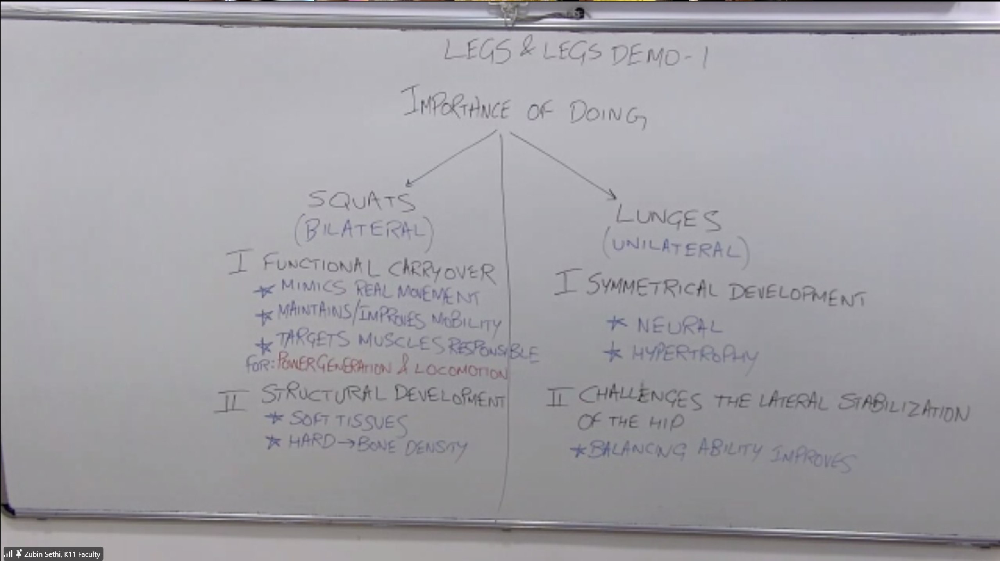

---

## Part 2: The demo menu

The demo is a video-watching session. The exercises written on the board in the lecture are the recommended ones, and the demo also discusses dos and don'ts, machine variety and resistance profile, so a trainer knows what will be met in gyms. The hands-on version is learned in the practical sessions with the master trainers.

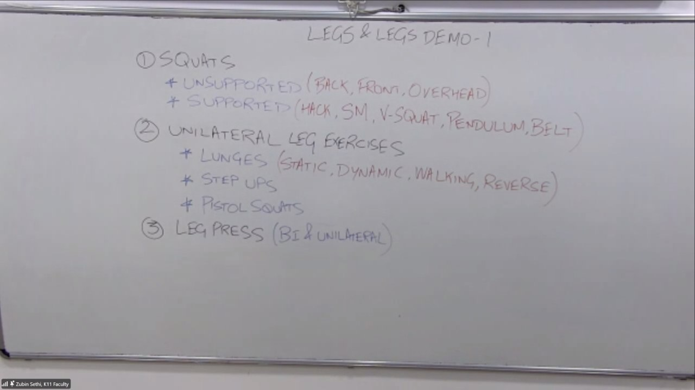

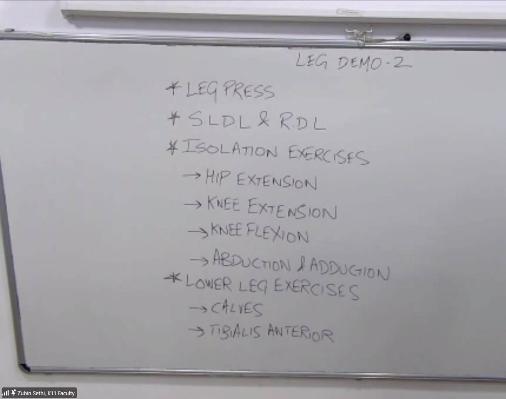

---

## Part 3: Squats

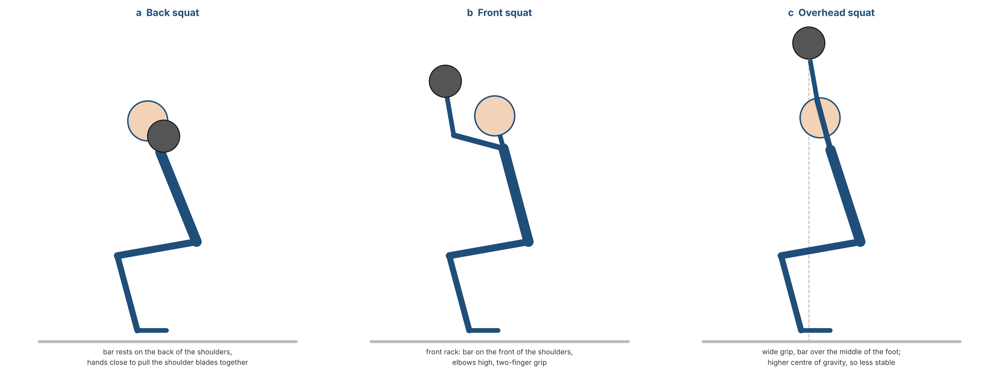

### 3.1 Back squat

- **Power cage versus squat rack.** The cage has safety arms that catch the bar, so it is safer for heavy work.
- **Bar height.** At collarbone height or slightly lower, so the lifter unracks it with a small dip.
- **Bar position.** On the widest area of the upper back, along the spine of the scapula. Hands are placed close, to pull the shoulder blades together and make a shelf.
- **Hip and knee rule.** The hips and knees bend together. The knees follow the direction of the toes.
- **Gaze.** At a fixed focal point, not into a mirror, so the neck stays neutral.

### 3.2 Front squat

- The bar rests on the front of the shoulders in the **front rack position**. The elbows stay high, and a two-finger grip is enough.
- It carries over to the clean and jerk.
- It is useful in late pregnancy, because the upright torso leaves room for the abdomen.

### 3.3 Overhead squat

- A wide grip with the bar held over the middle of the foot.
- The centre of gravity is higher, so the lift is less stable and demands more mobility.

---

## Part 4: Resistance profile in the squat

In a squat the load creates a moment arm at two joints: the hip (the distance from the hip to the line of the bar) and the knee (from the knee to the same line). The longer arm demands more of that joint. A forward lean raises the hip demand, and an upright torso with the knees forward raises the knee demand.

The class analysed photos to see where the line of force falls. The same idea explains the Smith machine: because the bar moves on a fixed path, **moving the feet forward** shifts the work to the gluteals and hamstrings, and **placing the feet under the bar** shifts it to the quadriceps.

---

## Part 5: Supported squats

Supported squats give the lifter a fixed path, so the balance demand drops and the target muscles can be loaded more.

| Machine | Notes |
|---|---|
| Hack squat | Plate loaded and guided by rods. The line of force is parallel to the guide rod. |
| V-squat | Two versions: facing away from the pad or towards it. |
| Pendulum squat | The machine swings on an arc. |
| Belt squat | The load hangs from a belt on the hips, so the spine is not loaded. |
| Smith machine | The bar runs on fixed rails. |
| Ball squat | A ball against a wall, used mainly in rehabilitation. |

---

## Part 6: Lunges

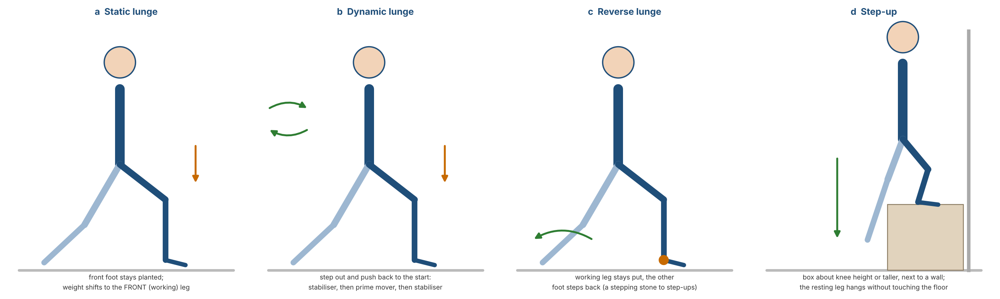

1. **Static lunge.** The front foot stays fixed and the weight shifts to the front leg. The **front leg is the working leg**.
2. **Dynamic lunge.** The lifter steps out and pushes back. It has a plyometric effect. The working leg goes stabiliser, then prime mover, then stabiliser.
3. **Walking lunge.** The eccentric part is like the dynamic lunge and the concentric part is like the static lunge.
4. **Reverse lunge.** The working leg stays in place and the other foot steps back. It is a stepping stone to the step-up.

---

## Part 7: Step-ups and the pistol squat

- **Step-up.** Use a box about 3 feet tall, next to a wall, so the resting leg can slide down without touching the floor. It gives a greater range of motion and needs good hip, knee and ankle mobility. A weightlifting shoe with a raised heel helps ankle dorsiflexion.
- **Pistol squat.** A deep squat on one leg with the other leg held out in front. It is an advanced exercise that needs mobility, balance and strength.

---

## Part 8: The leg press

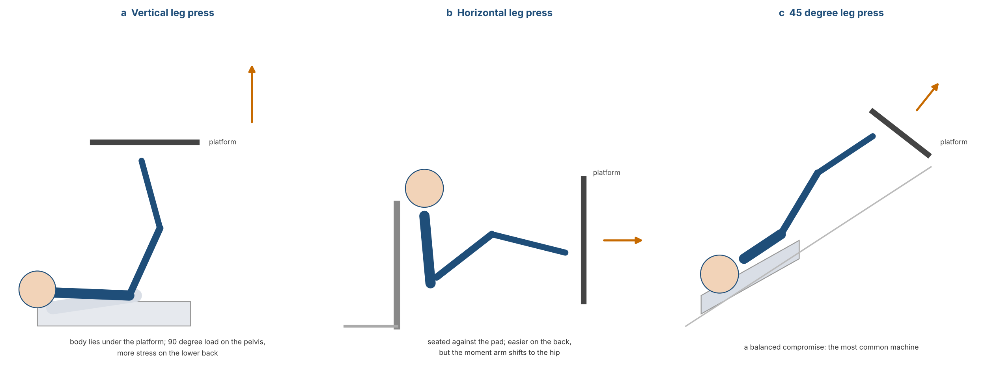

### 8.1 Types and why they evolved

1. **Vertical.** The first design. The load acts at 90 degrees on the pelvis and puts stress on the lower back.
2. **Horizontal.** Solved the back problem, but the moment arm moves to the hip.
3. **45 degrees.** A balanced compromise, and the most common.

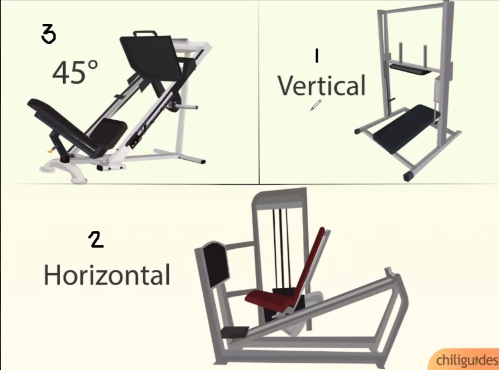

### 8.2 Feet placement

A **high** platform position uses more of the hip extensors. A **low** position uses more of the quadriceps. The middle is balanced.

### 8.3 Notes

- The horizontal machine shown was **isolateral**, so each leg works on its own lever. Single leg work is also possible (unilateral).
- Keep the head on the pad. A lifted head strains the neck (Newton's third law: the push goes both ways).
- **Toes out** for two legs, **toes straight** for one leg.

---

## Part 9: Stiff leg and Romanian deadlift

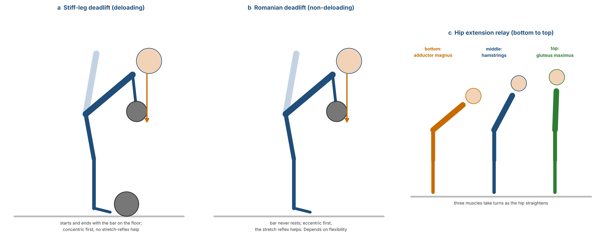

Both remove knee flexion, so the hamstrings can work as hip extensors.

| | SLDL | RDL |
|---|---|---|
| Deloading? | Yes: the weight touches the floor | No |
| First phase | Concentric (lift from the floor) | Eccentric (lower first) |
| Stretch reflex help | No | Yes |
| Depends on flexibility | Less | More |

### 9.1 Types and techniques

The types are conventional (regular), sumo, Romanian and stiff leg. The **techniques** are deloading and non-deloading. Both are separate questions.

### 9.2 The hip extension relay

As the hip straightens, three muscles take turns: the **adductor magnus at the bottom**, the **hamstrings in mid range**, and the **gluteus maximus at the top**.

The deadlift is not a back lift or a leg lift. It is covered in the scheduling lecture.

---

## Part 10: Hip isolation

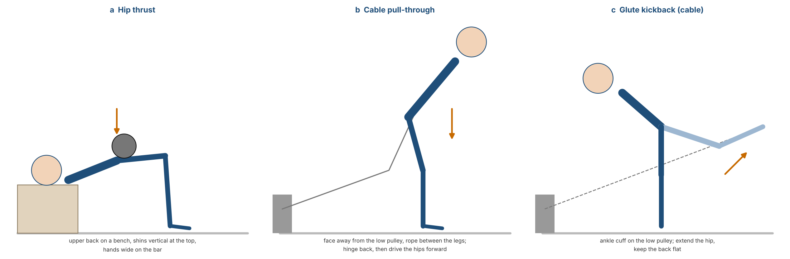

- **Hip thrust.** Upper back on a bench, the shins vertical at the top, hands wide on the bar.
- **Cable pull-through.** Face away from the low pulley with the rope between the legs. Hinge back, then drive the hips forward.
- **Glute kickback.** On a cable (ankle cuff) or on a cam machine. Extend the hip and keep the back flat.

---

## Part 11: Leg extension

The seat back is reclined to about 40 degrees so the rectus femoris works (see the Legs Lecture, Part 6). The demo showed machines with an adjustable back.

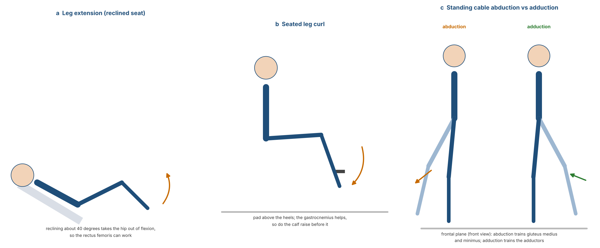

---

## Part 12: Calf and tibialis exercises, and the order with leg curls

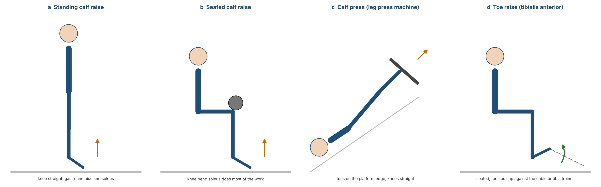

1. **Standing calf raise.** Knee straight. Works the gastrocnemius and the soleus.
2. **Seated calf raise.** Knee bent. The soleus does most of the work.
3. **Calf press.** On the leg press machine with the toes on the platform edge and the knees straight.
4. **Toe raise.** For the tibialis anterior, on a tibia trainer or with a cable and an incline bench.

### 12.1 Calf raise before the leg curl

The gastrocnemius is a **synergist** in the leg curl. If the leg curl is done first, the calf is tired before the calf raise. So do the **standing calf raise before the seated leg curl**, so the gastrocnemius is fresh for its own work. The board compares two orders (scenario A and B).

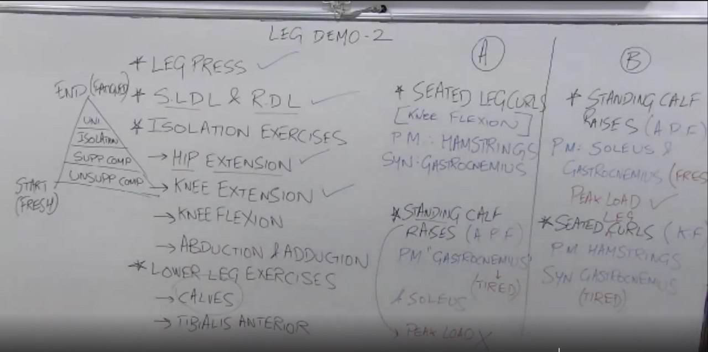

---

## Part 13: Leg curls

The seated leg curl sets the pad above the heels. The hamstrings flex the knee. The gastrocnemius helps, so see Part 12.1 for the order.

---

## Part 14: Abduction and adduction

- **Seated adduction** (machine): horizontal adduction for the adductors.
- **Seated abduction** (machine): horizontal abduction for the horizontal fibres of the gluteus maximus.
- **Standing cable abduction**, in the frontal plane, for the gluteus medius and minimus.
- **Standing cable adduction**, in the frontal plane, for the adductors.

---

## Part 15: Class questions and what follows

The demo was followed by the next body part lecture. The slide schedule and the assignments were not discussed in these sessions.

---

## Exercise video library

| Exercise | Main muscles |
|---|---|
| Back squat, front squat, overhead squat | Quadriceps, gluteus maximus, adductor magnus |
| Hack squat, V-squat, pendulum, belt, Smith | Quadriceps, gluteals |
| Static, dynamic, walking and reverse lunge | Quadriceps, gluteals, gluteus medius and minimus |
| Step-up | Quadriceps, gluteals |
| Pistol squat | Quadriceps, gluteals |
| Leg press | Quadriceps, gluteals |
| SLDL, RDL | Hamstrings, gluteus maximus |
| Hip thrust, pull-through, kickback | Gluteus maximus |
| Leg extension | Quadriceps (rectus femoris when reclined) |
| Standing and seated calf raise, calf press | Gastrocnemius, soleus |
| Toe raise | Tibialis anterior |
| Seated leg curl | Hamstrings |
| Abduction and adduction | Gluteals, adductors |

---

Key takeaways: squats and lunges give functional carryover and structural development, and the lunge adds balanced single leg work. The back, front and overhead squat shift the bar and the balance demand. Foot position changes the resistance profile on machines such as the leg press and the Smith machine. The SLDL is deloading and starts with the lift, the RDL is non-deloading and starts with the lowering. The adductor magnus, hamstrings and gluteus maximus share the hip extension in turn. Recline the leg extension. Do the standing calf raise before the seated leg curl, and use the toe raise for the tibialis anterior.

---

## Points to Confirm

1. **Missing recordings.** The video library parts (back squat variations, pistol squat and some machine details) were taken from the class description and the slides. Check them against the exact form taught in the practical sessions.
2. **Part 14.** The seated abduction and adduction machine wording follows the class, and the horizontal fibres of the gluteus maximus claim should be confirmed.
3. **Smith machine foot position.** The direction of the effect (feet forward means more gluteal work) follows standard exercise science. Please confirm it matches the class.
4. **Slide schedule.** The slides contain a weekly schedule and the legs assignments. They were not discussed in these sessions.
5. **Two sessions combined.** The demo was split over two sessions, so the exercise parts of both are combined here.
6. **Figures.** The figures are simplified drawings made for these notes. Exact form is taught in the practical sessions.

---

# Board Photos from the Demo

