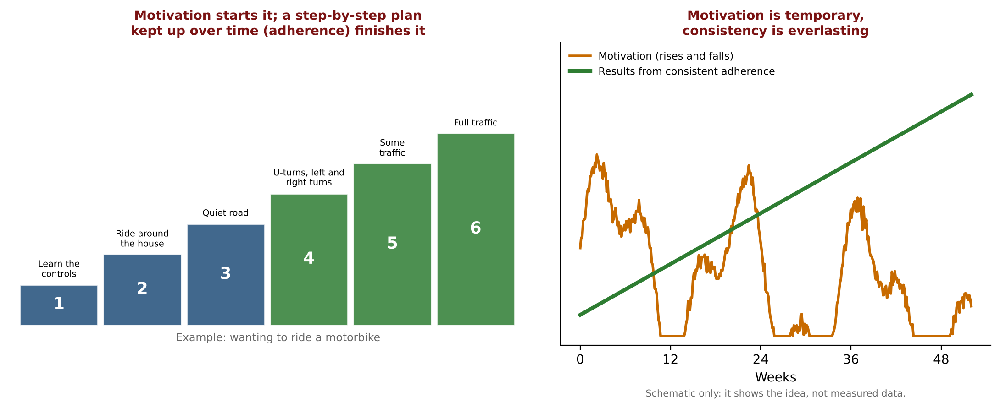
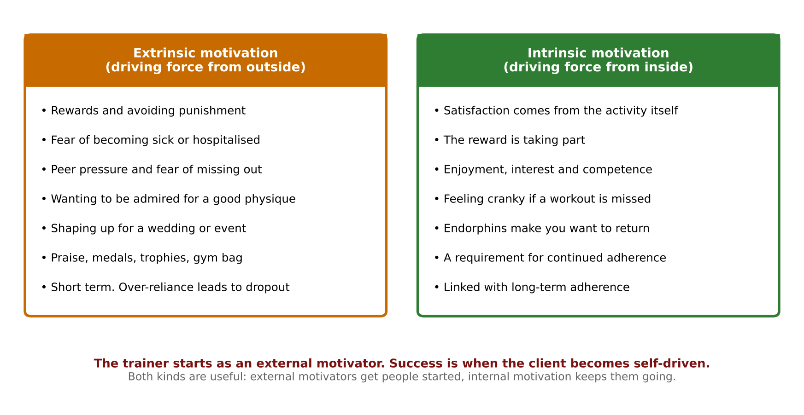
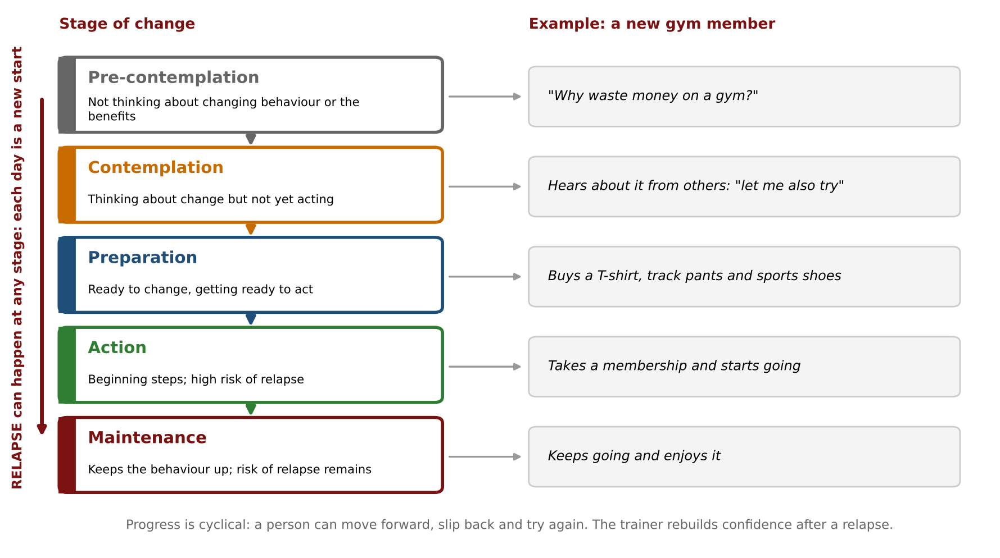
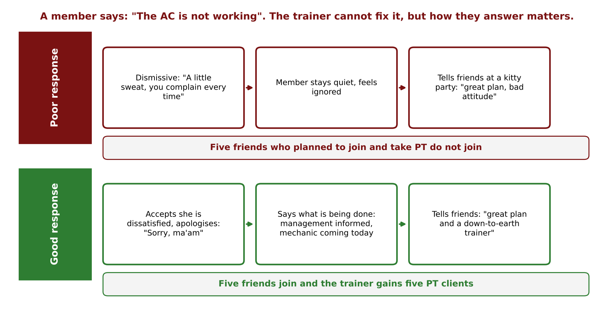
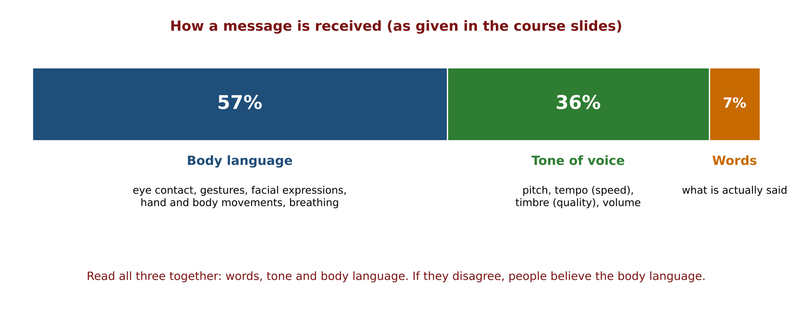
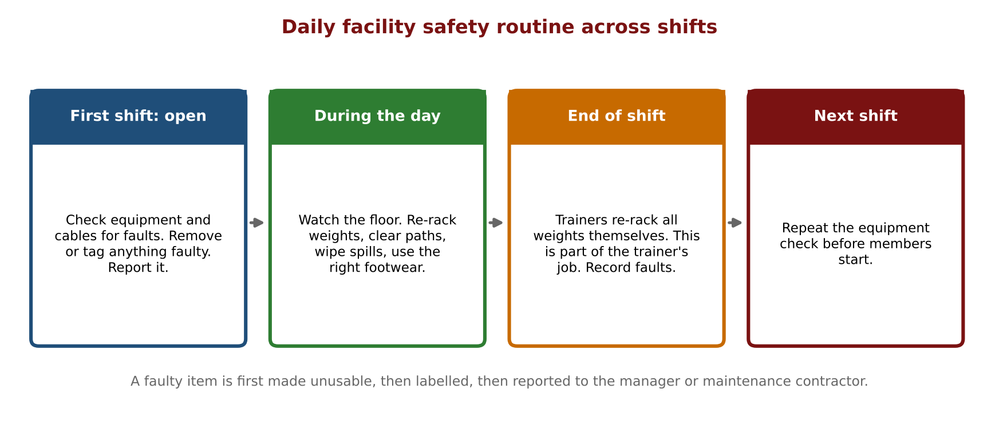
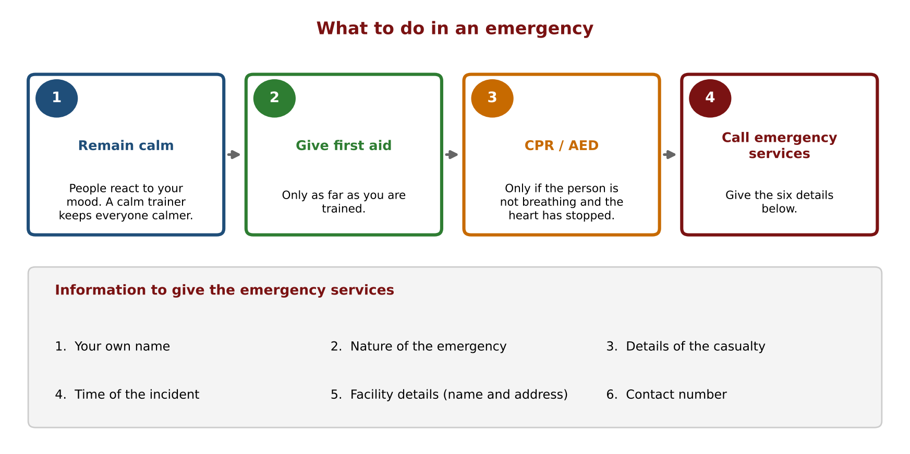
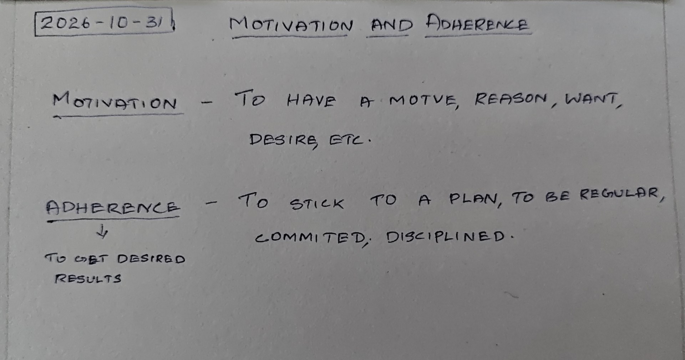
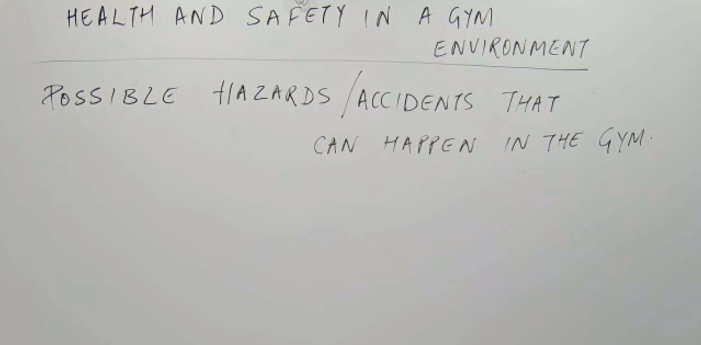

# Motivation, Adherence, Health & Safety in Gym Environment: Detailed Notes

**Course:** Personal Training Certification

**Topic:** Motivation and adherence (intrinsic and extrinsic motivation, client goals, behaviour change models, relationships, complaints, communication) and health and safety in a gym environment (hazards, emergencies, screening, code of conduct)

**About these notes:** Detailed notes from the Motivation, Adherence, Health & Safety in Gym Environment lecture, written so the whole lecture can be studied without watching the recording. Every concept, example, analogy and class question is covered. For a short revision version see the Study Notes. Sources: the lecture recording, the course slides ("Motivation & Adherence and Health & Safety in a Gym Environment"), the course handbook pages on these topics, the course E-book chapter on first aid, and the board photos.

---

## Abbreviations used in these notes

| Short form | Meaning |
|---|---|
| TTM | Transtheoretical Model (stages of behaviour change) |
| SLT | Social Learning Theory |
| PR | Personal record (a new best lift) |
| PT | Personal training, or a personal trainer |
| FOMO | Fear of missing out |
| PAR-Q | Physical Activity Readiness Questionnaire |
| CPR | Cardiopulmonary resuscitation |
| AED | Automated external defibrillator |
| AMC | Annual maintenance contract (a contractor who services the equipment) |
| AC | Air conditioner |
| ROM | Range of motion |
| Special population | A group needing extra care in training, for example people with heart disease, high blood pressure, pregnancy, older adults or children |

## Before this lecture

This lecture is about psychology and professional conduct, not exercise science. You should already know the course material on scheduling (the previous two lectures), because a trainer who understands scheduling is one of the qualities clients expect. You should also know the basics of muscle growth (hypertrophy), because the lecture uses it to explain why training must continue for a lifetime. The next lecture covers special populations in detail, so some safety points here are only introduced.

## Outline of the lecture

| Part | Topic |
|---|---|
| 1 | Motivation and adherence: definitions, the motorbike analogy and why adherence must be lifelong |
| 2 | Why people join a gym and what keeps them attending |
| 3 | Intrinsic and extrinsic motivation |
| 4 | Client goals and the qualities clients expect from a trainer |
| 5 | Incentives and rewards, and the client's own responsibility |
| 6 | Behaviour change: the habit period, the Transtheoretical Model and Social Learning Theory |
| 7 | Effective trainer and client relationships |
| 8 | Handling complaints |
| 9 | Interpreting client responses and effective communication |
| 10 | Health and safety: hazards and accidents in the gym |
| 11 | Equipment checks and the daily routine |
| 12 | Emergencies and special groups |
| 13 | Screening, and leaving the environment suitable for the next user |
| 14 | Code of conduct and core values |

---

# Part A: Motivation and Adherence

## Part 1: Motivation and adherence

### 1.1 The two definitions

The board for this part (see the board photos at the end) gives both definitions.

- **Motivation** is to have a motive, a reason, a want or a desire. It is the driving force that prompts action. It energises, directs and sustains behaviour.
- **Adherence** is to stick to a plan, to be regular, committed and disciplined, in order to get the desired results.

The slide opens with the statement "It is easy to be motivated but difficult to adhere to." The meaning is that almost everyone feels motivated at the start (a new year, a wedding, a health scare). The hard part is to keep turning up when that feeling has faded. **Motivation is temporary, consistency is everlasting.**

### 1.2 The motorbike analogy

Wanting to ride a motorbike is motivation. Actually learning to ride takes a plan followed step by step:

1. Learn the controls (clutch, gears, brakes).
2. Ride around the house or the housing society.
3. Ride on a quiet road.
4. Practise U-turns, left turns and right turns.
5. Ride on a road with some traffic.
6. Ride in full traffic.

The person who only has the desire, but does not follow the steps, never rides in traffic. Training is the same: the desire starts it, and following the plan (adherence) finishes it.

### 1.3 Adherence has to last for life

Adherence is not for a few months. The trainer should explain that:

- Muscle that is built is lost if training stops, so the results only last as long as the habit.
- Training is a **lifestyle change**, not a short project with an end date.
- A client who trains for one or two months and then stops returns to the starting point.

**Class question:** How long does it take for muscle to become visible?

**Answer from the class and the lecture:** About 3 to 6 months of consistent training for most people (some in the class said up to a year). Hypertrophy (the growth process itself) needs about 48 hours of recovery after each session, so growth happens between sessions, not only during them. The point for the trainer is that visible results take months, so the client needs a reason to stay beyond the first few weeks.

## Part 2: Why people join a gym and what keeps them attending

### 2.1 General reasons for going to a gym

The slides list these reasons:

- Muscle building
- Improving body composition
- Personal reasons (for example, feeling clear-headed after a workout)
- Stress management
- Emotional reasons (for example, self care or "me time")
- Networking
- Exercising for fat loss
- Increasing strength
- Improving fitness to do better in a sport

### 2.2 Key drivers of consistent attendance

The slide lists what the trainer and the gym can do to keep clients regular:

| Group | Drivers |
|---|---|
| Reminders and atmosphere | Continuous reminders, motivational posters and music, regular competitions for engagement |
| Education | Educate the client, explain the muscle building process, explain anti-ageing benefits, explain the adverse effects of a poor or sedentary lifestyle |
| Trainer behaviour | The trainer's passion for fitness (it inspires), and the trainer's gestures and behaviour (important) |
| Tracking | Record progression, dietary recalls |
| Social and emotional | Social media transformation stories, emotional reasons |
| Rewards | Incentives and rewards, both financial and non-financial |

The lecture did not go through every item in this slide in detail. The items that were developed (education, rewards, trainer passion, behaviour) are covered in the parts below.

## Part 3: Intrinsic and extrinsic motivation

### 3.1 The comparison

| Point | Extrinsic motivation | Intrinsic motivation |
|---|---|---|
| Source | Driving force from outside | Driving force from inside |
| What drives it | Rewards, or avoiding punishment or a bad outcome | Enjoyment, interest and satisfaction from the activity itself |
| Reward | Something given by others (praise, a prize, an outcome) | Taking part is the reward |
| Length | Generally short term | Linked with long-term adherence |
| Risk | Over-reliance on it leads to dropout | Few, because the person returns for the activity itself |

Examples from the slides:

- **Intrinsic:** an artist paints for the love of creating. Someone reads a book because they are curious about the story, not because there is a test. Running for peace of mind. Some people work out because it makes them feel strong, focused and alive, and they do not need rewards or recognition.
- **Extrinsic:** a fine for running a red light motivates people to stop, even when nobody is watching. A child takes up swimming or dancing because a parent pushes them, and the parent's praise is the external motivator. A person exercises to receive continuous attention and admiration from friends. Exercising to avoid health problems such as obesity or high blood pressure is also extrinsic (avoidance of a bad outcome).

### 3.2 Both kinds are useful

External motivators are not bad. They get people to start. The trainer's real success is to move a client from being driven by external motivators to being driven by internal ones, so that the client trains because they feel cranky when they miss a session, or because the endorphins make them want to come back. When that happens, the client does not need the trainer to chase them. The lecture treated this as the real measure of a trainer's success.

### 3.3 Extrinsic motivators discussed in class

**Fear of sickness.** Many people start because a doctor warned them about a metabolic or lifestyle disease (diabetes, high blood pressure, high cholesterol). The trainer should know that these conditions are **managed, not cured**. Exercise and diet keep them under control, but the control only lasts while the habits last. This is another reason adherence has to be lifelong.

**Peer pressure and FOMO.** A person joins because friends have joined and they do not want to miss out. When the friends drop out, this client often drops out too.

**Wanting admiration.** Some clients want praise for how they look. The lecture called the shortage of praise in a person's life "validation starvation". These clients stay motivated while the compliments come, and the motivation falls when they stop.

**Shaping up for an event.** A person who wants to look good for a wedding or event trains hard until the date and then stops. The lecture gave the example of a friend who dieted for an event and regained all the weight afterwards. The event was the only reason, and when the event ended the reason ended.

**Heavy reliance on extrinsic motivators hurts long-term adherence.** The trainer should use them to start the client, while helping the client find an internal reason.

## Part 4: Client goals and the qualities clients expect from a trainer

### 4.1 Client goals

Typical goals: lose fat, build muscle, get stronger and improve fitness. Rewards and incentives enhance motivation towards these goals.

### 4.2 Qualities clients expect (the handbook table)

| Quality | What it means |
|---|---|
| Patience | Allowing time for learning and results |
| Communication | Explaining clearly and listening |
| Professionalism | Keeping boundaries, being punctual and respectful |
| Education and safe guidance | Knowledge, and keeping the client safe |
| Passion for fitness | Living the lifestyle that is being taught |
| Understanding of scheduling | Building flexible, realistic plans (see the Scheduling lectures) |

### 4.3 Patience

Patience is needed at several levels:

- **Learning movements.** A client who learned an exercise with wrong form has built the wrong neural pathway, and unlearning it takes much longer than learning it fresh. The trainer has to correct the same mistake many times without showing frustration.
- **Expecting quick results.** Clients often want fast results. The trainer has to keep explaining that results take months.
- **Instruction style.** The lecture used the idea of being "like water": water takes the shape of the container. Some clients respond to a loud, energetic count. Others respond to a calm and compassionate voice. Five clients are like five fingers, each different, so the same style does not fit everyone.

### 4.4 Communication

- Avoid jargon with clients who are new to training.
- Give the science behind the plan to clients who want to understand it. A client who understands why a rule exists follows it more willingly.

### 4.5 Professionalism

- **No personal or romantic relationship with clients.** The lecture warned that it can start with an innocent "good morning, how was your day?" and end in a romantic involvement. When it turns bad, the organisation removes the trainer, not the client, because the client brings the business and one complaint is enough. In a high-end gym the clients are influential people, so a trainer who ends up in their bad books can lose the job and the reputation.
- **Listening within boundaries.** A trainer spends one or two hours alone with a client, so a client may share personal problems (for example, a fight at home that made them late). The trainer has to listen, because the client often just wants someone to listen, but the lines become blurred and the trainer must be careful not to turn into a therapist or a close friend.
- **Advances from the other side.** Even when the attention comes from the client's side, the trainer must learn to handle it and not slip. The trainer cannot speak badly to the client, so it has to be handled politely and firmly.

### 4.6 Education

A trainer never stops learning. Extra certifications keep the knowledge current and can also open further income streams (for example nutrition, special population work or group classes).

### 4.7 Passion for fitness

The lecture put this as "your body is your business card". The points were:

- **You get clients by your physique and keep them by your knowledge.** A client notices how the trainer looks, but stays because the trainer's guidance works.
- The trainer should work out 3 to 4 days a week and not be a trainer who only instructs.
- **No ego lifting.** A trainer who lifts carelessly to impress is more likely to get injured and sets a poor example.
- **Consistency in nutrition.** The lecture's anecdote: at a wedding breakfast, one guest with a good physique took a plate of 10 whole eggs and discarded the yolks, while everyone else ate something else, and the others smiled at him. The lesson was that others think we are crazy and we think others are crazy, so choose your crazy, and that body composition can be read from what is on the plate. One meal or one piece of birthday cake does nothing, but what matters is what is eaten in the remaining days. That is consistency, in diet and in workouts.
- **Sleep and recovery** are part of the trainer's own routine. Sleep becomes more important with age, even though young people do not notice it.

### 4.8 Understanding of scheduling

The handbook lists this as a quality: the trainer should be able to plan sessions that fit the client's life, which is what the Scheduling lectures covered.

## Part 5: Incentives, rewards and the client's responsibility

### 5.1 Incentives and rewards

| Type | Examples |
|---|---|
| Tangible (physical items) | Gym bag, T-shirt, mug, shaker, medals, trophies |
| Intangible (non-physical) | Public praise, a social media mention, a free PT session, a complimentary nutrition consultation |

Example from the lecture: when a client sets a new **PR**, the trainer celebrates it in front of others. The reward does not need to be expensive. The recognition is what matters.

**Rules for using rewards:**

- Use **positive reinforcement only**.
- **Never compare clients with each other.**

The reason is shown by the lecture's anecdote of a 16 year old who was publicly compared with a stronger person and told he could not do even a push-up. The remark hurt him, and it also taught the rest of the class that the trainer humiliates people. Praise should be given for a person's own progress, not for being better than someone else.

### 5.2 Client responsibilities

The slide and handbook list four responsibilities of the client:

- Be regular and consistent
- Adhere to the training plan
- Give time to the process
- Stay committed to the goal

The lecture's phrase is "it takes two hands to clap". The trainer can only do the trainer's half: the client must do theirs.

## Part 6: Behaviour change

### 6.1 What is behaviour and behaviour change

**Behaviour** is the way we act, and it can be positive or negative. **Behaviour change** is most often breaking a habit. Some behaviours need to change if they harm well-being, for example smoking, drinking and overeating.

The lecture mentioned that a habit is commonly said to take **21 days** to form. (See Points to Confirm.)

### 6.2 The Transtheoretical Model (TTM)

Developed by Prochaska and DiClemente. It describes five stages a person goes through when changing a behaviour.

| Stage | Meaning | Example: a new gym member |
|---|---|---|
| Pre-contemplation | Not thinking about changing, and not seeing the benefits | "Why waste money on a gym?" |
| Contemplation | Thinking about the change but not acting yet | Hears about it from others: "let me also try" |
| Preparation | Ready to change and getting ready to act | Buys a T-shirt, track pants and sports shoes |
| Action | Taking the first steps | Takes a membership and starts going |
| Maintenance | Keeping the new behaviour up | Keeps going and enjoys it |

**Relapse can happen at any stage.** The lecture's phrase is "each day is a new day": a person who slips back can start again. In a relapse, the trainer plays a supportive role in **rebuilding confidence**, and does not blame the client.

### 6.3 Social Learning Theory (SLT)

Founded by Albert Bandura.

- People learn by **observing and imitating others**.
- Behaviour is influenced by role models, peers and the environment.
- **Reinforcement** strengthens the desired behaviour.
- Personality is not constant. It changes with the people around us.

The slide shows this as "the influence of company" (a proverb meaning that a person takes on the habits of the people they spend time with). Application for the trainer: be a good role model, and encourage clients to spend time with others who train. A new member who sees others training regularly is more likely to do the same.

## Part 7: Effective trainer and client relationships

- **Know the client personally and use their name.**
- **Adapt communication and teaching style** to the client's needs.
- **Maintain professionalism and confidentiality.** What a client tells the trainer is not shared with other members.
- **Do not joke about a client's problems** (weight, a weak body part, an injury).
- **Resolve disagreements calmly.**
- **Build trust through respect and consistency.**
- **Handle complaints promptly** (next part).

## Part 8: Handling complaints

### 8.1 Why a complaint matters: the ripple effect

Example from the lecture: a member tells the trainer that the AC is not working. The trainer cannot repair it, but the way the trainer answers matters.

- **Poor response:** the trainer dismisses her ("a little sweat, you complain every time"). She stays quiet, feels ignored, and at a kitty party tells her friends it is a "great plan, but a bad attitude". Five friends who planned to join and take PT do not join.
- **Good response:** the trainer accepts she is dissatisfied and apologises ("Sorry, ma'am"), and says what is being done (management has been informed, the mechanic is coming today). She tells her friends it is a "great plan and a down-to-earth trainer". Five friends join, and the trainer gains five PT clients.

### 8.2 The four steps

1. **Recognise and accept** the dissatisfaction.
2. **Be positive and polite.** Respond sensitively.
3. **Record the complaint.** Acknowledge it and note it so it can be passed on.
4. **Apologise sincerely.**

### 8.3 Three benefits of handling complaints well

1. **Customer loyalty.** A client who is heard stays.
2. **Referrals and conversions.** Satisfied clients bring friends.
3. **Brand image.** The gym's reputation improves.

## Part 9: Interpreting client responses and effective communication

### 9.1 Observe the client

A trainer must watch the client, not only listen. The lecture's example: a client was doing the decline press and said "I'm fine". The trainer noticed the client's feet were not locked under the support and the body was sliding, so the client was not fine. The words said one thing and the body said another.

### 9.2 The 57, 36 and 7 split

| Channel | Share (as given on the slides) | What it includes |
|---|---|---|
| Body language | 57% | Facial expressions, posture, eye contact, gestures, breathing |
| Tone of voice | 36% | Pitch, tempo (speed), timbre (quality of the voice) and volume |
| Words | 7% | What is actually said |

Combine words, tone and body language to get the full picture. If they disagree, the body language usually tells more.

### 9.3 Verbal and non-verbal communication

| Type | Tips |
|---|---|
| Verbal | Be clear, repeat when needed, rephrase, stay respectful |
| Non-verbal | Keep eye contact, keep a confident posture, avoid distractions |
| Tone of voice | Encouraging, calm and professional |

Avoid fidgeting, crossed arms and looking at the phone while a client speaks, because these signal that the trainer is not interested.

---

# Part B: Health and Safety in a Gym Environment

## Part 10: Hazards and accidents in the gym

**Health and safety** means protecting everyone in the facility from harm: members, staff and visitors. The board for this part is titled "Possible hazards / accidents that can happen in the gym". The class brainstormed these:

| Hazard | Why it is a problem and what to do |
|---|---|
| Dumbbells left on the path (for example after walking lunges) | Someone trips. Re-rack, or keep the walking lunge path clear. |
| Leaking water cooler | A wet floor causes slips. Wipe and place a warning sign, report the leak. |
| Treadmill left running | A person can step on a moving belt. Stop it, and never leave it unattended. |
| Faulty cable | First make it unusable, then label it, report it, and call the AMC contractor. |
| Wet walls and electric shock, short circuits | Water and electricity are dangerous. Report it and keep members away. |
| Damaged floors | Trips and falls, and damage to equipment. |
| Overcrowded benches and pec deck | Not enough space and a risk of collision. |
| Dumbbells on the floor, and dumbbells dropped at failure | Trip hazard, and a risk of hitting the foot. |
| Battle rope next to a squat rack | The rope swings into the lifter's space. |
| Safety bars and mirror reliance | A story from the lecture: a member relied on the mirror and the safety bar collapsed. Always check that the bar is in place. |
| Loose pins and missing clamps | A plate or bar can slip off. |
| Distraction | People walking behind a bench press, or chatting between sets, can break the lifter's focus. |
| A plate dropped on a bare foot | Wear proper footwear in the gym. |

**First aid kit.** The kit must be stocked, and every trainer must know where it is. Do not spray anything on an open wound.

## Part 11: Equipment checks and the daily routine

### 11.1 Procedure for checking equipment (slides and handbook)

- Check that the pin of the weight plate is fully inserted, that the seat or bench is locked in place, and that there is full range of travel with the bar or handles.
- **Separate faulty or unsafe items** and post a note to inform users.
- Educate clients to observe and report issues to the concerned authority.
- Use a **service contractor** for routine inspection, repairs and maintenance (the AMC contractor).
- Check the **whole facility daily**, and inform the floor manager of any discrepancy.
- Before using any equipment, take a minute to check it is in good order.
- On weight machines, make sure all safety bars and clamps work before working out.

### 11.2 Daily routine across shifts

- The first shift checks equipment and cables at opening.
- During the day, trainers keep an eye on the floor.
- At the end of a shift, trainers **re-rack the weights**. The lecture stressed that this is the trainer's job, not the housekeeping staff's.
- The next shift repeats the check, so a fault is caught the same day.

## Part 12: Emergencies and special groups

### 12.1 Why staying calm matters

Humans are biologically built to react rather than to think carefully in an emergency. Panic makes us act emotionally. Remaining calm lets us make sensible decisions and follow the emergency procedure. The trainer's calm also calms the members.

The lecture mentioned **fire drills** as a way to practise this. A separate lecture on trauma response follows.

### 12.2 Steps in an emergency

1. **Remain calm.**
2. **Give first aid**, as far as you are trained.
3. **CPR or AED** only if the person is not breathing and the heart has stopped.
4. **Call the emergency services** and give the information listed below.

**Information to give:** your own name, the nature of the emergency, details of the casualty, the time, the facility details, and a contact number.

### 12.3 Special groups in an evacuation

| Group | What to do |
|---|---|
| Children | Use short, simple and truthful words. Answer their questions directly. Calm them and give them confidence. |
| Older adults | Allow for mobility limits. Take the nearest safe exit and help them reach a safe place. Use stairs, not lifts. |
| Disabled users | Similar to older adults. Arrange the help they need to reach a safe place. |

In all cases, stay calm and follow the evacuation protocol of the facility.

## Part 13: Screening, and leaving the environment suitable for the next user

### 13.1 Screening

Exercise has risks and benefits, and the trainer weighs the risk against the benefit for each person.

- **PAR-Q.** A questionnaire completed before starting.
- **Verbal screening at every session.** Ask how the client feels today (sleep, illness, pain, medicine, food).
- **Fever or illness.** Send the client home. The same applies to trainers.
- **Special populations.** Heart ailment, a stent, high blood pressure and diabetes are special population cases. A trainer who has done only this course cannot train such a client. They need a trainer who has completed the personal training special population course (PTSP), which high-end gyms provide for. The lecture discussed a class example of a gym member who had a heart attack.
- **Caffeine.** Ask how much caffeine the client has had (energy drinks, pre-workout, coffee, dry scooping), because it adds to the load on the heart.
- **Metabolic disorders and high blood pressure.** Such a client must not be treated as just another client, because exercise can affect them adversely. The lecture said a client with high blood pressure should not be given decline bench or chest presses, because the pressure is already high and rises further during exercise, and the lecture warned of burst capillaries in the brain and clots. See Points to Confirm.

The next lecture covers special populations.

### 13.2 Leaving the environment suitable for future use

After use, each person (member or trainer) should:

- Wipe away sweat from the equipment, and use towels.
- Keep up **personal hygiene** (clean clothes, deodorant).
- Stack and put away equipment tidily.
- Report and record any fault.

## Part 14: Code of conduct

A **code of conduct** is a set of rules that members of an organisation, or people in a particular job, must follow.

### 14.1 Fitness professionals must

- Maintain **professional boundaries**.
- Keep **client confidentiality**.
- Avoid any **conflict of interest**.
- Treat all clients with **dignity and respect**.
- Show respect for **individual differences and diversity**.

### 14.2 Additional points from the lecture

- Follow the employer's grooming and phone rules without ego.
- Do not discuss religion or politics at work.
- **Be tolerant of other forms of exercise.** Do not make jokes about yoga, marathon running, CrossFit or any other form of exercise.

### 14.3 Core values

- Give **equal importance to all components of fitness**.
- Train on a **science-based** approach.
- Treat **training, nutrition and recovery** as complementing each other.

## Summary (from the slides)

- Defined motivation and adherence
- Explored intrinsic and extrinsic motivation
- Understood client goals, expectations and responsibilities
- Learned the TTM and Social Learning Theory
- Covered communication and complaint handling
- Identified health and safety measures in gyms

Key takeaways: consistency, professionalism and a client-centred approach.

---

## Points to Confirm

1. **The 57, 36 and 7 split.** The percentages are printed on the course slides. The lecture also stated that words are 7% and everything else (93%) is non-verbal. This split is widely quoted but comes from a small set of experiments on feelings and attitudes, and it is not a general rule for all communication. Confirm whether the exam expects these numbers.
2. **The 21 day habit.** The lecture said a habit takes 21 days. Published research (a 2010 habit formation study) found about 2 months on average, with a wide range. Confirm which figure the course expects.
3. **Time to see visible muscle.** The class gave 3 to 6 months and one year. These are estimates, not fixed values.
4. **Bleeding and leg elevation.** Whether to raise the leg or apply direct pressure for bleeding should be confirmed against the first aid chapter.
5. **First aid in the E-book.** Some points in the E-book chapter differ from current common guidance: it gives a CPR ratio of 15 compressions to 2 breaths for one rescuer (the usual figure is 30:2), it suggests putting a gag in the mouth during a fit (current guidance says not to put anything in the mouth), and it advises not starting CPR unless the heart has definitely stopped. Confirm which version the exam follows.
6. **High blood pressure and decline presses.** The lecture gave this as a rule with the reason that blood pressure rises and capillaries can burst. The lecturer directed the class to ask the Special Populations lecturer, so confirm it there.
7. **Key drivers slide.** The slide was shown but not discussed item by item.
8. **PTSP.** The lecture used the short form PTSP for the personal training special population course. Confirm the full course name.
9. **AMC frequency.** How often the contractor visits depends on the contract and was not specified.
10. **Handbook content.** The handbook pages were provided as screenshots, and their tables were rebuilt here as text. Check small wording differences against the original handbook.

---

# Board Photos from the Lecture

