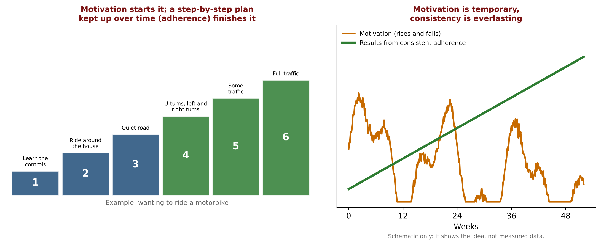
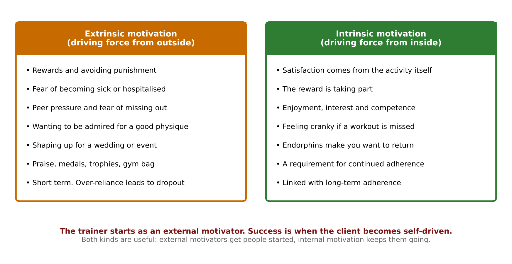
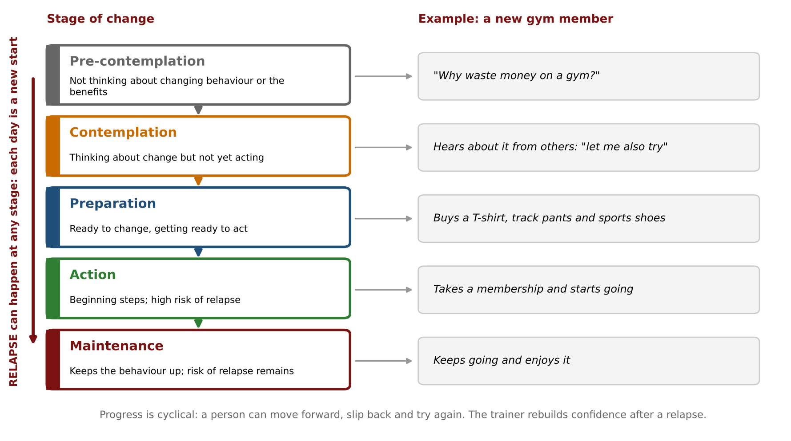
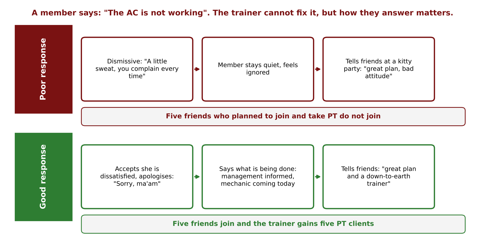
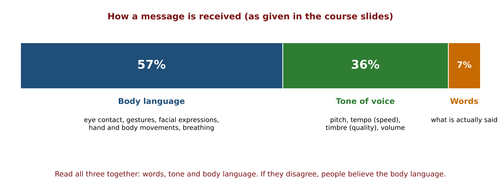
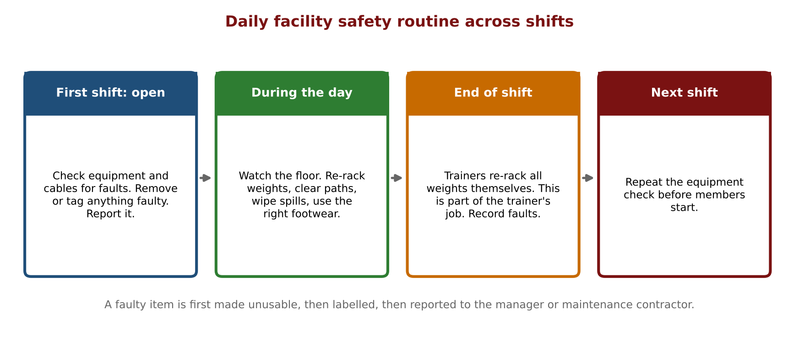
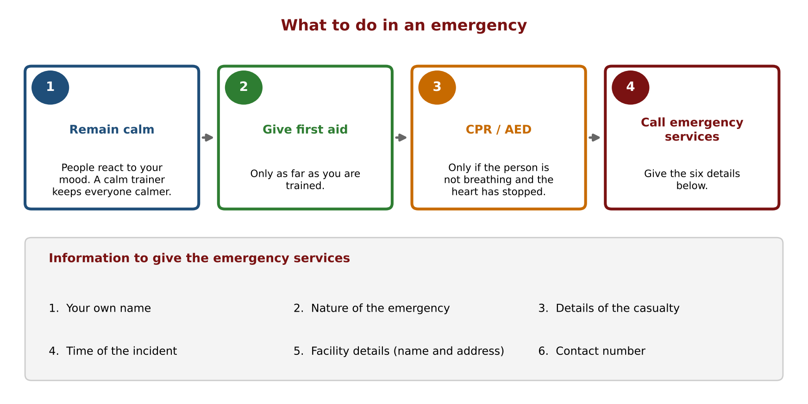
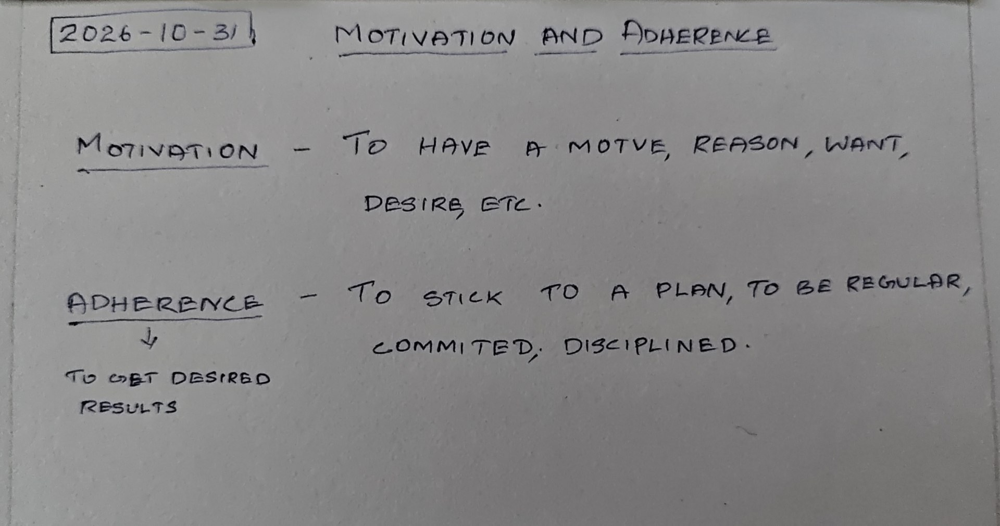
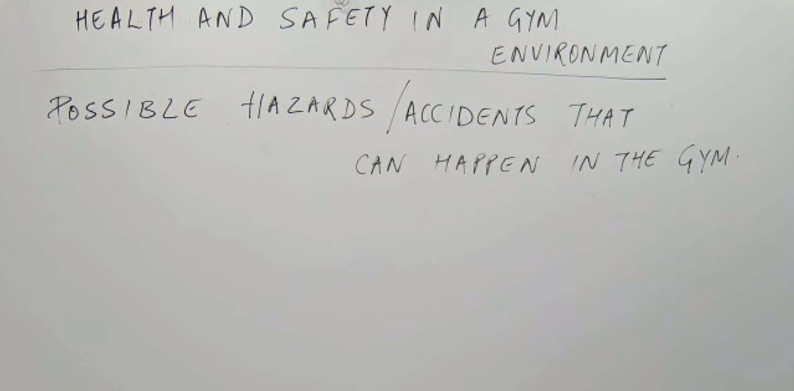

# Motivation, Adherence, Health & Safety in Gym Environment: Study Notes

**Course:** Personal Training Certification

**Topic:** Motivation and adherence (intrinsic and extrinsic motivation, client goals, behaviour change models, relationships, complaints, communication) and health and safety in a gym environment (hazards, emergencies, screening, code of conduct)

**About these notes:** Short revision version of the Motivation, Adherence, Health & Safety in Gym Environment lecture. For the full explanation of every concept, example and class question, see the Detailed Notes. Sources: the lecture recording, the course slides ("Motivation & Adherence and Health & Safety in a Gym Environment"), the course handbook pages, the course E-book chapter on first aid, and the board photos.

**Big idea:** Motivation starts a client, adherence gets the result, and the trainer's job is to turn a client who is pushed by outside reasons into one who is driven from inside. The trainer keeps clients through patience, professionalism, praise and good communication, and keeps everyone safe by checking equipment daily, screening clients, staying calm in an emergency and following the code of conduct.

---

## 1. Motivation and adherence

| Term | Meaning |
|---|---|
| Motivation | A motive, reason, want or desire. The driving force that prompts action. |
| Adherence | Sticking to a plan, being regular, committed and disciplined, to get the desired results. |

- **Motivation is temporary, consistency is everlasting.**
- Motorbike analogy: wanting to ride is motivation. The step-by-step plan (controls, around the house, quiet road, turns, some traffic, full traffic) is adherence.
- Training is a **lifestyle change**. Muscle is lost if training stops.
- Visible muscle takes about **3 to 6 months** of consistent training. Hypertrophy needs about **48 hours** between sessions.

## 2. Why people join and what keeps them attending

- **Reasons to join:** muscle building, body composition, personal reasons, stress management, emotional reasons (me-time), networking, fat loss, strength, sports fitness.
- **Keeping them regular:** reminders, posters and music, competitions, educating the client, the trainer's passion, recording progress, dietary recalls, incentives and rewards, and the trainer's gestures and behaviour.

## 3. Intrinsic and extrinsic motivation

| Point | Extrinsic | Intrinsic |
|---|---|---|
| Source | Outside | Inside |
| Driver | Rewards, avoiding punishment | Enjoyment, interest, the activity itself |
| Length | Short term. Over-reliance leads to dropout. | Linked with long-term adherence |

- Extrinsic examples: fear of lifestyle disease (managed, not cured), peer pressure and FOMO, wanting admiration, shaping up for a wedding or event.
- Trainer's real success: moving the client from extrinsic to intrinsic motivation.

## 4. Client goals and what clients expect from a trainer

| Quality | Key points |
|---|---|
| Patience | Wrong form needs unlearning. Clients want fast results. Adapt the style, like water (five clients are like five fingers). |
| Communication | No jargon. Give the science to clients who want it. |
| Professionalism | No personal or romantic involvement. Listen within boundaries. Handle advances politely. |
| Education | Keep learning. Extra certifications. |
| Passion for fitness | Body is the business card. Train 3 to 4 days, no ego lifting, consistent diet, sleep and recovery. |
| Scheduling | Build realistic plans. |

- You get clients by your physique and keep them by your knowledge.

## 5. Incentives, rewards and client responsibility

| Type | Examples |
|---|---|
| Tangible | Gym bag, T-shirt, mug, shaker, medals, trophies |
| Intangible | Public praise, social media mention, free PT session, complimentary nutrition consultation |

- Use **positive reinforcement only**. **Never compare clients.**
- Client responsibility: be regular and consistent, follow the plan, give time, stay committed. "It takes two hands to clap."

## 6. Behaviour change

- **TTM** (Prochaska and DiClemente): pre-contemplation, contemplation, preparation, action, maintenance. **Relapse can happen at any stage**, and the trainer rebuilds confidence.
- **Social Learning Theory** (Bandura): people learn by observing and imitating role models, peers and the environment. Reinforcement strengthens behaviour. "The influence of company."
- A habit is commonly said to take 21 days (see section 10).

## 7. Relationships and complaints

- Use the client's name, adapt the style, keep confidentiality, never joke about their problems, resolve disagreements calmly.

| Four steps for a complaint | Three benefits |
|---|---|
| 1 Recognise and accept dissatisfaction, 2 be positive and polite, 3 record it, 4 apologise | Loyalty, referrals and conversions, brand image |

## 8. Interpreting responses and communicating

- **57% body language, 36% tone** (pitch, tempo, timbre, volume), **7% words**. Combine all three.
- Observe the client: the words "I'm fine" can contradict the body.
- Verbal: clear, repeat, rephrase, respectful. Non-verbal: eye contact, confident posture, no distractions (no fidgeting or crossed arms).

## 9. Health and safety in the gym

**Hazards:** weights left on the path, leaking water cooler, running treadmill, faulty cable, wet walls and short circuits, damaged floors, overcrowded benches, dropped dumbbells, rope near a squat rack, safety bars, loose pins and missing clamps, distraction, a plate on a bare foot.

- **Faulty item:** make it unusable, label it, report it, call the AMC contractor.
- **Equipment checks:** pins fully in, seat locked, full range of travel, safety bars and clamps working.

- The whole facility is checked **daily**. Trainers re-rack weights at the end of a shift.
- **Keep the first aid kit stocked** and know where it is. Do not spray on open wounds.

| Group | Evacuation |
|---|---|
| Children | Short, simple, truthful words. Calm them. |
| Older adults | Allow for mobility. Nearest safe exit. Use stairs, not lifts. |
| Disabled users | Like older adults. Arrange the help they need. |

- **Screening:** weigh risk against benefit. Use the PAR-Q and verbal screening at every session. Send a client with fever home (trainers too). Special populations need a PTSP trainer. Ask about caffeine and pre-workout.
- **Leave the space ready for the next user:** wipe sweat, hygiene and deodorant, tidy stacking, report faults.

## 10. Code of conduct

- A set of rules for members of an organisation. Maintain **professional boundaries**, **confidentiality**, avoid **conflicts of interest**, give **dignity and respect**, respect **individual differences**.
- No religion or politics at work. Be tolerant of other forms of exercise. Follow the employer's grooming and phone rules.
- **Core values:** equal importance for all components of fitness, science-based training, and training, nutrition and recovery that complement each other.

## 11. Key terms

| Term | Meaning |
|---|---|
| Motivation | The driving force that prompts action |
| Adherence | Sticking to a plan |
| Intrinsic motivation | Drive from inside, enjoyment of the activity |
| Extrinsic motivation | Drive from outside, rewards or avoiding punishment |
| Positive reinforcement | Rewarding the desired behaviour |
| TTM | Five stages of behaviour change, with relapse possible |
| Social Learning Theory | Learning by observing and imitating others |
| Ripple effect | One member's experience spreads to many others |
| Hazard | Anything in the gym that can cause harm |
| PAR-Q | Physical Activity Readiness Questionnaire |
| AMC | Annual maintenance contract for equipment servicing |
| Special population | A group needing extra care, such as heart disease, high blood pressure, children or older adults |
| Code of conduct | Rules a person in a job must follow |

## 12. Where the sources differ

- **57 / 36 / 7.** The slides print these percentages. They come from limited experiments on feelings and are not a general law.
- **21 days.** The lecture says a habit forms in 21 days. Published research found about 2 months on average, with a wide range.
- **First aid in the E-book.** It gives 15:2 for one rescuer (usual guidance is 30:2) and suggests a gag in the mouth during a fit (current guidance says nothing should be put in the mouth).
- **Visible muscle.** The class gave 3 to 6 months and one year. These are estimates.
- **Decline press and high blood pressure.** Taught as a rule here. Confirm in the Special Populations lecture.

## 13. Revision questions

1. Define motivation and adherence.
2. Which one is temporary and which is everlasting?
3. What does the motorbike example show?
4. Why must adherence last for life?
5. How long does visible muscle take, and how long does hypertrophy need between sessions?
6. Compare intrinsic and extrinsic motivation in two points.
7. Name three extrinsic motivators discussed in class.
8. What is the trainer's real measure of success with motivation?
9. Name five qualities clients expect from a trainer.
10. Give one tangible and one intangible reward.
11. What are the two rules for using rewards?
12. List the five stages of the Transtheoretical Model.
13. What should the trainer do when a client relapses?
14. State the main idea of Social Learning Theory.
15. State the four steps for handling a complaint.
16. State the 57, 36 and 7 split.
17. What should be done with a faulty cable?
18. Who re-racks the weights at the end of a shift?
19. List the four emergency steps and the six pieces of information for the emergency services.
20. Name four things a fitness professional must do under the code of conduct.

## Answers

1. Motivation is a motive, reason, want or desire that prompts action. Adherence is sticking to a plan, being regular, committed and disciplined, to get the desired results.
2. Motivation is temporary. Consistency (adherence) is everlasting.
3. Wanting to ride starts it, but only a step-by-step plan followed in order lets you ride in traffic.
4. Training is a lifestyle change. Muscle and results are lost when training stops, and conditions like diabetes are managed, not cured.
5. About 3 to 6 months (the class also said up to a year). Hypertrophy needs about 48 hours.
6. Extrinsic comes from outside (rewards, avoiding punishment) and is short term. Intrinsic comes from inside (enjoyment of the activity) and is linked with long-term adherence.
7. Any three of: fear of disease, peer pressure and FOMO, wanting admiration, shaping up for an event, praise or prizes.
8. Moving the client from external motivators to internal motivation.
9. Any five of: patience, communication, professionalism, education and safe guidance, passion for fitness, understanding of scheduling.
10. Tangible: gym bag, T-shirt, mug, shaker, medals or trophies. Intangible: public praise, social media mention, free PT session or complimentary nutrition consultation.
11. Use positive reinforcement only, and never compare clients.
12. Pre-contemplation, contemplation, preparation, action, maintenance.
13. Support the client and rebuild confidence. Each day is a new day.
14. People learn by observing and imitating others (role models, peers and the environment), and reinforcement strengthens the behaviour.
15. Recognise and accept the dissatisfaction, be positive and polite, record the complaint, and apologise.
16. 57% body language, 36% tone of voice and 7% words.
17. Make it unusable, label it, report it, and call the AMC contractor.
18. The trainers. It is the trainer's job and not housekeeping's.
19. Remain calm, give first aid, CPR or AED only if the person is not breathing, and call the emergency services. Give your name, the nature of the emergency, the casualty details, the time, the facility details and a contact number.
20. Any four of: maintain professional boundaries, keep confidentiality, avoid conflicts of interest, treat clients with dignity and respect, respect individual differences and diversity.

---

## Board photos

