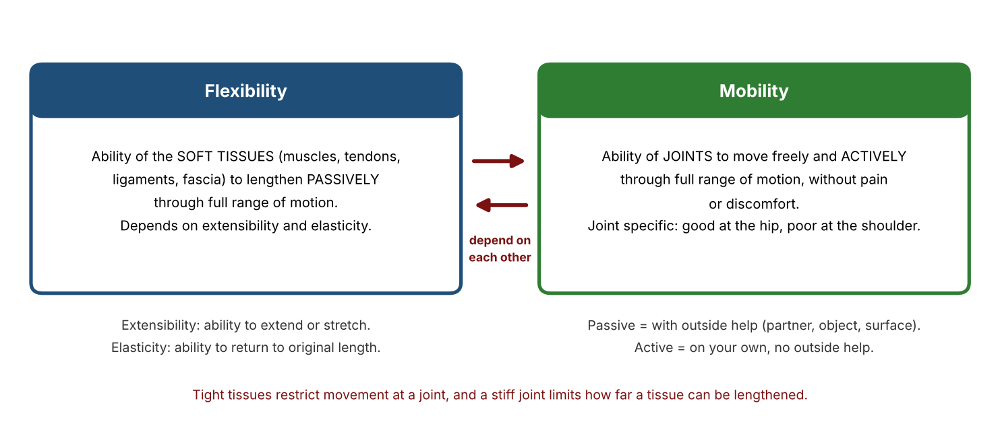
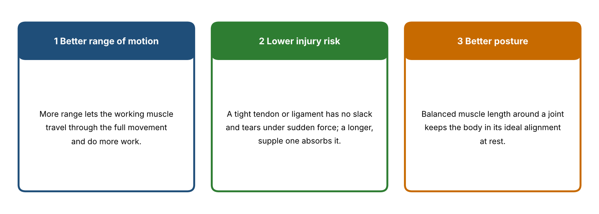
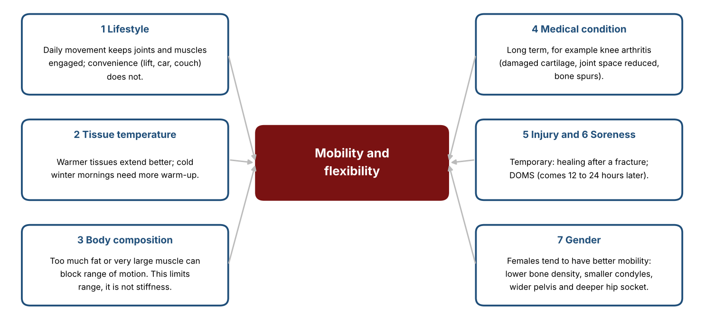
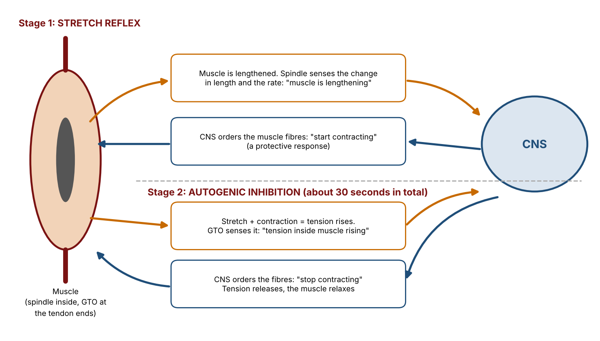
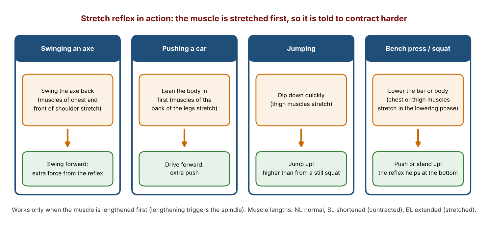
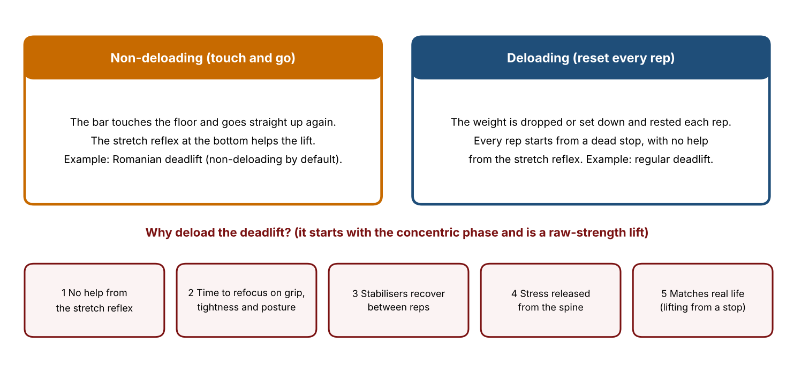
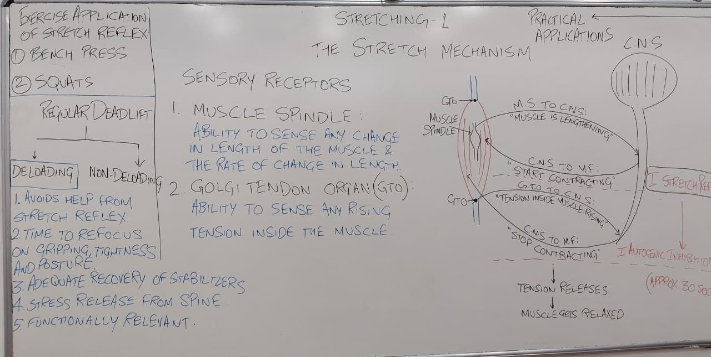
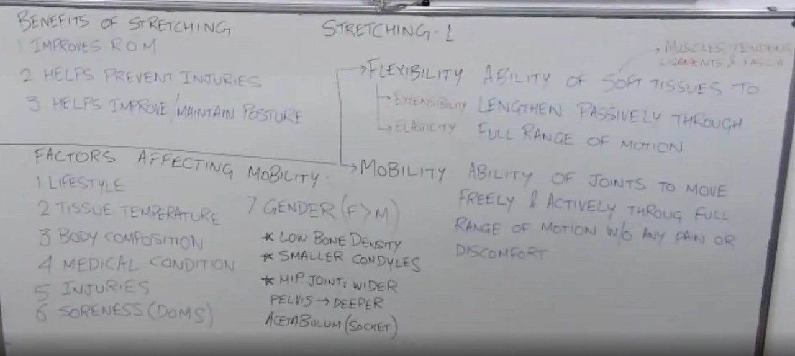

# Stretching 1: Detailed Notes

**Course:** Personal Training Certification

**Topic:** Introduction to stretching: flexibility and mobility, benefits of stretching, factors affecting mobility, the stretch mechanism (muscle spindle, Golgi tendon organ, stretch reflex, autogenic inhibition), applications of the stretch reflex in lifting, and deloading in the deadlift

**About these notes:** Detailed notes from the first Stretching lecture, written so the whole lecture can be studied without watching the recording. Every concept, example, analogy and class question is covered. For a short revision version, see the Study Notes. Types of stretching, the mobility drills and the stretch exercises are in the Stretching 2 notes. Sources: the lecture recording, the course slides ("Stretching"), the course handbook pages and the board photos.

---

## Abbreviations used in these notes

| Short form | Meaning |
|---|---|
| ROM | Range of motion |
| CNS | Central nervous system |
| GTO | Golgi tendon organ |
| DOMS | Delayed onset muscle soreness |
| NL | Normal length of a muscle |
| SL | Shortened length (the muscle is contracted) |
| EL | Extended length (the muscle is stretched) |
| Concentric | The muscle shortens while it produces force |
| Eccentric | The muscle lengthens while it produces force |

## Before this lecture

You should know the joint actions (flexion, extension, abduction, adduction, rotation), the three muscle contractions (concentric, eccentric, isometric), and the terms workload and range of motion from the earlier lectures. The lecture builds on the idea that a longer range of motion lets a muscle do more work.

## Outline of the lecture

| Part | Topic |
|---|---|
| 1 | What stretching is: flexibility and mobility |
| 2 | Benefits of stretching |
| 3 | Factors affecting mobility |
| 4 | The stretch mechanism: sensory receptors and the two stages |
| 5 | Applications of the stretch reflex in daily life and in lifting |
| 6 | The deadlift: deloading and non-deloading |

---

## Part 1: What stretching is

### 1.1 Stretching

Stretching means lengthening muscles with a purpose. The purpose can be better movement, less injury risk, better posture or relaxation after training.

### 1.2 Flexibility

**Flexibility** is the ability of the soft tissues (muscles, tendons, ligaments and fascia) to lengthen **passively** through the full range of motion. Two properties decide it:

- **Extensibility:** the ability of the tissue to extend or stretch.
- **Elasticity:** the ability of the tissue to return to its original length afterwards.

"Passively" means with outside help, such as a partner, an object or a surface.

### 1.3 Mobility

**Mobility** is the ability of the **joints** to move freely and **actively** through the full range of motion, without pain or discomfort. "Actively" means with no outside help, using your own muscles.

Mobility is **joint specific**. A person can have excellent hip mobility and poor shoulder mobility, so each joint must be judged on its own.

### 1.4 How they relate

Flexibility and mobility **depend on each other**. Tight tissues restrict movement at a joint, and a stiff joint limits how far the tissues around it can be lengthened. Improving one usually helps the other.

---

## Part 2: Benefits of stretching

### 2.1 Improves range of motion

A longer range of motion lets the working muscle travel through the full movement. This links to the workload lecture: workload depends on the range of motion, so a greater range allows more work to be done.

### 2.2 Helps prevent injuries

A tight tendon or ligament has no slack. When a sudden or large force arrives, it cannot lengthen enough and it tears. A tissue that has been lengthened regularly can absorb more force before it reaches its limit.

### 2.3 Helps improve and maintain posture

When the muscles around a joint have balanced length, the body rests in its ideal alignment. Shortened muscles (for example the chest in someone who sits all day) pull the body out of line.

---

## Part 3: Factors affecting mobility

### 3.1 Lifestyle

Daily life decides how much movement the joints get. A person living in a village who squats, climbs and walks every day keeps good mobility. A person in a city who uses lifts, cars and chairs for everything moves far less, and the range shrinks.

### 3.2 Tissue temperature

Warmer tissues extend more easily. On a cold winter morning the tissues are stiffer, so more warm-up and more mobility work is needed than in summer.

### 3.3 Body composition

Excess body fat or very large muscles can physically block the range of motion. A large belly stops the thighs from coming close to the chest, and a leg press then runs out of range sooner. This is a limit on range, **not stiffness**, and stretching does not fix it.

### 3.4 Medical condition

Long-term conditions change the joint itself. Knee arthritis is an example: the cartilage is damaged, the joint space is reduced and bone spurs can form, so the movement is painful and limited.

### 3.5 Injuries

A recent injury, such as a healing fracture or a torn tissue, limits mobility until it has healed. This is temporary.

### 3.6 Soreness

Delayed onset muscle soreness (DOMS) appears about 12 to 24 hours after hard training and makes the muscle painful to move or stretch. This is also temporary.

### 3.7 Gender

Females generally have a greater range of motion than males. The reasons given in the lecture were lower bone density, smaller condyles (the rounded ends of the bones at a joint), a wider pelvis and a deeper hip socket (acetabulum) in the female skeleton.

---

## Part 4: The stretch mechanism

### 4.1 Two sensory receptors

The body has two receptors that tell the nervous system what a muscle is doing:

| Receptor | What it senses | Where it sits |
|---|---|---|
| **Muscle spindle** | A change in the length of the muscle, and the **rate** of that change | Inside the muscle belly |
| **Golgi tendon organ (GTO)** | A rise in **tension** inside the muscle | At the tendon ends |

The lecture explained them with an analogy of detectives reporting to a central office: the spindle reports "the length is changing", the GTO reports "the tension is rising", and the CNS sends the orders to the muscle fibres.

### 4.2 Stage 1: the stretch reflex

1. The muscle is lengthened.
2. The muscle spindle senses the change in length and sends the message to the CNS: "the muscle is lengthening".
3. The CNS sends a message straight back to the muscle fibres: "start contracting".

This is a protective reaction. It tries to stop the muscle being stretched too far.

### 4.3 Stage 2: autogenic inhibition

1. You keep the muscle lengthened while its fibres are contracting, so the **tension rises** inside the muscle.
2. The GTO senses this and tells the CNS: "the tension inside the muscle is rising".
3. The CNS tells the muscle fibres: "stop contracting".
4. The tension is released and the muscle **relaxes**.

Once the muscle has relaxed, it can be lengthened a little more. This extra length is the usable range gained.

### 4.4 Why hold a stretch for about 30 seconds

The two stages need time to complete, and the lecture gave about **30 seconds** for both together. If you let go earlier, you only get stage 1 (the muscle is told to contract) and never reach stage 2 (the muscle is told to relax). Repeating stretches over days and weeks widens the usable range.

### 4.5 Muscle lengths: NL, SL and EL

The board used three lengths. **NL** is the normal length, **SL** is the shortened length when the muscle contracts, and **EL** is the extended length when it is stretched. The stretch reflex is triggered only when the muscle goes towards EL, that is, when it lengthens.

Q: Is the stretch reflex triggered when a muscle shortens?

A: No. It is triggered only by lengthening, because the spindle senses the stretch.

---

## Part 5: Applications of the stretch reflex

Whenever a muscle is stretched first, the reflex adds extra contraction to the movement that follows. Everyday examples from the lecture:

- **Swinging an axe.** The axe is swung back first (stretching the chest and the front of the shoulder), then forward with more force.
- **Pushing a car.** Leaning the body in first stretches the muscles of the back of the legs and then drives the push.
- **Cricket back swing.** The bat goes back before it comes forward.
- **Jumping.** People dip down before they jump, because the stretched thigh muscles then give a higher jump than a jump from a still squat.

### 5.1 The bench press and the squat

Both lifts start with the **eccentric phase**: the bar is lowered to the chest, or the body is lowered into the squat. The working muscles (chest, or thighs and hips) lengthen. At the bottom the stretch reflex helps to push the bar up or stand up. In the bench press, **leg drive** (pushing the feet into the floor) is a third force that adds to the muscles and the reflex.

---

## Part 6: The deadlift

### 6.1 A different starting phase

In the regular deadlift the bar rests on the floor and the lifter pulls it up, so the **concentric phase comes first**. There is no lowering phase before the pull, so the muscles are not pre-stretched and the reflex does not help.

### 6.2 Deloading and non-deloading

- **Non-deloading (touch and go):** the bar touches the floor and goes straight up again, so the stretch reflex at the bottom helps the next rep. The Romanian deadlift is non-deloading by default.
- **Deloading:** after each rep the weight is set (or dropped) on the floor and the lifter resets. Every rep starts from a dead stop.

### 6.3 Five reasons the deadlift is deloaded

1. **It avoids help from the stretch reflex.** The deadlift is meant to be a test of raw strength from a standing start. (It is an exception to the usual rule that the reflex helps.)
2. **It gives time to refocus** on the grip, on body tightness and on posture, and to take the breath for the Valsalva manoeuvre before every rep.
3. **The stabilisers recover** between reps, so the form does not fall apart.
4. **The spine gets a break** from the stress of the load.
5. **It is functionally relevant,** because in real life we lift an object from rest.

Q: What is the difference between a deloading and a non-deloading deadlift?

A: In the deloading deadlift the weight is rested on the floor at the end of every rep. In the non-deloading style the lifter touches the floor and goes straight back up.

---

Key takeaways: flexibility is about soft tissues, mobility is about joints, the two depend on each other. A stretch needs about 30 seconds for the stretch reflex to give way to autogenic inhibition. The stretch reflex helps any movement that begins with a lengthening, but not the deadlift, which begins with the concentric phase.

---

## Points to Confirm

1. **The 30 second rule and autogenic inhibition.** The lecture explained the 30 seconds with the spindle and GTO sequence. This is the traditional textbook explanation. Many researchers now think the gain in range after stretching comes mostly from a greater tolerance of the stretch sensation, so the mechanism is a useful model but a simplification. The 30 second hold itself is the course standard.
2. **Gender and mobility.** The reasons given (bone density, condyles, pelvis, acetabulum) were as stated in the lecture.
3. **Stretch reflex in the lifts.** The lecture taught that the reflex helps at the bottom of the bench press and squat. The size of the benefit varies between lifters and technique.
4. **Reasons for deloading.** The five reasons are as listed on the board. Whether to deload is a technique choice, and some programmes use touch and go deadlifts.

---

# Board Photos from the Lecture

