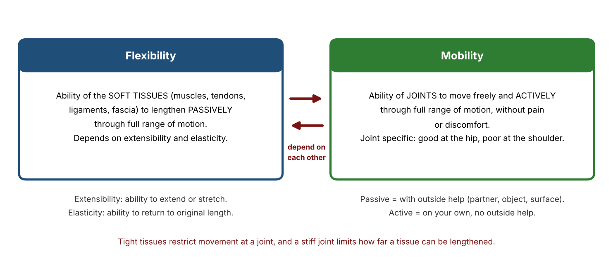
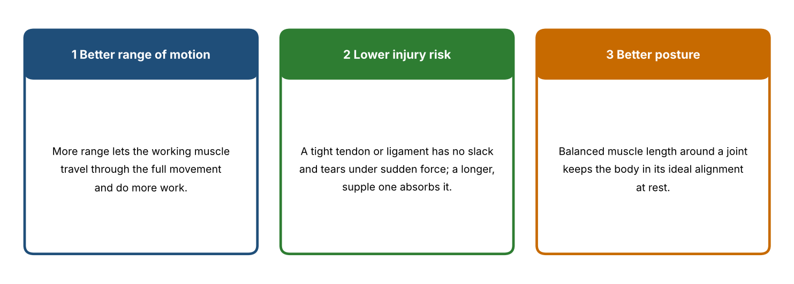
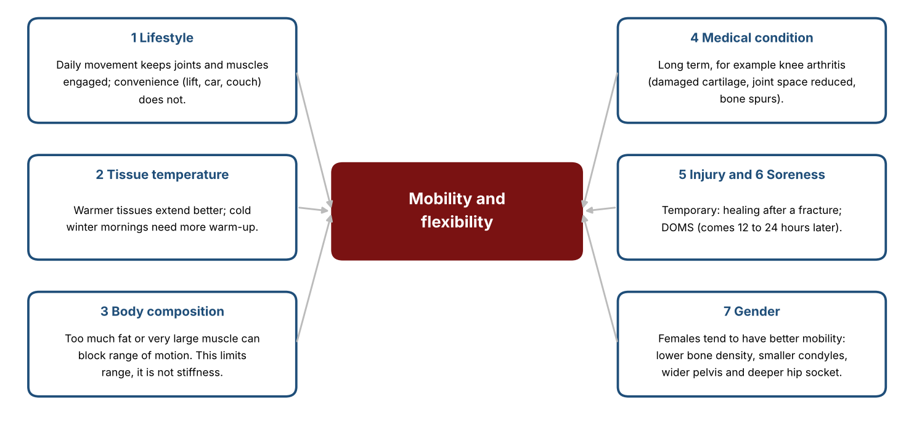
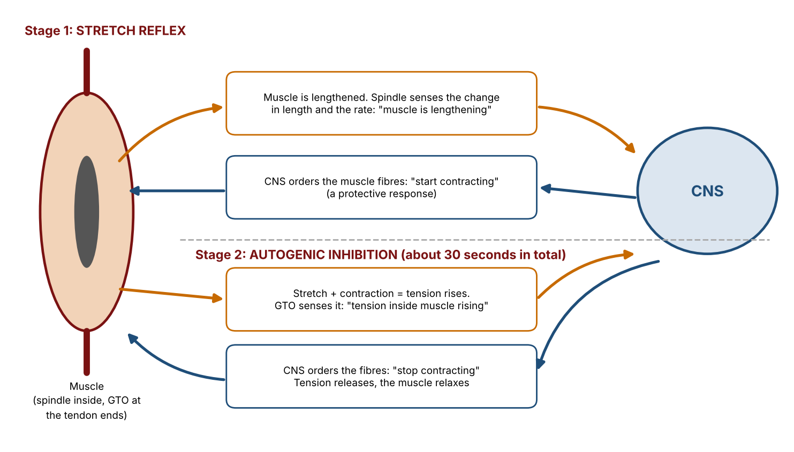
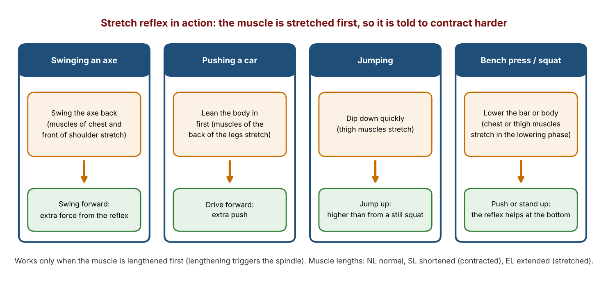
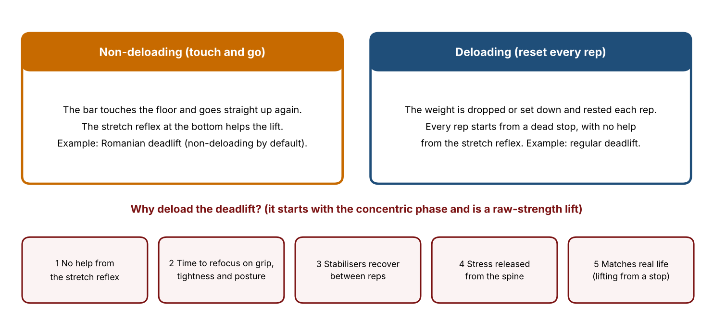
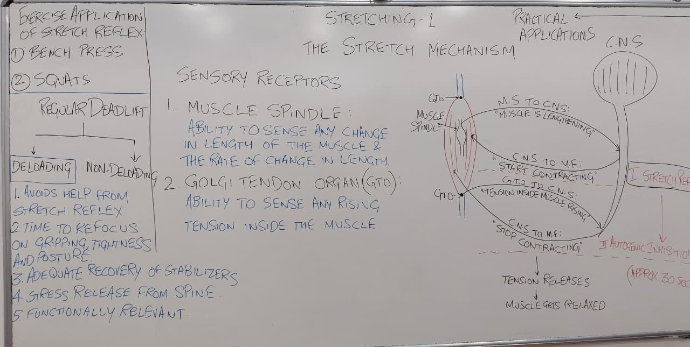
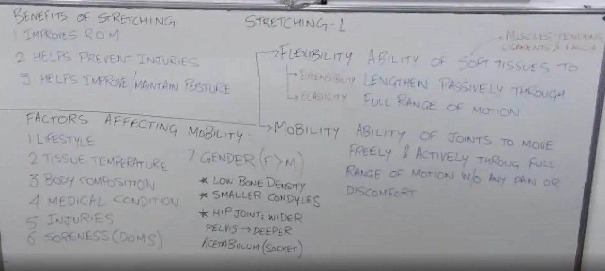

# Stretching 1: Study Notes

**Course:** Personal Training Certification

**Topic:** Flexibility and mobility, benefits of stretching, factors affecting mobility, the stretch mechanism (muscle spindle, GTO, stretch reflex, autogenic inhibition), stretch reflex in lifting, and deloading in the deadlift

**About these notes:** Short revision version of the first Stretching lecture. For the full explanation of every concept, example and class question, see the Detailed Notes. Sources: the lecture recording, the course slides ("Stretching"), and the board photos.

**Big idea:** Stretching lengthens muscles with a purpose. Flexibility belongs to the soft tissues, mobility to the joints, and the two depend on each other. A stretch must be held about 30 seconds so the muscle can move from the protective stretch reflex to relaxation (autogenic inhibition).

---

## 1. Flexibility and mobility

| Term | Meaning |
|---|---|
| Flexibility | Ability of soft tissues (muscles, tendons, ligaments, fascia) to lengthen **passively** through full range of motion. Depends on extensibility and elasticity. |
| Mobility | Ability of joints to move freely and **actively** through full range of motion without pain. Joint specific. |

- Passive means with outside help. Active means without outside help.
- Each depends on the other.

## 2. Benefits

- Improves range of motion (more range, more work).
- Helps prevent injury (a tight tendon or ligament tears under force).
- Helps improve and maintain posture.

## 3. Factors affecting mobility

| Factor | Key point |
|---|---|
| Lifestyle | Active village life keeps range, urban convenience reduces it |
| Tissue temperature | Cold tissue is stiffer, so more warm-up in winter |
| Body composition | Excess fat or big muscle limits range. This is not stiffness. |
| Medical condition | For example knee arthritis |
| Injuries | Temporary, until healed |
| Soreness (DOMS) | Appears 12 to 24 hours after training |
| Gender | Females have greater range (bone density, condyles, pelvis, hip socket) |

## 4. The stretch mechanism

| Receptor | Senses |
|---|---|
| Muscle spindle | Change in length and its rate |
| Golgi tendon organ (GTO) | Rising tension |

- **Stage 1, stretch reflex:** the muscle lengthens, the spindle tells the CNS, and the CNS tells the fibres to **start contracting**.
- **Stage 2, autogenic inhibition:** tension rises, the GTO tells the CNS, and the CNS tells the fibres to **stop contracting**. The muscle relaxes.
- Both stages take about **30 seconds**, so hold stretches about 30 s.
- Muscle lengths: NL normal, SL shortened, EL extended. The reflex is triggered only by lengthening.

## 5. Stretch reflex in lifting

- Everyday examples: swinging an axe, pushing a car, cricket back swing, dipping before a jump.
- **Bench press and squat** begin with the eccentric phase, so the reflex helps at the bottom. Leg drive is a third force in the bench press.

## 6. Deadlift: deloading and non-deloading

- The regular deadlift starts with the **concentric** phase, so there is no reflex help.
- **Deloading:** rest the weight on the floor every rep. **Non-deloading:** touch and go (Romanian deadlift).
- Five reasons to deload: no reflex help, time to refocus (grip, tightness, posture), stabilisers recover, spine stress released, functionally relevant.

## 7. Key terms

| Term | Meaning |
|---|---|
| Stretching | Lengthening muscles with a purpose |
| Flexibility | Passive lengthening of soft tissues through full range |
| Mobility | Active, pain-free movement of a joint through full range |
| Extensibility | Ability to extend |
| Elasticity | Ability to return to original length |
| Muscle spindle | Receptor sensing change in length and its rate |
| GTO | Receptor sensing rising tension |
| Stretch reflex | Stage 1: muscle told to contract when lengthened |
| Autogenic inhibition | Stage 2: muscle told to stop contracting and relax |
| Deloading | Resting the weight on the floor between reps |
| DOMS | Delayed onset muscle soreness |

## 8. Where the sources differ

- **30 seconds.** The lecture explains it by the spindle and GTO sequence. Many researchers think the gain after stretching comes mostly from greater stretch tolerance, so treat the mechanism as a simplified model.
- **Deloading.** The five reasons are as taught. Some programmes use touch and go deadlifts.

## 9. Revision questions

1. Define stretching.
2. Define flexibility.
3. Define mobility.
4. What do extensibility and elasticity mean?
5. What do passive and active mean?
6. Why is mobility called joint specific?
7. Name the three benefits of stretching.
8. Why does a tight tendon increase injury risk?
9. Name seven factors that affect mobility.
10. Why does a leg press belly limit range, and is it stiffness?
11. When does DOMS appear?
12. What does the muscle spindle sense?
13. What does the GTO sense?
14. Describe stage 1 of the stretch mechanism.
15. Describe stage 2 of the stretch mechanism.
16. Why hold a stretch for about 30 seconds?
17. What do NL, SL and EL stand for?
18. Give three everyday examples of the stretch reflex.
19. Why does the stretch reflex help in the bench press and squat but not in the regular deadlift?
20. Give two of the five reasons for deloading the deadlift.

## Answers

1. Lengthening muscles with a purpose.
2. The ability of soft tissues (muscles, tendons, ligaments, fascia) to lengthen passively through the full range of motion.
3. The ability of joints to move freely and actively through the full range of motion, without pain or discomfort.
4. Extensibility is the ability to extend or stretch. Elasticity is the ability to return to the original length.
5. Passive means with outside help (partner, object, surface). Active means on your own.
6. A person can have good mobility at one joint (the hip) and poor mobility at another (the shoulder).
7. Improves range of motion, helps prevent injury, helps improve and maintain posture.
8. It has no slack, so it tears when a sudden or large force arrives.
9. Lifestyle, tissue temperature, body composition, medical condition, injuries, soreness, gender.
10. The fat or muscle mass physically blocks the movement. It limits range, but it is not stiffness.
11. About 12 to 24 hours after hard training.
12. The change in length of the muscle and the rate of that change.
13. A rise in tension inside the muscle.
14. The muscle lengthens, the spindle tells the CNS, and the CNS tells the fibres to start contracting.
15. Tension rises, the GTO tells the CNS, and the CNS tells the fibres to stop contracting, so the muscle relaxes.
16. Both stages need about 30 seconds. A shorter hold stops at the reflex without reaching relaxation.
17. Normal length, shortened length, extended length.
18. Any three of: swinging an axe, pushing a car, cricket back swing, dipping before a jump.
19. The bench press and squat begin with the eccentric phase, which stretches the muscle. The regular deadlift begins with the concentric phase, so there is no pre-stretch.
20. Any two of: avoids help from the stretch reflex, time to refocus on grip, tightness and posture, stabilisers recover, stress released from the spine, functionally relevant.

---

## Board photos

