# Stretching 2: Detailed Notes

**Course:** Personal Training Certification

**Topic:** Types of stretching: dynamic stretching (mobility drills), static stretching (static active and static passive), reciprocal inhibition, isometric stretch, PNF (CRAC) stretch, fascia line stretches, and stretching safety guidelines

**About these notes:** Detailed notes from the second Stretching lecture, written so the whole lecture can be studied without watching the recording. Every concept, example, analogy and class question is covered, and each exercise has a figure showing how to perform it. The figures are original drawings made for these notes. They show the idea of each exercise; the practical sessions teach the exact form. For a short revision version, see the Study Notes. Flexibility, mobility and the stretch mechanism are in the Stretching 1 notes. Sources: the lecture recording, the course slides ("Stretching"), the demonstration videos shown in class and the board photos.

---

## Abbreviations used in these notes

| Short form | Meaning |
|---|---|
| SAS | Static active stretch |
| SPS | Static passive stretch |
| PNF | Proprioceptive neuromuscular facilitation |
| CRAC | Contract, relax, antagonist contract |
| GTO | Golgi tendon organ |
| CNS | Central nervous system |
| AI | Autogenic inhibition |
| ROM | Range of motion |
| Agonist | The muscle that contracts to produce a movement (prime mover) |
| Antagonist | The muscle on the opposite side of the joint, which lengthens during the movement |

## Before this lecture

You should know flexibility and mobility, the stretch reflex and autogenic inhibition (Stretching 1), the joint actions (including horizontal abduction and adduction at the shoulder), the three muscle contractions (concentric, eccentric, isometric) and the meaning of workload and intensity. The lecture came the day before the first unit test and the class was reminded to revise these topics.

## Outline of the lecture

| Part | Topic |
|---|---|
| 1 | Two categories of stretching: dynamic and static |
| 2 | Dynamic stretching: benefits, dose and the ten mobility drills |
| 3 | Static stretching: what it is and the two rules |
| 4 | Reciprocal inhibition and static active stretch (SAS) |
| 5 | Static passive stretch (SPS) |
| 6 | Isometric stretch |
| 7 | PNF stretch (CRAC) |
| 8 | Fascia line stretch |
| 9 | Safety guidelines, mobility and hypermobility |

---

## Part 1: Two categories of stretching

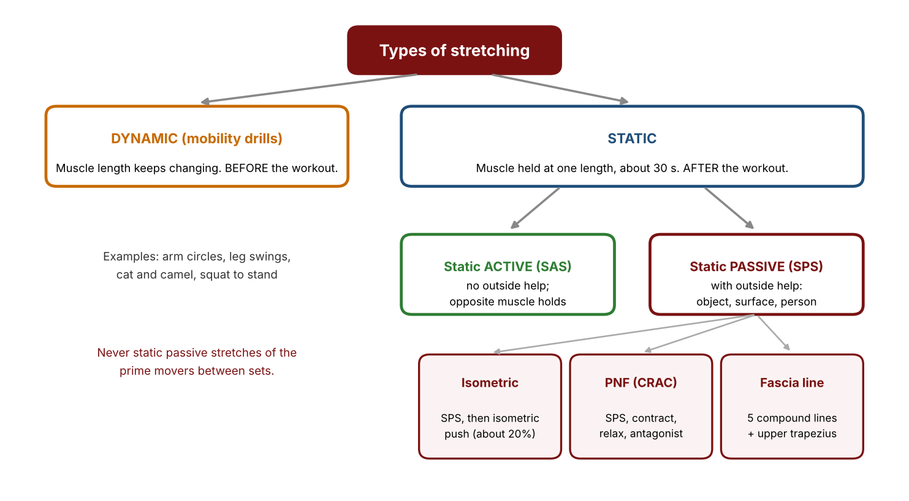

| Point | Dynamic | Static |
|---|---|---|
| Muscle length | Changes continuously | Does not change, held at one fixed length |
| Joint movement | To and fro, continuous | None while holding |
| When | **Before** the workout | **After** the workout |

Example with the upper trapezius: bending the neck to the **opposite** side lengthens the upper fibres on one side. Holding that position is a **static** stretch. Moving the neck to and fro (lengthen, shorten, lengthen) is a **dynamic** stretch.

---

## Part 2: Dynamic stretching (mobility drills)

### 2.1 What it is

Dynamic stretching is continuous movement of the joints through their range of motion. Because mobility is the ability of joints to move actively through full range, dynamic stretches are also called **mobility drills**. A drill means a continuous activity, as in a fire drill.

### 2.2 Benefits

1. **Improves range of motion** at the joints being drilled.
2. **Prepares the body physically and mentally** by stimulating the central nervous system. This effect is immediate.
3. **Improves blood flow** to the muscles, so they contract and produce force better.
4. **Lubricates the joints.** The synovial membrane makes synovial fluid, which acts like engine oil. Synovial fluid is a **non-Newtonian fluid**: it is thick when still and becomes thin and spreads evenly over the joint surfaces when the joint moves, so friction is small.
5. **Nourishes the articular cartilage.** Cartilage has no blood supply of its own, so it takes its nutrients from the synovial fluid. Movement spreads the fluid over the cartilage like a sponge soaking up liquid. This is a long-term benefit.

Q: When is the best time for dynamic stretches, before or after the workout?

A: Before. After a workout the aim is to relax the muscles, not to stimulate the nervous system, increase blood flow or lubricate the joints.

### 2.3 Dose

- **Count repetitions, not time.** For example, 8 to 10 circles clockwise and 8 to 10 anticlockwise make one set of arm circles.
- **At most 2 sets** per drill. The number depends on the conditions: about 1 set in a warm summer, 2 sets in a cold winter or when the area is stiff. More than 2 would tire the muscles before strength training.
- **Negligible load.** If a machine or light dumbbells are used for a drill (for example the lat pulldown for the shoulder blades), the weight must be as light as in a stretch. If the muscle is a prime mover for strength training, train it in the proper place in the workout instead.
- **Barefoot is better.** Change into lifting shoes after the drills.

### 2.4 The ten mobility drills

Each drill is a continuous movement. Do each repetition under control and stop at mild discomfort. Many drills work both sides, one side at a time (**unilateral**).

#### Drills 1 to 6

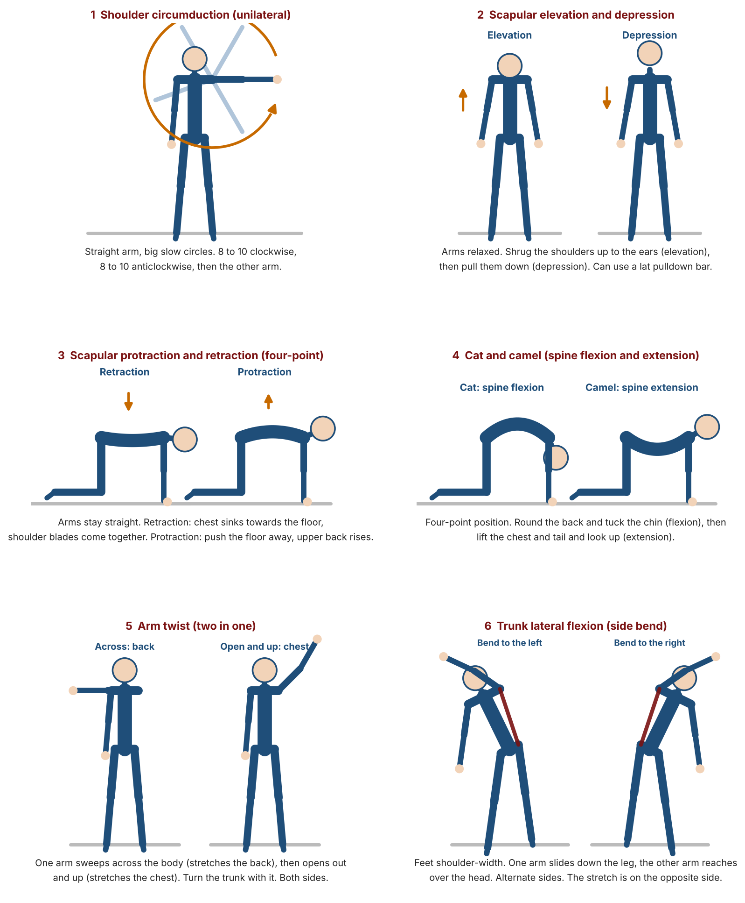

| No. | Drill | How to perform it | Joint action |
|---|---|---|---|
| 1 | Shoulder circumduction (arm circles) | Stand tall. Swing one arm in a full circle at the shoulder, 8 to 10 times clockwise, then 8 to 10 anticlockwise. Repeat with the other arm. | Circumduction of the shoulder |
| 2 | Scapular elevation and depression | Raise the shoulder blades towards the ears, then press them down. Can be done standing or on a lat pulldown with a very light load. | Scapulothoracic elevation and depression |
| 3 | Scapular protraction and retraction | In a four-point position (hands and knees), let the chest sink between the shoulder blades (retraction, towards the floor), then push the floor away and round the upper back (protraction, towards the ceiling). | Scapulothoracic retraction and protraction |
| 4 | Cat and camel | In the four-point position, round the whole spine up (flexion of the lumbar spine and neck), then arch it down (extension). Move slowly between the two. | Spinal flexion and extension |
| 5 | Arm twist | Reach one arm across the body to turn the trunk (the back muscles stretch), then open the same arm up and out (the chest stretches). Repeat on the other side. | Trunk rotation with shoulder movement |
| 6 | Trunk lateral flexion (side bend) | Stand tall. Bend the trunk to one side, return, and bend to the other side. Bending right lengthens the left side. | Lateral flexion of the trunk |

Class review: the four scapulothoracic actions are elevation, depression, retraction (the blades move closer together) and protraction (the blades move apart).

Q: What joint action is happening when the spine is held in the rounded position of cat and camel?

A: Spinal (trunk) flexion, which is lumbar and cervical flexion. The other end of the drill is extension, or to an extent hyperextension.

#### Drill 7: leg swings, and drill 9: standing spiral

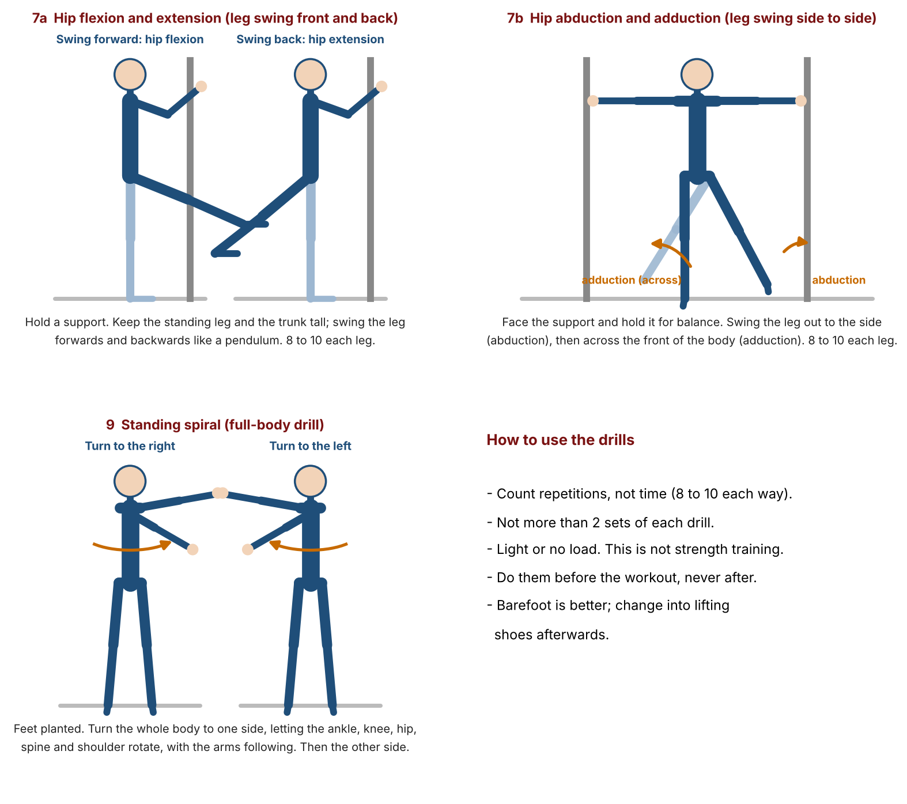

| No. | Drill | How to perform it |
|---|---|---|
| 7a | Leg swing, front and back (hip flexion and extension) | Hold a support for balance. Swing one leg forward, then back past the body, keeping the movement smooth. Do both legs. |
| 7b | Leg swing, side to side (hip abduction and adduction) | Face a support. Swing the leg out to the side (abduction), then across the body (adduction). Do both legs. |
| 9 | Standing spiral | Stand tall, then rotate the whole body to one side with the arm reaching round, turning through the ankle, knee, hip, spine and shoulder. Return and repeat to the other side. |

In medical language, anything behind the neutral position of the hip is called extension. In fitness language the swing back is often called hyperextension. The lecture used the fitness meaning.

#### Drill 8: squat to stand

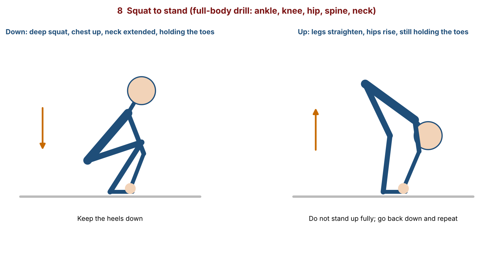

Hold your toes. Sit down into a deep squat while holding the toes and look up (the neck extends). Then, still holding the toes, straighten the legs and lift the hips, without standing fully upright. Repeat. The drill moves the ankle, knee, hip and spine and is useful when a client is short of time.

#### Drill 10: triple sequence

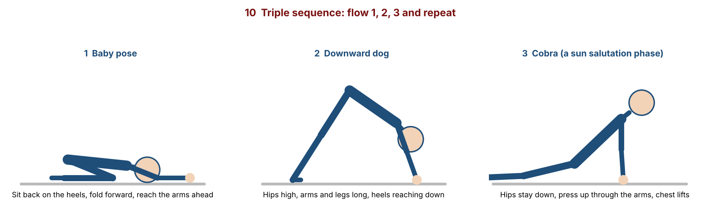

Three yoga positions in order, repeated: **baby pose**, **downward dog**, then one phase of the **sun salutation** (a cobra-type movement of the spine). It works many joints and muscles in one flow.

---

## Part 3: Static stretching

### 3.1 What it is

In a static stretch the muscle is held at one fixed length and the joints do not move while holding. Check the joint action first, using the full term. For the chest (pectoral) muscle:

- **Shoulder horizontal abduction** lengthens the chest.
- **Shoulder horizontal adduction** shortens (contracts) the chest.

Always give the full term, for example "horizontal abduction", not just "abduction". An assessor will expect the full name.

### 3.2 Two kinds

Static stretches are either **static active (SAS)** or **static passive (SPS)**. In both the muscle length does not change.

### 3.3 Two rules common to SAS and SPS

1. **Hold for about 30 seconds in one fixed length.** The stretch mechanism needs this time (see Stretching 1). Stopping earlier gives the stretch reflex but not the relaxation of autogenic inhibition.
2. **Do static stretches after the workout, not before or during.** Static stretching relaxes the muscle, so doing it before or between sets would reduce its ability to produce force. After training there is no more strength work, and the relaxation helps bring the raised tension back to normal.

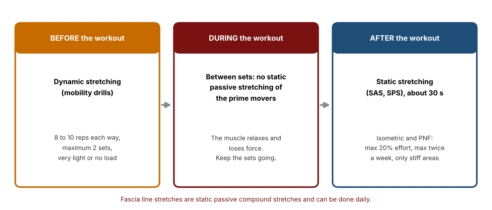

---

## Part 4: Reciprocal inhibition and static active stretch

### 4.1 Reciprocal inhibition

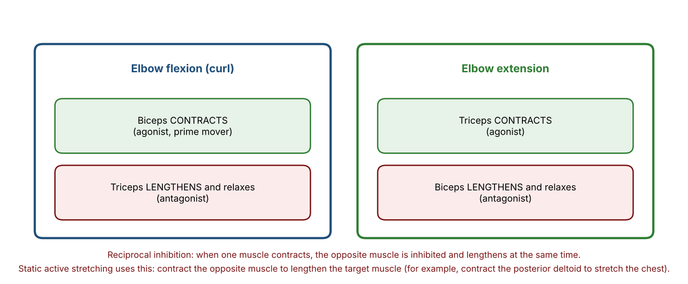

When a muscle contracts, the opposite muscle (its antagonist) has to lengthen and relax. In a biceps curl (elbow flexion), the biceps contracts and the triceps lengthens. In elbow extension, the triceps contracts and the biceps lengthens.

The lecture told this as a story: the two muscles used to fight, both wanting to contract together so that nothing moved. They went to a "Supreme Court of Muscles" and signed an agreement: when one contracts, the other lets go and lengthens.

### 4.2 Static active stretch (SAS)

In SAS the muscle is held at a fixed length **without any outside force**. The stretch is held by contracting the **opposite** muscle. For the chest, take the arm into horizontal abduction and hold it there with the posterior deltoid. How far the chest can lengthen depends on how strongly the posterior deltoid can contract.

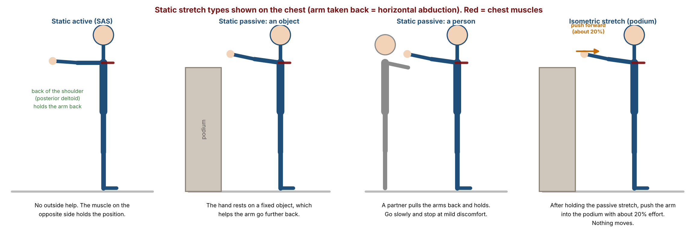

---

## Part 5: Static passive stretch (SPS)

### 5.1 What it is

In SPS the muscle is held at a fixed length **with an outside force**. The outside force is usually an object, a surface or a person, and the range is usually deeper than in SAS.

| Source of force | Example |
|---|---|
| Object | Hand on a podium, to take the arm further back for a chest stretch |
| Person | A partner behind pulls the elbows back, with the hands behind the head, for the chest. A trainer holding a client's leg for the hamstring. |
| Surface | Arm on a wall or board, pressing, to stretch the biceps (elbow extension) |
| Own body | The other hand pulls the arm across the body to stretch the posterior deltoid. This is SAS if only the chest muscle holds the arm across, and SPS when the other hand helps. |

### 5.2 Intensity

Workload is the amount of work. **Intensity** is the amount of effort, or the level of difficulty. Within SPS there are three harder forms: the isometric stretch, the PNF stretch and the fascia line stretch.

---

## Part 6: Isometric stretch

### 6.1 Steps

Isometric means the muscle length stays the same while tension changes (like a plank or a dead hang).

1. Do a normal **SPS** and hold for about 30 seconds.
2. Straight after, **contract the same muscle isometrically with about 20% effort**. Nothing should move. For the chest on a podium, the arm is pushed forward into the podium.

A sign that the contraction is real: if the podium were suddenly taken away, the arm would swing forward much faster than after a plain SPS.

### 6.2 Why it relaxes the muscle better

- **Lengthening the muscle:** the spindle tells the CNS, and the CNS tells the fibres to contract (stretch reflex, stage 1).
- **Tension rises:** the GTO tells the CNS, and the CNS tells the fibres to stop contracting (autogenic inhibition, stage 2). The muscle relaxes.
- **Isometric step:** the lifter makes the fibres contract again, the tension rises again, and the GTO and CNS stop the contraction again (a second autogenic inhibition).

On the board this was written as **1 stretch reflex + 2 AI = better relaxation**.

---

## Part 7: PNF stretch (CRAC method)

### 7.1 Meaning of PNF

PNF is proprioceptive neuromuscular facilitation. **Proprioception** is the body's sense of its position and movement, with receptors that detect changes in length and tension. **Neuromuscular** means nerves and muscles working together. **Facilitation** means helping, here by relaxing the muscle to improve flexibility.

### 7.2 Steps

| Step | What happens |
|---|---|
| Baseline test | An **SAS**, to see how far you reach on your own now. Mark the position. |
| 1 | **SPS** (about 30 s) |
| 2 | **Isometric contraction** of the same muscle (about 20% effort) |
| 3 | **Relax** the muscle for about 5 seconds |
| 4 | **Antagonist contraction**, an SAS as a retest. You should now go beyond the baseline. |

Steps 1 and 2 alone are the isometric stretch. Steps 3 and 4 are extra steps on top of it, like silver, gold and platinum packages that each include the one below.

The method is nicknamed **CRAC** (said as "crack"): **C**ontract (step 2), **R**elax (step 3), **A**ntagonist **C**ontract (step 4).

### 7.3 Hamstring demonstration

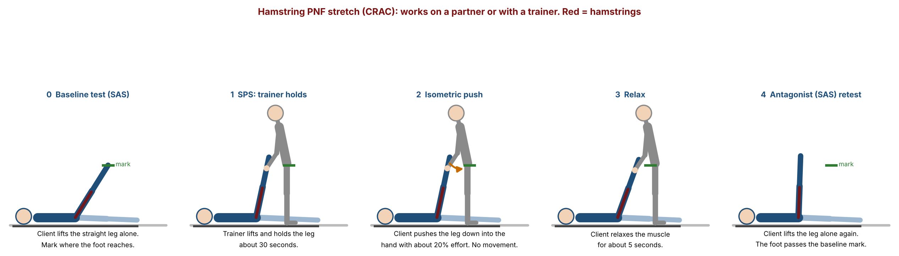

1. **Baseline:** the client lies on the back (**supine**) and raises one straight leg on their own. Mark where the foot reaches.
2. **Step 1 (SPS):** the trainer stands beside the client, holds the leg and takes it up until the stretch is felt. Hold about 30 seconds.
3. **Step 2:** the client pushes the leg down against the trainer's hand with about 20% effort. The trainer's hand does not move.
4. **Step 3:** the client relaxes for about 5 seconds.
5. **Step 4:** the client raises the leg again on their own using the muscles on the front of the thigh and hip. The foot should pass the baseline mark.

### 7.4 Guidelines for isometric and PNF stretches

1. **No more than 20% effort** in the contraction.
2. **No more than twice a week.** The intensity is higher and can cause small stress to the fibres, and the aim is relaxation, not fatigue.
3. **Leave 24 to 48 hours** before training the same muscle. For example, after PNF for the chest on Monday, do not train the chest before Wednesday.
4. **Use them only for concerned areas**, that is, muscles that are stiff, not everywhere.

---

## Part 8: Fascia line stretch

### 8.1 What fascia is

**Fascia** is a dense layer of connective tissue present all over the body like a wrap. It attaches and stabilises the muscles and other structures to each other. It is one continuous web with no start or end point, unlike a muscle with an origin and insertion. The lecture compared it to the thin white lining on a peeled boiled egg, or the thin white layer seen on raw meat, and to cling film wrapped around a remote control.

Fascia is thin over muscle bellies and thicker where there is less muscle, for example the lower back.

If the fascia loses its suppleness, for example through lack of physical activity, it can lead to **transfer of pain** from one point to another. A video of a person in a web-printed bodysuit showed this: a restriction made at the right ribs and armpit limited the raising of both arms and tilted the neck, and releasing it restored the movement. A tight right hip can make a person lean to that side and load the lumbar disc, so the pain may be felt far from its cause. The painful area is not always the problem area.

### 8.2 The five fascia lines

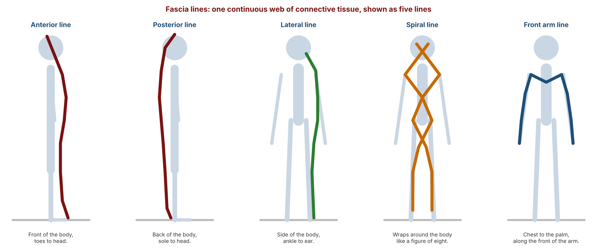

| Line | Where it runs |
|---|---|
| Anterior | The front of the body: legs, abdomen, chest |
| Posterior | The back of the body: calves, hamstrings, hips, spine muscles, lats, posterior deltoid |
| Lateral | The sides of the body |
| Spiral | A spiral (figure-of-eight) around the ribs and abdomen and down the legs |
| Front arm | Along the arms and across the front of the chest |

### 8.3 Features

- Each fascia stretch lengthens many muscles at once, so it is a **compound stretch**.
- It is a static passive stretch held for about **30 seconds**.
- The lecture said fascia line stretches should be done **daily**. They are not covered by the twice-a-week rule that applies to isometric and PNF stretches.
- An **isolation stretch** lengthens one muscle. The upper fibres of the trapezius are missed by the five lines, so they get their own stretch.
- Progress slowly. Do not expect to touch the head to the knees on the first day.

### 8.4 The fascia stretches

#### Anterior and posterior lines

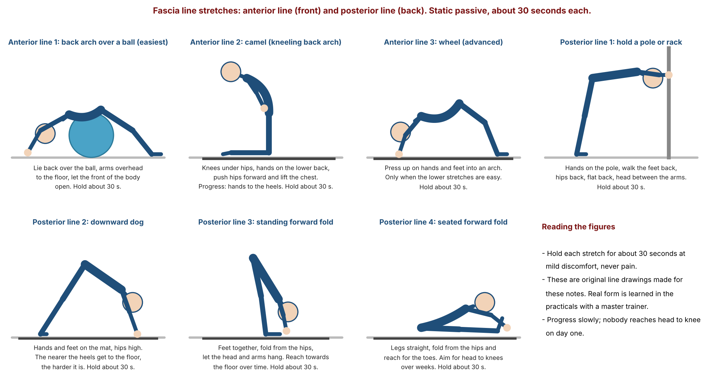

| Line | Stretch | How to perform it |
|---|---|---|
| Anterior | Over a ball (beginner) | Lean back over a stability ball so the front of the body lengthens in an arch. |
| Anterior | Camel | Kneel upright, lean back and reach towards the heels, hips forward. |
| Anterior | Wheel (advanced) | Lie on the back and press up into an arch, or go back from standing to the floor. More extension gives more intensity. |
| Posterior | Pole | Fold forward with the hands on a pole at hip height, back long. |
| Posterior | Downward dog | Hands and feet on the floor, hips high. The closer the heels get to the floor, the more challenging. |
| Posterior | Standing fold | Stand and fold the trunk forward towards the legs. |
| Posterior | Seated fold | Sit with the legs straight and fold forward over them. Over time work towards the head to the knees. |

#### Lateral, spiral and front arm lines, and the upper trapezius

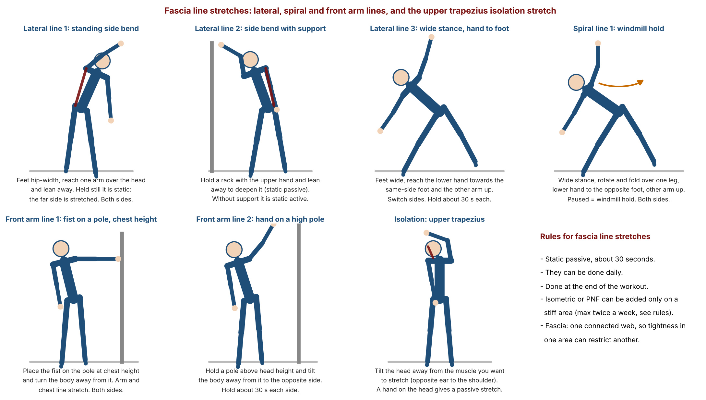

| Line | Stretch | How to perform it |
|---|---|---|
| Lateral | Side bend, held | The drill 6 side bend, but paused and held at the end. With a support it is SPS, without it is SAS. A variation: reach the opposite hand to the foot, then switch sides. |
| Spiral | Windmill hold | The windmill movement, but held at the end on one side. Both sides. A floor version is more challenging. |
| Front arm | Pole at a higher point | Hold a pole above head height and turn the body away to the opposite side. |
| Front arm | Pole at the same level | Place the fist on a pole at about chest height and turn the body away. |
| Upper trapezius | Neck side bend | Bend the neck to the side opposite the muscle (SAS). Place the same-side hand on the head to deepen it (SPS). Hold about 30 s. |

Isometric and PNF can be added to any of these stretches, but only for stiff areas and within the guidelines above.

---

## Part 9: Safety guidelines, mobility and hypermobility

### 9.1 Guidelines from the slides

1. Reach **mild discomfort, not pain**.
2. **Hold about 30 seconds** (the time the stretch mechanism needs).
3. **Dynamic first, static last**: mobility drills at the start of the workout, static passive stretches at the end.
4. **Never do static passive stretches of the prime movers between sets.** The muscle relaxes and loses its ability to produce force.

### 9.2 Mobility is joint specific

The same person can have excellent hip mobility and poor shoulder mobility. A quick shoulder test is to reach one hand over the shoulder and the other from below, behind the back. If the fingers cannot touch, the shoulder mobility needs work.

### 9.3 Hypermobility

There is a myth that too much stretching makes a person overly flexible. **Hypermobility** (very high flexibility) is a medical condition that some people, such as contortionists, are born with. It is not caused by stretching, and stretching more will not create it.

### 9.4 Unit test and assignments

The first unit test was 30 questions in 30 minutes, followed by a rapid-fire review. The assignment slide asked each trainer to counsel five members on not doing static passive stretches at the start of a workout, five on warming up, and five on fascia stretches.

---

Key takeaways: dynamic drills go before the workout, static stretches go after, and static passive stretches of the prime movers never go between sets. Hold static stretches for about 30 seconds. SAS uses the opposite muscle (reciprocal inhibition), SPS uses outside help. Isometric and PNF are harder forms with a 20% effort cap, at most twice a week and a 24 to 48 hour gap. Fascia stretches are compound and can be done daily.

---

## Points to Confirm

1. **The 30 second rule and autogenic inhibition.** This is the traditional model. Many researchers think the gain in range comes mostly from greater stretch tolerance. The 30 second hold is the course standard.
2. **Length of the isometric contraction.** The lecture gave the effort (about 20%) but no duration. PNF protocols commonly use about 3 to 10 seconds. Confirm the duration the course expects.
3. **The relax step.** The lecture said about 5 seconds, although once the spoken word was "five minutes". Five seconds is taken here.
4. **20% effort and micro trauma.** The lecture said the contraction creates some micro trauma, which is why the weekly limit exists. This is a course explanation, and the evidence for it is limited.
5. **"Muscle relaxed twice".** The equation 1 stretch reflex + 2 AI is the course model for the isometric stretch.
6. **Fascia model.** The five-line model is simplified. Published models of fascial lines contain more lines. The comparison with the egg lining is only a visual aid.
7. **Fascia stretches daily.** The lecture said they should be done daily. This is course guidance.
8. **Static stretching between sets.** The course rule is never. Research suggests short holds have a small effect on force, and some studies support stretching between sets. Follow the course rule for assessments.
9. **Hypermobility.** The lecture said stretching does not cause it. Joint hypermobility has several causes, and some people are at risk if they stretch to the extreme.
10. **Exercise figures.** The figures show the idea of each exercise as described in the lecture. The exact form (hand position, foot position, depth) is taught in the practical sessions.
11. **Course handbook and E-book.** The handbook and E-book chapter on flexibility training were not available as text, so only the lecture, slides and boards were used.

---

# Board Photos from the Lecture

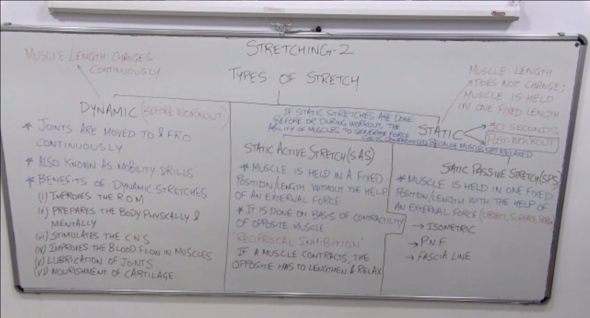

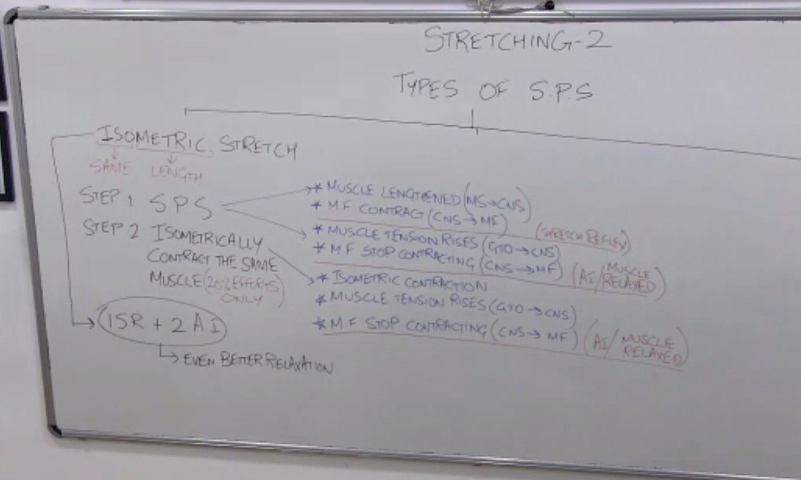

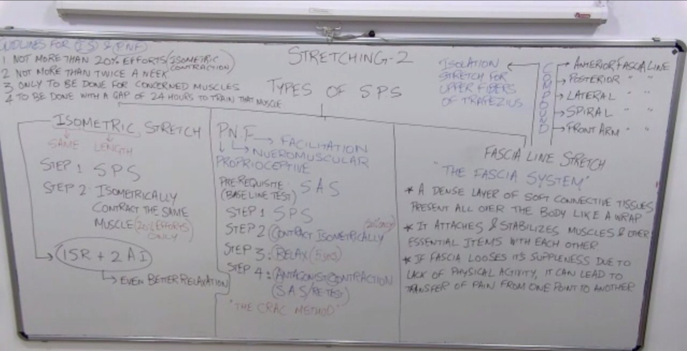
