# Stretching 2: Study Notes

**Course:** Personal Training Certification

**Topic:** Dynamic and static stretching, mobility drills, SAS and SPS, reciprocal inhibition, isometric and PNF stretch, fascia line stretches, stretching safety guidelines

**About these notes:** Short revision version of the second Stretching lecture. For the full explanation of every concept, example, class question and how to perform each exercise, see the Detailed Notes. The figures are original drawings that show the idea of each exercise. Sources: the lecture recording, the course slides ("Stretching"), and the board photos.

**Big idea:** Move before you train (dynamic drills), hold after you train (static stretches), and never relax a prime mover with a static passive stretch between sets. Harder stretches (isometric, PNF) are capped at 20% effort and twice a week, while fascia line stretches are compound and can be done daily.

---

## 1. Types of stretching

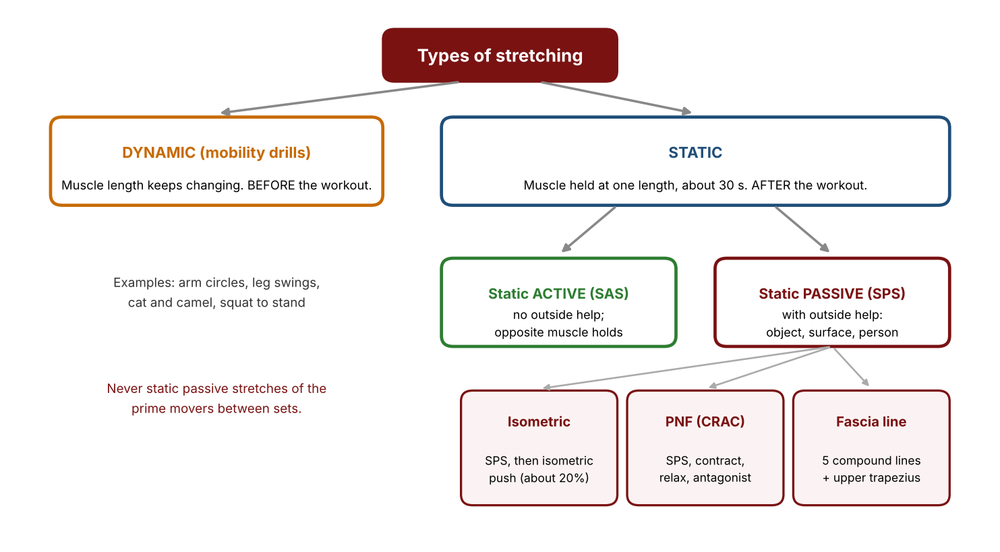

| Point | Dynamic | Static |
|---|---|---|
| Muscle length | Changes continuously | Held at one fixed length |
| When | Before the workout | After the workout |
| Dose | Count reps, 8 to 10 each way, at most 2 sets | Hold about 30 s |

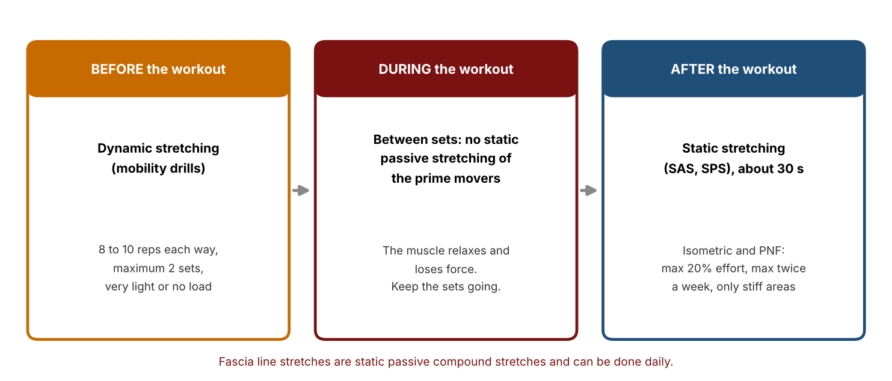

## 2. Dynamic stretching (mobility drills)

- Benefits: better range of motion, prepares body and CNS, better blood flow, lubricates joints (synovial fluid is non-Newtonian), nourishes cartilage (no blood supply).
- Load negligible. Barefoot is better.

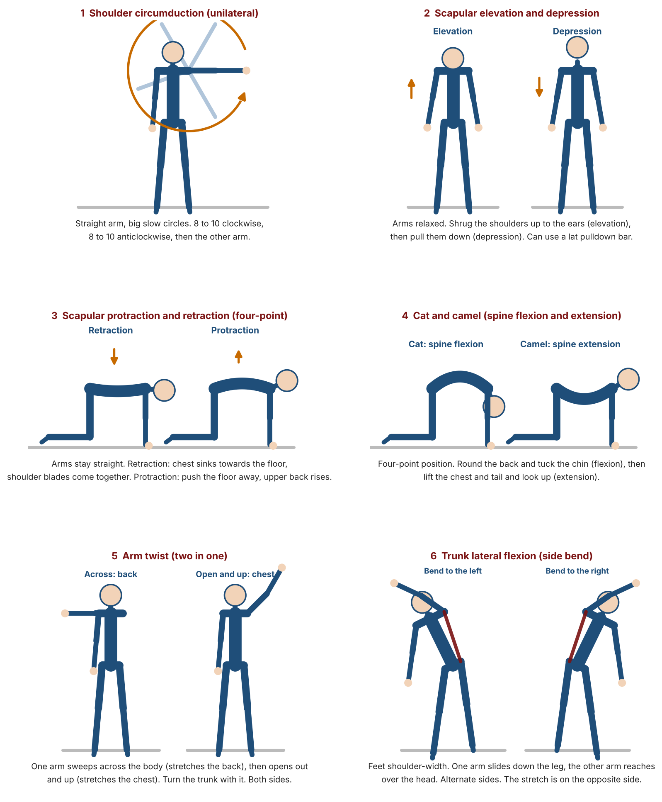

| No. | Drill |
|---|---|
| 1 | Shoulder circumduction (arm circles), one arm at a time |
| 2 | Scapular elevation and depression |
| 3 | Scapular protraction and retraction (four-point position) |
| 4 | Cat and camel (spinal flexion and extension) |
| 5 | Arm twist (back stretches across, chest stretches open) |
| 6 | Trunk lateral flexion (side bend) |
| 7 | Leg swing: front and back, and side to side |
| 8 | Squat to stand |
| 9 | Standing spiral |
| 10 | Triple sequence: baby pose, downward dog, sun salutation phase |

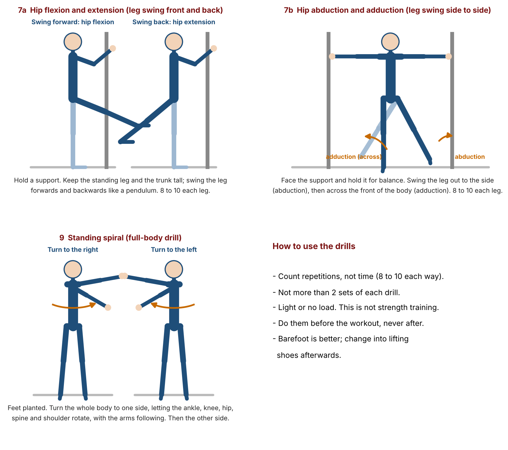

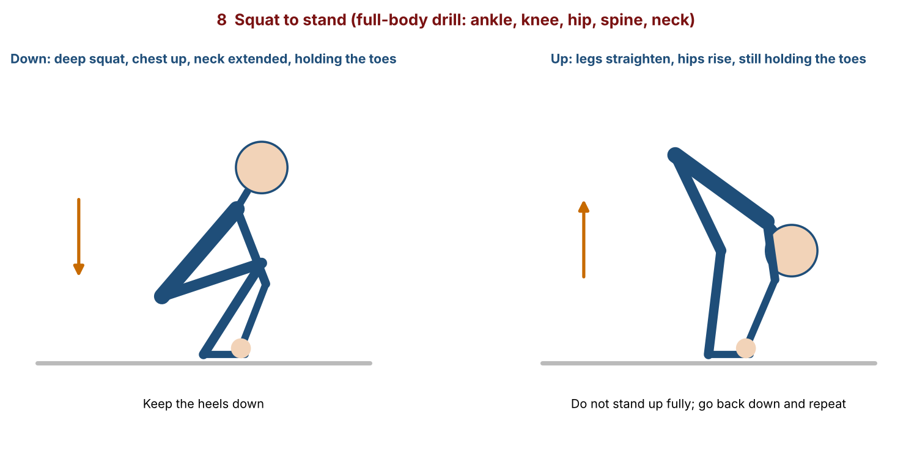

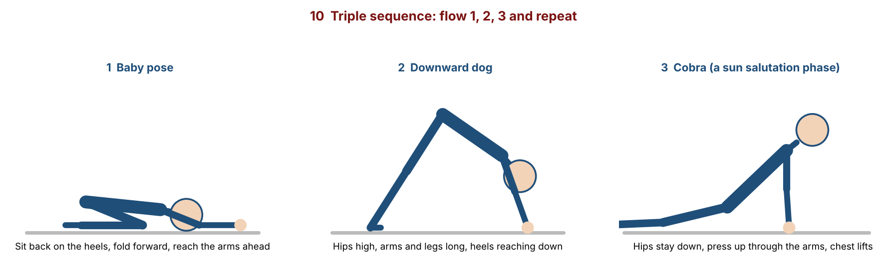

## 3. Static stretching

- Use full joint terms. The chest lengthens with shoulder **horizontal abduction**.
- Two rules for SAS and SPS: **hold about 30 s**, and do them **after** the workout.

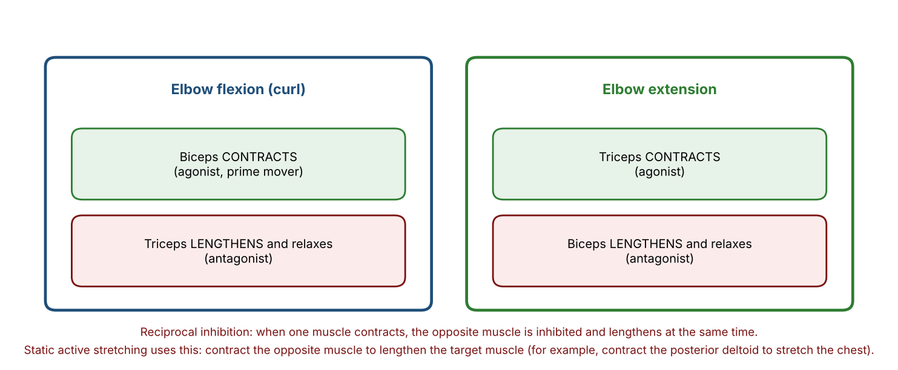

| Type | Meaning |
|---|---|
| **Reciprocal inhibition** | When a muscle contracts, the opposite muscle lengthens and relaxes |
| **SAS** | No outside help. The opposite muscle holds the stretch. |
| **SPS** | Outside help: object, surface, person. Deeper range. |

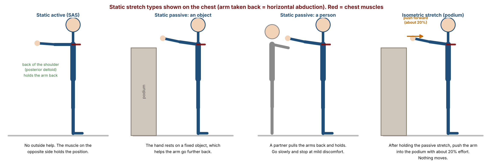

- **Intensity** is the amount of effort or the difficulty level.

## 4. Isometric and PNF stretch

| Isometric stretch | PNF (CRAC) |
|---|---|
| 1 SPS about 30 s, then 2 isometric contraction of the same muscle at about 20% effort | Baseline SAS test, 1 SPS, 2 isometric contraction (about 20%), 3 relax about 5 s, 4 antagonist contraction (SAS retest) |
| 1 stretch reflex + 2 AI = better relaxation | Contract, Relax, Antagonist Contract. The foot passes the baseline mark. |

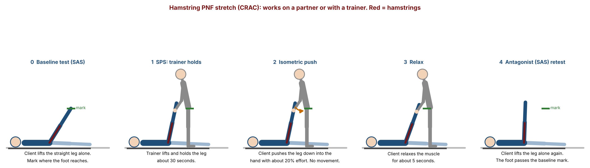

**Guidelines:** no more than 20% effort, no more than twice a week, 24 to 48 hours before training that muscle, only on concerned (stiff) areas.

## 5. Fascia line stretch

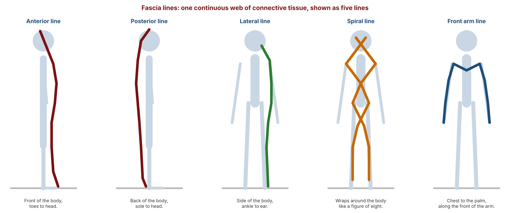

- Fascia is a dense connective tissue wrap, one continuous web with no start or end. Lost suppleness can transfer pain to other areas.
- Five lines: **anterior, posterior, lateral, spiral, front arm**. Isolation stretch: upper trapezius.
- Compound, static passive, about 30 s, can be done **daily** (not under the twice-a-week rule).

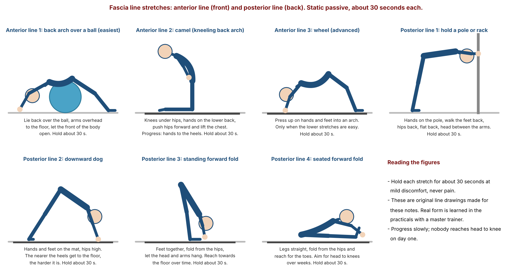

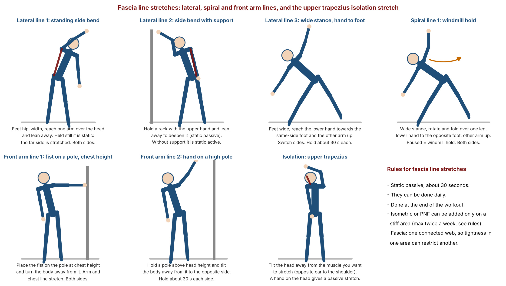

## 6. Safety guidelines

- Reach **mild discomfort, not pain**.
- Hold about **30 seconds**.
- **Dynamic first, static last.**
- **No static passive stretches of the prime movers between sets.**
- Mobility is joint specific. **Hypermobility** is a medical condition, not a result of stretching.

## 7. Key terms

| Term | Meaning |
|---|---|
| Dynamic stretch | Continuous movement, muscle length keeps changing |
| Static stretch | Muscle held at one length |
| Mobility drill | Another name for a dynamic stretch |
| SAS | Static active stretch, no outside help |
| SPS | Static passive stretch, with outside help |
| Reciprocal inhibition | Contracting muscle makes its opposite relax |
| Isometric stretch | SPS followed by an isometric contraction of the same muscle |
| PNF | Proprioceptive neuromuscular facilitation |
| CRAC | Contract, relax, antagonist contract |
| Fascia | Connective tissue web wrapping the body |
| Compound stretch | Stretch that lengthens many muscles at once |
| Hypermobility | Medical condition of excessive joint range |

## 8. Where the sources differ

- **30 seconds.** Explained by autogenic inhibition in the lecture. Many researchers credit greater stretch tolerance.
- **Isometric contraction time.** Not given in the lecture. PNF protocols commonly use about 3 to 10 seconds.
- **Relax step.** The lecture said about 5 seconds (once said "five minutes" by slip).
- **Fascia lines.** The five-line model is simplified. Other models have more lines.
- **Between-set stretching.** The course rule is never. Some research is more mixed.

## 9. Revision questions

1. What is the difference between dynamic and static stretching?
2. When are dynamic stretches done, and when are static stretches done?
3. Name three benefits of dynamic stretching.
4. Why is synovial fluid called non-Newtonian?
5. How are dynamic stretches dosed?
6. Name four of the ten mobility drills.
7. Which joint action lengthens the chest muscle?
8. What is reciprocal inhibition?
9. Define SAS and SPS.
10. Give two examples of outside help in SPS.
11. What are the two rules common to SAS and SPS?
12. Define intensity.
13. Describe the isometric stretch.
14. Explain "1 stretch reflex + 2 AI".
15. List the steps of PNF.
16. What does CRAC stand for?
17. State the four guidelines for isometric and PNF stretches.
18. What is fascia, and why can tight fascia cause pain elsewhere?
19. Name the five fascia lines and one isolation stretch.
20. Why is hypermobility not caused by stretching?

## Answers

1. In dynamic stretching the muscle length changes continuously with joint movement. In static stretching the muscle is held at one fixed length.
2. Dynamic before the workout. Static after the workout.
3. Any three of: improves range of motion, prepares the body and CNS, improves blood flow, lubricates joints, nourishes cartilage.
4. It is thick when still and becomes thin and spreads over the joint surfaces when the joint moves, which reduces friction.
5. Count repetitions, not time: about 8 to 10 each direction, at most 2 sets, with negligible load.
6. Any four of: shoulder circumduction, scapular elevation and depression, scapular protraction and retraction, cat and camel, arm twist, trunk lateral flexion, leg swing, squat to stand, standing spiral, triple sequence.
7. Shoulder horizontal abduction.
8. When a muscle contracts, the opposite muscle lengthens and relaxes.
9. SAS is a stretch held at a fixed length with no outside help, using the opposite muscle. SPS is a stretch held at a fixed length with outside help.
10. Any two of: an object (podium), a surface (wall), a person (partner or trainer), the other hand.
11. Hold about 30 seconds, and do them after the workout.
12. The amount of effort, or the level of difficulty.
13. An SPS held about 30 seconds, then an isometric contraction of the same muscle at about 20% effort.
14. The stretch gives one stretch reflex and the isometric contraction gives a second autogenic inhibition, so the muscle relaxes twice for better relaxation.
15. Baseline SAS test, SPS, isometric contraction (about 20%), relax about 5 seconds, antagonist contraction (SAS retest).
16. Contract, Relax, Antagonist Contract.
17. No more than 20% effort, no more than twice a week, a 24 to 48 hour gap before training that muscle, and only on concerned areas.
18. Fascia is a dense connective tissue wrap over the whole body. If it loses suppleness the tightness restricts or pulls on other areas, so pain can transfer from one point to another.
19. Anterior, posterior, lateral, spiral, front arm. Isolation: upper trapezius.
20. It is a medical condition people are born with, so stretching more will not create it.

---

## Board photos

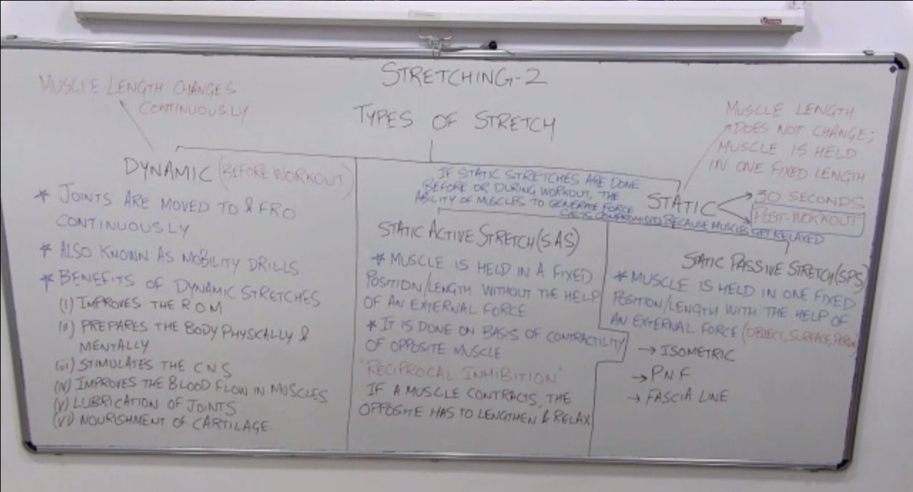

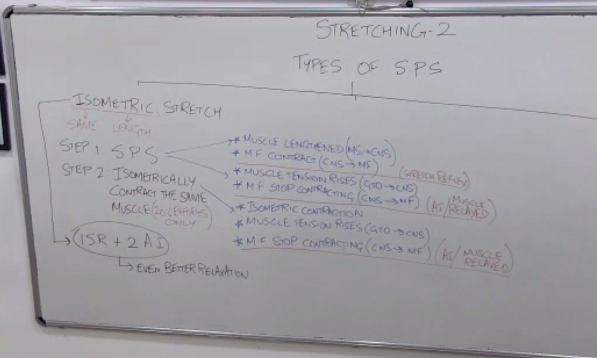

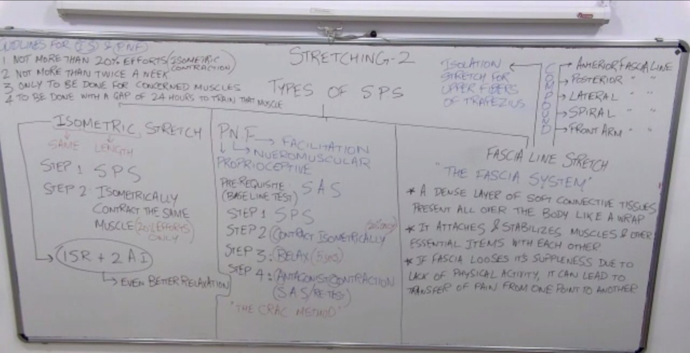
